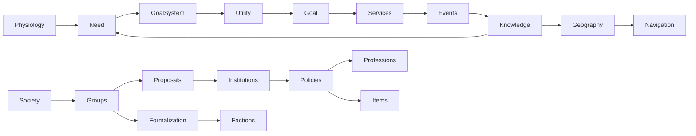

# PROJECT — simulador procedural de mundo

Documentação do estado atual, sem reconstrução narrativa das fases anteriores.

| Campo | Valor |
| --- | --- |
| Objetivo | Mundo finito com NPCs persistentes, conhecimento subjetivo e consequências materiais |
| Regras/save | `mvp-12-fase5.5` |
| Geração | `mvp-5.4` |
| Linguagem | Python 3.11+; somente biblioteca padrão |
| Arquitetura | Dataclasses + serviços coordenados por Engine; Need → alternativas → Utility → Goal → ação |
| Entrada | `procedural/__main__.py :: main` |
| Interface | Terminal em português; simulação sem jogador disponível |
| Persistência | JSON tipado, versionado, escrita atômica; estado do RNG incluído |

## Executar, salvar e testar

```bash
python3 -m procedural --seed Dovha --nome Viajante
python3 -m procedural --seed MinhaSeed --simular 100 --salvar campanha.json
python3 -m procedural --carregar campanha.json --simular 24 --salvar campanha.json
PYTHONDONTWRITEBYTECODE=1 PYTHONPATH=tests python3 -m unittest test_phase55 test_phase54
python3 -m unittest discover -s tests -v
```

O último comando enumera a suíte completa; a auditoria de coesão executa somente
28 controles selecionados, não apresenta o restante como aprovado. `--simular`
mede horas adicionais; `GenerationConfig.historical_turns` vale 24 por padrão.
A campanha diagnóstica usa explicitamente zero horas de história inicial e 300
horas observadas. Não confundir o turno absoluto do CLI com o tempo solicitado.
Não há dependências externas, instalação de pacote, banco de dados ou serviço de IA.

No jogo, `ajuda` mostra os comandos. Consultas e ações inválidas não avançam o
relógio; ações válidas usam `Engine.execute` e o mesmo núcleo dos NPCs. As famílias
de comandos incluem movimento/entrada/saída, comida/água/trabalho, conversa/fatos,
investigação, combate, grupos/propostas/organizações, rotas/viagens e ritos.

## Árvore relevante

```text
procedural/                  núcleo e interface atuais
tests/                       testes existentes, preservados
experiments/
    cohesion_audit.py         observador externo da campanha de 300h
    cohesion_reports.py       análise dos dados compactos e relatório de coesão
    project_docs.py           este catálogo gerado a partir de fontes/AST
reports/
    fase_5_5/                somente os três Markdown históricos de Vaelora-55
    diagnostico_coesao/       relatório, métricas, traces e manifesto atuais
PROJECT.md                   referência técnica atual
README.md                    operação resumida
LIMPEZA.md                   inventário resumido e retenção
instruction.md               especificação original de referência
fase_5_5.md                  especificação institucional de referência
.git/                        histórico local de fontes/documentos
```

Os documentos de especificação descrevem intenções e não substituem esta descrição
do código. Recursos marcados como PARCIAL abaixo não devem ser anunciados como um
ciclo completo. Ferramentas de auditoria ficam fora de `procedural/` e não modificam
o comportamento do motor.

## Entradas e objetos coordenadores

| Símbolo | Responsabilidade |
| --- | --- |
| `__main__.main()` | Interpreta CLI, gera/carrega WorldState, instancia Engine, executa simulação ou terminal e salva quando solicitado. |
| `generation.generate_world(seed, player_name, with_player, config)` | Gera a verdade inicial e o histórico inicial configurado. |
| `engine.Engine(world)` | Restaura RNG, instancia serviços, liga eventos/listeners e inicializa campos institucionais. |
| `engine.Engine.step()` | Uma hora de decisões, fechamento fisiológico e rotinas globais. |
| `engine.Engine.execute(text)` | Traduz comando de jogador em operação validada do núcleo. |
| `ui.run_terminal(engine, repository)` | Laço de apresentação e entrada; não define regras do mundo. |
| `persistence.JsonRepository.save/load` | Adaptador de disco; valida dados e versão. |
| `unittest` + `tests/test_*.py` | Entrada de testes controlados; não é evidência de ocorrência natural. |

## Uma hora real de simulação

`Engine.step` calcula `closing_turn = world.turn + 1`. Na ordem atual:

1. Percorre personagens em ordem crescente de ID; ignora mortos e jogador.
2. `FeedingSystem.decision_interval` define LOD; o módulo da hora/ID seleciona quem
   decide. `elapsed` mede desde a última atualização. `GoalSystem.decide` observa o
   mercado, atualiza necessidades, escolhe e movimenta/executa ações antes do
   fechamento da hora. Caminhada consome o tempo disponível da ação.
3. Atribui `world.turn = closing_turn`.
4. Aplica `NeedSystem.physiology` a todos os vivos, independentemente do LOD;
   `finish_death` resolve HP zerado. Atualiza necessidades do jogador sobrevivente.
5. A cada 6h, `KnowledgeSystem.gossip`.
6. A cada 24h, `Economy.daily`.
7. `JusticeSystem.tick`, `SocietySystem.tick`, `Institutions.tick`, `FaithSystem.tick`,
   nesta ordem; cada serviço possui suas próprias guardas de periodicidade.
8. `QuestSystem.reconcile`; grava o estado corrente do RNG em `world.rng_state`.

Salvar não é uma operação automática a cada hora. Atualização de decisão e
fisiologia têm frequências diferentes. Comer ocorre antes do dano daquela hora,
mas comprar/coletar, caminhar e consumir podem constituir etapas distintas.

## Modelos persistentes

`models.py` contém dataclasses sem as regras dos serviços. O serializador genérico
persiste todos os campos dessas dataclasses, inclusive dicionários com chaves
inteiras, tuplas e estruturas aninhadas. Índice espacial, caches, assinaturas de
eventos e objetos de serviço são reconstruídos pelo Engine, não serializados.

| Dataclass em models.py | Responsabilidade | Campos de entrada |
| --- | --- | --- |
| Location | Estrutura auxiliar persistente. | `map_id`, `x`, `y` |
| Area | Estrutura auxiliar persistente. | `name`, `structures` |
| Grid | Estrutura auxiliar persistente. | `id`, `name`, `width`, `height`, `rows`, `areas`, `exit_to` |
| Personality | Traços numéricos; emoções e necessidades são estruturas separadas. | `honesty`, `compassion`, `courage`, `independence`, `greed`, `diligence`, `family_loyalty`, `persistence`, `temperament`, `vengefulness` … |
| Need | Pressão com origem, alvo, prioridade, contexto e estado. | `id`, `owner_id`, `kind`, `target_id`, `base_urgency`, `priority`, `created_at`, `updated_at`, `status`, `source` … |
| Observation | Sinais e localização observados, com data; não rastreia remotamente. | `turn`, `position`, `hunger`, `thirst`, `health`, `alive`, `profession`, `weapon_power`, `injured` |
| Grievance | Estrutura auxiliar persistente. | `target_id`, `cause`, `intensity`, `created_at`, `last_reinforced`, `source_fact` |
| EmotionalState | Estrutura auxiliar persistente. | `anger`, `resentment`, `humiliation`, `desperation`, `last_updated`, `last_support`, `strain`, `adaptation`, `last_adapted`, `losses` … |
| ActionPressure | Pressão contextual e fontes; não aumenta dano. | `value`, `world`, `failures`, `last_failure`, `updated_at`, `source_facts`, `reason` |
| CombatState | Oponentes, lesões, rendição, detenção, memória e julgamentos. | `opponents`, `defending_until`, `surrendered_until`, `protected_by`, `last_active`, `injured`, `detention_until`, `captor_id`, `truces`, `violence_intents` … |
| LethalDecision | Decisão letal dirigida, persistente e distinta de oportunidade física. | `id`, `actor_id`, `target_id`, `mode`, `cause`, `facts`, `created_at`, `updated_at`, `confidence`, `intensity` … |
| MigrationState | Estrutura auxiliar persistente. | `destination_id`, `origin_id`, `reason`, `started_at`, `arrived_at` |
| Route | Conexão objetiva, percurso, custo, condição e uso. | `id`, `origin`, `destination`, `distance`, `travel_time`, `terrain`, `danger`, `condition`, `route_type`, `toll` … |
| RouteKnowledge | Conhecimento pessoal de uma conexão, com origem e confiança. | `actor`, `origin`, `destination`, `route_id`, `confidence`, `source`, `learned_at`, `last_used_at`, `source_id`, `travel_time` … |
| Journey | Viagem física em etapas, baseada no que se sabia na partida. | `origin`, `destination`, `route_ids`, `nodes`, `reason`, `started_at`, `mode`, `guide_id`, `leg`, `offset` … |
| DivineContract | Condições e estados de um pacto específico. | `id`, `god`, `mortal`, `god_obligation`, `mortal_obligation`, `conditions`, `status`, `created_at`, `audience_id`, `known_by_god` … |
| WantedRecord | Estrutura auxiliar persistente. | `id`, `suspect_id`, `jurisdiction`, `originating_fact`, `severity`, `confidence`, `created_at`, `last_known_location`, `known_by`, `status` … |
| Goal | Intenção operacional escolhida: ação, alvo, destino, estado e resultado. | `id`, `need_id`, `action`, `score`, `created_at`, `target_id`, `destination`, `status`, `outcome` |
| Fact | Conhecimento de um acontecimento, com fonte/confiança/contexto. | `event_id`, `kind`, `actor_id`, `target_id`, `location`, `turn`, `description`, `confidence`, `required_trust`, `source_id` … |
| FactImpact | Contribuição já contabilizada, independente da memória curta. | `actor_id`, `confidence`, `tags`, `trust`, `emotion_confidence`, `renown_confidence` |
| Memory | Estrutura auxiliar persistente. | `event_id`, `turn`, `description`, `firsthand` |
| Reputation | Estrutura auxiliar persistente. | `tags`, `sources`, `popularity`, `admiration`, `fear` |
| Clue | Estrutura auxiliar persistente. | `subject_id`, `location`, `observed_at`, `source_id`, `confidence`, `specificity`, `related_fact`, `direction`, `status`, `source_kind` |
| Commitment | Continuidade de intenção com investimento, progresso e condição de resolução. | `id`, `owner_id`, `originating_need`, `originating_fact`, `target_id`, `motivation`, `intensity`, `created_at`, `last_progress_at`, `last_attempt_at` … |
| Aspiration | Objetivo pessoal mais duradouro; não executa ação sozinho. | `domain`, `intensity`, `created_at`, `principal`, `status`, `progress`, `context` |
| Character | Agente persistente; não é uma classe de profissão ou de bandido. | `id`, `name`, `surname`, `position`, `home`, `workplace`, `town_id`, `profession`, `personality`, `category` … |
| Item | Bem possuído e transferível; quantidades ficam nos inventários dos donos. | `id`, `name`, `kind`, `owner_id`, `quality`, `rarity`, `creator_id`, `created_at`, `origin`, `stackable` … |
| Town | Localidade real usada para cidade, capital e vila; mercado, residentes, tesouro e infraestrutura. | `id`, `name`, `kingdom_id`, `position`, `market`, `kind`, `capital`, `population`, `specialization`, `money` … |
| Kingdom | Reino, localidades subordinadas, governante e estados institucionais. | `id`, `name`, `family_name`, `bounds`, `great`, `culture`, `religion`, `city_ids`, `village_ids`, `royal_family` … |
| Faction | Organização persistente com patrimônio, membros, sede e funções. | `id`, `name`, `leader_id`, `headquarters_id`, `kind`, `member_ids`, `purpose`, `ranks`, `assignments`, `knowledge` … |
| Group | Organização por causa compartilhada, membros, liderança e memória. | `id`, `name`, `town_id`, `cause`, `subject_id`, `leader_id`, `member_ids`, `created_at`, `originating_need`, `originating_fact` … |
| Proposal | Demanda política e apoio por pessoas, grupos e facções. | `id`, `group_id`, `town_id`, `target_id`, `cause`, `objective`, `solution`, `urgency`, `support`, `created_at` … |
| Policy | Orçamento reservado, setor, trabalho, efeito, barreira e conclusão. | `id`, `jurisdiction`, `proposal_id`, `sector`, `objective`, `intensity`, `budget`, `money`, `start_time`, `status` … |
| Divinity | Deus objetivo; separado da crença em um mortal ou num nome. | `id`, `name`, `domain`, `values`, `power`, `origin`, `location`, `alive`, `known_followers`, `influence` … |
| PointOfInterest | POI com mapa, estoque, posse e história. | `id`, `name`, `kind`, `position`, `depth`, `areas`, `danger`, `shelter`, `inventory`, `remains` … |
| Relationship | Aresta dirigida tipada entre IDs. | `source_id`, `target_id`, `kind`, `value` |
| Event | Registro publicado pelo motor; não implica conhecimento universal. | `id`, `kind`, `turn`, `description`, `actor_id`, `target_id`, `location`, `witnesses`, `historical`, `context` |
| Quest | Estrutura auxiliar persistente. | `id`, `owner_id`, `need_id`, `title`, `created_at`, `status`, `completed_at`, `kind`, `target_id`, `context` |
| WorldState | Agregado persistente: entidades, relações, relógio, RNG, métricas, histórico e registros de morte. | `seed`, `rules_version`, `world_map_id`, `next_id`, `turn`, `player_id`, `primordial_id`, `maps`, `characters`, `towns` … |

`Interest`, `Priority`, `Alternative` e `Result` não são quatro novas classes
persistentes: interesse é expresso por Need/Aspiration/Commitment; prioridade é o
campo `Need.priority`; alternativa é `goals.Solution`; o resultado de execução é
normalmente `(success, outcome)` e é refletido no Goal. `professions.WorkResult`
detalha trabalho/pagamento/produção. A localidade chama-se `Town`, o deus chama-se
`Divinity`; localização conhecida é principalmente dicionário, não uma entidade
Locality ou God adicional.

### Character: mapa completo de campos

| Grupo | Campos existentes |
| --- | --- |
| Identidade | `id`, `name`, `surname`, `nickname`, `category`, `alive`, `is_player`, `origin`, `faction` |
| Corpo e recursos | `health`, `money`, `hunger`, `thirst`, `fatigue`, `starvation_hours`, `recoverable_deprivation_damage`, `damage_by_origin`, `recovery_state`, `inventory`, `wage_credit`, `last_meal`, `last_drink`, `last_successful_action` |
| Personalidade e emoção | `personality`, `emotions`, `grievances`, `death_affinity`, `death_state` |
| Lugar e trabalho | `position`, `home`, `workplace`, `town_id`, `profession`, `financial_since`, `financial_setbacks`, `training_target`, `training_progress`, `training_required`, `training_started`, `training_last_practice`, `market_observation` |
| Conhecimento e memória | `knowledge`, `memories`, `reputations`, `known_places`, `failures`, `applied_facts`, `observations`, `processed_personal_facts`, `personal_cooldowns` |
| Decisão e continuidade | `needs`, `goal`, `suspended_goal`, `last_update`, `active_until`, `lod`, `food_state`, `commitments`, `aspirations`, `agency_state`, `action_pressures`, `lethal_decisions` |
| Vida institucional | `group_ids`, `organization_ids`, `social_state`, `known_groups`, `known_proposals`, `known_policies`, `known_factions` |
| Fé e renome | `religion`, `devotion`, `beliefs`, `renown`, `item_beliefs`, `mythic_trait`, `mythic_development`, `known_sacred_sites` |
| Combate e viagem | `combat`, `known_towns`, `migration`, `route_knowledge`, `place_knowledge`, `journey`, `access_state` |

Relações familiares não são `family_ids` em Character: ficam no grafo dirigido de WorldState (`pai_de`, `filho_de`, `casamento`, etc.). `faction` é um vínculo legado de geração; `organization_ids` representa participação institucional atual. Consultar um sem o outro pode produzir interpretação incorreta.

## Motor de decisão e fórmulas

`NeedSystem.ensure` cria/reativa pressões por chave; `finish` encerra estados e a
intenção associada. `refresh` combina corpo, trabalho e serviços pessoais/sociais.
A prioridade e a utilidade possuem escalas e papéis distintos. `decide` percorre
as necessidades ordenadas e para na primeira com alternativa viável; não coloca
todos os trabalhos de todas as necessidades num único leilão global de scores.
Uma intenção ativa ainda pode continuar quando a nova pressão não supera a
anterior por 12 pontos, respeitadas exceções de emergência/refeição/recuperação.

### Prioridade e ordem

Fonte: `procedural/needs.py :: NeedSystem.refresh`.

```python
active = []
        for need in character.needs.values():
            if need.status in FINISHED or need.status=="waiting_for_information":
                continue
            age = min(8, (self.world.turn - need.created_at) * .15)
            personality = 0
            if need.kind in ("money", "work"):
                personality = character.personality.diligence / 5
            elif need.kind == "security":
                personality = character.personality.courage / 10 + 20
            elif self.personal:
                personality = self.personal.priority_modifier(character, need)
            relationship = (self.graph.value(character.id, need.target_id, "amizade") / 10
                            if need.target_id else 0)
            danger = 15 if need.kind in ("food", "water") and need.base_urgency >= 80 else 0
            emotion = self.interactions.emotions.priority_modifier(character, need) if self.interactions else 0
            need.priority = min(100, need.base_urgency + age + personality + relationship + danger + emotion)
            if need.kind in ("food", "water") and need.context.get("emergency"):
                need.priority = 100
            elif need.kind == 'food_reserve' and self.feeding:
                need.priority = self.feeding.reserve_pressure(character, need)
            if self.agency:
                need.priority = min(100, need.priority+self.agency.priority_modifier(character,need))
            active.append(need)
        if self.interactions and hasattr(self.interactions,'action_pressure'):
            self.interactions.action_pressure.refresh(character,active)
        def survival_rank(need):
            if need.kind not in ("food", "water") or not need.context.get('emergency'):
                return 0
            level = character.hunger if need.kind == 'food' else character.thirst
            return 2 if level >= 98 else 1
        return sorted(active, key=lambda need: (-survival_rank(need), -need.priority, need.id))
```

### Utilidade de alternativas

Traços entram normalizados por `social.normalized`. O termo de viagem usa distância da alternativa no mesmo mapa; viagens remotas seguem a enumeração de Geography, não uma distância global adivinhada. Agência, influência mítica, pressão de ação e contexto terminal podem ajustar ou substituir a avaliação base no GoalSystem.

Fonte: `procedural/utility.py :: evaluate`.

```python
def evaluate(action, character, social_terms=None, travel=0):
    values = {trait: normalized(getattr(character.personality, trait))
              for trait in ("honesty", "greed", "courage", "independence", "compassion", "diligence",
                            "family_loyalty", "persistence", "temperament", "vengefulness", "ambition")}
    values["devotion"] = normalized(getattr(character,'devotion',0))
    values.setdefault("risk", 0)
    values["hunter"] = float(character.profession == "caçador")
    values.update(social_terms or {})
    for key in ('physical_depletion', 'critical_depletion', 'recovery_pressure'):
        values.setdefault(key, 0)
    # Termos ficam entre -1 e 1; score apresentado em pontos para facilitar debug.
    terms = {"base": BASE[action] / 200}
    terms.update({name: values[name] * weight / 200
                  for name, weight in WEIGHTS.get(action, {}).items()})
    terms["travel"] = -min(1, travel * UTILITY.distance_weight / 200)
    return 200 * sum(terms.values()), terms
```

Fonte: `procedural/goals.py :: GoalSystem.choose`.

```python
def choose(self, alternatives):
        if alternatives and all('terminal_winner' in s.considerations for s in alternatives):
            return next((s for s in alternatives if s.considerations['terminal_winner']),alternatives[0])
        near = [s for s in alternatives if alternatives[0].score - s.score <= UTILITY.close_choices]
        if len(near) == 1:
            return near[0]
        return max(near, key=lambda s: s.score + self.rng.uniform(-UTILITY.variation, UTILITY.variation))
```

| Ação | Base atual | Pesos adicionais de Utility |
| --- | --- | --- |
| eat | 200 | nenhum |
| drink | 200 | nenhum |
| drink_well | 100 | nenhum |
| sleep | 100 | recovery_pressure=50 |
| buy_food | 75 | honesty=20 |
| forage | 35 | independence=50, hunter=20 |
| steal | 70 | greed=33.3333, honesty=-100, courage=10 |
| work | 50 | diligence=50, physical_depletion=-35 |
| work_for_food | 45 | diligence=25, physical_depletion=-35 |
| organize | 55 | ambition=25, compassion=20, persistence=20 |
| join_group | 45 | compassion=20, independence=-20 |
| share_problem | 45 | compassion=15, independence=-15 |
| meet_group | 50 | diligence=20, persistence=20 |
| submit_proposal | 70 | ambition=25, persistence=20 |
| support_proposal | 65 | nenhum |
| review_proposal | 65 | diligence=25, honesty=15 |
| policy_work | 65 | diligence=25, financial_pressure=25 |
| answer_invitation | 65 | nenhum |
| request_membership | 52 | nenhum |
| institutional_patrol | 60 | diligence=20, courage=15 |
| institutional_purchase | 60 | nenhum |
| institutional_supply | 85 | nenhum |
| institutional_raid | 55 | greed=35, honesty=-75, courage=15 |
| institutional_support | 65 | nenhum |
| route_travel | 58 | persistence=20, risk=-20 |
| ask_route | 70 | persistence=20 |
| attack | 28 | anger=45, resentment=30, vengefulness=30, courage=25, risk=-55, compassion=-30, authority=-25, low_health=-35, defensive=25, bond=-25, critical_depletion=-45 |
| defend | 40 | risk=25, courage=15, defensive=30, injury=-10 |
| flee | 35 | fear=40, risk=30, courage=-25, low_health=45, injury=-20, authority=15 |
| surrender | 25 | authority=40, risk=25, low_health=45, courage=-25, defensive=-10 |
| capture | 115 | honesty=15, diligence=15 |
| spare | 50 | compassion=55, honesty=20, authority=20, risk=20, vengefulness=-20 |
| finish | 20 | vengefulness=40, anger=40, compassion=-60, honesty=-10 |
| seek_divine_contact | 55 | devotion=25, ambition=15 |
| accept_contract | 55 | devotion=25, independence=-25 |

### Fisiologia, refeição e recuperação

Fome e sede acumulam por hora. Aquisição/posse/consumo são etapas distintas. Comer reduz fome; não repõe HP. Descanso seguro pode recuperar dano de privação registrado, com orçamento que impede somar duas curas completas. O LOD antecipa decisão por fome/baixa vida, sem reduzir a fisiologia de NPCs distantes.

Fonte: `procedural/needs.py :: NeedSystem.physiology`.

```python
def physiology(self, character: Character) -> None:
        symbol = self.world.maps[character.position.map_id].rows[character.position.y][character.position.x]
        character.hunger = min(100, character.hunger + 2)
        character.thirst = min(100, character.thirst + (4 if symbol == "D" else 2))
        character.fatigue = min(100, character.fatigue + 1.2)
        if max(character.hunger, character.thirst) >= SURVIVAL.starvation:
            character.starvation_hours += 1
            damage = min(SURVIVAL.maximum_damage, SURVIVAL.starvation_damage +
                         character.starvation_hours // SURVIVAL.progression_hours)
            origin = ('both' if character.hunger >= 100 and character.thirst >= 100 else
                      'hunger' if character.hunger >= 100 else 'thirst')
            if self.recovery:
                self.recovery.damage(character, damage, origin)
            else:
                character.health = max(0, character.health-damage)
        else:
            character.starvation_hours = 0
```

Fonte: `procedural/feeding.py :: FeedingSystem.meal_pressure`.

```python
def meal_pressure(self, person):
        hunger = person.hunger
        if hunger < FEEDING.meal_opportunity_end:
            return 20+(hunger-FEEDING.meal_threshold)*3
        if hunger < FEEDING.meal_important:
            return 40+(hunger-FEEDING.meal_opportunity_end)*1.5
        return min(100, 70+(hunger-FEEDING.meal_important)*1.5)
```

Fonte: `procedural/recovery.py :: RecoverySystem.recover_hp`.

```python
def recover_hp(self, person, hours=1, treatment=0):
        """Um orçamento por descanso; cura rápida só debita privação real.

        O teto total é max(cura normal, cura fisiológica), nunca a soma.
        Socorro limitado atende dano físico primeiro, debitando privação se
        necessário para manter ledger <= HP ausente.
        """
        if not person.alive:
            return 0
        missing = 100-person.health
        ledger = min(missing, person.recoverable_deprivation_damage)
        normal = SURVIVAL.rest_healing*hours
        band = SURVIVAL.band(max(person.hunger, person.thirst))
        if band in ('critical', 'starvation'):
            normal = 0
        elif band == 'severe':
            normal = int(normal*SURVIVAL.reduced_healing)
        fast = self.fast_rate(person)*hours if ledger else 0
        if treatment:
            physical = min(missing-ledger, treatment)
            physiological = min(ledger, treatment-physical)
        else:
            budget = max(normal, fast)
            physiological = min(ledger, fast or normal, budget)
            physical = min(missing-ledger, normal, budget-physiological)
        healed = physiological+physical
        person.health += healed
        person.recoverable_deprivation_damage -= physiological
        self.count('DeprivationHealed', physiological)
        self.count('PhysicalHealed', physical)
        if healed:
            person.recovery_state['last_healed_at'] = self.world.turn
            person.recovery_state['last_hp'] = person.health
        if not treatment and normal:
            person.combat.injured = max(0, person.combat.injured-2*hours)
        if ledger and not person.recoverable_deprivation_damage:
            self.count('DeprivationFullyRecovered')
        return healed
```

### Personalidade: onde cada traço entra

| Traço real | Efeito | Funções que o consultam diretamente |
| --- | --- | --- |
| honesty | Restrição moral, compra/roubo, resposta legal e decisão política. | `agency.py :: AgencySystem.adjust`; `faith.py :: FaithSystem.modifier`; `faith.py :: FaithSystem.apotheosis`; `lethal_decisions.py :: LethalDecisionSystem.evaluate`; `lethal_decisions.py :: LethalDecisionSystem.terminal`; `conflicts.py :: ConflictSystem.candidates`; `conflicts.py :: ConflictSystem.intent_scores`; +8 usos localizáveis |
| compassion | Ajuda, moderação de agressão, afinidade social, aprovações e pertencimento. | `agency.py :: AgencySystem.aspirations`; `personal.py :: PersonalNeeds.priority_modifier`; `faith.py :: FaithSystem.apotheosis`; `lethal_decisions.py :: LethalDecisionSystem.evaluate`; `lethal_decisions.py :: LethalDecisionSystem._consider`; `lethal_decisions.py :: LethalDecisionSystem.on_fact`; `lethal_decisions.py :: LethalDecisionSystem.seeking`; +10 usos localizáveis |
| courage | Disposição a conflito, fuga, risco e atividades organizacionais. | `agency.py :: AgencySystem.profile`; `access.py :: AccessActions.faction_fit`; `access.py :: AccessActions.expedition`; `access.py :: AccessActions.explore`; `access.py :: AccessActions.claim`; `personal.py :: PersonalNeeds.priority_modifier`; `needs.py :: NeedSystem.refresh`; +12 usos localizáveis |
| independence | Autonomia, pedir ajuda, adesão/recusa e exploração. | `agency.py :: AgencySystem.profile`; `access.py :: AccessActions.refresh`; `access.py :: AccessActions.execute`; `faith.py :: FaithSystem.execute`; `society.py :: SocietySystem.tick`; `institutions.py :: Institutions.acceptable_group`; `institutions.py :: Institutions.decision_scores`; +3 usos localizáveis |
| greed | Obtenção de recursos, roubo, custo político e contribuição. | `agency.py :: AgencySystem.aspirations`; `lethal_decisions.py :: LethalDecisionSystem.cause`; `society.py :: SocietySystem.bootstrap`; `institutions.py :: Institutions.own_pressure`; `institutions.py :: Institutions.decision_scores`; `institutions.py :: Institutions.faction_candidates` |
| diligence | Trabalho, recuperação de renda, atendimento e avaliações administrativas. | `agency.py :: AgencySystem.profile`; `agency.py :: AgencySystem.aspirations`; `needs.py :: NeedSystem.refresh`; `professions.py :: ProfessionSystem.train`; `social.py :: SocialSystem.interpret`; `society.py :: SocietySystem.hierarchy`; `society.py :: SocietySystem.bootstrap`; +3 usos localizáveis |
| family_loyalty | Necessidades e assistência a pessoas próximas. | `agency.py :: AgencySystem.profile`; `agency.py :: AgencySystem.aspirations`; `personal.py :: PersonalNeeds.priority_modifier` |
| persistence | Continuidade, reuniões, busca e custo de abandono. | `agency.py :: AgencySystem.refresh`; `faith.py :: FaithSystem.apotheosis`; `lethal_decisions.py :: LethalDecisionSystem._consider`; `lethal_decisions.py :: LethalDecisionSystem.refresh`; `lethal_decisions.py :: LethalDecisionSystem.action_audit`; `social.py :: SocialSystem.interpret`; `society.py :: SocietySystem.form`; +6 usos localizáveis |
| temperament | Humilhação/insulto/ameaça e protesto. | `agency.py :: AgencySystem.aspirations`; `personal.py :: PersonalNeeds.priority_modifier` |
| vengefulness | Agravo dirigido, perseguição e inibidores de perdão. | `agency.py :: AgencySystem.profile`; `personal.py :: PersonalNeeds.on_fact`; `personal.py :: PersonalNeeds.revenge`; `personal.py :: PersonalNeeds.priority_modifier`; `faith.py :: FaithSystem.modifier`; `lethal_decisions.py :: LethalDecisionSystem.cause`; `lethal_decisions.py :: LethalDecisionSystem.evaluate`; +7 usos localizáveis |
| ambition | Formação/liderança, adesão, carreira, exploração e contato. | `agency.py :: AgencySystem.profile`; `agency.py :: AgencySystem.aspirations`; `agency.py :: AgencySystem.refresh`; `access.py :: AccessActions.refresh`; `access.py :: AccessActions.faction_fit`; `personal.py :: PersonalNeeds.refresh`; `personal.py :: PersonalNeeds.priority_modifier`; +10 usos localizáveis |
| sadism | Decisão letal e reforço posterior; não altera força física. | `lethal_decisions.py :: LethalDecisionSystem.evaluate`; `lethal_decisions.py :: LethalDecisionSystem.seeking`; `lethal_decisions.py :: LethalDecisionSystem.terminal`; `aftermath.py :: AftermathSystem.on_kill`; `generation.py :: generate_world` |

Alguns usos passam por dicionários de pesos em `utility.WEIGHTS`, portanto não aparecem como acesso de atributo na tabela AST. Raiva, ressentimento, humilhação, desespero e devoção não são nomes alternativos dos doze traços: são estados separados.

## Conhecimento, relações e percepção

`WorldState` contém verdade objetiva. `EventRecorder.emit` publica um fato real,
mas `KnowledgeSystem` filtra testemunhas/observação e propaga conhecimento por
fontes e rumores. `Fact` carrega evento, data, confiança e origem. Um NPC não
consulta toda a história objetiva para decidir. `Observation` expira como pista
remota: não segue automaticamente a posição atual do outro personagem.

`known_places`, `known_towns` e `place_knowledge` registram existência/local;
`route_knowledge` registra conexões, direção, confiança e data. Conhecer destino
não concede trajeto. `beliefs` são interpretações do personagem; `Divinity` é
existência objetiva. Rumor pode produzir crença sem tornar sua interpretação real.
`applied_facts` e registros de processamento evitam reaplicar indefinidamente o
mesmo efeito. Memórias e dicionários possuem limites diferentes.

`RelationshipGraph` usa chaves `source:target:kind`; relações são dirigidas e só
são recíprocas quando solicitado. Confiança, amizade, casamento, filiação,
lealdade, representação municipal e diplomacia não são um único escore.
Reputação, renome e crença também permanecem separados.

## Geografia, geração e viagem

`generation.seed_number` transforma SHA-256 de `GENERATION_VERSION:seed` em
semente do RNG. A fonte aleatória é persistida e restaurada; regras de execução
não são chamadas a serviços externos. Geração padrão: mapa externo 500×500,
quatro reinos, cada um com capital, quatro outras cidades e seis a oito vilas.
`GenerationConfig` permite 1–6 reinos, distâncias e densidade. A configuração
escolhe a escala de NPCs persistentes; população abstrata não equivale a pessoas
individualmente simuladas. Famílias, relações, profissões, deuses, facções, POIs
e rotas são criados nas funções de geração/bootstrap correspondentes.

`Geography.plan` busca no grafo pessoal; `candidates` pode procurar instruções ou
mantimentos; `ask` transmite apenas conexões conhecidas pelo interlocutor.
`begin` exige condição física, rota válida, provisões e pedágios conhecidos.
`Journey` conserva os trechos conhecidos na partida. `step` caminha até o portão,
percorre o mapa externo, entra nas localidades e completa conexões. `visit` não
troca automaticamente residência. Migração é outro estado e possui estabilização.
Seguir/escoltar exige guia presente com viagem válida; não cria conhecimento por
nome de destino. `Geography.audit` valida coerência de viagens e conexões.

POIs têm interior, estoque finito e posse; exploração/ocupação reutilizam
`AccessActions` e itens. **PARCIAL:** exploração interna é resumida, sem uma
simulação de todas as câmaras; disputa territorial e contratos longos de sede
não constituem um sistema completo de propriedade legal.

## Economia e sobrevivência material

Cada dono mantém `inventory: item_id → quantidade`; o item possui um único
`owner_id`. `ItemService.transfer` movimenta/soma pilhas sem duplicar quantidade.
Consume elimina quantidade real. Dinheiro pertence a Character/Town/Kingdom/
Faction/Group/Policy; tesouro municipal não é saldo pessoal do prefeito.
`Kingdom.treasury` guarda o tesouro real (inicialmente 2000/reino), enquanto
`Town.abstract_money` pertence ao conjunto abstrato local. `Economy.daily` cria
`abstract_population // 100` moedas por localidade/dia nessa conta, registrando
`MoneySourceAbstractWork`; é uma fonte monetária explícita, sem débito de outro
pagador. Os demais salários materiais seguem transferências de saldos existentes.

`Economy.observe` registra cotação/estoque e sua data; `known_unaffordable` usa
observação, enquanto compra executada verifica preço, saldo e estoque reais.
Conhecer uma cotação não garante que o bem permaneça disponível ao chegar.
`ProfessionSystem.work`, trabalho avulso, temporário e treinamento usam profissão,
local de trabalho e materiais. `prepare` converte grão em alimento usando crédito
fracionário, preservando balanço; pagamentos são transferências entre donos.
`Population` mantém a contabilidade entre abstratos e residentes persistentes.
Reposição/formação profissional é **PARCIAL**, não substitui qualquer governante
ou qualquer carreira de forma genérica.

Água diária usa a capacidade de `Town.infrastructure`, com base 80/dia e 160 de
armazenamento. A rotina diária coleta/renova água segundo a fonte existente;
aprovar uma obra não cria água imediatamente. Preços, reservas e salários têm
regras no próprio Economy/ProfessionSystem, não um orçamento mágico institucional.

## Grupos: descoberta, criação e continuidade

`Society.pressure` reconhece problema pessoal; `Institutions.own_pressure` acrescenta
escassez observada de água e cooperação criminosa conhecida. `Institutions.refresh`
descobre grupos por encontros/fatos. `search_groups` percorre grupos conhecidos,
não todos os grupos do mundo; `acceptable_group` aplica compatibilidade e acesso.
`collective_candidates` retorna adesão antes de oferecer criação quando há grupo
compatível. Portanto join/create frequentemente são caminhos mutuamente excluídos
na enumeração, não dois scores competindo juntos.

Fonte: `procedural/society.py :: SocietySystem.affinity`.

```python
def affinity(self,p,q,cause):
        trust=self.e.graph.value(p.id,q.id,'confiança',10)
        bond=self.e.graph.value(p.id,q.id,'amizade')
        return trust*.5+bond*.2+p.personality.compassion*.2+p.personality.ambition*.15+(8 if p.profession==q.profession else 0)
```

Fonte: `procedural/institutions.py :: Institutions.acceptable_group`.

```python
def acceptable_group(self,p,g,cause,subject):
        if g.status!='active' or g.cause!=cause or g.subject_id!=subject:return False,'different_objective'
        if g.plan.get('closed'):return False,'closed'
        if len(g.member_ids)>=64:return False,'capacity_reached'
        if len(p.group_ids)>=3:return False,'too_many_commitments'
        leader=self.w.characters.get(g.leader_id)
        if not leader or not leader.alive:return False,'leader_unavailable'
        trust=self.e.graph.value(p.id,leader.id,'confiança',10)
        if trust<5:return False,'hostility_or_distrust'
        if g.cause=='religious_interest' and g.subject_id not in p.beliefs:return False,'incompatible_belief'
        if g.failures>=3 and p.personality.independence>=80 and p.personality.ambition>=85:return False,'known_failure_and_leadership_preference'
        if p.position.map_id!=g.town_id and not self.e.geography.plan(p,g.town_id):return False,'route_unknown'
        if self.e.society.affinity(p,leader,cause)<25:return False,'low_social_affinity'
        return True,'shared_problem_and_access'
```

A criação exige um problema compartilhado confiável, interlocutor presente e afinidade com pares. `Society.form` seleciona até sete pares e um líder por conexão/traços, não por sorteio de facção. Novos membros podem entrar por qualquer membro presente; o teto é 64. Um NPC pode ter até três grupos. Reunião exige líder e pelo menos dois presentes, atualiza investimento e pode propor demanda. O grupo não desaparece só porque uma proposta foi aprovada.

Fonte: `procedural/society.py :: SocietySystem.form`.

```python
def form(self,p,cause,subject,source):
        known=self.e.institutions.search_groups(p,cause,subject)
        if known:
            return known[0] if self.e.institutions.join(p,known[0])[0] else None
        t=self.w.towns[p.town_id]
        if len(self.groups_here(p))>=32 or len(p.group_ids)>=3 or any(g.cause==cause and g.subject_id==subject and p.id in g.member_ids for g in self.groups_here(p)):return None
        peers=[self.w.characters[f.actor_id] for f in self.shared_facts(p,cause,subject)
               if self.compatible(self.w.characters[f.actor_id],cause,subject) and self.affinity(p,self.w.characters[f.actor_id],cause)>=35 and len(self.w.characters[f.actor_id].group_ids)<3]
        peers=list({q.id:q for q in peers}.values())[:7]
        if not peers:return None
        members=[p]+peers
        # Autor da iniciativa participa; escolha inclui confiança e conexão, não só um traço.
        leader=max(members,key=lambda q:(q.personality.ambition*.2+q.personality.persistence*.15+
                  sum(self.affinity(v,q,cause) for v in members if v!=q)/len(members)+10*(q.id==p.id),-q.id))
        id=self.w.allocate_id();g=Group(id,f'Círculo de {t.name} — '+{'resource_pressure':'Sustento',
            'security':'Proteção','religious_interest':'Fé'}.get(cause,cause),t.id,cause,subject,leader.id,
            [q.id for q in members],self.w.turn,source.id,self.shared_facts(p,cause,subject)[0].event_id,last_relevant=self.w.turn)
        g.pressure=source.priority;self.w.groups[id]=g
        g.plan={'meeting_place':vars(t.market),'meeting_period':24}
        self.remember(g,p.knowledge[g.originating_fact])
        n=self.e.needs.ensure(g,cause,g.pressure,'individual_pressure',source.reason,subject)
        g.commitment=Commitment(self.w.allocate_id(),g.id,n.id,g.originating_fact,subject,cause,g.pressure,self.w.turn,self.w.turn)
        for q in members:
            if len(q.group_ids)<3:q.group_ids.append(id)
            g.support[q.id]=self.affinity(q,leader,cause)
        event=self.emit('GroupFormed',leader,g.id,cause=cause,members=g.member_ids,originating_need=source.id,
                        source_fact=g.originating_fact,town_id=t.id)
        g.memory.append(event.id);self.count('group_formed');self.e.institutions.register_group(leader,g);return g
```

`Society.tick` remove mortos da lista a cada 24h, escolhe sucessor do líder quando possível e dissolve grupos sem membros/relevância suficiente. Grupo dissolvido pode conservar lista histórica de membros até a retirada posterior do objeto; ela não equivale a vínculo ativo em Character. Expedições têm prazo próprio. A auditoria deve distinguir lista histórica, pessoas vivas e vínculo recíproco atual.

## Propostas, pressão e decisão

`Institutions.propose` procura proposta conhecida na jurisdição da autoridade
derivada por `CollectiveActionSystem.authority`. Reuso compara setor, efeito,
sujeito e estado relevante, inclusive política ainda ativa/paralisada. A consulta
à publicação só ocorre quando o representante está no mercado administrativo.
Dois grupos podem legitimamente desconhecer propostas equivalentes em rascunho.

`support` registra presentes e pessoas únicas; `support_by_group` conserva
assinaturas; `deliver_support` leva apoio à jurisdição. `submit` exige representante
e prefeito juntos no mercado. `delivered_supporter_ids` não é igual a todos os
apoiadores conhecidos pelo grupo. Facção pode apoiar por representante e pessoas
presentes; não recebe bônus automático por ser facção.

Fonte: `procedural/institutions.py :: Institutions.pressure`.

```python
def pressure(self,prop,p=None):
        t=self.w.towns[prop.town_id]
        age=min(20,(self.w.turn-prop.created_at)/6)
        visibility=10 if prop.id in t.office.get('known_proposals',[]) else 2
        crisis=10 if t.economic_report.get('deficit',0) or prop.urgency>=70 else 0
        living=sum(self.w.characters[i].alive for i in prop.delivered_supporter_ids)
        value=min(100,living*2+prop.urgency*.3+age+visibility+crisis)
        previous=prop.pressure;prop.pressure=value
        prop.pressure_state={'unique_support':living,'severity':prop.urgency,'persistence':age,'visibility':visibility,'local_crisis':crisis,'affected_localities':list(prop.affected_locality_ids)}
        if p and abs(previous-value)>=2:self.emit('PoliticalPressureChanged',p,prop.id,proposal_id=prop.id,previous=previous,pressure=value,factors=prop.pressure_state)
        return value
```

Fonte: `procedural/institutions.py :: Institutions.decision_scores`.

```python
def decision_scores(self,p,prop):
        t=self.w.towns[prop.town_id];pressure=self.pressure(prop)
        cost=25 if t.money<8 else 5
        # Sem capacidade material ou sob exaustão, uma demanda de baixa pressão
        # pode ser deixada sem encaminhamento. A alternativa não é dominada
        # matematicamente pela recusa em todos os contextos.
        avoid=(25 if t.money<2 and pressure<45 else 0)+(30 if p.fatigue>=85 and pressure<45 else 0)
        return {'approve':pressure*.55+p.personality.compassion*.3+p.personality.diligence*.15-cost-p.personality.greed*.15,
                'partial':22+pressure*.35+p.personality.diligence*.25-cost*.4,
                'reject':18+p.personality.greed*.45+p.personality.independence*.1-pressure*.15,
                'defer':25+p.personality.persistence*.2+cost*.6-pressure*.2,
                'ignore':p.personality.independence*.25+p.personality.greed*.25-pressure*.35+avoid}
```

`resolve` escolhe o maior score, verifica capacidade financeira para reservar orçamento e grava motivo/scores. Aprovação sem orçamento suficiente vira adiamento. Administração considera demandas recebidas; ignoradas podem voltar se a pressão aumentar após 24h. O quadro público é conservado na troca de prefeito. Liderança, entrega e julgamento continuam dependendo de pessoas específicas; não existe substituição genérica por qualquer integrante.

## Políticas: reserva, trabalho e efeito

`create_policy` cria/reutiliza Policy por jurisdição/setor/objetivo. Reserva
dinheiro de Town para Policy: até 16 na aprovação ou 8 na parcial, mínimo 2.
Cada etapa bem executada paga 1 ao trabalhador e aumenta `spent`; conclusão
devolve a sobra, conservando `money + spent + refunded = budget`. `work_required`
é 8 ou 4. `policy_work` exige conhecimento, estado ativo/paralisado, profissão,
posição correta e aptidão física. `PolicyBlocked` não é uma prova de falha
definitiva: a política pode retomar e concluir.

| Setor | Profissional/caminho | Material e efeito |
| --- | --- | --- |
| WATER | Mineiro, lenhador, ferreiro ou agricultor no mercado | Uma madeira + um ferro/etapa; a cada duas etapas aumenta 20/dia e 40 de armazenamento. Zero água instantânea. |
| FOOD | Cozinheiro, agricultor ou caçador | prepare usa grão/crédito; até quatro rações por etapa, teto de estoque 240. |
| PROCESSING | Cozinheiro | Mesmo primeiro caminho material de processamento alimentar. |
| EMPLOYMENT | Elegibilidade temporária existente | Primeiro caminho usa processamento alimentar; PARCIAL para diversidade de empregos. |
| WEAPONS | Ferreiro | Duas unidades de ferro + uma madeira criam uma arma real. |
| RAW_MATERIAL | Mineiro, lenhador ou agricultor no workplace | Executa work existente; salário normal mais subsídio de 1 vêm de saldos reais. |
| SECURITY | Guarda ou soldado | Observação/patrulha real, custo e fadiga; não garante evitar crimes. |
| TRANSPORT | Comerciante, rota conhecida e provisões | Carga real de três grãos/madeira/ferro, Journey no mesmo reino e entrega confirmada antes do salário. |
| cult_recognition | Objetivo especial de política | Reconhecimento administrativo de culto usa Town.policies, sem criar alimento. |

Barreiras emitidas incluem orçamento esgotado, trabalhador inapto, falta de madeira/ferro/grão/armazenamento, rota/carga/provisões ausentes, chegada não confirmada, carga perdida e falta de trabalho efetivo. Nem toda causa de não seleção vira barreira: uma Need que nunca foi escolhida pode não chegar a policy_work. `known_policies` é informação individual; a existência de uma política não contrata todos os profissionais automaticamente.

## Formalização, facções e adesão

O chamado de formalização em `Society.meeting` tem guardas anteriores: investimento ≥4, idade ≥168h, pelo menos três membros e dois presentes com dinheiro >15. Passar por elas ainda não garante formalizar. `Institutions.formalization` deriva pressão, presença e contribuições; `Society.found_faction` verifica limite mundial, liderança e capacidade organizacional.

Existe também uma via legada em `AccessActions.candidates/execute`: `formalize_organization` chama `Society.found_faction` diretamente. Ela exige idade/investimento/membros e contribuições, mas não passa pelo score ≥65 nem pelo mínimo de três presentes de `Institutions.formalization`. A auditoria reproduziu a divergência com score 55 e dois fundadores; não foi corrigida nesta limpeza. Portanto, os gates da função de pressão não são invariantes de todas as vias.

Fonte: `procedural/institutions.py :: Institutions.formalization`.

```python
def formalization(self,p,g,present,execute=False):
        age=self.w.turn-g.created_at;funds=sum(min(2,max(0,q.money-15)) for q in present)
        score=min(100,min(25,age/8)+g.failures*8+g.investment*5+min(15,len(present)*3)+min(15,funds*2))
        g.plan['formalization_pressure']={'value':score,'age':age,'known_failures':g.failures,'meetings':g.investment,'present_members':len(present),'available_contributions':funds}
        if self.w.turn-g.plan.get('last_formalization_audit',-1000)>=24:
            g.plan['last_formalization_audit']=self.w.turn
            self.emit('FormalizationConsidered',p,g.id,group_id=g.id,factors=g.plan['formalization_pressure'])
        if not execute or score<65 or g.investment<4 or age<168 or len(present)<3 or funds<4:return None
        f=self.e.society.found_faction(p,g,present)
        return f
```

A facção guarda `origin_group_id`, fundadores, causa, história e hora da formalização. Contribuições saem de dinheiro pessoal real; apenas fundadores presentes entram. O modelo preserva o grupo de origem como registro. Cooperação criminosa reutiliza o mesmo Group/Faction, derivada de fatos próprios, conhecimento de crime e confiança; não há BanditNPC.

`AccessActions` descobre organizações por encontro/fato. Convite precisa de oferta comunicada; pedido espontâneo usa interesse conhecido. `Institutions.membership` avalia termos recebidos e custos. Fadiga ≥85 ou HP <45 adiam com reconsideração; independência ≥90 pode recusar. Guarda/soldado pode condicionar ingresso a arma em risco alto. Contato com um membro basta para registrar; não há adesão telepática. O ingresso comum exige ausência de organização prévia, embora o modelo comporte até três por outros caminhos.

Fonte: `procedural/institutions.py :: Institutions.membership_scores`.

```python
def membership_scores(self,p,f,record):
        info=record.get('terms',{});b=info.get('benefits',{});c=info.get('costs',{})
        benefit=(min(15,b.get('income',0)*4)*(1 if p.money<15 else .3)+min(20,b.get('food',0)*4)*p.hunger/100+
                 min(25,b.get('water',0)*5)*p.thirst/100+b.get('protection',0)*(20 if self.e.society.pressure(p) else 8)+
                 min(12,b.get('company',0)*4)+p.personality.ambition*.12+self.e.access.faction_fit(p,f)*.35+
                 b.get('training',0)*8)
        cost=c.get('dues',1)*3+p.personality.independence*.2+c.get('risk',.4)*(100-p.personality.courage)*.15
        if f.headquarters_id!=p.position.map_id and not self.e.geography.plan(p,f.headquarters_id):cost+=8
        if self.e.graph.value(p.id,record.get('inviter',f.leader_id),'confiança',10)<5:cost+=30
        return {'perceived_benefit':round(benefit,2),'perceived_cost':round(cost,2)}
```

Fonte: `procedural/access.py :: AccessActions.faction_fit`.

```python
def faction_fit(self,p,f):
        profession = p.profession in ({'caçador','lenhador'} if f.purpose=='hunters' else {'guarda','caçador','soldado'} if f.purpose=='mercenaries' else {'agricultor','cozinheiro','ferreiro','comerciante','guarda'})
        return 35*profession + p.personality.courage*.25 + p.personality.ambition*.2 + (10 if p.money<15 else 0)
```

Fonte: `procedural/institutions.py :: Institutions.invitation_info`.

```python
def invitation_info(self,p,f):
        caps=self.capabilities(f,p)
        report=f.norms.get('hq_report',{})
        return {'benefits':{'protection':int(caps['patrol']),'food':self.e.items.count(f.id,'food')+report.get('food',0),
                            'water':self.e.items.count(f.id,'water')+report.get('water',0),'income':min(4,f.money),
                            'company':len(f.member_ids),'training':int(caps['train'])},
                'costs':{'dues':f.norms.get('dues',1),'risk':f.norms.get('risk',.4),'autonomy':.2},
                'reported_at':self.w.turn,'source':p.id}
```

Convites conservam offered/considering/conditioned/deferred/accepted/rejected/expired_for_reason; morte é motivo de expiração, não um simples relógio. Retomada depende de refresh, prioridade, aptidão e contato. Termos podem citar relatório do estoque de HQ e recursos da organização, sem prometer recebimento automático.

Fonte: `procedural/institutions.py :: Institutions.capabilities`.

```python
def capabilities(self,f,p):
        members=[q for q in self.e.society.living(f.member_ids) if q.position.map_id==p.position.map_id]
        supplied=[q for q in members if self.e.items.count(q.id,'food') and self.e.items.count(q.id,'water') and q.health>=30]
        guards=[q for q in supplied if q.profession in ('guarda','soldado')]
        hq=self.e.geography.place(f.headquarters_id)
        return {'patrol':bool(guards),'escort':bool(guards and len(supplied)>=2),
                'train':len(guards)>=2,'produce':any(q.profession in ('cozinheiro','ferreiro','agricultor','mineiro','caçador','lenhador') for q in supplied),
                'store':bool(hq),'guard':bool(guards),'investigate':bool(guards),
                'trade':any(q.profession=='comerciante' for q in supplied) and f.money>=2,
                'recruit':f.status=='active' and bool(members),
                'explore':len(supplied)>=2 and any(q.profession in ('mineiro','caçador') for q in supplied),
                'occupy':len(supplied)>=2 and bool(hq)}
```

`faction_candidates` permite compra, suprimento, patrulha, apoio político ou incursão conforme causa/capacidade. As ações existentes também incluem contribuições, relatórios, ordens e preparação. Capacidade booleana não prova que exista uma ação autônoma completa para cada rótulo: treinamento especializado, comércio geral, escolta remunerada e contratos CityContract são **PARCIAIS/ausentes como ciclo completo**. Estoque de Faction é agregado; não existe um sistema completo de depósitos e custódia por região.

Inconsistências atuais documentadas na auditoria, sem correção comportamental: `faction_candidates` oferece suprimento se houver comida OU água, enquanto `execute` exige o tipo da maior privação; `GoalSystem.preventive_choice` pode recriar `fill_water` após `_evaluate`, contornando o bloqueio de falha e sem verificar estoque. `Society.refresh` também pode preservar `faction_id` ao reutilizar organizational_survival para um grupo; é preciso ler fonte/alvo/contexto juntos, pois não há uma Need independente para cada instituição.

## Crime, lei, investigação e combate

Roubo transfere bem real e emite ItemStolen; autoria conhecida é separada de
suspeita e de existência objetiva do crime. `KnowledgeSystem`, `JusticeSystem`
e `InvestigationSystem` conservam fontes, confiança, pista/local e idade. Guardas
recebem casos conhecidos por canais locais e latência; não percorrem uma lista
global de culpados. Pista ausente pode deixar compromisso esperando informação.

`Institutions.authority_response` classifica ação conhecida de facção por
jurisdição. Serviço legal pode ser tolerado; evidências ilegais levam a restrição
e reincidência conhecida a ilegalidade. A classificação pode variar por cidade.
Reagir a uma restrição exige que o membro tenha recebido o fato. **PARCIAL:**
todos os estados possíveis de lei, contratos, multas e dissolução institucional
não possuem cadeia completa; não há guerra civil ou entre reinos automática.

`ConflictSystem` separa confrontar/ameaçar, atacar, defender, fugir, render e
socorrer. Arma, HP, lesão, defesa e variação física alteram dano; coragem altera
escolha. Dano pode causar incapacidade antes da morte. Captura exige autoridade,
evidência e oportunidade. Socorro consome recursos reais.

`LethalDecisionSystem` separa motivo, inibidores, decisão persistente, acesso ao
alvo e oportunidade terminal. `TerminalCombat.opportunity` exige alvo alcançável,
incapacidade e decisão letal ativa. Finalizar válido encerra a vida sem repetir
rolagem de dano; poupar/ajudar/retirar continuam alternativas no contexto terminal.

Fonte: `procedural/lethal_decisions.py :: LethalDecisionSystem.evaluate`.

```python
def evaluate(self,p,target,n=None):
        if not target:return {'available':False,'pressure':0,'blocking':['unknown_target']}
        d=self.active(p,target.id);cause=self.cause(p,target.id,n);traits=p.personality
        t=self.e.conflicts.terms(p,target.id);g=p.grievances.get(target.id)
        c=self.e.agency.current(p,n) if n else None
        harm=g.intensity if g else 0
        justification=.65 if cause['mode'] in ('reactive_threat','protective') else .8 if cause['mode']=='moral_punishment' else 1
        impellors={'instigation':cause['severity']*.5,'vengefulness':traits.vengefulness*.17,
            'directed_emotion':min(harm,(p.emotions.anger+p.emotions.resentment)/2)*.22,
            'commitment':(c.intensity if c else 0)*.12,'sadism':traits.sadism*.13,
            'death_affinity':p.death_affinity*.15,'failed_repair':min(12,p.combat.conflict_history.get(target.id,{}).get('failed_alternatives',0)*4)}
        inhibitors={'harm_aversion':traits.compassion*.55*justification,'moral_restraint':traits.honesty*.12*justification,
            'fear':t['fear']*(25+(100-traits.courage)*.15),'risk':t['risk']*12,
            'bond':t['bond']*60,'authority_or_witnesses':t['authority']*15,
            'uncertain_authorship':(100-cause['confidence'])*.5,
            'available_nonlethal_alternative':10 if cause['severity']<65 else 0}
        pressure=round(30+sum(impellors.values())-sum(inhibitors.values()),2)
        blocks=[]
        if not cause['grave'] and not d:blocks.append('insufficient_pressure')
        if cause['confidence']<60 and not d:blocks.append('low_confidence')
        if t['fear']>.85 and traits.courage<30:blocks.append('fear')
        if pressure<40 and not d:blocks.append('inhibition')
        if traits.compassion>=90 and cause['mode'] not in ('reactive_threat','protective'):blocks.append('compassion')
        # A capacidade e a localização impedem execução, não apagam desejo.
        if d:
            pressure=max(pressure,55+d.intensity*.25+d.rumination*.15)
            cause={'severity':d.world_pressure,'facts':list(d.facts),'confidence':d.confidence,'mode':d.mode,'causes':[d.cause]}
            blocks=[]
        return {'available':not blocks,'pressure':pressure,'mode':cause['mode'],'confidence':cause['confidence'],
            'known_facts':cause['facts'],'source_fact':cause['facts'][-1] if cause['facts'] else None,
            'commitment_id':d.commitment_id if d else c.id if c else None,'motive':n.kind if n else None,
            'world_pressure':cause['severity'],'grave_basis':cause['causes'][0] if cause['causes'] else 'none',
            'blocking':blocks,'positive_factors':impellors,'barriers':inhibitors,
            'decision_id':d.id if d else None,'rumination':d.rumination if d else 0,
            'current_commitment_strength':c.intensity if c else 0,'commitment_intensity':c.intensity if c else 0}
```

Fonte: `procedural/conflicts.py :: ConflictSystem.power`.

```python
def power(self, person):
        weapon=self.weapon(person)
        bonus=min(INTERACTION.maximum_weapon_bonus,weapon.damage*(.5+weapon.quality/200)) if weapon else 0
        base=(INTERACTION.unarmed_damage+bonus)*(.5+person.health/200)*(1-person.combat.injured/250)
        # Potencial excepcional só cresce por treino. Humanos comuns preservam a fórmula.
        return base*(1+min(.15,person.mythic_development*.0015) if person.mythic_trait else 1)
```

A execução adiciona `rng.randint(-INTERACTION.damage_variation, INTERACTION.damage_variation)`, arredonda e aplica dano mínimo 1. Defesa multiplica pelo `defense_multiplier`; contextos específicos podem ajustar o resultado. O trecho operacional está em `ConflictSystem.execute`, e morte converge para `Engine.finish_death`.

## Religião, deuses, afinidade e contatos

`FaithSystem` interpreta fatos conhecidos, oração, difusão e reavaliação.
Devoção é um campo do personagem; crença não cria divindade. `DivineRelations`
recebe informação por canais válidos e avalia domínio/alinhamento/favor.
`ReligiousHealth` resume fé por região a partir dos canais existentes; não obriga
intervenção. `RenownSystem` separa renome contextual de fama ou adoração.

`AccessActions` pode gerar necessidade seek_divine_contact por fé, perda e
ambição; exige lugar e caminho conhecidos. Rito e chegada não obrigam audiência.
Pactos podem ser oferecidos, aceitos, recusados, abandonados ou quebrados com
conhecimento do descumprimento. Manifestação tem custo/duração; um deus invisível
não fica fisicamente atacável por alguém saber seu nome. Morte divina exige
acesso físico válido; apropriação de essência/apoteose é outro passo com condições.
O potencial mítico raro não garante destino nem ascensão.

Fonte: `procedural/divine_relations.py :: DivineRelations.adjust`.

```python
def adjust(self,god,subject,amount,source,confidence=100):
        if subject not in self.w.characters or not amount:return
        if subject not in god.affinities and len(god.affinities)>=64:
            # Protege vínculos/extremos; não cria afinidade ilimitada.
            removable=[i for i in god.affinities if i not in god.bonds]
            if not removable:return
            weakest=min(removable,key=lambda i:(abs(god.affinities[i]['value']),god.affinities[i]['updated_at'],i))
            del god.affinities[weakest]
        r=god.affinities.setdefault(subject,{'value':0,'deeds':0,'facts':{},'updated_at':self.w.turn})
        previous_confidence=r['facts'].get(source,0)
        if confidence<=previous_confidence:return
        delta=amount*(confidence-previous_confidence)/100;old=r['value']
        if amount<=1 and old>=12:return  # Oração isolada tem contribuição limitada.
        r['value']=round(max(-100,min(100,old+delta)),2);r['updated_at']=self.w.turn
        r['facts'][source]=confidence
        while len(r['facts'])>12:r['facts'].pop(next(iter(r['facts'])))
        if amount>=7 and previous_confidence==0:r['deeds']+=1
        if abs(r['value']-old)>=3 or int(old//10)!=int(r['value']//10):
            self.e.recorder.emit('DivineAffinityChanged',f'{god.name} mudou sua afinidade por um mortal.',god.id,
                witnesses=[],historical=True,context={'mortal':subject,'before':old,'value':r['value'],'source_fact':source,'confidence':confidence})
        if r['value']>=85 and r['deeds']>=3 and subject not in god.bonds and len(god.bonds)<8:
            god.bonds.append(subject)
            self.e.recorder.emit('DivineBondCreated',f'{god.name} estabeleceu um vínculo raro.',god.id,
                witnesses=[],historical=True,context={'mortal':subject,'affinity':r['value'],'source_fact':source})
        if r['value']<60 and subject in god.bonds:god.bonds.remove(subject)
        p=self.w.characters[subject]
        if r['value']>=75 and r['deeds']>=3 and p.health>=60 and (p.mythic_development>=40 or self.e.conflicts.weapon(p)):
            candidates=god.essence.setdefault('champion_candidates',[])
            if subject not in candidates and len(candidates)<4:
                candidates.append(subject)
                self.e.recorder.emit('ChampionCandidate',f'{god.name} considerou um mortal como campeão.',god.id,
                    witnesses=[],historical=True,context={'mortal':subject,'source_fact':source,'recognized':False})
```

Fonte: `procedural/access.py :: AccessActions.audience`.

```python
def audience(self,p,god,prayer):
        row=next((m for m in reversed(god.messages) if m['actor']==p.id and m['source_fact']==prayer.id),None)
        favor=self.e.divine_relations.affinity(god,p.id)
        if not row or not god.alive or not self.e.divine_relations.present(god,p.position.map_id) or god.energy<45 or god.values['honor']<50 or p.devotion<80 or favor<30:
            return False
        if self.w.turn-god.essence.get('last_audience',-1000)<72:return False
        god.energy-=10;god.essence['last_audience']=self.w.turn
        event=self.e.recorder.emit('DivineAudience',f'{god.name} reconheceu a busca de {p.name}.',god.id,p.id,p.position,historical=True,
            context={'channel':'direct_sign','source_fact':prayer.id,'energy_cost':10,'physical_access':False})
        if favor>=60 and god.energy>=55 and row.get('context',{}).get('grave_request'):
            self.manifest(god,p.position,prayer.id)
        if favor>=40 and god.affinities.get(p.id,{}).get('deeds',0)>=2 and not any(c.mortal==p.id and c.god==god.id and c.status in ('offered','active') for c in self.w.divine_contracts.values()):
            c=DivineContract(self.w.allocate_id(),god.id,p.id,'protection','protect_person',{'report_channel':'prayer_or_bond','direct_knowledge':False,'deadline':self.w.turn+240,'source_fact':prayer.id},'offered',self.w.turn,event.id)
            self.w.divine_contracts[c.id]=c
            self.emit('DivineContractOffered',p,god.id,contract_id=c.id,god_obligation=c.god_obligation,mortal_obligation=c.mortal_obligation)
        return True
```

Fonte: `procedural/divine_relations.py :: DivineRelations.assessment`.

```python
def assessment(self,god):
        messages=[m for m in god.messages if self.w.turn-m['received_at']<=200 and m['confidence']>=60]
        severe=[]
        for m in messages:
            c=m['context'];state=c.get('state')
            if c.get('shock') in ('favored_death','favored_near_death'):
                severe.append((95 if c['shock']=='favored_death' else 75,m))
            elif state in ('CORE_EROSION','REGIONAL_CRISIS','CULT_COLLAPSE','EXISTENTIAL_RELIGIOUS_THREAT'):
                important=c.get('importance',0)>=60
                severity=90 if state in ('CULT_COLLAPSE','EXISTENTIAL_RELIGIOUS_THREAT') else 80 if important else 65
                severe.append((severity,m))
        if not severe:return None
        severity,m=max(severe,key=lambda x:(x[0],x[1]['received_at']))
        ap=self.e.action_pressure.disposition(severity,100-god.values.get('patience',50)*.4,70,god.action_pressure.failures,0,(100-god.energy)/160)
        return {'world_pressure':severity,'action_pressure':ap,'eligibility_causes':[m['context'].get('shock') or 'received_'+m['context'].get('state','religious_crisis')],
                'source_facts':[m['source_fact']],'capacity':god.energy,'perceived_capacity':god.energy,
                'major_barriers':[],'eligible':god.energy>=20 and self.w.turn-god.last_intervention>=168,
                'known_losses':m['context'].get('losses',1),'message':m}
```

## Pressão de ação e dependências

Pressão contextual limita motivo, disposição e capacidade; não converte traços médios em causa grave. As fórmulas abaixo são consultas do código atual. Mudanças em pressão não executam ações por si mesmas.

Fonte: `procedural/action_pressure.py :: ActionPressureSystem.disposition`.

```python
def disposition(self,severity,persistence,agency,failures,investment,barriers):
        # A causa limita a escala; traços médios nunca fabricam gravidade.
        motivation=(.45+.25*persistence/100+.30*agency/100)
        continuity=min(1.25,1+min(6,failures)*.025+min(48,investment)*.002)
        return clamp(severity*motivation*continuity*(1-min(.8,barriers)))
```

Fonte: `procedural/action_pressure.py :: ActionPressureSystem.assess`.

```python
def assess(self,p,n,action,target=None):
        if action in ('attack','finish') and target in self.w.characters:
            decision=self.e.lethal_decisions.active(p,target)
            if action=='finish' or decision:
                q=self.w.characters[target]
                return self.e.lethal_decisions.action_audit(p,target,n,terminal=action=='finish' and q.health<=12)
        if action=='attack' and target in self.w.characters:
            scores=self.e.conflicts.intent_scores(p,self.w.characters[target],n)
            if max(scores,key=lambda k:(scores[k],k))=='kill':
                audit=self.e.lethal_decisions.action_audit(p,target,n)
                return {**audit,'selected_alternative':'attack','violence_intent':'kill'}
        wp=self.known_harm(p,target) if action=='finish' else self.world_pressure(p,n) if n else {'grave':False,'severity':0,'causes':[],'facts':[]}
        value=self.record(p,n).value if n else 0
        if not value and (n or wp['grave']):
            value=self.disposition(wp['severity'],p.personality.persistence,50,0,0,max(p.fatigue/180,max(p.hunger,p.thirst)/250))
        capacity=clamp(p.health*(1-p.fatigue/150))
        barriers=[];eligible=True
        if action=='finish':
            q=self.w.characters.get(target)
            lethal=self.e.lethality.evaluate(p,q,n) if q else {'available':False}
            eligible=wp['grave'] and lethal['available'] and value>=35
            if not eligible:barriers.append('no_grave_supported_lethal_action')
        elif action=='challenge_divinity':
            eligible=wp['grave'] and p.mythic_development>=60 and value>=35
            if not eligible:barriers.append('no_grave_religious_cause_or_capacity')
        elif action=='assume_local_office':
            g=self.w.groups.get(target)
            eligible=bool(g and g.failures>=3 and g.responsibility_id and g.action_pressure.world>=70 and p.profession not in ('guarda','soldado'))
            if not eligible:barriers.append('no_received_escalated_political_cause')
        if action in STRONG and (capacity<12 or p.combat.detention_until>self.w.turn or p.combat.surrendered_until>self.w.turn):
            eligible=False;barriers.append('actor_incapacity')
        return {'eligible':bool(eligible),'world_pressure':wp['severity'],'action_pressure':round(value,2),
                'eligibility_causes':list(wp['causes']),'source_facts':list(wp['facts']),'capacity':capacity,
                'perceived_capacity':clamp(capacity*(.6+p.personality.courage/125)),
                'major_barriers':barriers,'selected_alternative':action}
```



O Engine coordena esses serviços. As setas representam dados/chamadas existentes,
não processos concorrentes independentes. O motor não usa um modelo de linguagem
para inventar decisões ou histórias; relatórios são leitura posterior dos registros.

## Eventos principais e seus consumidores

| Evento/família | Emissor principal | Dados e consumidores | Uso em auditoria |
| --- | --- | --- | --- |
| CharacterDied / CharacterKilled | Engine.finish_death / combate terminal | Pessoa, causa, lugar e fonte; Population, Knowledge, aftermath/justiça/fé | Morte única e consequências. |
| ItemStolen | Ações econômicas/conflito/facção | Bem, autor, vítima, lugar; Knowledge, Justice, Society/Institutions | Distinguir roubo objetivo de autoria percebida. |
| GroupSearchAttempt / ExistingGroupFound / GroupJoinRejected | Institutions.search_groups/join | Causa, grupo, origem ou motivo; conhecimento local e auditoria | Eventos têm throttling; não equivalem a todas as avaliações. |
| NewGroupCreated / GroupJoined / GroupMeeting / GroupDissolved | Society + Institutions | Grupo, participantes, causa, fontes; conhecimento e continuidade | Criação, coesão, churn e atividade. |
| ProposalCreated / CompatibleProposalFound / ProposalSupported | Institutions.propose/support | Setor, proposta, pessoas únicas, grupos; conhecimento | Funil de reuso/apoio. |
| ProposalSupportDelivered / ProposalSubmitted | Institutions.deliver_support/submit | Apoio recebido e representante; administração | Entrega física distinta de assinatura remota. |
| PolicyDecided / PolicyDecision | Institutions.resolve | Scores, motivo, pressão e política; Society/Knowledge | Decisão contextual verificável. |
| PolicyCreated / PolicyEffect / PolicyBlocked / PolicyCompleted | Institutions | Orçamento, materiais, trabalho, efeito e obstáculo; percepção dos participantes | Aprovação ≠ efeito e bloqueio ≠ fracasso final. |
| FactionInvite / FactionMembership* | Access + Institutions | Pessoa, termos, avaliação e estado; necessidades/conhecimento | Oferta, resposta, continuidade e ingresso. |
| FormalizationConsidered / FactionFormalized | Institutions.formalization/registered_faction | Fatores, origem, fundadores; conhecimento social | Formalização considerada versus obtida. |
| FactionAction / FactionLocalStatusChanged | Institutions | Ação, capacidade, legalidade, fontes e jurisdição | can_do separado de did_do; autoridade deve conhecer. |
| JourneyStarted / JourneyArrived / RouteKnowledgeShared | Geography | Rotas conhecidas na partida, fonte, provisões e duração | Acesso físico, latência e aprendizado. |
| DivineMessage / DivineIntervention / DivineManifestation | Fé e relações divinas | Canal, região, custo, alvo e efeito; Knowledge/Access | Resposta divina sem onisciência do NPC. |

Os listeners concretos são ligados em `Engine.__init__` e nos construtores dos
serviços. `EventRecorder` atualiza métricas/história e publica no EventBus;
consumidores específicos e observadores recebem o evento. Emitir um evento não
significa que todos os personagens se tornaram testemunhas ou concordaram.

## Persistência e compatibilidade

`persistence.encode/decode` usa tags `$type`, `$dict`, `$tuple`; tipos permitidos
vêm das dataclasses conhecidas. JSON não executa código. `loads` verifica versão
de formato e regras, valida WorldState e testa restauração do RNG.
`JsonRepository.save` valida, escreve arquivo temporário, fsync e substitui
atomicamente o destino. As regras atuais não migram automaticamente saves de
outra versão. Auditorias antigas não são saves necessários ao runtime.

O contexto de Event/Fact pode conservar listas mutáveis do estado vivo. Por
exemplo, adesões posteriores podem alterar a lista de membros de um evento de
fundação antigo. A serialização por valor não preserva esses aliases: continuar
após load pode produzir histórico diferente do mundo original mesmo com RNG e
membros atuais iguais. Continuidade determinística básica funciona em cenários
cobertos, mas não é garantia universal enquanto esse caso existir.

## Invariantes verificadas e limites operacionais

`validation.validate_world/assert_valid` verifica IDs, donos, inventários,
quantidades, locais passáveis, relações, entidades referenciadas, compromissos,
viagens, limites de estruturas e recursos. Orçamento de Policy conserva saldo,
gasto e devolução; apoio por pessoa não duplica dentro da mesma proposta.
`Geography.audit` complementa a coerência entre viagem e rotas.

Invariantes de regras também são demonstradas por controles: conhecer destino
sem rota não autoriza viagem; aprovação não cria recursos; desconhecer fato não
autoriza reação institucional; deus não manifestado não pode ser morto por acesso
físico inexistente. Essas regras não significam que todo NPC conseguirá comer,
viajar, formalizar ou sobreviver.

### Parâmetros declarados

| Conjunto | Parâmetro | Valor atual | Local |
| --- | --- | --- | --- |
| SURVIVAL | normal | 30 | procedural/rules.py |
| SURVIVAL | moderate | 60 | procedural/rules.py |
| SURVIVAL | severe | 80 | procedural/rules.py |
| SURVIVAL | starvation | 100 | procedural/rules.py |
| SURVIVAL | reduced_healing | 0.5 | procedural/rules.py |
| SURVIVAL | rest_healing | 3 | procedural/rules.py |
| SURVIVAL | starvation_damage | 2 | procedural/rules.py |
| SURVIVAL | progression_hours | 12 | procedural/rules.py |
| SURVIVAL | maximum_damage | 6 | procedural/rules.py |
| FEEDING | reserve_hours | 24 | procedural/rules.py |
| FEEDING | travel_margin_hours | 6 | procedural/rules.py |
| FEEDING | maximum_reserve | 6 | procedural/rules.py |
| FEEDING | meal_threshold | 35 | procedural/rules.py |
| FEEDING | meal_opportunity_end | 40 | procedural/rules.py |
| FEEDING | meal_important | 60 | procedural/rules.py |
| FEEDING | high_hunger | 80 | procedural/rules.py |
| FEEDING | emergency_window | 6 | procedural/rules.py |
| FEEDING | reserve_priority | 26 | procedural/rules.py |
| FEEDING | reserve_deficit_weight | 8 | procedural/rules.py |
| FEEDING | reserve_hunger_weight | 0.2 | procedural/rules.py |
| FEEDING | hunger_per_hour | 2 | procedural/rules.py |
| FEEDING | meal_reduction | 40 | procedural/rules.py |
| FEEDING | minimum_market_price | 2 | procedural/rules.py |
| FEEDING | estimate_horizon | 128 | procedural/rules.py |
| FEEDING | diagnostics_limit | 256 | procedural/rules.py |
| UTILITY | distance_weight | 2 | procedural/rules.py |
| UTILITY | close_choices | 3 | procedural/rules.py |
| UTILITY | variation | 1.5 | procedural/rules.py |
| UTILITY | help_threshold | 75 | procedural/rules.py |
| UTILITY | trust_weight | 35 | procedural/rules.py |
| UTILITY | reputation_weight | 45 | procedural/rules.py |
| RECOVERY | target_hp | 80 | procedural/rules.py |
| RECOVERY | critical_hp | 20 | procedural/rules.py |
| RECOVERY | lod_hp | 30 | procedural/rules.py |
| RECOVERY | excellent_level | 50 | procedural/rules.py |
| RECOVERY | acceptable_level | 70 | procedural/rules.py |
| RECOVERY | poor_level | 80 | procedural/rules.py |
| RECOVERY | excellent_rate | 8 | procedural/rules.py |
| RECOVERY | acceptable_rate | 4 | procedural/rules.py |
| RECOVERY | poor_rate | 1 | procedural/rules.py |
| RECOVERY | stable_hours | 6 | procedural/rules.py |
| RECOVERY | material_desperation_decay | 0.25 | procedural/rules.py |
| INTERACTION | unarmed_damage | 4 | procedural/rules.py |
| INTERACTION | maximum_weapon_bonus | 12 | procedural/rules.py |
| INTERACTION | damage_variation | 2 | procedural/rules.py |
| INTERACTION | defense_multiplier | 0.45 | procedural/rules.py |
| INTERACTION | incapacity_health | 12 | procedural/rules.py |
| INTERACTION | conflict_timeout | 12 | procedural/rules.py |
| INTERACTION | truce_hours | 48 | procedural/rules.py |
| INTERACTION | detention_hours | 12 | procedural/rules.py |
| INTERACTION | warrant_confidence | 60 | procedural/rules.py |
| INTERACTION | maximum_pursuit_hours | 168 | procedural/rules.py |
| INTERACTION | anger_decay | 0.3 | procedural/rules.py |
| INTERACTION | resentment_decay | 0.04 | procedural/rules.py |
| INTERACTION | humiliation_decay | 0.1 | procedural/rules.py |
| INTERACTION | adaptation_hours | 720 | procedural/rules.py |

| Limite/condição adicional | Valor | Fonte |
| --- | --- | --- |
| Membros de Group / Faction | 64 / 64 | Institutions.acceptable_group/join/membership; validation |
| Grupos / organizações por personagem | 3 / 3 no modelo; ingresso comum exige nenhuma organização | Society.form/found_faction; Institutions.membership |
| Grupos locais / facções mundiais para criação | 32 / 24 | Society.form/found_faction |
| Propostas na administração / em grupo | 24 / 6 | Institutions.propose/support; Society.tick |
| Conhecimento/memória de grupo/facção | 24 / 16 | Society.remember; validation |
| Livros institucionais pessoais | 64 | Institutions.remember |
| Histórico de política | 24 | Institutions.policy_work/policy_barrier |
| Convites terminais conservados | 16 por facção | Institutions.tick |
| Formalização | 168h, investimento 4, score 65, presentes 3 e contribuição 4, entre outras guardas | Society.meeting/found_faction; Institutions.formalization |
| Troca de boatos / economia diária | 6h / 24h | Engine.step |
| Limpeza/reposição social | 24h | Society.tick |
| Água inicial: capacidade/armazenamento | 80/dia / 160 | Institutions.bootstrap; Economy.daily |

## Mapa dos arquivos atuais

A tabela é obtida da AST atual: símbolos e imports são do código existente. Import não implica chamada a cada tick. O papel resume a responsabilidade principal, sem apresentar todos os métodos como ações autônomas.

| Arquivo | Responsabilidade | Classes/funções de módulo | Imports relativos | Importado por (dependência estática) |
| --- | --- | --- | --- | --- |
| `procedural/__init__.py` | Motor procedural independente da interface. | constantes | — | — |
| `procedural/__main__.py` | python3 -m procedural: terminal jogável ou simulação sem jogador. | main | engine, generation, persistence, ui, validation | — |
| `procedural/access.py` | Ações espaciais acopladas a Need/Goal, Sociedade, Fé, itens e conhecimento existentes. | AccessActions | models | engine, goals |
| `procedural/action_pressure.py` | Causa, disposição e capacidade separadas; consultas não alteram o mundo. | ActionPressureSystem, clamp, band | models, needs | collective_action, engine, goals |
| `procedural/aftermath.py` | Avaliação do próprio matador e aprendizagem compacta, sem diagnóstico clínico. | AftermathSystem | lethal_decisions | engine |
| `procedural/agency.py` | Intenção persistente: informa Need/Utility, nunca executa ações. | AgencySystem, clamp | models, navigation, needs, rules | engine |
| `procedural/collective_action.py` | Continuidade presencial de grupos e um conjunto pequeno de ações de facção. | CollectiveActionSystem | action_pressure, models, navigation | engine, goals, society |
| `procedural/conflicts.py` | Soluções e execução de interação. Decisão pertence a Need/Goal/Utility. | ConflictSystem | models, navigation, needs, rules | engine, goals |
| `procedural/divine_relations.py` | Afinidade dirigida e canais divinos explícitos; presença não é conhecimento. | DivineRelations | faith, models, navigation | engine |
| `procedural/economy.py` | Produção, consumo e dinheiro regionais; estoque nunca é infinito. | Economy | items, models | engine |
| `procedural/emotions.py` | Estado dinâmico causal: modifica prioridades/utility, nunca escolhe ações. | EmotionSystem, clamp | models, needs, rules | engine |
| `procedural/engine.py` | Coordenação do motor. Nenhum input, print ou acesso a arquivos de save. | CommandResult, Engine | access, action_pressure, aftermath, agency, collective_action, conflicts, divine_relations, economy, emotions, events, faith, feeding, geography, goals, institutions, investigation, items, justice, knowledge, lethal_decisions, lethality, migration, models, navigation, needs, personal, personal_actions, politics, population, professions, quests, recovery, relationships, religious_health, renown, social, society, terminal_combat, violence_patterns | __main__, generation, ui |
| `procedural/events.py` | Event Bus interno e registro limitado de eventos cotidianos. | EventBus, SpatialIndex, EventRecorder | models | engine, generation |
| `procedural/faith.py` | Verdade divina, crença subjetiva e ações religiosas são estados distintos. | FaithSystem | models, needs | divine_relations, engine, goals, religious_health |
| `procedural/feeding.py` | Cobertura alimentar, prazo biológico e diagnóstico dentro de Need/Solution. | FeedingSystem | navigation, rules | engine, goals |
| `procedural/generation.py` | Geração por etapas usando um único RNG e uma versão explícita das regras. | GenerationConfig, seed_number, make_local_grid, generate_world | engine, events, items, models, population, relationships | __main__, professions |
| `procedural/geography.py` | Rotas físicas e conhecimento individual, usando os mapas e o Event Bus existentes. | Geography | models, navigation | engine, goals |
| `procedural/goals.py` | Alternativas avaliadas pela personalidade, seguidas de execução e reavaliação. | Solution, GoalSystem | access, action_pressure, collective_action, conflicts, faith, feeding, geography, institutions, investigation, models, navigation, personal, rules, society, utility | engine |
| `procedural/institutions.py` | Continuidade institucional sobre Sociedade, Need/Goal, itens, trabalho e eventos. | Institutions | models | engine, goals |
| `procedural/investigation.py` | Busca geral por informação conhecida; pistas são locais de busca, não GPS. | InvestigationSystem | models, navigation, rules | engine, goals |
| `procedural/items.py` | Inventários referenciam itens únicos; transferências dividem pilhas. | ItemService | models | economy, engine, generation, professions, quests |
| `procedural/justice.py` | Evidência conhecida por autoridades locais; não é um rastreador global. | JusticeSystem | models, needs, rules | engine |
| `procedural/knowledge.py` | Percepção local, memórias e propagação de informação por contato. | KnowledgeSystem | models, rules | engine, validation |
| `procedural/lethal_decisions.py` | Decisão é persistente; avaliações e oportunidades são consultas sem efeitos. | LethalDecisionSystem, clamp | models, needs | aftermath, engine |
| `procedural/lethality.py` | Pressão relacional auditável. Não modifica potência, dano ou aleatoriedade. | LethalPressure | rules | engine |
| `procedural/migration.py` | Deslocamento individual por rotas conhecidas, visita e residência separadas. | MigrationSystem | models, navigation, needs | engine |
| `procedural/models.py` | Dados persistentes; as regras pertencem aos serviços, não às entidades. | Location, Area, Grid, Personality, Need, Observation, Grievance, EmotionalState, ActionPressure, CombatState, LethalDecision, MigrationState, Route, RouteKnowledge, Journey, DivineContract, WantedRecord, Goal, Fact, FactImpact, Memory, Reputation, Clue, Commitment, Aspiration, Character, Item, Town, Kingdom, Faction, Group, Proposal, Policy, Divinity, PointOfInterest, Relationship, Event, Quest, WorldState | — | access, action_pressure, agency, collective_action, conflicts, divine_relations, economy, emotions, engine, events, faith, generation, geography, goals, institutions, investigation, items, justice, knowledge, lethal_decisions, migration, navigation, needs, personal, professions, quests, relationships, religious_health, renown, society, violence_patterns |
| `procedural/navigation.py` | Navegação cardinal em mapas independentes; muralhas são intransponíveis. | Navigation, distance, passable | models | agency, collective_action, conflicts, divine_relations, engine, feeding, geography, goals, investigation, migration, validation |
| `procedural/needs.py` | Necessidade é pressão; prioridade e ação são decisões separadas. | NeedSystem | models, rules | action_pressure, agency, conflicts, emotions, engine, faith, justice, lethal_decisions, migration, personal, personal_actions, quests, society |
| `procedural/persistence.py` | Adaptador JSON versionado, com escrita atômica e sem execução de código. | WorldRepository, JsonRepository, encode, decode, dumps, loads | validation | __main__, ui |
| `procedural/personal.py` | Pressões pessoais: percepção e ciclo de vida dentro do NeedSystem existente. | PersonalNeeds | models, needs | engine, goals, personal_actions |
| `procedural/personal_actions.py` | Candidatos e execução pessoais chamados pelo GoalSystem existente. | PersonalActions | needs, personal | engine |
| `procedural/politics.py` | Sucessão simples preserva o reino e seus habitantes após uma morte. | Politics | — | engine |
| `procedural/population.py` | Contabilidade de residentes; posição física não altera o censo. | Population | — | engine, generation, professions |
| `procedural/professions.py` | Trabalho concreto, preparo parcial e aprendizagem dentro das profissões. | WorkResult, ProfessionSystem | generation, items, models, population, relationships | engine |
| `procedural/quests.py` | Quests representam necessidades reais nas quais o jogador se envolve. | QuestSystem | items, models, needs | engine |
| `procedural/recovery.py` | Dano por origem e recuperação; sem recursos ou escolhas automáticas. | RecoverySystem | rules | engine |
| `procedural/relationships.py` | Grafo dirigido: nomes nunca são usados como chaves. | RelationshipGraph | models | engine, generation, professions |
| `procedural/religious_health.py` | Censo objetivo compacto e relatos religiosos construídos de conhecimento local. | ReligiousHealth | faith, models | engine |
| `procedural/renown.py` | Fama deriva de fatos aprendidos. História objetiva de item não é crença. | RenownSystem | models | engine |
| `procedural/rules.py` | Parâmetros pequenos, explícitos e comuns a todas as entidades. | SurvivalRules, UtilityRules, FeedingRules, RecoveryRules, InteractionRules, AgencyRules | — | agency, conflicts, emotions, feeding, goals, investigation, justice, knowledge, lethality, needs, recovery, social, terminal_combat, utility |
| `procedural/social.py` | Considerações sociais e interpretação contextual, sem conhecimento global. | SocialSystem, normalized | rules | engine, utility |
| `procedural/society.py` | Organização local por encontros. Decisões continuam em Need/Solution/Goal. | SocietySystem | collective_action, models, needs | engine, goals |
| `procedural/terminal_combat.py` | Incapacidade muda o contexto; não refaz a barreira de entrada da decisão. | TerminalCombat | rules | engine |
| `procedural/ui.py` | Apresentação textual: encaminha ações ao motor sem implementar regras. | render, run_terminal | engine, persistence | __main__ |
| `procedural/utility.py` | Pesos e considerações normalizadas; nenhuma regra de execução aqui. | evaluate | rules, social | goals |
| `procedural/validation.py` | Invariantes usadas tanto por testes longos quanto pelo carregamento de saves. | validate_world, assert_valid | knowledge, navigation | __main__, persistence |
| `procedural/violence_patterns.py` | Padrões pertencem ao conhecimento do observador; autoria pode continuar oculta. | ViolencePatterns | models | engine |

### Métodos centrais: entradas, saídas e efeitos

| Símbolo / assinatura atual | Entrada | Saída | Efeitos |
| --- | --- | --- | --- |
| `engine.py :: Engine.step(self)` | Estado do mundo e RNG | None | Avança hora, executa ações/fisiologia/eventos e rotinas. |
| `needs.py :: NeedSystem.refresh(self, character: Character)` | Character | Lista ordenada de Need | Cria/reativa/encerra pressões e atualiza prioridades. |
| `goals.py :: GoalSystem.solutions(self, character, need)` | Character e Need | Lista ordenada de Solution | Enumera e pontua caminhos; alguns produtores mantêm diagnósticos/estado de acesso, portanto não usar debug como prova de ausência de efeitos. |
| `goals.py :: GoalSystem.decide(self, character, elapsed: int=1)` | Character e elapsed | None | Escolhe necessidade, mantém/interrompe Goal e anda/executa. |
| `goals.py :: GoalSystem.execute(self, character, goal, hours: int)` | Character, Goal, horas | (bool, texto) | Valida, despacha serviço, registra resultado/estado. |
| `institutions.py :: Institutions.search_groups(self, p, cause, subject, audit=True)` | Pessoa, causa, sujeito, audit | Lista de Group | Busca conhecimento pessoal; pode emitir diagnóstico throttled. |
| `institutions.py :: Institutions.propose(self, p, g)` | Pessoa e grupo | Proposal ou None | Reutiliza/cria proposta e registra apoio. |
| `institutions.py :: Institutions.resolve(self, p, prop)` | Prefeito e proposta | (bool, texto) | Decide, reserva orçamento e publica resposta. |
| `institutions.py :: Institutions.policy_work(self, p, policy)` | Pessoa e política | (bool, texto) | Consome materiais/carga, paga trabalho e registra efeito. |
| `institutions.py :: Institutions.membership(self, p, f, request=False)` | Pessoa, facção, request | (bool, texto) | Avalia termos, muda estado do convite e pode registrar ingresso. |
| `geography.py :: Geography.begin(self, p, target, reason, mode='known_route', guide=None)` | Pessoa, destino, motivo, modo, guia | (bool, texto) | Valida provisões/rota, cobra pedágio, cria Journey. |
| `geography.py :: Geography.step(self, p)` | Pessoa viajando | (bool, texto) | Move fisicamente e registra travessia/chegada. |
| `knowledge.py :: KnowledgeSystem.learn(self, character: Character, fact: Fact, firsthand: bool)` | Pessoa e Fact | Retorno do método | Filtra/aplica conhecimento e informa listeners. |
| `professions.py :: ProfessionSystem.work(self, character, hours=1)` | Pessoa e horas | WorkResult | Consome/produz bens, transfere salário e registra produção. |
| `engine.py :: Engine.finish_death(self, person, cause, killer=None, weapon_id=None, context=None)` | Pessoa, causa e contexto | bool | Fecha vida/intenções, preserva corpo/posses e publica morte única. |

## Testes existentes e o que demonstram

| Arquivo | Métodos | Escopo declarado ou exemplos reais | Tipo de evidência |
| --- | --- | --- | --- |
| test_feeding.py | 25 | Regressões causais de alimentação, prazo, conhecimento e persistência. | capacidade/regressão controlada |
| test_hardening.py | 25 | Regressões reproduzidas nas campanhas; não incluem reposição populacional. | capacidade/regressão controlada |
| test_phase2.py | 30 | Regressões e contratos comportamentais da fase_2.md. | capacidade/regressão controlada |
| test_phase3.py | 32 | Contratos econômicos/populacionais e cenários A–G da fase 3. | capacidade/regressão controlada |
| test_phase32.py | 49 | Regressões causais da Fase 3.2, sobre oportunidades e transferências reais. | capacidade/regressão controlada |
| test_phase4.py | 20 | Vinte regressões compostas para causalidade, consequências e persistência. | capacidade/regressão controlada |
| test_phase41.py | 10 | Dez regressões compostas para sobrevivência, recuperação e origem de dano. | capacidade/regressão controlada |
| test_phase45.py | 18 | Dezoito regressões sobre continuidade, informação e consequências reais. | capacidade/regressão controlada |
| test_phase46.py | 18 | Dezoito regressões compostas: decisões morais e informação local. | capacidade/regressão controlada |
| test_phase5.py | 30 | 30 regressões compostas. Cenários raros são capacidade técnica, não frequência. | capacidade/regressão controlada |
| test_phase51.py | 11 | Onze regressões da Fase 5.1; condições controladas não são frequência natural. | capacidade/regressão controlada |
| test_phase52.py | 10 | Dez testes focados, em quatro famílias controladas; não são lore natural. | capacidade/regressão controlada |
| test_phase521.py | 6 | Seis verificações da escolha final, continuidade e classificação dos Actors. | capacidade/regressão controlada |
| test_phase54.py | 10 | 01_place_without_route_and_save_roundtrip; 02_directions_enable_physical_trip_and_audit; 03_multihop_has_no_unknown_edge; 04_follow_and_escort_learn_after_walking | capacidade/regressão controlada |
| test_phase55.py | 14 | 01_known_compatible_group_precedes_creation; 02_unknown_group_does_not_prevent_legitimate_creation; 03_known_hostile_leader_allows_separate_group; 04_compatible_proposal_is_reused | capacidade/regressão controlada |
| test_simulation.py | 18 | Testes de invariantes, causalidade e continuação determinística. | capacidade/regressão controlada |

Testes controlados preparam circunstâncias e comprovam capacidade/regressão. Emergência natural exige campanha sem manipulação de personagens/estoques/traits. `reports/diagnostico_coesao/RELATORIO_COESAO.md` faz essa distinção e compara o novo resultado com os três Markdown de Vaelora-55, sem inventar métricas históricas ausentes.

## Fluxos de ponta a ponta

**Sobrevivência:** fisiologia/estado → Need de fome/sede/recuperação → conhecimento
de fonte/preço → soluções conhecidas → viabilidade alimentar/Utility → Goal →
caminhar/adquirir → possuir → consumir → reavaliar; dano e morte ficam no fechamento.

**Política:** problema pessoal → compartilhamento/conhecimento → adesão/criação →
reunião → proposta conhecida equivalente ou nova → assinaturas → entrega presencial
à jurisdição → prefeito disponível → julgamento → dinheiro reservado → trabalhador
informado/apto → material e trabalho → efeito conhecido → continuidade do grupo.

**Facção:** encontro/fato → conhecimento → convite/pedido → termos → benefício/custo
e barreiras → resposta/retomada → registro físico → membros/recursos → capacidade
contextual → necessidade e escolha de ação → compra/serviço/suprimento/resultado.

**Viagem:** saber que local existe → conhecer conexões → obter mantimentos → iniciar
Journey → sair pelo portão → estrada → conexão/entrada → chegada → observação e
atualização da rota. Chegar não é mudar residência nem obter audiência divina.

## Limitações atuais

- `FaithSystem.candidates` pode enumerar `report_congregation`, mas essa ação
  não existe em `utility.BASE`; avaliar a alternativa provoca KeyError antes do
  envio do relato religioso. Há reprodução controlada, sem correção aplicada.
- `Society.react` retorna após delegar PolicyDecided antes do ramo que atribui
  `Group.responsibility_id`; a consequência de responsabilização/tomada de cargo
  não completa esse caminho. A delegada atual não preenche o campo.
- `GoalSystem.solutions` pode atualizar planos/diagnósticos durante a enumeração;
  não é uma API universalmente pura para um visualizador consultar passivamente.
- Morte por exploração registra a causa `exploration`, mas a descrição genérica
  de `finish_death` pode descrevê-la como autoinfligida. O contexto guarda a causa
  específica; a frase não é uma fonte confiável para classificá-la.
- Decisões institucionais competem com fisiologia, deslocamento e compromissos;
  não há garantia de atendimento por prefeito, representante ou candidato.
- A busca social usa afinidade dirigida ao líder; familiaridade, confiança e
  conhecimento de existência são estados diferentes. Isso pode sustentar fragmentação.
- Um booleano de capacidade não implementa treinamento, comércio, escolta ou
  contratos completos. Estoques de organizações ainda são agregados.
- Conhecimento de falha/êxito depende de circulação; aprovação não é efeito e
  efeito não demonstra que o problema de todos foi resolvido.
- Há limites de memória e de propostas; políticas referenciadas permanecem.
  Arquivamento de muitos anos institucionais não é um ciclo completo.
- Produção, cargos, sucessões e população abstrata têm tratamentos específicos;
  não existe substituição profissional/demográfica universal.
- Mortalidade, estabilidade econômica e eventos raros não ficam comprovados por
  uma única campanha de 300h. Frequência baixa não demonstra por si só um bug.
- Registros existentes não retêm todos os descartes de alternativas, ruídos de
  desempate e razões de cada movimento. A auditoria externa observa parte desses
  dados sem adicionar persistência ou instrumentação nova ao núcleo.
