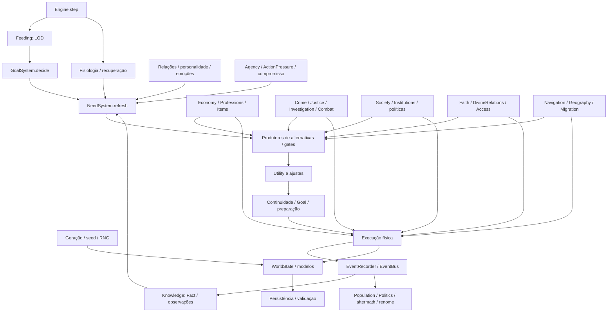

# RADIOGRAFIA TOTAL — simulador atual

## Índice

- [Como ler e verificar](#como-ler-e-verificar)
- [Dependências reais](#dependências-reais)
- [Uma hora: ordem exata e consequências do relógio](#uma-hora-ordem-exata-e-consequências-do-relógio)
- [LOD real](#lod-real)
- [Geração: seed até o mundo](#geração-seed-até-o-mundo)
- [Character: estado completo e proprietários das alterações](#character-estado-completo-e-proprietários-das-alterações)
- [Personalidade e emoções](#personalidade-e-emoções)
- [Need, prioridade e alternativas](#need-prioridade-e-alternativas)
- [Gates: antes e depois da Utility](#gates-antes-e-depois-da-utility)
- [Utility e Goal](#utility-e-goal)
- [WorldPressure, ActionPressure e capacidade](#worldpressure-actionpressure-e-capacidade)
- [Fome, sede, descanso, dano, cura e morte](#fome-sede-descanso-dano-cura-e-morte)
- [Economia: donos, preço e conservação](#economia-donos-preço-e-conservação)
- [Profissões, procura de trabalho, produção e carreira](#profissões-procura-de-trabalho-produção-e-carreira)
- [Itens e propriedade](#itens-e-propriedade)
- [Relações, família e epistemologia](#relações-família-e-epistemologia)
- [Crime, investigação, justiça e combate](#crime-investigação-justiça-e-combate)
- [Letalidade: querer, buscar, atacar e finalizar](#letalidade-querer-buscar-atacar-e-finalizar)
- [Grupos, propostas e governo](#grupos-propostas-e-governo)
- [Políticas: cada setor](#políticas-cada-setor)
- [Facções, formalização e capacidade institucional](#facções-formalização-e-capacidade-institucional)
- [Fé, deuses, audiência, contrato, apoteose e mito](#fé-deuses-audiência-contrato-apoteose-e-mito)
- [Geografia, rotas, Journey, migração e POIs](#geografia-rotas-journey-migração-e-pois)
- [População, jogador e Quests](#população-jogador-e-quests)
- [Persistência, validação, limites e desempenho](#persistência-validação-limites-e-desempenho)
- [Campanha natural e comportamento medido](#campanha-natural-e-comportamento-medido)
- [Leitura integrada dos resultados desta seed](#leitura-integrada-dos-resultados-desta-seed)
- [Problemas confirmados, gargalos e limites](#problemas-confirmados-gargalos-e-limites)
- [Suíte inteira e capacidade de prova](#suíte-inteira-e-capacidade-de-prova)
- [Comparação compatível com auditorias anteriores](#comparação-compatível-com-auditorias-anteriores)
- [Matriz de cobertura conceitual de todo o núcleo](#matriz-de-cobertura-conceitual-de-todo-o-núcleo)
- [Evidências e retenção](#evidências-e-retenção)
- [Apêndice — fórmulas, geradores de alternativas e guardas exatas](#apêndice--fórmulas-geradores-de-alternativas-e-guardas-exatas)

Regras **mvp-12-fase5.5**, geração **mvp-5.4**. Referência SHA256 `c60349c54564a759147738b10d6c490c44440d53afb2e681b0a8aaa5c82d4a72`. **48 arquivos,501 funções/métodos,49 dataclasses,233 sites de emissão,326 testes**. Auditoria estática antes da simulação; campanha única **Thalven-Radiografia55,300h**.

O mundo tem ciclos materiais, sociais e religiosos ativos, mas sua causalidade é apenas parcialmente registrada. Foram confirmados problemas de histórico/persistência, consequência política e caminhos divergentes, além de gargalos entre sobrevivência, acesso e ação coletiva. A auditoria documenta esses limites sem alterar o comportamento.

## Como ler e verificar

O código é a autoridade. O [MAPA_CODIGO.md](</home/hugo/Área de trabalho/procedrual/reports/auditoria_total/MAPA_CODIGO.md>) enumera cada função, campos lidos/escritos, chamadas, emissores, gates, traits, constantes, invariantes e cada teste. As expressões exatas e os trechos de fonte no apêndice delimitam fórmulas e exceções. [DECISOES_REAIS.md](</home/hugo/Área de trabalho/procedrual/reports/auditoria_total/DECISOES_REAIS.md>) mostra entradas e resultados realmente capturados; [OBSERVABILIDADE.md](</home/hugo/Área de trabalho/procedrual/reports/auditoria_total/OBSERVABILIDADE.md>) identifica o que não se consegue reconstruir. “Não observado” não significa “ausente”, e “implementado” não significa ciclo completo em todas as profissões/setores.

Não houve mecânica, rebalanceamento, ajuste de seed nem correção do núcleo nesta auditoria. Houve inventário antes da simulação, execução da suíte inteira e um único mundo natural de 300h. Controles isolados são identificados como controles. A campanha sem jogador não prova a experiência de comandos ou Quests.

## Dependências reais



O grafo de chamadas resolvidas por método está no MAPA; as arestas medidas na campanha ficam em metrics.call_edges. Despacho dinâmico e callbacks são declarados como tal; uma importação não é prova de chamada.

## Uma hora: ordem exata e consequências do relógio

| Ordem | Função/guarda | Entidades e efeito |
| --- | --- | --- |
| 1 | closing_turn = turn+1; IDs em ordem crescente | Ignora mortos e jogador; o menor ID age antes e pode modificar recursos/conhecimento de quem decide depois. |
| 2 | feeding.decision_interval | Atualiza lod; decide se closing_turn % interval == id % interval. elapsed=max(1,closing_turn−last_update). |
| 3 | goals.decide; last_update=closing_turn | Observe mercado, refresh de Needs/serviços, alternativas, gates, Utility, continuidade, preparo, movimento e execução. Eventos reagem sincronicamente durante a ação. Ainda usa o turn anterior ao fechamento. |
| 4 | world.turn=closing_turn | Só agora fecha a hora. |
| 5 | needs.physiology, todos os vivos, inclusive jogador | Fome/sede/fadiga aumentam todo tick, qualquer LOD. Dano e starvation_hours são aplicados. |
| 6 | health≤0 → finish_death('deprivation') | Fecha morte imediatamente; sobrevivente jogador recebe needs.refresh. Mortes em combate podem ter ocorrido antes, dentro da ação. |
| 7 | turn%6==0 → knowledge.gossip | Snapshot impede notícia atravessar cadeia inteira no mesmo gossip. |
| 8 | turn%24==0 → economy.daily | Produção/consumo/relatórios coletivos/mercado e demandas; não equivale a cada NPC trabalhar. |
| 9 | justice.tick | A cada hora expira casos/libera detenção; communicate a cada AGENCY.institutional_latency=6h. |
| 10 | society.tick | Chamado a cada hora, retorna fora de turn%24==0; então substitui cargos, limpa grupos/propostas e membros/lideranças de facções. |
| 11 | institutions.tick | Retorna fora de turn%24==0; verifica ausência de trabalho≥48h/tempo da política≥48h e convites/candidatos mortos, sem substituir trabalhador físico. |
| 12 | faith.tick | Toda hora avalia oportunidades/pressão dos deuses; saúde religiosa a24h, energia +.5 a24h; intervenções têm cooldown168h e consideração emitida≤1/24h. |
| 13 | quests.reconcile | Reconcilia estado material/social dos pedidos. |
| 14 | world.rng_state=rng.getstate() | Snapshot do RNG; execute também sincroniza quando há sucesso ou RNG consumido. Não existe autosave por hora. |

Comer pode impedir dano no fechamento seguinte, mas adquirir, caminhar e consumir são operações diferentes. Um NPC não toma necessariamente uma nova decisão entre duas horas de fisiologia. Uma ação longa usa elapsed, porém caminhada debita suas horas antes de produção. Uma falha pode voltar à fila com cooldown de12h; a preparação de água constitui a exceção problemática B03.

## LOD real

Não há enums HIGH/MEDIUM/LOW. Existem `active`, `local`, `background`. Active decide a cada1h por promoção temporal, combate, migração em curso, HP<30, categoria lendária, fome≥80, sede≥85 ou jogador vivo a distância≤3. Fome≥35 dá local/3h. Comum em casa sem essas condições fica background/12h; demais local/6h ou importante/3h. A ordem é relevante: uma condição anterior prevalece sobre a seguinte.

Fisiologia, gossip periódico e economia global continuam. Percepção/refresh/emoções/alternativas e trabalho dependem da decisão, enquanto aprender um evento dispara listeners imediatamente. LOD muda semanticamente oportunidades de comer/reagir/trabalhar, tamanho do lote elapsed, chegada e competição; não é só uma otimização gráfica. As distribuições observadas aparecem adiante.

## Geração: seed até o mundo

`seed_number` usa SHA256 de `GENERATION_VERSION:seed`, convertido em inteiro para um único random.Random. Uma mesma seed com versão/config diferentes não é comparação isolada. O mapa500×500 usa625 regiões de20×20 e 8% de irregularidade por célula em .FDS. Config valida500×500, reinos1–6, distância mínima1–12, distância de vila maior que a mínima e≤24, pelo menos8 NPCs/cidade e histórico≥0. Centros dos4 reinos são predeterminados; bounds, posições, biomas e escolhas usam RNG. Posição tenta até3000 vezes respeitando Manhattan mínima.

Cada reino tem5 cidades (primeira capital) e1–2 vilas por cidade, distribuídas por sorteio. Mapas locais têm15/11/7 células de lado; mercados/poços/casas/oficinas/área rural são acessos determinados, detalhes variam. População inicial sorteada é depois ajustada na densificação padrão de4 reinos:104 residentes/capital,60/cidade,18/vila, com razão abstrata2.1/2.5/2.7; não há promessa de quantidade fixa de localidades para toda seed. Cada Town recebe dinheiro800–1600 e reservas iniciais40food,80water,40grain,24iron,24wood; a geração é dotação inicial, não dinheiro criado pelo trabalho.

Onze traits iniciais são inteiros5–95; sadism=round(100*random()**6), concentrado em valores baixos. Dinheiro1–28, fome10–60, fadiga0–20, devoção0–100, comida1–2. Profissão segue ciclo de8 ocupações e papéis régios separados; itens/ferramentas/armas dependem da profissão/categoria. Famílias são arestas explícitas, nomes coerentes e trios de pais/filho na densificação; não há demografia reprodutiva autônoma.

O gerador cria8 POIs,2 sedes com líderes e facções iniciais, estoque material e6 locais exploráveis; caverna tem profundidade1–4 e perigo6–35. Cria dados de relações/reinos, densifica depois da geografia, salva RNG, instancia Engine, chama bootstrap de sociedade/fé/geografia/acesso e emite fundações. `historical_turns` normalmente24, explicitamente0 aqui. Jogador, quando solicitado, é criado depois da história inicial com25 moedas,4food,6water. Fórmulas/ranges restantes e todos os sites de RNG estão no MAPA e no apêndice da geração.

## Character: estado completo e proprietários das alterações

Os campos declarados, defaults e tipos estão integralmente no MAPA. Relações familiares não são uma lista oculta do personagem: ficam no grafo do mundo. `faction` legado não substitui organization_ids.

| Grupo | Estado | Leitores / escritores principais |
| --- | --- | --- |
| Identidade | id,name,surname,nickname,category,alive,is_player,origin,faction | Geração/materialização; renome; Engine.finish_death; serviços consultam IDs, não nomes. |
| Corpo | health,hunger,thirst,fatigue,starvation_hours,damage_by_origin,recoverable_deprivation_damage,recovery_state,last_meal,last_drink | Needs/Recovery/Feeding, execução de refeições/sono/tratamento, Conflict e Engine. |
| Economia | money,inventory,wage_credit,financial_since,financial_setbacks | Items/Economy/Professions/Institutions/Access; Needs e Utility leem pressão/renda. |
| Personalidade/emoções | personality,emotions,grievances,death_affinity,death_state | Geração; Emotion adapta lentamente; Aftermath/LethalDecision/ViolencePatterns; prioridade e Utility leem. |
| Trabalho/lugar | position,home,workplace,town_id,profession,training_target/progress/required/started/last_practice,market_observation | Navigation/Geography/Migration/Professions/Economy; conhecimento limita escolhas de trabalho/rotas. |
| Saber/memória | knowledge,memories,reputations,known_places,failures,applied_facts,observations,processed_personal_facts,personal_cooldowns | Knowledge/Personal/Social/Investigation/Geography; informações têm data/fonte, retenção e confiança. |
| Decisão | needs,goal,suspended_goal,last_update,active_until,lod,food_state,commitments,aspirations,agency_state,action_pressures,lethal_decisions | Needs/Goals/Agency/Feeding/ActionPressure/LethalDecision; eventos podem promover LOD, não executar ação diretamente. |
| Instituições | group_ids,organization_ids,social_state,known_groups/proposals/policies/factions | Society/Institutions/Access; conhecer e integrar são estados diferentes. |
| Fé/mito | religion,devotion,beliefs,renown,item_beliefs,mythic_trait,mythic_development,known_sacred_sites | Faith/Renown/DivineRelations/Access; crença e propriedades objetivas separadas. |
| Conflito/viagem | combat,known_towns,migration,route_knowledge,place_knowledge,journey,access_state | Conflict/Justice/TerminalCombat/Geography/Migration/Access; cargo não dá teleportação. |

## Personalidade e emoções

O MAPA contém, para cada um dos12 traits, todas as referências diretas e pesos Utility expandidos, com a expressão exata que mostra sinal, condição e efeito; não se resume cada trait a um adjetivo. Honesty afeta roubo, denúncia, restrição moral e decisão política; compassion afeta ajuda, vínculos, inibição e reação à morte; courage afeta risco/ação/fuga; independence afeta autonomia/ajuda/migração/adesão; greed afeta apropriação/retorno/decisão; diligence afeta prioridade laboral, trabalho/treino e governo; family_loyalty afeta família/proteção/migração; persistence afeta continuidade, busca e organização; temperament afeta hostilidade/protesto; vengefulness afeta investigação/agravo/letais; ambition afeta carreira/status/organização/poder; sadism afeta decisão letal/aftermath, sem peso genérico na Utility-base.

EmotionalState persiste anger, resentment, humiliation, desperation e ledgers/fontes de desespero, perdas/processamento, strain/adaptation e horários. Fear, guilt, shame, relief, pride, pleasure, fascination, numbness, grief e moral_conflict de morte são principalmente avaliações em death_state/appraisals e termos derivados, não onze barras globais com decaimento uniforme. Grief também é Need. Fear de combate deriva de poder/risco percebido.

Fato prejudicial com confiança≥30 e dano pessoal/familiar produz intensidade proporcional ao ganho de confiança: furto18, ataque30, ameaça16, insulto12, morte violenta45, privação8; anger soma intensidade, resentment55%, humiliation50% em contextos específicos/confiança≥70. O mesmo fato não duplica integralmente a emoção. Apoio reduz anger/desespero e parte da humilhação; reparação também reduz grievance/ressentimento. Atualização por elapsed decai anger .3/h, resentment .04/h, humiliation .1/h, grievance .025/h. Pressões de privação/pobreza/luto/violência/perseguição aumentam fontes separadas; estabilidade material≥6h reduz só fontes materiais .25/h, não apaga luto. Adaptação exige strain≥720, intervalo720 e máximo5 mudanças, +1vengefulness/+1independence. O histórico completo anterior não fica retido.

## Need, prioridade e alternativas

Need tem ID, owner, kind,target,base_urgency,priority,created/updated,status,source,reason,expires e context. A chave pode ser kind:alvo, mas `kind=key.split(':')[0]`; chaves distintas não são novos kinds. `ensure` reativa/reutiliza ID, limpa contexto na reativação de encerrado e finaliza compromisso anterior pertinente. `finish` muda status/prioridade, Goal e cooldown pessoal48h; não confundir status da ação com satisfação fisiológica. Alguns produtores usam espera por informação, bloqueio, expiração e resolução de compromissos.

Prioridade comum=min100(base+min8,idade*.15+traço+amizade/10+perigo+emoção), com diligence/5 em money/work e courage/10+20 em security. Food/water base≥80 recebem perigo15; emergência força100. Food_reserve substitui essa prioridade pela fórmula de cobertura. Agency acrescenta até seu teto; ActionPressure pode acrescentar value*.14. Ordenação é rank de emergência, prioridade decrescente, ID crescente. Emergência food/water tem rank2 com nível≥98, rank1 abaixo, demais0.

O motor percorre Needs nessa ordem e para na primeira com solução viável. Utility compara alternativas dessa Need; uma ação de score200 de uma Need inferior não vence globalmente uma ação de score70 da Need superior. Continuidade pode conservar Goal anterior dentro da margem12 respeitando emergências/refeição/recuperação. Objetivos suspensos não são uma fila ilimitada: há um suspended_goal, compromissos têm até4, aspirações até2, pressão até8 registros.

| Kind / dono | Criador | Ativação / base | Alternativas condicionais | Término / bloqueio |
| --- | --- | --- | --- | --- |
| food | needs.refresh | hunger ≥35; pressão por faixas 20–100 | eat; buy_food/forage/steal/ask_help/work/work_for_food; sete variantes *_meal; take_site_supplies | hunger<35; execução nominal de compra não satisfaz por si só |
| food_reserve | needs.refresh | déficit da reserva 24h, margem de viagem, alvo ≤6; pressão ≤85 | aquisições do food; train/temporary_service se ofertas conhecidas; suprimento de local | cobertura/alvo atingido; não significa comer |
| water | needs.refresh | thirst≥25; emergência≥98 | drink; drink_well em mercado/poços conhecidos; drink_stream sem mercado; suprimento em POI | thirst<25 |
| rest | needs.refresh | fatigue≥25 | sleep em casa; retorno geográfico se aplicável | fatigue<25 |
| money | needs.refresh | reserva<10 ou alvo20 após48h; urgência≤70 | work; train; temporary_service; work_for_food; sell_surplus; alternativas institucionais devidas | saldo/estabilidade e reavaliação; não há salário automático |
| work | needs.refresh | 8≤hora<18; ocupação remunerada ou treino; base35 | work; train; temporário conhecido e compatível | fora do horário ou responsabilidade resolvida; produção não é contínua sem ação |
| security | needs.refresh/justice/violence_patterns | guarda, crime conhecido fresco/confiante; base60; padrões violentos têm contexto próprio | secure; pursue; watch_case; follow_lead/search_area/ask_about_person; respostas legais | caso conhecido encerrado/expirado/inacessível; não olha lista global de criminosos |
| family | personal.refresh/on_fact | vínculo e observação de carência/ausência; urgência/contexto no criador | check_relative; give_supplies; ask_personal_help; aquisições de provisão; busca/pista/rota | encontro, ajuda válida ou notícia de morte; duração/cooldown por alvo |
| grief | personal.on_fact | morte conhecida de vínculo≥40; 20+.35*vínculo; duração48+vínculo | remember_relative; seek_company; ajuda pessoal | conforto recebido/lembrança/resolução/expiração; não deriva só da morte objetiva |
| revenge | personal.revenge/lethal_decisions | dano conhecido; base20+.25*vínculo; duração48+2*vengefulness | investigate; denounce; confront; demand_return; threaten; attack; busca; finish só com oportunidade | morte conhecida do responsável, guarda/reparação, compromisso resolvido/expiração |
| protection | personal.on_fact/conflicts | crime/ameaça conhecida; alvo é protegido, context.threat é agressor | stay_near; avoid_threat; denounce; protect/intervene; confront/attack; busca | proteção recebida/ameaça encerrada/expiração |
| status | personal.refresh/agency | ambição/reconhecimento e aspiração; urgência no criador | work; seek_company; train; share_problem; ações sociais condicionais | feito significativo, aspiração/meta ou expiração |
| advancement | personal.refresh/agency | competência/renda persistente; urgência no criador | train; work; sell_surplus; soluções restritas a train no domínio competence | treino/competência e reavaliação; não há carreira geral para toda profissão |
| response | conflicts.refresh | oponente/ameaça percebida, resposta física ou reparação | attack/defend/flee/surrender/confront/withdraw; alert/call_help; apologize/return_stolen/forgive | conflito acaba, trégua, morte/incapacidade ou timeout |
| assistance | conflicts.refresh | necessidade conhecida de socorro | first_aid; call_help; intervenção física compatível | socorro/risco resolvido ou alvo indisponível |
| pursuit | justice.refresh | wanted conhecido, severidade e jurisdição | pursue/follow_lead/watch_case/search_area/ask_about_person/capture; ataque condicionado | detenção/encerramento/expiração ou espera por informação |
| healing | conflicts.refresh | lesão e tratamento necessário | seek_treatment; first_aid/call_help conforme contexto | estabilização e reavaliação |
| recovery | recovery.refresh | HP<80; min95,25+(80−HP) | delegação a food/water para estabilizar; sleep; seek_treatment/call_help com lesão | HP≥80; cura rápida só sobre ledger fisiológico |
| despair | conflicts.refresh | convergência extrema e persistente; não é toda pobreza | apoio/alternativas de sobrevivência; self_harm sob gate raro | pressão/desespero reduzido ou fim do ciclo; não chamar toda morte natural |
| migration | migration.refresh | ameaça, wanted, pobreza e local conhecido viável | migrate; route_travel; ask_route; preparação de provisões | chegada muda residência; viagem isolada não muda censo |
| political_pressure | society.refresh | problema local percebido/compatível; urgência derivada | share_problem; organize; join_group; attend_group; ask_route/route_travel | aderir/encaminhar/resolver/reavaliar a causa; grupos desconhecidos não são opções |
| organizational_survival | society.refresh | grupo ou facção existente; contexto reutilizado | meet_group; submit/support_proposal; report/contribute/assignment/recruit; institucional_supply/purchase/patrol/raid; formalize_organization; representação | objetivo/estado institucional; risco de contextos group_id e faction_id misturados |
| governance | society.refresh/institutions.refresh | prefeito/representante, proposta recebida ou obrigação local | review_proposal; serve_office; issue_local_order; read_response; relay_response; policy_work | resposta/entrega/estado político; sem conhecimento não há julgamento remoto |
| institutional_work | institutions.refresh | política conhecida ativa/stalled e worker elegível; base48 ou63 se money<15, cap75 | policy_work; route_travel/ask_route se entrega TRANSPORT | política concluída ou sem oferta válida; aptidão material é revalidada na execução |
| institutional_response | institutions.refresh | membro recebe restrição RESTRICTED/ILLEGAL conhecida; base55 | institutional_response | resposta explícita satisfaz; silêncio ou lei desconhecida não inicia a ação |
| military_service | society.refresh | atribuição institucional/militar conhecida | perform_assignment; faction_prepare; faction_raid; defend/protect condicionais | atribuição/ordem e reavaliação |
| recognition | society.refresh | renome/posição aspirada | seek_local_office; ações de responsabilidade/organização conforme contexto | reconhecimento real e limites locais |
| religious_interest | faith.refresh/aftermath | crença, devoção, fatos ou conflito moral | pray; offer_resource; spread_faith; reinterpret; defend_cult; report_congregation (B08); tell_item_history; challenge_divinity/claim_essence condicionais | rito/reinterpretação/estado; repetição de ato não prova contato divino |
| power | faith.refresh | potencial mítico, ambição e conhecimento | train_power; challenge/claim são enumeradas por religious_interest sob seus próprios gates | treino/ascensão/resolução; ambição não gera essência |
| divine_contact | access.refresh | motivo e sítio sagrado conhecido | seek_divine_contact; ask_route/route_travel; oração/rito no destino | audiência/espera/recusa/novo conhecimento; chegar não garante resposta |
| divine_contract | access.refresh | oferta ou pacto pessoal conhecido | accept_contract; refuse_contract; abandon_contract; cumprimento por ações existentes | estado do pacto e obrigação; deus precisa saber da quebra |
| organizational_access | access.refresh | convite recebido/interesse em facção conhecida | answer_invitation; request_membership; invite_person; attend_faction; viagem | aceitação/recusa/adiamento/expiração motivada |
| affiliation | access.refresh | convite recebido base43 ou interesse próprio base36 em organização conhecida | answer_invitation; request_membership; attend_faction; viagem | aceitação/recusa/condicionamento/adiamento; não integração automática |
| organizational_base | access.refresh | base/POI conhecido e interesse organizacional | claim_location; store_supplies; form_expedition; explore_poi; viagem | ocupação/estoque/base ou bloqueio de acesso/capacidade |
| exploration | access.refresh | POI e motivação conhecidos | explore_poi; form_expedition; follow_expedition; viagem | exploração/retorno/expiração conforme contexto |
| return_from_site | access.refresh | retorno de POI/rota concluída | route_travel; ask_route; take_site_supplies se necessário | chegada confirmada |
| spatial_journey | access.refresh | Journey em curso | route_travel; rotina de retomada/pausa/provisões | Journey concluída/abortada; não implica trocar residência |
| professional | economy.daily (Town) | déficit produtivo/ProfessionalDemand; base55 | diagnóstico; resposta administrativa usa Goal coletiva ligada ao Need food, com expand_farming/publish_temporary_work/open_training/materialize_worker/improve_utilization | demanda revista; não possui seletor profissional autônomo por seu próprio ID |
| resource_pressure / water_access / security / religious_interest / criminal_cooperation (Group) | society.form, cause dinâmica | causa compartilhada; urgência/priority herdadas da fonte individual | commitment coletivo/plano; execução por membros/representante via organizational_survival, não um NPC Group autônomo | grupo/causa/proposta e lifecycle próprios; expedition cria Group, mas não chama ensure de Need coletiva nesse caminho |
| organizational_survival (Faction) | society.orders | relato conhecido; base45 | Goal perform_assignment da facção; ordens para membros presentes; ação depende de cada Character | ordem/capacidade/estado institucional; Goal do agregado não percorre Engine como personagem |
| food (Town/Kingdom) | economy.daily | escassez coletiva e pedidos | política/Quest/administração; não é um estômago coletivo que executa eat | estoque/relatório/encaminhamento reavaliado |

A tabela enumera famílias sem prometer todas simultaneamente. Para cada criador, o MAPA preserva argumentos de urgência/source/reason/target/context; o apêndice transcreve os produtores reais para resolver os gates específicos e a duração. Há Needs coletivas como water_access/resource_pressure e cooperação derivadas das causas/diagnósticos; uma causa de grupo não deve ser contada automaticamente como um Need.kind de Character.

## Gates: antes e depois da Utility

| Etapa | Exemplos reais / efeito |
| --- | --- |
| Produtor | Conhecimento do local/fato/rota, profissão, alvo, grupo conhecido e compatível, cargo/papel, oferta observada fresca, capacidade e recursos locais quando observáveis; pode retornar zero antes de criar Solution. |
| Filtro de soluções | Saturação/treino substitui work; detenção/rendição restringem ações e destino; competência aspirada mantém só train; busca troca alternativas genéricas por pistas. |
| _evaluate antes do score | ActionPressure não elegível; provisão familiar já suficiente; cooldown de ação/base/pedido; destino em outro mapa. Essas soluções não chamam utility.evaluate. |
| Avaliação especializada | Terminal usa tabela própria e não Utility.BASE; valores sentinela≤−1000 eliminam opções. |
| Após Utility-base | Feeding.estimate pode rejeitar prazo inviável; variantes refeição podem remover aquisição equivalente; Agency/Faith modificam scores; estas etapas não são gates pré-Utility. |
| Após escolha | Continuidade de Goal, suspended_goal e preventive_choice podem trocar winner/destino; o preparo de água não repete todas as guardas. |
| Execução | Revalida contato, saldo/estoque, capacidade, evidência, acesso e condições. Um candidato viável anteriormente pode falhar legitimamente depois da caminhada. |

Todos os gates sintáticos de saída/continue/erro estão por método no MAPA, com condições numéricas/compreensões nos trechos de fonte. Um candidato que o produtor nunca criou não aparece como “perdeu por Utility”. O observador só atribui razão quando a entrada/retorno real a sustenta; as demais são lacunas explícitas.

## Utility e Goal

`score = BASE[action] + Σ(values[name] * WEIGHTS[action][name]) − min(200,2*travel)`. Traits passam por normalized; termos sociais podem substituir valores e incluem confiança, reputação, vínculo, risco, autoridade, lesão, privação e pressão de recuperação. Considerations são parcelas divididas por200; comparar o score exige multiplicá-las por200. MEALS usa a base da aquisição original. O catálogo de TODAS as ações e pesos está no MAPA.

ActionPressure acrescenta25% de sua pressão às ações pertinentes, exceto attack no caminho normal. Treino considera demanda, pressão financeira, custo por diligência, valor do emprego e risco. Agency acrescenta compromisso/aspiração; Faith aplica influência mítica. Terminal substitui a competição pelo seu winner real. Fora do terminal, alternativas a até3 pontos da primeira sofrem variação uniforme[−1.5,+1.5] apenas no desempate; draw individual não fica persistido. Scores iguais ordenam ação/target antes da escolha.

Goal persiste ação, Need, score, criação, alvo/destino/status/outcome. Caminhada pode consumir todo elapsed e deixar Goal ativo sem execute. Falha registra outcome e cooldown12h; Need volta ativa. Uma ação concluída não resolve automaticamente todos os seus motivos. Suspensão por refeição e retomada, janela de continuidade, blocked, desistência/espera e progresso dos compromissos estão na fonte transcrita. O abandono usa clamp(idle/8 + failures*8 + setbacks*3 − persistence*.25 − ambition*.1) > 55 + persistence*.3; o horizonte finito é720 + 3*persistence horas, com exceções/continuidade para decisão letal ativa e espera por informação conforme a ordem dos ramos. AGENCY.no_progress_hours=168 não é lido nesse fluxo, portanto não é um timeout fixo de168h. Não existe planejador externo executando fora de Need/Goal.

## WorldPressure, ActionPressure e capacidade

WorldPressure exige causas conhecidas e específicas: perda próxima, ameaça extrema, dano grave repetido, pedido recebido, causa institucional/fé. Soma de traços fracos não cria automaticamente uma causa grave. Disposição=clamp(severidade*(.45+.25*persistence/100+.30*agency/100)*min1.25(1+min6(falhas)*.025+min48(investimento)*.002)*(1−min.8(barreiras))). Emoção pode prolongar pressão grave; falhas/idade têm limites.

Capacidade real normal=clamp(HP*(1−fatigue/150)); percebida=clamp(capacidade*(.6+courage/125)). Finish/attack com decisão ativa usam auditoria letal especializada; challenge_divinity exige causa grave, desenvolvimento mítico≥60 e pressão≥35; assume_local_office exige grupo escalado/responsabilidade e gates próprios; ações fortes não executam com capacidade<12, detenção ou rendição. Não há bônus automático de dano físico por pressão. As fórmulas integrais de agência, capacidade e inibidores estão no apêndice.

## Fome, sede, descanso, dano, cura e morte

Fome cresce2/h; sede2/h ou4 em D; fadiga1.2/h, todas limitadas100. Chegar a100 em fome OU sede causa dano `min6(2+starvation_hours//12)` por hora; o relógio de privação zera quando ambas voltam abaixo100. O dano real limitado ao HP entra em damage_by_origin e, para fome/sede/both, em recoverable_deprivation_damage. Comer reduz40; beber reduz45. Não é um teste simples “há comida na cidade, portanto come”: posse, conhecimento, preço, renda, distância, Need escolhida, intervalo de decisão e etapa de consumo são independentes.

Fome35–40 permite oportunidade de refeição com pressão relativamente baixa;40–60 cresce40+1.5*(fome−40),≥60 cresce70+1.5*(fome−60) até100. Reserva objetiva cobre24h e margem6h, máximo6; pressão inclui cobertura, oportunidade observada pagável, risco, idade e retorno da viagem. O prazo biológico simula até128h e rejeita soluções que não deixam o indivíduo vivo até adquirir/consumir. Estoque remoto não é lido como conhecimento grátis.

Sede≥25 cria Need; drink consome água própria, drink_well busca fonte conhecida em Town, drink_stream é caminho rural sem mercado. Poço consome estoque real da cidade; infraestrutura diária e capacidade de armazenamento não significam água infinita. Daily repõe somente dentro das regras/capacidade. `fill_water` recolhe para carregar, não bebe automaticamente. B03 permite repetição preventiva após falha; salvar água no inventário não garante sobreviver ao fechamento seguinte se o consumo ficou para outra decisão.

Sleep reduz fadiga12*horas e chama recuperação. Cura normal3/h, metade em privação severe,0 critical/starvation. Em casa sem oponentes, ledger de privação pode curar8/h com nível≤50,4/h≤70,1/h≤80,0 acima; o orçamento é max(cura normal,rápida), não soma. Tratamento atende dano físico primeiro; débito do ledger impede curar privação inexistente. Need recovery existe HP<80 e pode delegar estabilização a food/water antes de sleep. Fadiga reduz capacidade/aptidão e prioridades; não há morte de velhice modelada nem dano fatal diretamente por fadiga isolada.

Todas as mortes convergem para finish_death: privação classifica hunger/thirst/both no registro, combate pode carregar killer/weapon/intenção, self_harm usa causa própria abstrata quando elegível; explorar POI pode causar morte exploration, e desafio divino pode causar combat sem killer mortal. Encerra Goals/Needs/commitments e decisões do dono, remove do índice de vivos, mantém corpo/posses. EventBus atualiza censo uma vez, sucessão/relações/emoções/justiça/grupos/fé por seus consumidores; conhecimento não é universal. CharacterKilled ativa Aftermath. Morte de um deus é outra entidade/fluxo, não baixa o censo mortal como se fosse um residente.

## Economia: donos, preço e conservação

Dinheiro tem dono: Character.money, Town.money, Kingdom.treasury, Faction.money, Group.money, Policy.money e Town.abstract_money separado. Kingdom não possui campo money. Cada reino começa com treasury2000; Economy.daily adiciona floor(abstract_population/100) ao saldo abstrato como fonte monetária explícita de trabalho abstrato, registrada em MoneySourceAbstractWork. Não é transferência de um pagador persistente: a fronteira dessa fonte de moeda deve ser declarada, não ocultada sob a palavra salário. Compra transfere moeda Character→Town e item Town→Character; venda faz o inverso, com desconto e saldo real. Salário Town→Character usa wage_credit em sextos (restos não são moedas adicionais). Política reserva Town→Policy, paga Policy→worker, devolve sobra. Contribuição/dues fazem Character→Group/Facção; transporte move carga real. Morte mantém dinheiro/posses no cadáver; não é sumiço de moeda nem distribuição automática.

Preço base e cotação por estoque (inclusive cada unidade de lote) estão em Economy.market_value/buy_price/sell_price/quote. Compra observada só no mercado registra preço/estoque/turno; intenção pode caminhar sem conhecer preço remoto. Sem renda há trabalho, treino/temporário, venda de excedente, coleta, ajuda ou roubo conforme conhecimento/gates e personalidade; nenhuma dessas opções é garantida. Crédito salarial e grain_credit são unidades distintas e não devem ser somados como dinheiro. Relatórios diários e agregados não formam razão contábil histórico completo.

## Profissões, procura de trabalho, produção e carreira

| Ocupação | Local / input → output / limites | Pagamento e destino |
| --- | --- | --- |
| agricultor | workplace rural; trabalho gera grain2/h ou3 na especialização; cap240 | Produto→Town; crédito produzido*(6//rate), Town paga sexto convertido. |
| mineiro | workplace artesanal; iron2/h ou3 especializado; cap120 | Mesmo fluxo material/salarial; ferramenta não é um input consumido por hora. |
| lenhador | workplace artesanal; wood2/h ou3 especializado; cap120 | Produto Town e remuneração Town. |
| caçador | workplace rural; food2/h (a especialização padrão é grain/iron/wood); cap240 | Produto Town; não é comida automaticamente do caçador. |
| cozinheiro | mercado/taverna;2/3grain→1food com grain_credit inteiro em terços;3food/h; cap240 | Produto Town, salário por produção real. |
| ferreiro | workplace;2iron+1wood→1weapon por ação, cap8 | Insumos Town, arma Town; lote elapsed não cria horas retroativas de forja. |
| guarda/soldado | workplace válido, serviço/patrulha | Salário Town por horas; sem item produzido nessa ação. Captura exige conhecimento separado. |
| comerciante | workplace/serviço; transporte institucional é outro caminho | Salário Town; não existe comércio interlocal autônomo geral implementado por esse rótulo. |
| governante/conselheiro | workplace/serviço e administração separada | Salário Town; tesouro/decisão institucional não são dinheiro pessoal. |
| estudante / None | sem work remunerado genérico | None pode usar temporário; treino segue gates. Não existe emprego garantido pelo nome. |

Need work surge no horário8–18, money por baixa reserva; food/reserve pode oferecer work se comida conhecida é impagável. Um NPC não faz busca global de vagas: Economy.observe no mercado oferece dados frescos≤24h de estoque, temporário e treino. Goal.solutions remove work saturado/incompatível, adiciona vagas conhecidas; Utility penaliza distância2/passo e privação, recompensa diligence, e treino considera pressão financeira/custo/demanda. Salário esperado não é uma variável geral aprendida e comparada entre todos os empregos; o mecanismo prioriza alternativas existentes no mercado local. Pode não haver vaga/input/espaço/pagador, e a execução falha com razão explícita; fome/família/ação alternativa competem em decisões seguintes.

Trabalho temporário de preparo consome grão real e distribui o produto entre pagamento em comida e estoque. Distribuir refeições consome duas por unidade: uma paga trabalhador, outra população abstrata. Treinamento só cobre cozinha: aprendiz produz1food/h, ganha2sextos e conclui max12(36−diligence//5−8 se agricultor) unidades; abandono após168h sem prática. Não é árvore de carreira para toda profissão. ProfessionalDemand mede déficit; materializar exige déficit≥72h, cooldown, abstrato, dinheiro/insumos/instalação e ausência de candidato persistente adequado; transforma um residente abstrato em aprendiz, transfere12 do saldo abstrato, provisões da Town e preserva censo. Reposição profissional ampla é PARCIAL.

Produção conserva insumos na cozinha/forja/transporte; agricultura/mineração/caça/água são fontes modeladas por capacidade/ação/tempo e não esgotamento ecológico. Consumo abstrato agregado usa escala de moradores, não um estômago por cidadão invisível. Não interpretar “material finito em estoque” como modelo completo de energia/solo/minérios renováveis.

## Itens e propriedade

ItemService cria com ID/owner/origem/criador/qualidade/raridade e propriedades reais; inventários guardam quantidades. Transferência total altera dono, parcial divide stack; consumo debita/remove item conforme quantidade. Itens nomeados/importantes têm história/posição/uso seletivos; pilhas comuns não mantêm trilha por unidade consumida. Arma altera dano por damage/quality; tool e artefato podem carregar propriedades sem um ciclo universal de desgaste/fabricação. Food/water/grain/iron/wood têm consumo material específico. item_beliefs e lenda atribuída não são actual_properties: alguém acreditar em bônus não o cria.

## Relações, família e epistemologia

Grafo dirigido `(source,target,kind)`; value0–100, diplomacia−100–100; só reciprocal=True escreve duas direções. Espécies literais, valores iniciais e todos os sites de alteração/leitura estão no MAPA: afinidade_divina, amizade, autoridade_local, casamento, confiança, diplomacia, familiaridade, filho_de, lealdade, pai_de, pertence_a, representa_cidade, reside_em e residente_de. A materialização usa residente_de e migração usa reside_em; o censo autoritativo usa town_id/resident_ids, não a fusão desses rótulos. Divinity.relations pode guardar valores negativos enquanto a aresta afinidade_divina é truncada pelo Graph em0, uma diferença de representação que impede usar os dois como escala idêntica. Amizade/confiança podem divergir em direção; parentesco usa casamento/pai_de/filho_de. Siblings não têm ciclo próprio de relações derivadas/nascimentos; família funcional consulta arestas explícitas. Family care/search nasce de observação e notícia; morte objetiva só produz luto em quem aprende com vínculo suficiente. Conhecer alguém não garante confiar, e confiar em emissor para compartilhar não é necessariamente a confiança do receptor para acreditar.

Truth=WorldState e eventos objetivos; Fact=representação recebida, com confiança/fonte/contexto; Observation=estado visto com data; Memory=registro curto; Belief=atribuição religiosa/mítica; Reputation=interpretação subjetiva acumulada por fatos; conhecimento de local e de rota são estruturas distintas. EventRecorder publica; Knowledge observa testemunhas e participantes, learn aplica confiança e dispara listeners de forma síncrona. Não se reavalia o mundo remoto para corrigir automaticamente uma crença.

Conhecimento é limitado64 Facts e32 memórias, com causas protegidas por Agency/processamento em curso; aplicada contribuição/reputação não duplica ao reouvir o mesmo fato com menor confiança. Melhoria de confiança aplica diferença, não a história inteira de novo. Gossip a6h usa snapshot, sorteia contato na célula ou quatro adjacentes e um fato compartilhável; confiança do emissor permite compartilhar, do receptor classifica trusted/known/rumor/untrusted. Teto transmitido=min(confiança anterior,80/60/30/10); direto100. Não há recomposição automática de certeza por retransmissão.

Gossip conserva kind, actor, target, local e turno do Fact: muda fonte/confiança, não sorteia distorção textual nem cria uma autoria falsa. Informação velha é filtrada por idade/Need, local já buscado, observação mais nova e melhoria de confiança, não por um TTL universal de toda crença. Verdade objetiva, relato enfraquecido, informação desatualizada e interpretação/atribuição religiosa equivocada existem em graus diferentes; não há um campo universal truth=True/False nem um ciclo geral de falsas acusações fabricadas. Mentira deliberada geral com NPC escolhendo fabricar uma proposição falsa e manter versões é AUSENTE como ciclo completo; rumor não é automaticamente mentira. Falsa divindade/lenda atribuída é crença subjetiva PARCIAL, sem criar entidade divina objetiva.

## Crime, investigação, justiça e combate

Crimes concretos incluem furto de estoque/indivíduo e violência/ameaças/morte julgadas pelos filtros de justiça; incursão institucional pode ser legal/tolerada/restrita/ilegal conforme jurisdição e evidência conhecida. Furto transfere item real, não spawna recompensa. Greed positiva, honesty fortemente negativa e contexto de fome/estoque/acesso favorecem steal; security precisa conhecer, chegar e vencer a competição de Need antes de prender. Assim milhares de furtos podem coexistir com poucas capturas sem provar falha em EventBus: medir cada fronteira crime→testemunha→Fact→guarda→busca→encontro→captura.

Investigation parte de fatos/pistas conhecidos; pista guarda lugar/data/fonte/confiança/especificidade/direção/related_fact. Search/ask podem avançar, descartar local pesquisado ou deixar compromisso esperando informação. Wanted não é onisciência: record guarda known_by, local, severidade, confiança, evidência e prazo; expiração/detenção/soltura são distintas de inocência. Denunciar ao culpado é filtrado no caminho atual por alvo/fato; não se assume a presença de um bug antigo sem reproduzi-lo.

Conflito enumera confront/warn/threaten/demand_return/insult/apologize/return_stolen/forgive/calm, attack/defend/flee/withdraw/surrender, protect/intervene/call_help/alert, pursue/capture e first_aid/seek_treatment. Alvos precisam estar acessíveis e conhecidos; fuga move, rendição restringe, captura requer autoridade/evidência/oportunidade. Trégua/timeout têm regras próprias. Dano=`(4+min12(weapon.damage*(.5+quality/200)))*(.5+HP/200)*(1−injured/250)` com multiplicador mítico treinado até15%, variação inteira±2, defesa*.45 e mínimo1; coragem influencia decisão, não multiplica dano diretamente.

## Letalidade: querer, buscar, atacar e finalizar

Modos reais são reactive_threat, retributive, protective, instrumental, moral_punishment e hedonic. Cause usa fatos próprios com autoria/confiança, dano confirmado, perdas próximas e objetivo instrumental; humiliation repetida não equivale a qualquer insulto isolado. Death_seeking é trajetória derivada, não sétimo modo: exige afinidade/mortes positivas/sadismo/inibição sob gates próprios. A fórmula integral de todos os modos e limiares consta no apêndice.

Evaluate calcula instigação, vengefulness, emoção dirigida limitada pelo agravo, compromisso, sadismo, afinidade e reparação falha; subtrai compaixão, honestidade, medo, risco, vínculo, autoridade/testemunhas, autoria incerta e alternativas não letais. Pressão<40, falta de causa grave/confiança≥60 e inibidores bloqueiam adoção. Decisão persistente ativa não vira amnésia ao alvo sair da célula; mantém fontes/intensidade/ruminação/compromisso/estado. Capacidade/local limitam execução sem apagar desejo. Buscar requer pista/rota/provisões; atacar requer contato e competição; finalizar requer incapacidade, acesso e decisão ativa.

Terminal compara finish/spare/capture/help/withdraw. Ameaça defensiva removida pela incapacidade reduz muito finish e aumenta spare; motivos não defensivos podem continuar. Captura tem95+honesty*.1 se guarda com caso; ajuda exige food+water; vínculo/compaixão inibem finish; medo favorece retirar. Winner é o max real com desempate por chave, usado diretamente, não uma nova rolagem de moral. Finish válido mata sem nova rolagem de dano. Sem oportunidade/decisão não existe kill arbitrário por Utility-base.

Aftermath usa intenção, justificativa percebida, vulnerabilidade, vínculo, testemunhas, sadismo, crença do autor e afinidade. Registra guilt/shame/fear/relief/pride/pleasure/fascination/numbness/grief/moral_conflict, mortes positivas e antes/depois de afinidade. Feedback conhecido pode reduzi-la; decaimento tem janela. Mesmo gesto não produz o mesmo sentimento em todos. Os appraisals retidos são4 por pessoa, kill_facts8; não equivalem a histórico emocional integral.

## Grupos, propostas e governo

Group é causa compartilhada com membros/leader, conhecimento/atividade/pressão/plano/investimento. Criar, conhecer, ingressar e reunir são etapas diferentes; Institutions.search_groups exige conhecimento/compatibilidade antes de uma alternativa join. Recusa pode resultar de causa, distância, autonomia, confiança ou limite; não se presume que todo grupo mundial seja visível. Churn, líder morto, dissolução e registro de origem persistem de modo limitado. Reunião exige presença física; alto número de membros não prova encontros regulares.

Proposta reúne pessoas/grupos/facções por chave de jurisdição/setor/objetivo, apoio único e fontes; reuso evita duplicatas equivalentes. Apoiar não é entregar; representante precisa chegar ao prefeito/mercado, transmitir e depois receber/devolver resposta. Quadro público mantém respostas limitadas e conhecimento local; prefeito não lê status remoto como notícia. Decisão considera pressão, urgência, apoio vivo, idade, visibilidade e crise local, personalidade e orçamento. Scores approve/partial/reject/defer/ignore são persistidos no resultado; sem orçamento aprovação vira defer. Sucessão preserva o quadro, mas vários fluxos ainda dependem da pessoa escolhida.

B02 interrompe a ligação rejeição conhecida→responsável político→tomada de cargo: o bloco que escreveria responsibility_id está depois de um retorno. B06 pode misturar contexto grupo/facção. A antiga Society.material existe paralela à política material atual; sua acessibilidade precisa ser lida pelo grafo e não inferida de seu nome. O código legado que sai cedo em political_pressure não é uma segunda política ativa.

## Políticas: cada setor

Policy reserva2–16 moedas (parcial até8), exige8 etapas (parcial4), trabalhador apto/conhecedor/local, paga1 por etapa e devolve sobra na conclusão; budget=money+spent+refunded. Falhar pode produzir stalled/barreira, não desaparece o orçamento. A existência de Policy não contrata automaticamente qualquer profissional.

| Setor | Worker/local | Inputs/efeito/limites e conclusão |
| --- | --- | --- |
| WATER | mineiro/lenhador/ferreiro/agricultor no mercado |1wood+1iron/etapa; a cada2 etapas +20/dia,+40armazenamento; não cria água instantânea. |
| FOOD | cozinheiro/agricultor/caçador |prepare até4rações, grão/crédito real, espaço≤240. |
| PROCESSING | cozinheiro |Mesmo caminho de preparo; não é indústria multietapas genérica. |
| EMPLOYMENT | elegível temporário |Mesmo primeiro caminho de preparo: diversidade de emprego PARCIAL. |
| WEAPONS | ferreiro |2iron+1wood→weapon real, pagamento/subsídio separado dos insumos. |
| RAW_MATERIAL | mineiro/lenhador/agricultor no workplace |Chama work existente1h; produção+salário regular exigidos; subsídio1 sai da Policy. |
| SECURITY | guarda/soldado no mercado |Observa/patrulha, paga e fatiga; não garante impedir crimes. |
| TRANSPORT | comerciante |3grain/wood/iron reais; destino conhecido no mesmo reino, rota/provisões; atribuição não paga até certificado de chegada e entrega; carga perdida bloqueia. |
| cult_recognition | objective especial, elegibilidade herdada do setor |Registra culto reconhecido em Town.policies; não cria comida, divindade ou conhecimento universal. |

Barreiras incluem money<1, fatigue≥95/HP<30, recursos/armazenamento, input, rota/carga/provisões, chegada não confirmada/carga perdida e serviço especializado indisponível. Se trabalhador nunca conhece a política ou a Need perde prioridade, policy_work nem é chamado e nenhuma PolicyBlocked precisa aparecer: essa é uma lacuna entre notícia e trabalho.

## Facções, formalização e capacidade institucional

Duas facções iniciais têm líder, sede física, estoque real e dinheiro; novas derivam de grupos/ocupação/contribuições sob limites globais. A via meeting exige investimento≥4, idade≥168h,≥3membros e2presentes com dinheiro>15 antes da função de score. Institutions.formalization calcula idade/falhas/reuniões/presentes/contribuições, score≥65,≥3presentes e fundos≥4; found_faction acrescenta limite mundial/liderança/capacidade. Access.formalize_organization ignora parte desses gates (B04). Portanto eles não são invariantes globais de toda facção.

Ingresso exige conhecimento/contato/termos, custo de autonomia/risco/dues e benefício percebido de comida/água/proteção/renda/companhia/treino. Reconsideração por fadiga≥85 ouHP<45 não é recusa definitiva; independência≥90 pode recusar. Convites podem permanecer condicionados; morte os expira por motivo, não simples prazo. Só existir estoque na HQ não entrega água ao recruta distante.

Capacidades derivam de membros vivos presentes abastecidos (food+water,HP≥30), guardas, HQ e recursos. Patrol/guard/investigate requerem guarda apto; escort exige≥2abastecidos; train≥2guardas; produce requer profissão; trade comerciante e saldo≥2; explore≥2 e mineiro/caçador; occupy≥2 e HQ. Há ações concretas institutional_supply/purchase/patrol/support/raid/response, contribuições, assignment/preparo e recrutamento, mas nem todo booleano possui ciclo independente completo. Treino institucional geral, comércio complexo, contratos remunerados de escolta e custódia multidepósito são PARCIAIS/AUSENTES como ciclos.

Legalidade por cidade deriva de ações/evidências recebidas e valores/ideologia: tolerância, restrição e ilegalidade não mudam automaticamente por toda parte. Resposta institucional depende de líder/membro conhecer o fato, capacidade/material e escolha. Uma ação de suprimento pode preceder assignment e ocultá-lo naquela enumeração; B05 é a divergência de produto. Fontes/Needs concorrentes e sobrevivência da liderança são gargalos concretos.

## Fé, deuses, audiência, contrato, apoteose e mito

Geração cria os deuses definidos em Faith.GODS, crença/devoção local e potencial mítico raro; acreditar num mortal não o insere em world.divinities. Faith, DivineRelations, ReligiousHealth, Renown e Access compõem um fluxo, não uma mente onisciente. Deus conhece mensagens/fatos por oração/atividade/presença/relatos e fontes limitadas; composição religiosa objetiva só vira conhecimento pela cadeia de relatos permitida. Presença regional≠corpo acessível. Alvo e intervenção dependem de informação, domínio/valores, afinidade, energia, cooldown e motivo.

Mortal precisa motivo, lugar sagrado conhecido, rota, provisões, chegada e rito; Access.audience, não DivineRelations.audience, decide a audiência. Exemplos de gates: favor≥30,devoção≥80,honor do deus≥50,energia≥45 e cooldown72; audiência custa10. Manifestação forte exige motivo/favor/energia adicionais (favor≥60,energia≥55, custo25), duração/local; DivineRelations tem também avaliação e manifestação por mensagens, com funções/canais próprios no apêndice. Não unir esses dois caminhos como se compartilhassem todo limiar. Contrato exige condições/oferta (inclui favor≥40 e feitos≥2 no caminho), conhecimento e aceitação; obrigação/mensagem de quebra não é lida globalmente por simples estado objetivo.

Divine death requer deus vivo, acesso físico válido a manifestação e capacidade mítica/circunstância; apoteose é posterior e separada, essência acessível e desenvolvimento/gates, cap12divindades. Não exigir ocorrência natural em300h. Renown usa feitos conhecidos e alcance, pode nomear/epitetar/atribuir lenda a item; mythic_trait é potencial, mythic_development depende de treino; item_beliefs não altera automaticamente o dano real. Saúde religiosa distingue followers/devoted/cultists/actors, snapshots e crises, mantendo censos objetivos e percepção local separados.

## Geografia, rotas, Journey, migração e POIs

World map e mapas locais usam Location(map_id,x,y), Town e Kingdom com limites e posições; Navigation resolve passo local/portais, Geography conexões. Route guarda origem/destino/distância/tempo/terreno/perigo/condição/tipo/toll/uso. Conhecer Town/POI não dá rota; RouteKnowledge tem direção,confiança,fonte,data/custo aprendido. Fontes incluem geração local, viagem, pergunta/relato, encontro e expedição. Plan percorre grafo conhecido, não GPS de todos os lugares; dados objetivos podem bloquear execução.

Journey guarda origem/destino,rotas/nós,motivo,início,modo/guia,leg/offset,pausa/provisões/história. Begin exige caminho/acesso e abastecimento; step consome tempo/provisões/movimento, pode pausar/falhar/retomar; arrival emite certificado. Seguir/escort usa guia/caminho conhecido e continuidade do grupo, sem teleportar por vínculo. Ausência de ocorrência natural de escolta não é bug.

Migração de NPC reutiliza Journey mas confirma mudança de town_id/home/workplace/resident_ids e censos; visitar não muda a residência do NPC. Para o jogador, Navigation.enter atualiza town_id como referência da localidade atual, e ele não compõe o censo de residentes: não interpretar esse campo exatamente como residência de NPC. POI inclui geração, descoberta/rumor/routeknowledge, mapa interno, exploração/perigo/estoque/restos/história, claim/occupation/HQ; o estoque é do ponto/facção, não de todo visitante. Não há exploração de dungeon completa só por existir depth.

## População, jogador e Quests

Persistent_alive+abstract=total_living por Town; mortos continuam personagens/posses, counted_deaths impede dupla baixa. Register retira um abstrato e adiciona um residente; materialização não é nascimento nem expansão grátis do mundo. Não há nascimento/morte individual/sociologia completa dos abstratos; idade biológica e envelhecimento não são campos de Character nem causas naturais de morte implementadas. A escala abstrata de consumo/produção é agregada; não atribuir uma história individual a cada residente invisível.

Engine.execute traduz comandos, usa _finish/_action e os mesmos serviços; ação válida avança hora, consulta/ação inválida em geral não. Contudo diálogo/algumas consultas de candidatos podem ter efeitos informacionais: não anunciar todo método de apresentação como puro. Jogador não é decidido por GoalSystem, mas sofre fisiologia igual. QuestSystem pode criar/listar/aceitar/abandonar/reconciliar pedidos ligados a Need e ajuda material/pessoal; sem jogador esta campanha mede só rotinas chamadas, não teste natural completo de aceitação/entrega. Todas as ramificações de CLI/Quest estão no MAPA e fontes, sem implementação adicional.

## Persistência, validação, limites e desempenho

encode inclui dataclass `$type`, dicionário `$dict`, tupla `$tuple`, listas e primitivos; decode aceita apenas TYPES de models. Envelope exige format_version1 e rules_version atual, world deve ser WorldState compatível, validate e restauração RNG precisam passar. GENERATION_VERSION é constante do código/seed; WorldState e o envelope do save não armazenam generation_version nem GenerationConfig completos. O manifesto desta auditoria preserva ambos. Não há migração automática do esquema. Escrita usa temporário no destino, flush+fsync+os.replace e limpeza; serviços/bus/índice/caches são reconstruídos.

B01 é uma limitação real da continuidade: serialização por valor não preserva identidade compartilhada de contexto/lista. Não afirmar que todo load diverge: o teste básico de continuidade passou, e o controle específico de alias demonstrou quando diverge. Queries Goal.solutions e algumas avaliações podem alterar planos/diagnósticos; visualizador não pode chamá-las como leitura passiva.

Todos os invariantes emitidos pelo validador, thresholds embutidos, caps nomeados, ações e testes estão no MAPA. Cobre referências/IDs/mapas, posse/quantidade/owner, relações, censo, ledgers, políticas/orçamento, conhecimento/rotas/Journey e estados. Não valida toda causalidade histórica nem todos os ciclos econômicos. History seletiva não tem teto geral equivalente ao buffer events256; conflitos/fatos/retornos imediatos podem crescer pressão de memória. Grupos, facções, Needs/diagnósticos, crenças e histórias específicas possuem limites distintos: ler constantes e guardas, não supor limite global único.

O custo medido desta auditoria inclui sys.setprofile, snapshots e amostragem; não é benchmark do motor sem observador. A/B prova neutralidade no cenário curto, não ausência matemática de todo risco de instrumentação. Amostragem/retentores têm limites e não preservam a experiência completa de cada habitante.

## Campanha natural e comportamento medido

| Campo | Resultado |
| --- | --- |
| Seed | Thalven-Radiografia55 |
| Horas / jogador / história prévia | 300 / sem jogador / 0 |
| Persistentes iniciais | 1916 |
| Abstratos iniciais | 4742 |
| População final | {"named_total":1916,"named_alive":1574,"abstract":4742} |
| Mortes por causa | {"thirst":126,"hunger":202,"both":14} |
| Eventos emitidos | 132917 |
| Reinícios | 0 |
| Erros do observador | {} |
| Validações estruturais | [{"hour":25,"errors":[]},{"hour":50,"errors":[]},{"hour":75,"errors":[]},{"hour":100,"errors":[]},{"hour":125,"errors":[]},{"hour":150,"errors":[]},{"hour":175,"errors":[]},{"hour":200,"errors":[]},{"hour":225,"errors":[]},{"hour":250,"errors":[]},{"hour":275,"errors":[]},{"hour":300,"errors":[]}] |
| RNG/estado/events A/B | True |
| Tempo instrumentado em segundos | 3609.34 |

### Evolução a cada25h

| Hora | Vivos | Mortes | Grupos | Propostas | Policies | Moeda capturada sem treasury* |
| --- | --- | --- | --- | --- | --- | --- |
| 25 | 1916 | {} | 51 | 6 | 0 | 133861 |
| 50 | 1916 | {} | 87 | 21 | 2 | 133975 |
| 75 | 1916 | {} | 98 | 24 | 2 | 134119 |
| 100 | 1916 | {} | 108 | 26 | 3 | 134263 |
| 125 | 1916 | {} | 123 | 28 | 3 | 134407 |
| 150 | 1893 | {"thirst":22,"hunger":1} | 128 | 32 | 3 | 134551 |
| 175 | 1860 | {"thirst":50,"hunger":3,"both":3} | 129 | 36 | 3 | 134695 |
| 200 | 1799 | {"thirst":83,"hunger":27,"both":7} | 131 | 38 | 3 | 134839 |
| 225 | 1731 | {"thirst":115,"hunger":61,"both":9} | 136 | 39 | 4 | 134983 |
| 250 | 1674 | {"thirst":126,"hunger":105,"both":11} | 139 | 40 | 4 | 135127 |
| 275 | 1602 | {"thirst":126,"hunger":174,"both":14} | 140 | 42 | 4 | 135271 |
| 300 | 1574 | {"thirst":126,"hunger":202,"both":14} | 144 | 46 | 4 | 135415 |

*O contador inicial do observador leu money para Kingdom, mas o campo real é treasury. Esses marcos brutos não são o total monetário global. A correção contábil abaixo usa treasury real do save final e a dotação inicial explícita2000/reino; sem inventar snapshots intermediários de tesouro. Essa correção de medição não modifica o mundo nem refaz a campanha.

### Moeda por proprietário (contagem completa)

| Dono | Inicial | Final | Delta |
| --- | --- | --- | --- |
| characters | 28164 | 8655 | -19509 |
| towns | 58163 | 79721 | 21558 |
| kingdoms | 8000 | 6620 | -1380 |
| groups | 0 | 0 | 0 |
| factions | 0 | 1 | 1 |
| policies | 0 | 16 | 16 |
| abstract_money | 47420 | 47022 | -398 |
| total | 141747 | 142035 | 288 |

| Reconciliação | Valor |
| --- | --- |
| Fonte explícita MoneySourceAbstractWork | 288 |
| Delta total | 288 |
| Resíduo após fonte explícita | 0 |

Inclui dinheiro de vivos e mortos, Town/abstratos, tesouros Kingdom, organizações e Policy. Economy.daily acrescenta floor(abstract_population/100) por Town ao saldo abstrato e registra MoneySourceAbstractWork: há uma fonte monetária explícita modelada, não pagamento de um dono rico oculto. Conferir delta contra essa fonte, em vez de exigir total constante. Resíduo0 demonstra reconciliação agregada nesta campanha, sem provar justiça de cada salário nem excluir fluxos compensatórios. WorkResult real com saldo do trabalhador/pagador está nos traces laborais.

### Funil universal por Need

| Need | Aparições refresh | Chamadas _evaluate | Solutions entrada | Disponíveis saída | Seleções finais | _evaluate sem entrada |
| --- | --- | --- | --- | --- | --- | --- |
| advancement | 134593 | 135241 | 274120 | 266680 | 2514 | 3205 |
| affiliation | 7205 | 7 | 7 | 7 | 7 | 0 |
| divine_contact | 18366 | 748 | 730 | 710 | 555 | 18 |
| exploration | 7235 | 11 | 11 | 11 | 8 | 0 |
| family | 205957 | 222997 | 226385 | 224349 | 12476 | 53788 |
| food | 229245 | 127647 | 546839 | 498385 | 107533 | 335 |
| food_reserve | 237190 | 14143 | 51702 | 50773 | 10397 | 413 |
| governance | 1498 | 121 | 113 | 113 | 74 | 8 |
| grief | 5048 | 5048 | 41310 | 41310 | 1 | 0 |
| healing | 2647 | 11 | 2 | 2 | 1 | 10 |
| institutional_work | 851 | 11 | 11 | 11 | 11 | 0 |
| migration | 177029 | 1087 | 606 | 583 | 498 | 481 |
| military_service | 8720 | 564 | 522 | 377 | 287 | 42 |
| money | 170798 | 11216 | 20199 | 18802 | 8030 | 777 |
| organizational_access | 253 | 74 | 36 | 27 | 24 | 38 |
| organizational_survival | 90439 | 4200 | 2999 | 2895 | 2501 | 1224 |
| political_pressure | 204800 | 17391 | 19046 | 15594 | 12982 | 408 |
| power | 218 | 30 | 30 | 30 | 20 | 0 |
| protection | 164377 | 165119 | 1788523 | 1771322 | 2473 | 6349 |
| pursuit | 35613 | 371 | 499 | 499 | 131 | 226 |
| recognition | 21880 | 56 | 55 | 44 | 35 | 1 |
| recovery | 49484 | 77 | 89 | 86 | 495 | 3 |
| religious_interest | 85845 | 378 | 404 | 395 | 203 | 160 |
| response | 60249 | 1164 | 4979 | 4930 | 579 | 488 |
| rest | 245418 | 110073 | 110144 | 108453 | 77692 | 0 |
| revenge | 46198 | 46264 | 501352 | 497949 | 143 | 106 |
| security | 9733 | 1506 | 1455 | 1455 | 1407 | 51 |
| spatial_journey | 1895 | 471 | 471 | 467 | 466 | 0 |
| status | 46139 | 46333 | 91148 | 90164 | 617 | 1624 |
| water | 226331 | 22116 | 69654 | 45845 | 13605 | 0 |
| work | 104653 | 2768 | 2772 | 2758 | 2073 | 211 |

Denominadores diferem: aparições repetem a mesma Need em decisões diferentes; _evaluate pode ocorrer mais de uma vez por decisão, inclusive diagnóstico de Need pessoal perdedora e delegação recovery→food/water. “Disponível” é depois de gates, não equivale a número de chamadas Utility; “selecionado” pode ser preparo posterior e não chegar a execute por caminhada. Não tratar colunas como coorte estritamente decrescente.

### Ações: Utility, seleção, execução e resultado

| Ação | Utility-base chamada | Selecionada final | execute chamado | Sucesso nominal | Falha |
| --- | --- | --- | --- | --- | --- |
| alert | 1466 | 0 | 0 | 0 | 0 |
| answer_invitation | 3 | 3 | 3 | 3 | 0 |
| apologize | 59350 | 22 | 22 | 22 | 0 |
| ask_about_person | 1313 | 59 | 59 | 59 | 0 |
| ask_help | 18755 | 3364 | 3364 | 64 | 3300 |
| ask_meal | 0 | 66 | 66 | 0 | 66 |
| ask_personal_help | 109147 | 4111 | 4111 | 23 | 4088 |
| ask_route | 127 | 118 | 109 | 107 | 2 |
| attack | 33893 | 298 | 298 | 298 | 0 |
| attend_group | 2061 | 1496 | 1218 | 1218 | 0 |
| avoid_threat | 133840 | 285 | 79 | 79 | 0 |
| buy_food | 65192 | 32855 | 12020 | 11735 | 285 |
| buy_meal | 0 | 164 | 59 | 59 | 0 |
| call_help | 59353 | 0 | 0 | 0 | 0 |
| calm | 59304 | 13 | 13 | 13 | 0 |
| capture | 71 | 0 | 0 | 0 | 0 |
| check_relative | 130941 | 3988 | 2184 | 2184 | 0 |
| confront | 59009 | 50 | 50 | 50 | 0 |
| contribute | 4 | 1 | 1 | 1 | 0 |
| defend | 59350 | 251 | 251 | 251 | 0 |
| demand_return | 57028 | 105 | 105 | 105 | 0 |
| denounce | 1109265 | 767 | 664 | 300 | 364 |
| drink | 3600 | 13356 | 13356 | 13356 | 0 |
| drink_well | 42245 | 10106 | 9592 | 8527 | 1065 |
| eat | 22119 | 24554 | 24554 | 24554 | 0 |
| expand_farming | 121 | 0 | 0 | 0 | 0 |
| faction_prepare | 2 | 2 | 2 | 2 | 0 |
| fill_water | 269 | 17419 | 15987 | 7122 | 8865 |
| first_aid | 49 | 0 | 0 | 0 | 0 |
| flee | 59350 | 216 | 216 | 216 | 0 |
| forage | 138185 | 20130 | 4237 | 3498 | 739 |
| forage_meal | 0 | 407 | 164 | 82 | 82 |
| forgive | 59350 | 0 | 0 | 0 | 0 |
| give_supplies | 13486 | 1161 | 1161 | 1157 | 4 |
| improve_utilization | 317 | 0 | 0 | 0 | 0 |
| institutional_purchase | 1 | 1 | 1 | 1 | 0 |
| institutional_supply | 2 | 2 | 2 | 2 | 0 |
| insult | 59297 | 8 | 8 | 8 | 0 |
| intervene | 1466 | 3 | 3 | 3 | 0 |
| investigate | 45316 | 27 | 23 | 23 | 0 |
| invite_person | 38 | 25 | 22 | 15 | 7 |
| issue_local_order | 377 | 257 | 154 | 135 | 19 |
| join_group | 2944 | 1842 | 1254 | 1075 | 179 |
| meet_group | 183 | 126 | 84 | 70 | 14 |
| migrate | 49 | 49 | 49 | 49 | 0 |
| organize | 2078 | 2003 | 2003 | 144 | 1859 |
| perform_assignment | 4 | 1 | 1 | 1 | 0 |
| person_meal | 0 | 150 | 150 | 6 | 144 |
| policy_work | 11 | 10 | 8 | 8 | 0 |
| pray | 210 | 45 | 24 | 24 | 0 |
| protect | 1466 | 29 | 29 | 29 | 0 |
| publish_temporary_work | 292 | 0 | 0 | 0 | 0 |
| pursue | 114918 | 610 | 463 | 463 | 0 |
| read_response | 23 | 22 | 20 | 20 | 0 |
| relay_response | 1 | 1 | 1 | 1 | 0 |
| remember_relative | 5048 | 1 | 1 | 1 | 0 |
| report_to_faction | 11 | 4 | 4 | 2 | 2 |
| return_stolen | 2 | 1 | 1 | 1 | 0 |
| review_proposal | 6 | 5 | 4 | 4 | 0 |
| route_travel | 1183 | 773 | 773 | 753 | 20 |
| search_area | 29325 | 575 | 344 | 344 | 0 |
| secure | 1455 | 1334 | 1267 | 1267 | 0 |
| seek_company | 35979 | 0 | 0 | 0 | 0 |
| seek_divine_contact | 256 | 116 | 18 | 18 | 0 |
| seek_local_office | 44 | 33 | 12 | 0 | 12 |
| seek_treatment | 14 | 1 | 1 | 1 | 0 |
| sell_surplus | 951 | 185 | 140 | 83 | 57 |
| serve_office | 107 | 64 | 29 | 29 | 0 |
| service_meal | 0 | 13 | 13 | 13 | 0 |
| share_problem | 10572 | 7763 | 6953 | 6893 | 60 |
| sleep | 108524 | 56638 | 14719 | 14719 | 0 |
| spread_faith | 185 | 158 | 158 | 158 | 0 |
| stay_near | 3161 | 67 | 67 | 67 | 0 |
| steal | 133477 | 14637 | 2656 | 2648 | 8 |
| steal_meal | 0 | 487 | 144 | 144 | 0 |
| steal_person | 73270 | 1944 | 1944 | 258 | 1686 |
| store_supplies | 2 | 2 | 2 | 2 | 0 |
| submit_proposal | 123 | 78 | 45 | 13 | 32 |
| support_proposal | 19 | 14 | 11 | 11 | 0 |
| surrender | 59350 | 87 | 87 | 87 | 0 |
| take_site_supplies | 2 | 0 | 0 | 0 | 0 |
| temporary_service | 87658 | 1397 | 465 | 453 | 12 |
| threaten | 59278 | 13 | 13 | 13 | 0 |
| train_power | 30 | 19 | 7 | 7 | 0 |
| warn | 59326 | 2 | 2 | 2 | 0 |
| watch_case | 28 | 21 | 20 | 20 | 0 |
| withdraw | 59350 | 8 | 8 | 8 | 0 |
| work | 220775 | 28351 | 14153 | 13359 | 794 |
| work_for_food | 192605 | 2406 | 693 | 690 | 3 |
| work_for_meal | 0 | 63 | 63 | 63 | 0 |

Utility-base da variante *_meal é contabilizada pelo nome da aquisição original. Terminal usa scores especializados. Sucesso nominal pode ser atribuição/etapa, não resolução final do motivo; esses casos estão na fonte de cada ação.

### Gates/fracassos realmente observados

| Need / razão (pré ou pós) | Contagem |
| --- | --- |
| advancement:carried_food_exceeds_reserve | 702 |
| advancement:cooldown_after_failure | 6542 |
| advancement:destination_other_map | 196 |
| divine_contact:cooldown_after_failure | 20 |
| family:cooldown_after_failure | 186 |
| family:destination_other_map | 1490 |
| family:family_supply_already_covered | 360 |
| food:acquisition_replaced_by_immediate_meal_after_scoring | 2597 |
| food:cooldown_after_failure | 24944 |
| food:destination_other_map | 2 |
| food:feeding.survival_viable_false | 20911 |
| food_reserve:cooldown_after_failure | 836 |
| food_reserve:feeding.survival_viable_false | 93 |
| migration:cooldown_after_failure | 23 |
| military_service:cooldown_after_failure | 42 |
| military_service:destination_other_map | 103 |
| money:carried_food_exceeds_reserve | 219 |
| money:cooldown_after_failure | 1164 |
| money:destination_other_map | 14 |
| organizational_access:cooldown_after_failure | 9 |
| organizational_survival:cooldown_after_failure | 104 |
| political_pressure:cooldown_after_failure | 3452 |
| protection:ActionPressure.capacity_or_cause_gate | 6 |
| protection:cooldown_after_failure | 13705 |
| protection:destination_other_map | 3490 |
| recognition:cooldown_after_failure | 10 |
| recognition:destination_other_map | 1 |
| recovery:destination_other_map | 3 |
| religious_interest:destination_other_map | 9 |
| response:cooldown_after_failure | 49 |
| rest:destination_other_map | 1691 |
| revenge:ActionPressure.capacity_or_cause_gate | 11 |
| revenge:cooldown_after_failure | 3097 |
| revenge:destination_other_map | 295 |
| spatial_journey:cooldown_after_failure | 4 |
| status:carried_food_exceeds_reserve | 171 |
| status:cooldown_after_failure | 767 |
| status:destination_other_map | 46 |
| water:cooldown_after_failure | 23444 |
| water:destination_other_map | 365 |
| work:carried_food_exceeds_reserve | 3 |
| work:cooldown_after_failure | 11 |

| Ação / outcome de falha | Contagem |
| --- | --- |
| fill_water:Não há água para levar nesta fonte. | 8865 |
| ask_personal_help:Resposta sem avanço: no_information. | 3933 |
| ask_help:Não foi possível obter ajuda. | 3300 |
| organize:Afinidade conhecida insuficiente. | 1859 |
| steal_person:Não havia provisão acessível no alvo. | 1686 |
| drink_well:Não há água disponível. | 1065 |
| forage:Os alimentos silvestres locais acabaram por hoje. | 739 |
| work:O estoque já atende à demanda. | 692 |
| denounce:Faltam informante, guarda presente ou evidência conhecida. | 364 |
| join_group:Grupo não disponível para adesão presente. | 179 |
| ask_personal_help:Resposta sem avanço: stale_for_need. | 151 |
| person_meal:Não havia provisão acessível no alvo. | 144 |
| work:Faltam materiais para produzir. | 102 |
| buy_food:O mercado está sem estoque suficiente. | 84 |
| forage_meal:Os alimentos silvestres locais acabaram por hoje. | 82 |
| ask_meal:Não foi possível obter ajuda. | 66 |
| share_problem:Não há problema atual ou interlocutor. | 60 |
| sell_surplus:Vá até o mercado (M) para vender. | 57 |
| buy_food:São necessárias 14 moedas. | 54 |
| buy_food:Vá até o mercado (M) para comprar. | 34 |
| submit_proposal:Representante e autoridade devem se encontrar. | 32 |
| buy_food:Não há compra possível para o déficit atual. | 32 |
| route_travel:Visita em andamento. | 19 |
| issue_local_order:Não possui comando militar local. | 19 |
| buy_food:São necessárias 9 moedas. | 18 |
| buy_food:São necessárias 7 moedas. | 16 |
| buy_food:São necessárias 3 moedas. | 15 |
| buy_food:São necessárias 6 moedas. | 15 |
| meet_group:A reunião exige liderança e pelo menos dois membros presentes. | 14 |
| seek_local_office:Apoio e iniciativa política insuficientes. | 12 |
| temporary_service:Não há refeições para distribuir. | 12 |
| buy_food:São necessárias 5 moedas. | 9 |
| steal:Nenhum alimento acessível. | 8 |
| buy_food:São necessárias 4 moedas. | 8 |
| invite_person:Nenhum candidato local disponível e coerente. | 7 |
| give_supplies:Não há provisões disponíveis para ajudar. | 4 |
| work_for_food:Faltam insumos ou espaço para preparo. | 3 |
| ask_personal_help:Resposta sem avanço: irrelevant. | 2 |
| ask_route:Nenhum interlocutor disponível para novas instruções. | 2 |
| report_to_faction:O relatório exige encontro com liderança. | 2 |
| ask_personal_help:Resposta sem avanço: already_known. | 2 |
| route_travel:Já existe uma viagem em andamento. | 1 |

### LOD observado

| Estado / intervalo em horas | Medições |
| --- | --- |
| active:1 | 531828 |
| background:12 | 36645 |
| local:3 | 487084 |
| local:6 | 83643 |

### Latências com distribuição

| Métrica | n | min | p25 | median | mean | p75 | p90 | max |
| --- | --- | --- | --- | --- | --- | --- | --- | --- |
| event_to_knowledge | 1524246 | 0 | 0.0 | 0.0 | 1.552 | 0.0 | 0.0 | 286 |
| group_to_first_or_repeated_meeting | 67 | 1 | 15.0 | 32.0 | 60.8209 | 96.0 | 144.0 | 270 |
| invitation_to_response | 3 | 2 | 4.0 | 6.0 | 12.6667 | 18.0 | 25.2 | 30 |
| journey_start_to_arrival | 63 | 4 | 8.0 | 10.0 | 15.8095 | 17.5 | 33.8 | 78 |
| need_lifetime_when_finish_called | 99960 | 0 | 9.0 | 15.0 | 35.3131 | 48.0 | 87.0 | 298 |
| policy_to_first_work | 2 | 0 | 0.25 | 0.5 | 0.5 | 0.75 | 0.9 | 1 |
| proposal_creation_to_first_submission | 13 | 1 | 40.0 | 89.0 | 104.3077 | 148.0 | 223.4 | 257 |
| proposal_submission_to_decision | 4 | 2 | 2.0 | 33.0 | 44.25 | 75.25 | 95.5 | 109 |

Latências são em horas de world.turn. event_to_knowledge conta operações aceitas, inclusive reforço posterior; need_lifetime_when_finish_called inclui chamadas repetidas de finish de estados já encerrados, portanto não é tempo de resolução único por episódio. group_to_first_or_repeated_meeting mede cada reunião desde criação, não só a primeira. submission_to_decision usa primeira submissão e pode incluir reconsideração. Invitation→response/Journey→arrival só são medidas quando IDs e fases casam; n0 não é latência0. Crime→primeira investigação e Need→primeira ação não têm coorte universal retida: LACUNA, não média inventada.

### Grupos, propostas, políticas e facções

| Transição | Ocorrências |
| --- | --- |
| NewGroupCreated | 144 |
| GroupJoined | 1075 |
| GroupJoinRejected | 4725 |
| GroupMeeting | 67 |
| GroupDissolved | 18 |
| ProposalCreated | 46 |
| ProposalReused | 0 |
| ProposalSupported | 263 |
| ProposalSubmitted | 13 |
| PolicyDecided | 4 |
| PolicyCreated | 4 |
| PolicyEffect | 8 |
| PolicyCompleted | 2 |
| FactionInvite | 15 |
| FactionMembershipAccepted | 3 |
| FactionMembershipRejected | 0 |
| FactionMembershipDeferred | 0 |
| FactionFormalized | 0 |
| GroupFormalized | 0 |
| FactionAction | 3 |

| Grupos atuais | Contagem |
| --- | --- |
| Total | 144 |
| Status | {"active":126,"dissolved":18} |
| Investimento/reuniões | {"1":68,"0":75,"2":1} |
| Membros finais vivos | 1080 |

| Proposta | Grupo / município / setor | Status / decisão | Representante final: HP/fome/sede/lugar | Prefeito final |
| --- | --- | --- | --- | --- |
| 55203 | {"group":50846,"town":302,"sector":"SECURITY"} | ["draft",{}] | {"id":2415,"name":"Ruan Vale","hour":300,"alive":true,"profession":"ferreiro","lod":"active","position":{"map_id":302,"x":1,"y":13},"residence":302,"hp":56,"hunger":42,"thirst":43,"fatigue":100,"money":0,"food":0,"water":1,"local_food":0,"local_water":110,"recoverable_deprivation":44,"starvation_hours":0,"training":{"target":null,"progress":0,"required":0},"journey":null,"failures":{}} | {"id":2622,"name":"Elena Valerius","hour":300,"alive":true,"profession":"ferreiro","lod":"active","position":{"map_id":302,"x":8,"y":2},"residence":302,"hp":60,"hunger":82,"thirst":44,"fatigue":72.40000000000002,"money":0,"food":0,"water":0,"local_food":0,"local_water":110,"recoverable_deprivation":40,"starvation_hours":0,"training":{"target":null,"progress":0,"required":0},"journey":null,"failures":{}} |
| 56042 | {"group":48710,"town":601,"sector":"SECURITY"} | ["submitted",{}] | {"id":3865,"name":"Aldren Bruma","hour":300,"alive":true,"profession":"cozinheiro","lod":"local","position":{"map_id":601,"x":1,"y":13},"residence":630,"hp":36,"hunger":80,"thirst":60,"fatigue":100,"money":12,"food":0,"water":0,"local_food":0,"local_water":105,"recoverable_deprivation":64,"starvation_hours":0,"training":{"target":null,"progress":0,"required":0},"journey":null,"failures":{}} | {"id":3790,"name":"Mira Douran","hour":300,"alive":true,"profession":"lenhador","lod":"active","position":{"map_id":601,"x":1,"y":7},"residence":601,"hp":16,"hunger":76,"thirst":24,"fatigue":100,"money":1,"food":0,"water":1,"local_food":0,"local_water":105,"recoverable_deprivation":84,"starvation_hours":0,"training":{"target":null,"progress":0,"required":0},"journey":null,"failures":{}} |
| 56539 | {"group":53614,"town":1088,"sector":"SECURITY"} | ["draft",{}] | {"id":5686,"name":"Marie Vale","hour":300,"alive":true,"profession":"cozinheiro","lod":"local","position":{"map_id":1088,"x":5,"y":3},"residence":1088,"hp":72,"hunger":76,"thirst":60,"fatigue":100,"money":0,"food":0,"water":1,"local_food":11,"local_water":136,"recoverable_deprivation":28,"starvation_hours":0,"training":{"target":null,"progress":0,"required":0},"journey":null,"failures":{}} | {"id":5683,"name":"Arthus Vale","hour":300,"alive":true,"profession":"agricultor","lod":"local","position":{"map_id":1088,"x":2,"y":5},"residence":1088,"hp":54,"hunger":72,"thirst":60,"fatigue":66.40000000000015,"money":7,"food":0,"water":0,"local_food":11,"local_water":136,"recoverable_deprivation":46,"starvation_hours":0,"training":{"target":null,"progress":0,"required":0},"journey":null,"failures":{}} |
| 56827 | {"group":27660,"town":115,"sector":"SECURITY"} | ["partial",{"decision":"partial","scores":{"approve":41.84166666666667,"partial":59.30833333333333,"reject":27.125000000000007,"defer":31.96666666666667,"ignore":-0.30833333333333},"reason":"pressure_personality_and_material_budget","political_pressure":55.166666666666664,"policy_id":62177,"material":{"food":0,"money":0,"recipients":[]}}] | {"id":136,"name":"Silas Douran","hour":300,"alive":true,"profession":"comerciante","lod":"local","position":{"map_id":115,"x":4,"y":2},"residence":115,"hp":92,"hunger":78,"thirst":60,"fatigue":100,"money":0,"food":0,"water":1,"local_food":41,"local_water":125,"recoverable_deprivation":8,"starvation_hours":0,"training":{"target":null,"progress":0,"required":0},"journey":null,"failures":{}} | {"id":1817,"name":"Iria Alvor","hour":300,"alive":true,"profession":"lenhador","lod":"active","position":{"map_id":115,"x":2,"y":9},"residence":115,"hp":100,"hunger":82,"thirst":60,"fatigue":68.80000000000038,"money":1,"food":0,"water":0,"local_food":41,"local_water":125,"recoverable_deprivation":0,"starvation_hours":0,"training":{"target":null,"progress":0,"required":0},"journey":null,"failures":{}} |
| 57750 | {"group":15576,"town":695,"sector":"SECURITY"} | ["draft",{}] | {"id":4234,"name":"Cael Corven","hour":300,"alive":true,"profession":"comerciante","lod":"local","position":{"map_id":724,"x":3,"y":2},"residence":724,"hp":100,"hunger":50,"thirst":60,"fatigue":69.00000000000075,"money":1,"food":1,"water":1,"local_food":20,"local_water":158,"recoverable_deprivation":0,"starvation_hours":0,"training":{"target":null,"progress":0,"required":0},"journey":null,"failures":{}} | {"id":4173,"name":"John Corven","hour":300,"alive":true,"profession":"lenhador","lod":"local","position":{"map_id":695,"x":2,"y":2},"residence":695,"hp":100,"hunger":44,"thirst":35,"fatigue":73.60000000000028,"money":1,"food":0,"water":1,"local_food":27,"local_water":131,"recoverable_deprivation":0,"starvation_hours":0,"training":{"target":null,"progress":0,"required":0},"journey":null,"failures":{}} |
| 57845 | {"group":56255,"town":864,"sector":"SECURITY"} | ["partial",{"decision":"partial","scores":{"approve":45.8,"partial":57.8,"reject":36.449999999999996,"defer":36.4,"ignore":8.700000000000001},"reason":"pressure_personality_and_material_budget","political_pressure":43.0,"policy_id":61662,"material":{"food":0,"money":0,"recipients":[]}}] | {"id":4740,"name":"Nora Montes","hour":300,"alive":true,"profession":"comerciante","lod":"active","position":{"map_id":864,"x":1,"y":4},"residence":864,"hp":4,"hunger":78,"thirst":38,"fatigue":100,"money":4,"food":0,"water":0,"local_food":0,"local_water":113,"recoverable_deprivation":96,"starvation_hours":0,"training":{"target":null,"progress":0,"required":0},"journey":null,"failures":{}} | {"id":4918,"name":"Aldren Kars","hour":300,"alive":true,"profession":"mineiro","lod":"active","position":{"map_id":864,"x":12,"y":5},"residence":864,"hp":37,"hunger":92,"thirst":44,"fatigue":98.80000000000005,"money":2,"food":0,"water":0,"local_food":0,"local_water":113,"recoverable_deprivation":63,"starvation_hours":0,"training":{"target":null,"progress":0,"required":0},"journey":null,"failures":{}} |
| 61519 | {"group":57703,"town":695,"sector":"SECURITY"} | ["partial",{"decision":"partial","scores":{"approve":63.425000000000004,"partial":73.875,"reject":20.375,"defer":27.700000000000003,"ignore":-18.875},"reason":"pressure_personality_and_material_budget","political_pressure":92.5,"policy_id":288178,"material":{"food":0,"money":0,"recipients":[]}}] | {"id":4213,"name":"Iria Alvor","hour":300,"alive":true,"profession":"ferreiro","lod":"active","position":{"map_id":695,"x":4,"y":2},"residence":695,"hp":12,"hunger":78,"thirst":60,"fatigue":100,"money":0,"food":0,"water":0,"local_food":27,"local_water":131,"recoverable_deprivation":88,"starvation_hours":0,"training":{"target":null,"progress":0,"required":0},"journey":null,"failures":{}} | {"id":4173,"name":"John Corven","hour":300,"alive":true,"profession":"lenhador","lod":"local","position":{"map_id":695,"x":2,"y":2},"residence":695,"hp":100,"hunger":44,"thirst":35,"fatigue":73.60000000000028,"money":1,"food":0,"water":1,"local_food":27,"local_water":131,"recoverable_deprivation":0,"starvation_hours":0,"training":{"target":null,"progress":0,"required":0},"journey":null,"failures":{}} |
| 61697 | {"group":24301,"town":911,"sector":"SECURITY"} | ["draft",{}] | {"id":5071,"name":"Bela Alvor","hour":300,"alive":true,"profession":"comerciante","lod":"local","position":{"map_id":911,"x":1,"y":5},"residence":911,"hp":78,"hunger":73,"thirst":60,"fatigue":100,"money":0,"food":0,"water":0,"local_food":12,"local_water":130,"recoverable_deprivation":0,"starvation_hours":0,"training":{"target":null,"progress":0,"required":0},"journey":null,"failures":{}} | {"id":5091,"name":"Elena Kars","hour":300,"alive":true,"profession":"lenhador","lod":"active","position":{"map_id":911,"x":3,"y":2},"residence":911,"hp":14,"hunger":78,"thirst":51,"fatigue":100,"money":1,"food":0,"water":0,"local_food":12,"local_water":130,"recoverable_deprivation":86,"starvation_hours":0,"training":{"target":null,"progress":0,"required":0},"journey":null,"failures":{}} |
| 61730 | {"group":24384,"town":911,"sector":"SECURITY"} | ["submitted",{}] | {"id":5152,"name":"Bela Bruma","hour":300,"alive":true,"profession":"comerciante","lod":"local","position":{"map_id":940,"x":3,"y":5},"residence":940,"hp":100,"hunger":27,"thirst":60,"fatigue":78.00000000000078,"money":0,"food":0,"water":0,"local_food":57,"local_water":156,"recoverable_deprivation":0,"starvation_hours":0,"training":{"target":null,"progress":0,"required":0},"journey":null,"failures":{}} | {"id":5091,"name":"Elena Kars","hour":300,"alive":true,"profession":"lenhador","lod":"active","position":{"map_id":911,"x":3,"y":2},"residence":911,"hp":14,"hunger":78,"thirst":51,"fatigue":100,"money":1,"food":0,"water":0,"local_food":12,"local_water":130,"recoverable_deprivation":86,"starvation_hours":0,"training":{"target":null,"progress":0,"required":0},"journey":null,"failures":{}} |
| 64564 | {"group":27456,"town":976,"sector":"SECURITY"} | ["draft",{}] | {"id":5373,"name":"Aldren Kars","hour":300,"alive":true,"profession":"ferreiro","lod":"local","position":{"map_id":1,"x":382,"y":390},"residence":1005,"hp":100,"hunger":27,"thirst":30,"fatigue":33.10000000000002,"money":0,"food":1,"water":0,"local_food":null,"local_water":null,"recoverable_deprivation":0,"starvation_hours":0,"training":{"target":null,"progress":0,"required":0},"journey":{"origin":976,"destination":1005,"route_ids":[5951],"nodes":[976,1005],"reason":"family","started_at":274,"mode":"known_route","guide_id":null,"leg":0,"offset":6,"last_step":284,"entering":false,"known_at_start":[{"actor":5373,"origin":976,"destination":1005,"route_id":5951,"confidence":100,"source":"initial_local_life","learned_at":0,"last_used_at":175,"source_id":null,"travel_time":9,"danger":4,"condition":"open"}]},"failures":{"route_travel":297}} | {"id":988,"name":"Iria Arven","hour":300,"alive":true,"profession":"ferreiro","lod":"active","position":{"map_id":976,"x":8,"y":6},"residence":976,"hp":49,"hunger":100,"thirst":15,"fatigue":100,"money":1,"food":0,"water":0,"local_food":21,"local_water":124,"recoverable_deprivation":51,"starvation_hours":4,"training":{"target":null,"progress":0,"required":0},"journey":null,"failures":{"work":306}} |
| 67120 | {"group":27001,"town":601,"sector":"SECURITY"} | ["draft",{}] | {"id":3689,"name":"Arthus Ferros","hour":300,"alive":true,"profession":"cozinheiro","lod":"active","position":{"map_id":601,"x":1,"y":7},"residence":601,"hp":7,"hunger":82,"thirst":41,"fatigue":100,"money":0,"food":0,"water":1,"local_food":0,"local_water":105,"recoverable_deprivation":93,"starvation_hours":0,"training":{"target":null,"progress":0,"required":0},"journey":null,"failures":{}} | {"id":3790,"name":"Mira Douran","hour":300,"alive":true,"profession":"lenhador","lod":"active","position":{"map_id":601,"x":1,"y":7},"residence":601,"hp":16,"hunger":76,"thirst":24,"fatigue":100,"money":1,"food":0,"water":1,"local_food":0,"local_water":105,"recoverable_deprivation":84,"starvation_hours":0,"training":{"target":null,"progress":0,"required":0},"journey":null,"failures":{}} |
| 68170 | {"group":27751,"town":479,"sector":"SECURITY"} | ["partial",{"decision":"partial","scores":{"approve":42.31666666666667,"partial":58.33333333333333,"reject":50.5,"defer":35.266666666666666,"ignore":16.916666666666668},"reason":"pressure_personality_and_material_budget","political_pressure":51.666666666666664,"policy_id":144260,"material":{"food":0,"money":0,"recipients":[]}}] | {"id":3237,"name":"Arthus Alvor","hour":300,"alive":true,"profession":"guarda","lod":"active","position":{"map_id":479,"x":5,"y":4},"residence":479,"hp":100,"hunger":28,"thirst":34,"fatigue":100,"money":8,"food":0,"water":1,"local_food":29,"local_water":134,"recoverable_deprivation":0,"starvation_hours":0,"training":{"target":null,"progress":0,"required":0},"journey":null,"failures":{}} | {"id":3286,"name":"Arthus Bruma","hour":300,"alive":true,"profession":"caçador","lod":"active","position":{"map_id":479,"x":1,"y":9},"residence":479,"hp":100,"hunger":43,"thirst":60,"fatigue":58.00000000000004,"money":5,"food":0,"water":0,"local_food":29,"local_water":134,"recoverable_deprivation":0,"starvation_hours":0,"training":{"target":null,"progress":0,"required":0},"journey":null,"failures":{}} |
| 68407 | {"group":29955,"town":648,"sector":"SECURITY"} | ["draft",{}] | {"id":4044,"name":"Iria Valerius","hour":300,"alive":true,"profession":"comerciante","lod":"local","position":{"map_id":677,"x":2,"y":2},"residence":677,"hp":100,"hunger":57,"thirst":60,"fatigue":41.00000000000081,"money":4,"food":0,"water":0,"local_food":35,"local_water":157,"recoverable_deprivation":0,"starvation_hours":0,"training":{"target":null,"progress":0,"required":0},"journey":null,"failures":{}} | {"id":3914,"name":"John Corven","hour":300,"alive":true,"profession":"lenhador","lod":"local","position":{"map_id":648,"x":1,"y":2},"residence":648,"hp":100,"hunger":77,"thirst":60,"fatigue":100,"money":1,"food":0,"water":0,"local_food":3,"local_water":128,"recoverable_deprivation":0,"starvation_hours":0,"training":{"target":null,"progress":0,"required":0},"journey":null,"failures":{}} |
| 70129 | {"group":34428,"town":1023,"sector":"SECURITY"} | ["submitted",{}] | {"id":1079,"name":"Silas Montes","hour":300,"alive":true,"profession":"cozinheiro","lod":"local","position":{"map_id":1070,"x":1,"y":5},"residence":1070,"hp":100,"hunger":58,"thirst":60,"fatigue":73.00000000000077,"money":2,"food":2,"water":0,"local_food":13,"local_water":158,"recoverable_deprivation":0,"starvation_hours":0,"training":{"target":null,"progress":0,"required":0},"journey":null,"failures":{}} | {"id":5525,"name":"Darin Kars","hour":300,"alive":true,"profession":"cozinheiro","lod":"local","position":{"map_id":1023,"x":5,"y":3},"residence":1023,"hp":72,"hunger":76,"thirst":60,"fatigue":100,"money":0,"food":0,"water":0,"local_food":14,"local_water":133,"recoverable_deprivation":28,"starvation_hours":0,"training":{"target":null,"progress":0,"required":0},"journey":null,"failures":{}} |
| 70217 | {"group":66503,"town":3,"sector":"SECURITY"} | ["draft",{}] | {"id":1469,"name":"Iria Vale","hour":300,"alive":true,"profession":"cozinheiro","lod":"active","position":{"map_id":32,"x":3,"y":5},"residence":32,"hp":100,"hunger":66,"thirst":60,"fatigue":67.00000000000078,"money":3,"food":3,"water":0,"local_food":183,"local_water":156,"recoverable_deprivation":0,"starvation_hours":0,"training":{"target":null,"progress":0,"required":0},"journey":null,"failures":{}} | {"id":1388,"name":"Bela Douran","hour":300,"alive":true,"profession":"cozinheiro","lod":"active","position":{"map_id":3,"x":7,"y":8},"residence":3,"hp":10,"hunger":72,"thirst":12,"fatigue":100,"money":0,"food":0,"water":1,"local_food":0,"local_water":46,"recoverable_deprivation":90,"starvation_hours":0,"training":{"target":null,"progress":0,"required":0},"journey":null,"failures":{}} |
| 70427 | {"group":66767,"town":227,"sector":"SECURITY"} | ["submitted",{}] | {"id":2297,"name":"Nora Kars","hour":300,"alive":true,"profession":"cozinheiro","lod":"local","position":{"map_id":227,"x":5,"y":9},"residence":227,"hp":75,"hunger":53,"thirst":14,"fatigue":23.999999999999993,"money":1,"food":0,"water":0,"local_food":14,"local_water":135,"recoverable_deprivation":0,"starvation_hours":0,"training":{"target":null,"progress":0,"required":0},"journey":null,"failures":{}} | {"id":2182,"name":"Mira Kars","hour":300,"alive":true,"profession":"cozinheiro","lod":"active","position":{"map_id":227,"x":5,"y":4},"residence":227,"hp":71,"hunger":74,"thirst":15,"fatigue":100,"money":0,"food":0,"water":0,"local_food":14,"local_water":135,"recoverable_deprivation":29,"starvation_hours":0,"training":{"target":null,"progress":0,"required":0},"journey":null,"failures":{}} |
| 72181 | {"group":37229,"town":911,"sector":"SECURITY"} | ["draft",{}] | {"id":5016,"name":"Lyra Douran","hour":300,"alive":true,"profession":"ferreiro","lod":"local","position":{"map_id":911,"x":2,"y":2},"residence":911,"hp":71,"hunger":62,"thirst":60,"fatigue":77.2,"money":2,"food":1,"water":1,"local_food":12,"local_water":130,"recoverable_deprivation":29,"starvation_hours":0,"training":{"target":null,"progress":0,"required":0},"journey":null,"failures":{}} | {"id":5091,"name":"Elena Kars","hour":300,"alive":true,"profession":"lenhador","lod":"active","position":{"map_id":911,"x":3,"y":2},"residence":911,"hp":14,"hunger":78,"thirst":51,"fatigue":100,"money":1,"food":0,"water":0,"local_food":12,"local_water":130,"recoverable_deprivation":86,"starvation_hours":0,"training":{"target":null,"progress":0,"required":0},"journey":null,"failures":{}} |
| 75449 | {"group":42162,"town":648,"sector":"SECURITY"} | ["draft",{}] | {"id":3954,"name":"Arthus Vale","hour":300,"alive":true,"profession":"ferreiro","lod":"active","position":{"map_id":648,"x":4,"y":2},"residence":648,"hp":51,"hunger":98,"thirst":60,"fatigue":100,"money":1,"food":0,"water":0,"local_food":3,"local_water":128,"recoverable_deprivation":40,"starvation_hours":0,"training":{"target":null,"progress":0,"required":0},"journey":null,"failures":{"work":307}} | {"id":3914,"name":"John Corven","hour":300,"alive":true,"profession":"lenhador","lod":"local","position":{"map_id":648,"x":1,"y":2},"residence":648,"hp":100,"hunger":77,"thirst":60,"fatigue":100,"money":1,"food":0,"water":0,"local_food":3,"local_water":128,"recoverable_deprivation":0,"starvation_hours":0,"training":{"target":null,"progress":0,"required":0},"journey":null,"failures":{}} |
| 76198 | {"group":38005,"town":115,"sector":"SECURITY"} | ["submitted",{}] | {"id":1837,"name":"Cael Arven","hour":300,"alive":true,"profession":"mineiro","lod":"local","position":{"map_id":115,"x":2,"y":2},"residence":115,"hp":100,"hunger":56,"thirst":60,"fatigue":79.60000000000035,"money":2,"food":1,"water":0,"local_food":41,"local_water":125,"recoverable_deprivation":0,"starvation_hours":0,"training":{"target":null,"progress":0,"required":0},"journey":null,"failures":{}} | {"id":1817,"name":"Iria Alvor","hour":300,"alive":true,"profession":"lenhador","lod":"active","position":{"map_id":115,"x":2,"y":9},"residence":115,"hp":100,"hunger":82,"thirst":60,"fatigue":68.80000000000038,"money":1,"food":0,"water":0,"local_food":41,"local_water":125,"recoverable_deprivation":0,"starvation_hours":0,"training":{"target":null,"progress":0,"required":0},"journey":null,"failures":{}} |
| 84882 | {"group":81259,"town":414,"sector":"SECURITY"} | ["submitted",{}] | {"id":2924,"name":"Iria Alvor","hour":300,"alive":true,"profession":"cozinheiro","lod":"local","position":{"map_id":414,"x":2,"y":2},"residence":414,"hp":100,"hunger":68,"thirst":60,"fatigue":84.40000000000013,"money":1,"food":0,"water":0,"local_food":16,"local_water":130,"recoverable_deprivation":0,"starvation_hours":0,"training":{"target":null,"progress":0,"required":0},"journey":null,"failures":{}} | {"id":2959,"name":"Cael Montes","hour":300,"alive":true,"profession":"comerciante","lod":"active","position":{"map_id":414,"x":5,"y":9},"residence":414,"hp":98,"hunger":96,"thirst":60,"fatigue":90.40000000000003,"money":2,"food":0,"water":1,"local_food":16,"local_water":130,"recoverable_deprivation":2,"starvation_hours":0,"training":{"target":null,"progress":0,"required":0},"journey":null,"failures":{}} |
| 85522 | {"group":81910,"town":367,"sector":"SECURITY"} | ["submitted",{}] | {"id":405,"name":"John Hammer","hour":300,"alive":true,"profession":"cozinheiro","lod":"local","position":{"map_id":367,"x":2,"y":9},"residence":396,"hp":100,"hunger":43,"thirst":60,"fatigue":100,"money":15,"food":0,"water":0,"local_food":10,"local_water":124,"recoverable_deprivation":0,"starvation_hours":0,"training":{"target":null,"progress":0,"required":0},"journey":null,"failures":{"buy_food":308}} | {"id":2852,"name":"Arthus Alvor","hour":300,"alive":true,"profession":"ferreiro","lod":"local","position":{"map_id":367,"x":2,"y":2},"residence":367,"hp":63,"hunger":66,"thirst":60,"fatigue":90.4,"money":1,"food":0,"water":1,"local_food":10,"local_water":124,"recoverable_deprivation":37,"starvation_hours":0,"training":{"target":null,"progress":0,"required":0},"journey":null,"failures":{}} |
| 90277 | {"group":21992,"town":760,"sector":"SECURITY"} | ["draft",{}] | {"id":4371,"name":"Cael Douran","hour":300,"alive":true,"profession":"cozinheiro","lod":"local","position":{"map_id":760,"x":2,"y":2},"residence":760,"hp":61,"hunger":74,"thirst":60,"fatigue":100,"money":0,"food":0,"water":0,"local_food":12,"local_water":127,"recoverable_deprivation":39,"starvation_hours":0,"training":{"target":null,"progress":0,"required":0},"journey":null,"failures":{}} | {"id":4434,"name":"Iria Bruma","hour":300,"alive":true,"profession":"caçador","lod":"active","position":{"map_id":760,"x":2,"y":8},"residence":760,"hp":100,"hunger":92,"thirst":60,"fatigue":100,"money":1,"food":0,"water":1,"local_food":12,"local_water":127,"recoverable_deprivation":0,"starvation_hours":0,"training":{"target":null,"progress":0,"required":0},"journey":null,"failures":{}} |
| 92693 | {"group":58896,"town":544,"sector":"SECURITY"} | ["submitted",{}] | {"id":3554,"name":"Darin Stone","hour":300,"alive":true,"profession":"agricultor","lod":"local","position":{"map_id":573,"x":1,"y":5},"residence":573,"hp":96,"hunger":78,"thirst":60,"fatigue":53.20000000000003,"money":4,"food":0,"water":0,"local_food":13,"local_water":157,"recoverable_deprivation":4,"starvation_hours":0,"training":{"target":null,"progress":0,"required":0},"journey":null,"failures":{}} | {"id":3496,"name":"Nora Stone","hour":300,"alive":true,"profession":"agricultor","lod":"local","position":{"map_id":544,"x":1,"y":9},"residence":544,"hp":86,"hunger":72,"thirst":60,"fatigue":88.00000000000009,"money":2,"food":0,"water":2,"local_food":5,"local_water":130,"recoverable_deprivation":14,"starvation_hours":0,"training":{"target":null,"progress":0,"required":0},"journey":null,"failures":{}} |
| 110863 | {"group":78541,"town":162,"sector":"SECURITY"} | ["draft",{}] | {"id":1935,"name":"Darin Solaris","hour":300,"alive":true,"profession":"mineiro","lod":"active","position":{"map_id":162,"x":5,"y":8},"residence":162,"hp":88,"hunger":34,"thirst":15,"fatigue":100,"money":12,"food":0,"water":1,"local_food":29,"local_water":120,"recoverable_deprivation":12,"starvation_hours":0,"training":{"target":null,"progress":0,"required":0},"journey":null,"failures":{}} | {"id":1952,"name":"Cael Alvor","hour":300,"alive":true,"profession":"cozinheiro","lod":"local","position":{"map_id":162,"x":5,"y":7},"residence":162,"hp":100,"hunger":53,"thirst":15,"fatigue":100,"money":4,"food":0,"water":1,"local_food":29,"local_water":120,"recoverable_deprivation":0,"starvation_hours":0,"training":{"target":null,"progress":0,"required":0},"journey":null,"failures":{}} |
| 129224 | {"group":38045,"town":115,"sector":"SECURITY"} | ["draft",{}] | {"id":1906,"name":"Marie Corven","hour":300,"alive":true,"profession":"caçador","lod":"local","position":{"map_id":144,"x":1,"y":5},"residence":144,"hp":100,"hunger":56,"thirst":60,"fatigue":63.00000000000061,"money":3,"food":1,"water":0,"local_food":19,"local_water":156,"recoverable_deprivation":0,"starvation_hours":0,"training":{"target":null,"progress":0,"required":0},"journey":{"origin":144,"destination":115,"route_ids":[5917],"nodes":[144,115],"reason":"organizational_survival","started_at":189,"mode":"known_route","guide_id":null,"leg":0,"offset":0,"last_step":256,"entering":false,"known_at_start":[{"actor":1906,"origin":144,"destination":115,"route_id":5917,"confidence":100,"source":"initial_professional_life","learned_at":0,"last_used_at":-1,"source_id":null,"travel_time":6,"danger":4,"condition":"open"}]},"failures":{}} | {"id":1817,"name":"Iria Alvor","hour":300,"alive":true,"profession":"lenhador","lod":"active","position":{"map_id":115,"x":2,"y":9},"residence":115,"hp":100,"hunger":82,"thirst":60,"fatigue":68.80000000000038,"money":1,"food":0,"water":0,"local_food":41,"local_water":125,"recoverable_deprivation":0,"starvation_hours":0,"training":{"target":null,"progress":0,"required":0},"journey":null,"failures":{}} |
| 138782 | {"group":55922,"town":544,"sector":"SECURITY"} | ["draft",{}] | {"id":3522,"name":"Iria Vale","hour":300,"alive":true,"profession":"cozinheiro","lod":"active","position":{"map_id":544,"x":5,"y":9},"residence":544,"hp":100,"hunger":60,"thirst":60,"fatigue":66.40000000000006,"money":0,"food":0,"water":0,"local_food":5,"local_water":130,"recoverable_deprivation":0,"starvation_hours":0,"training":{"target":null,"progress":0,"required":0},"journey":null,"failures":{}} | {"id":3496,"name":"Nora Stone","hour":300,"alive":true,"profession":"agricultor","lod":"local","position":{"map_id":544,"x":1,"y":9},"residence":544,"hp":86,"hunger":72,"thirst":60,"fatigue":88.00000000000009,"money":2,"food":0,"water":2,"local_food":5,"local_water":130,"recoverable_deprivation":14,"starvation_hours":0,"training":{"target":null,"progress":0,"required":0},"journey":null,"failures":{}} |
| 158274 | {"group":44462,"town":1023,"sector":"SECURITY"} | ["draft",{}] | {"id":5560,"name":"Tomas Arven","hour":300,"alive":true,"profession":"cozinheiro","lod":"local","position":{"map_id":1052,"x":3,"y":5},"residence":1052,"hp":100,"hunger":52,"thirst":60,"fatigue":61.00000000000071,"money":2,"food":0,"water":0,"local_food":198,"local_water":158,"recoverable_deprivation":0,"starvation_hours":0,"training":{"target":null,"progress":0,"required":0},"journey":null,"failures":{}} | {"id":5525,"name":"Darin Kars","hour":300,"alive":true,"profession":"cozinheiro","lod":"local","position":{"map_id":1023,"x":5,"y":3},"residence":1023,"hp":72,"hunger":76,"thirst":60,"fatigue":100,"money":0,"food":0,"water":0,"local_food":14,"local_water":133,"recoverable_deprivation":28,"starvation_hours":0,"training":{"target":null,"progress":0,"required":0},"journey":null,"failures":{}} |
| 162205 | {"group":20763,"town":162,"sector":"SECURITY"} | ["draft",{}] | {"id":2154,"name":"Arthus Stone","hour":300,"alive":true,"profession":"comerciante","lod":"active","position":{"map_id":209,"x":3,"y":2},"residence":209,"hp":100,"hunger":31,"thirst":60,"fatigue":80.00000000000081,"money":3,"food":0,"water":0,"local_food":10,"local_water":157,"recoverable_deprivation":0,"starvation_hours":0,"training":{"target":null,"progress":0,"required":0},"journey":null,"failures":{}} | {"id":1952,"name":"Cael Alvor","hour":300,"alive":true,"profession":"cozinheiro","lod":"local","position":{"map_id":162,"x":5,"y":7},"residence":162,"hp":100,"hunger":53,"thirst":15,"fatigue":100,"money":4,"food":0,"water":1,"local_food":29,"local_water":120,"recoverable_deprivation":0,"starvation_hours":0,"training":{"target":null,"progress":0,"required":0},"journey":null,"failures":{}} |
| 178733 | {"group":175590,"town":1088,"sector":"SECURITY"} | ["draft",{}] | {"id":5850,"name":"Arthus Solaris","hour":300,"alive":true,"profession":"agricultor","lod":"local","position":{"map_id":1135,"x":3,"y":5},"residence":1135,"hp":100,"hunger":37,"thirst":65,"fatigue":73.00000000000077,"money":9,"food":0,"water":1,"local_food":106,"local_water":156,"recoverable_deprivation":0,"starvation_hours":0,"training":{"target":null,"progress":0,"required":0},"journey":null,"failures":{}} | {"id":5683,"name":"Arthus Vale","hour":300,"alive":true,"profession":"agricultor","lod":"local","position":{"map_id":1088,"x":2,"y":5},"residence":1088,"hp":54,"hunger":72,"thirst":60,"fatigue":66.40000000000015,"money":7,"food":0,"water":0,"local_food":11,"local_water":136,"recoverable_deprivation":46,"starvation_hours":0,"training":{"target":null,"progress":0,"required":0},"journey":null,"failures":{}} |
| 186555 | {"group":76091,"town":50,"sector":"SECURITY"} | ["draft",{}] | {"id":1541,"name":"John Vale","hour":300,"alive":true,"profession":"lenhador","lod":"active","position":{"map_id":50,"x":1,"y":9},"residence":50,"hp":100,"hunger":50,"thirst":60,"fatigue":96.40000000000013,"money":0,"food":0,"water":1,"local_food":19,"local_water":138,"recoverable_deprivation":0,"starvation_hours":0,"training":{"target":null,"progress":0,"required":0},"journey":null,"failures":{}} | {"id":1598,"name":"Arthus Stone","hour":300,"alive":true,"profession":"agricultor","lod":"active","position":{"map_id":50,"x":5,"y":9},"residence":50,"hp":52,"hunger":100,"thirst":61,"fatigue":100,"money":3,"food":0,"water":1,"local_food":19,"local_water":138,"recoverable_deprivation":48,"starvation_hours":15,"training":{"target":null,"progress":0,"required":0},"journey":null,"failures":{}} |
| 187418 | {"group":103903,"town":227,"sector":"SECURITY"} | ["draft",{}] | {"id":262,"name":"Elena Montes","hour":300,"alive":true,"profession":"agricultor","lod":"local","position":{"map_id":256,"x":1,"y":5},"residence":256,"hp":100,"hunger":34,"thirst":66,"fatigue":64.00000000000064,"money":6,"food":1,"water":0,"local_food":50,"local_water":160,"recoverable_deprivation":0,"starvation_hours":0,"training":{"target":null,"progress":0,"required":0},"journey":{"origin":256,"destination":227,"route_ids":[5920],"nodes":[256,227],"reason":"organizational_survival","started_at":204,"mode":"known_route","guide_id":null,"leg":0,"offset":0,"last_step":288,"entering":false,"known_at_start":[{"actor":262,"origin":256,"destination":227,"route_id":5920,"confidence":100,"source":"initial_local_life","learned_at":0,"last_used_at":-1,"source_id":null,"travel_time":3,"danger":4,"condition":"open"}]},"failures":{}} | {"id":2182,"name":"Mira Kars","hour":300,"alive":true,"profession":"cozinheiro","lod":"active","position":{"map_id":227,"x":5,"y":4},"residence":227,"hp":71,"hunger":74,"thirst":15,"fatigue":100,"money":0,"food":0,"water":0,"local_food":14,"local_water":135,"recoverable_deprivation":29,"starvation_hours":0,"training":{"target":null,"progress":0,"required":0},"journey":null,"failures":{}} |
| 201231 | {"group":60767,"town":302,"sector":"SECURITY"} | ["draft",{}] | {"id":358,"name":"Marie Arven","hour":300,"alive":true,"profession":"cozinheiro","lod":"local","position":{"map_id":349,"x":2,"y":2},"residence":349,"hp":100,"hunger":58,"thirst":60,"fatigue":60.00000000000078,"money":17,"food":0,"water":1,"local_food":62,"local_water":159,"recoverable_deprivation":0,"starvation_hours":0,"training":{"target":null,"progress":0,"required":0},"journey":null,"failures":{}} | {"id":2622,"name":"Elena Valerius","hour":300,"alive":true,"profession":"ferreiro","lod":"active","position":{"map_id":302,"x":8,"y":2},"residence":302,"hp":60,"hunger":82,"thirst":44,"fatigue":72.40000000000002,"money":0,"food":0,"water":0,"local_food":0,"local_water":110,"recoverable_deprivation":40,"starvation_hours":0,"training":{"target":null,"progress":0,"required":0},"journey":null,"failures":{}} |
| 209132 | {"group":29370,"town":115,"sector":"SECURITY"} | ["draft",{}] | {"id":1889,"name":"Arthus Luar","hour":300,"alive":true,"profession":"cozinheiro","lod":"local","position":{"map_id":144,"x":1,"y":5},"residence":144,"hp":100,"hunger":46,"thirst":60,"fatigue":84.0000000000008,"money":1,"food":0,"water":1,"local_food":19,"local_water":156,"recoverable_deprivation":0,"starvation_hours":0,"training":{"target":null,"progress":0,"required":0},"journey":null,"failures":{"ask_help":304}} | {"id":1817,"name":"Iria Alvor","hour":300,"alive":true,"profession":"lenhador","lod":"active","position":{"map_id":115,"x":2,"y":9},"residence":115,"hp":100,"hunger":82,"thirst":60,"fatigue":68.80000000000038,"money":1,"food":0,"water":0,"local_food":41,"local_water":125,"recoverable_deprivation":0,"starvation_hours":0,"training":{"target":null,"progress":0,"required":0},"journey":null,"failures":{}} |
| 213916 | {"group":181580,"town":760,"sector":"SECURITY"} | ["draft",{}] | {"id":4449,"name":"Bela Hammer","hour":300,"alive":true,"profession":"agricultor","lod":"local","position":{"map_id":789,"x":3,"y":5},"residence":789,"hp":100,"hunger":24,"thirst":65,"fatigue":67.20000000000013,"money":11,"food":0,"water":0,"local_food":22,"local_water":155,"recoverable_deprivation":0,"starvation_hours":0,"training":{"target":null,"progress":0,"required":0},"journey":null,"failures":{}} | {"id":4434,"name":"Iria Bruma","hour":300,"alive":true,"profession":"caçador","lod":"active","position":{"map_id":760,"x":2,"y":8},"residence":760,"hp":100,"hunger":92,"thirst":60,"fatigue":100,"money":1,"food":0,"water":1,"local_food":12,"local_water":127,"recoverable_deprivation":0,"starvation_hours":0,"training":{"target":null,"progress":0,"required":0},"journey":null,"failures":{}} |
| 220826 | {"group":131774,"town":807,"sector":"FOOD"} | ["draft",{}] | {"id":4671,"name":"Tomas Ferros","hour":300,"alive":true,"profession":"mineiro","lod":"background","position":{"map_id":836,"x":2,"y":2},"residence":836,"hp":100,"hunger":28,"thirst":60,"fatigue":64.80000000000035,"money":1,"food":0,"water":0,"local_food":26,"local_water":159,"recoverable_deprivation":0,"starvation_hours":0,"training":{"target":null,"progress":0,"required":0},"journey":null,"failures":{"steal_person":299}} | {"id":4518,"name":"Marie Montes","hour":300,"alive":true,"profession":"ferreiro","lod":"active","position":{"map_id":807,"x":7,"y":2},"residence":807,"hp":60,"hunger":100,"thirst":60,"fatigue":100,"money":1,"food":0,"water":0,"local_food":13,"local_water":130,"recoverable_deprivation":40,"starvation_hours":17,"training":{"target":null,"progress":0,"required":0},"journey":null,"failures":{"ask_help":300}} |
| 226739 | {"group":165564,"town":807,"sector":"SECURITY"} | ["draft",{}] | {"id":845,"name":"Elena Douran","hour":300,"alive":true,"profession":"cozinheiro","lod":"active","position":{"map_id":836,"x":3,"y":4},"residence":836,"hp":100,"hunger":30,"thirst":61,"fatigue":76.80000000000055,"money":5,"food":0,"water":1,"local_food":26,"local_water":159,"recoverable_deprivation":0,"starvation_hours":0,"training":{"target":null,"progress":0,"required":0},"journey":null,"failures":{}} | {"id":4518,"name":"Marie Montes","hour":300,"alive":true,"profession":"ferreiro","lod":"active","position":{"map_id":807,"x":7,"y":2},"residence":807,"hp":60,"hunger":100,"thirst":60,"fatigue":100,"money":1,"food":0,"water":0,"local_food":13,"local_water":130,"recoverable_deprivation":40,"starvation_hours":17,"training":{"target":null,"progress":0,"required":0},"journey":null,"failures":{"ask_help":300}} |
| 245022 | {"group":126846,"town":1023,"sector":"SECURITY"} | ["draft",{}] | {"id":5407,"name":"Aldren Bruma","hour":300,"alive":true,"profession":"agricultor","lod":"active","position":{"map_id":1023,"x":2,"y":6},"residence":1023,"hp":84,"hunger":96,"thirst":24,"fatigue":100,"money":0,"food":0,"water":1,"local_food":14,"local_water":133,"recoverable_deprivation":16,"starvation_hours":0,"training":{"target":null,"progress":0,"required":0},"journey":null,"failures":{}} | {"id":5525,"name":"Darin Kars","hour":300,"alive":true,"profession":"cozinheiro","lod":"local","position":{"map_id":1023,"x":5,"y":3},"residence":1023,"hp":72,"hunger":76,"thirst":60,"fatigue":100,"money":0,"food":0,"water":0,"local_food":14,"local_water":133,"recoverable_deprivation":28,"starvation_hours":0,"training":{"target":null,"progress":0,"required":0},"journey":null,"failures":{}} |
| 251049 | {"group":54731,"town":695,"sector":"SECURITY"} | ["draft",{}] | {"id":4271,"name":"Silas Montes","hour":300,"alive":true,"profession":"lenhador","lod":"local","position":{"map_id":742,"x":2,"y":2},"residence":742,"hp":100,"hunger":56,"thirst":60,"fatigue":51.00000000000075,"money":2,"food":0,"water":0,"local_food":14,"local_water":153,"recoverable_deprivation":0,"starvation_hours":0,"training":{"target":null,"progress":0,"required":0},"journey":null,"failures":{}} | {"id":4173,"name":"John Corven","hour":300,"alive":true,"profession":"lenhador","lod":"local","position":{"map_id":695,"x":2,"y":2},"residence":695,"hp":100,"hunger":44,"thirst":35,"fatigue":73.60000000000028,"money":1,"food":0,"water":1,"local_food":27,"local_water":131,"recoverable_deprivation":0,"starvation_hours":0,"training":{"target":null,"progress":0,"required":0},"journey":null,"failures":{}} |
| 271733 | {"group":159853,"town":227,"sector":"SECURITY"} | ["draft",{}] | {"id":2358,"name":"Bela Stone","hour":300,"alive":true,"profession":"lenhador","lod":"local","position":{"map_id":274,"x":1,"y":5},"residence":274,"hp":100,"hunger":52,"thirst":60,"fatigue":62.800000000000395,"money":1,"food":2,"water":1,"local_food":65,"local_water":157,"recoverable_deprivation":0,"starvation_hours":0,"training":{"target":null,"progress":0,"required":0},"journey":null,"failures":{}} | {"id":2182,"name":"Mira Kars","hour":300,"alive":true,"profession":"cozinheiro","lod":"active","position":{"map_id":227,"x":5,"y":4},"residence":227,"hp":71,"hunger":74,"thirst":15,"fatigue":100,"money":0,"food":0,"water":0,"local_food":14,"local_water":135,"recoverable_deprivation":29,"starvation_hours":0,"training":{"target":null,"progress":0,"required":0},"journey":null,"failures":{}} |
| 301607 | {"group":134628,"town":162,"sector":"SECURITY"} | ["submitted",{}] | {"id":2148,"name":"Aldren Valerius","hour":300,"alive":true,"profession":"mineiro","lod":"local","position":{"map_id":162,"x":5,"y":9},"residence":209,"hp":100,"hunger":59,"thirst":60,"fatigue":86.5000000000008,"money":0,"food":1,"water":0,"local_food":29,"local_water":120,"recoverable_deprivation":0,"starvation_hours":0,"training":{"target":null,"progress":0,"required":0},"journey":{"origin":209,"destination":162,"route_ids":[5919],"nodes":[209,162],"reason":"organizational_survival","started_at":267,"mode":"known_route","guide_id":null,"leg":0,"offset":14,"last_step":274,"entering":false,"known_at_start":[{"actor":2148,"origin":209,"destination":162,"route_id":5919,"confidence":100,"source":"initial_local_life","learned_at":0,"last_used_at":-1,"source_id":null,"travel_time":5,"danger":4,"condition":"open"}]},"failures":{}} | {"id":1952,"name":"Cael Alvor","hour":300,"alive":true,"profession":"cozinheiro","lod":"local","position":{"map_id":162,"x":5,"y":7},"residence":162,"hp":100,"hunger":53,"thirst":15,"fatigue":100,"money":4,"food":0,"water":1,"local_food":29,"local_water":120,"recoverable_deprivation":0,"starvation_hours":0,"training":{"target":null,"progress":0,"required":0},"journey":null,"failures":{}} |
| 318103 | {"group":315043,"town":50,"sector":"SECURITY"} | ["draft",{}] | {"id":103,"name":"Arthus Arven","hour":300,"alive":true,"profession":"agricultor","lod":"active","position":{"map_id":50,"x":5,"y":9},"residence":97,"hp":100,"hunger":33,"thirst":21,"fatigue":35.400000000000176,"money":11,"food":1,"water":0,"local_food":19,"local_water":138,"recoverable_deprivation":0,"starvation_hours":0,"training":{"target":null,"progress":0,"required":0},"journey":null,"failures":{"submit_proposal":300}} | {"id":1598,"name":"Arthus Stone","hour":300,"alive":true,"profession":"agricultor","lod":"active","position":{"map_id":50,"x":5,"y":9},"residence":50,"hp":52,"hunger":100,"thirst":61,"fatigue":100,"money":3,"food":0,"water":1,"local_food":19,"local_water":138,"recoverable_deprivation":48,"starvation_hours":15,"training":{"target":null,"progress":0,"required":0},"journey":null,"failures":{}} |
| 335029 | {"group":282307,"town":50,"sector":"SECURITY"} | ["draft",{}] | {"id":1668,"name":"Silas Vale","hour":300,"alive":true,"profession":"lenhador","lod":"local","position":{"map_id":79,"x":3,"y":2},"residence":79,"hp":100,"hunger":57,"thirst":60,"fatigue":73.20000000000054,"money":3,"food":1,"water":0,"local_food":145,"local_water":154,"recoverable_deprivation":0,"starvation_hours":0,"training":{"target":null,"progress":0,"required":0},"journey":null,"failures":{}} | {"id":1598,"name":"Arthus Stone","hour":300,"alive":true,"profession":"agricultor","lod":"active","position":{"map_id":50,"x":5,"y":9},"residence":50,"hp":52,"hunger":100,"thirst":61,"fatigue":100,"money":3,"food":0,"water":1,"local_food":19,"local_water":138,"recoverable_deprivation":48,"starvation_hours":15,"training":{"target":null,"progress":0,"required":0},"journey":null,"failures":{}} |
| 345334 | {"group":33224,"town":302,"sector":"SECURITY"} | ["draft",{}] | {"id":2674,"name":"Tomas Ferros","hour":300,"alive":true,"profession":"agricultor","lod":"local","position":{"map_id":331,"x":3,"y":5},"residence":331,"hp":100,"hunger":54,"thirst":60,"fatigue":34.000000000000696,"money":9,"food":3,"water":2,"local_food":57,"local_water":153,"recoverable_deprivation":0,"starvation_hours":0,"training":{"target":null,"progress":0,"required":0},"journey":null,"failures":{}} | {"id":2622,"name":"Elena Valerius","hour":300,"alive":true,"profession":"ferreiro","lod":"active","position":{"map_id":302,"x":8,"y":2},"residence":302,"hp":60,"hunger":82,"thirst":44,"fatigue":72.40000000000002,"money":0,"food":0,"water":0,"local_food":0,"local_water":110,"recoverable_deprivation":40,"starvation_hours":0,"training":{"target":null,"progress":0,"required":0},"journey":null,"failures":{}} |
| 353039 | {"group":350467,"town":479,"sector":"SECURITY"} | ["draft",{}] | {"id":517,"name":"Nora Corven","hour":300,"alive":true,"profession":"cozinheiro","lod":"local","position":{"map_id":508,"x":3,"y":5},"residence":508,"hp":100,"hunger":62,"thirst":60,"fatigue":48.00000000000036,"money":18,"food":2,"water":0,"local_food":78,"local_water":158,"recoverable_deprivation":0,"starvation_hours":0,"training":{"target":null,"progress":0,"required":0},"journey":null,"failures":{}} | {"id":3286,"name":"Arthus Bruma","hour":300,"alive":true,"profession":"caçador","lod":"active","position":{"map_id":479,"x":1,"y":9},"residence":479,"hp":100,"hunger":43,"thirst":60,"fatigue":58.00000000000004,"money":5,"food":0,"water":0,"local_food":29,"local_water":134,"recoverable_deprivation":0,"starvation_hours":0,"training":{"target":null,"progress":0,"required":0},"journey":null,"failures":{}} |
| 356907 | {"group":253988,"town":911,"sector":"FOOD"} | ["draft",{}] | {"id":5209,"name":"Silas Arven","hour":300,"alive":true,"profession":"mineiro","lod":"local","position":{"map_id":958,"x":2,"y":2},"residence":958,"hp":100,"hunger":69,"thirst":60,"fatigue":66.00000000000013,"money":7,"food":0,"water":0,"local_food":72,"local_water":157,"recoverable_deprivation":0,"starvation_hours":0,"training":{"target":null,"progress":0,"required":0},"journey":null,"failures":{}} | {"id":5091,"name":"Elena Kars","hour":300,"alive":true,"profession":"lenhador","lod":"active","position":{"map_id":911,"x":3,"y":2},"residence":911,"hp":14,"hunger":78,"thirst":51,"fatigue":100,"money":1,"food":0,"water":0,"local_food":12,"local_water":130,"recoverable_deprivation":86,"starvation_hours":0,"training":{"target":null,"progress":0,"required":0},"journey":null,"failures":{}} |
| 360910 | {"group":357644,"town":414,"sector":"SECURITY"} | ["draft",{}] | {"id":3083,"name":"Aldren Bruma","hour":300,"alive":true,"profession":"lenhador","lod":"local","position":{"map_id":443,"x":3,"y":5},"residence":443,"hp":100,"hunger":58,"thirst":61,"fatigue":60.00000000000006,"money":16,"food":1,"water":0,"local_food":68,"local_water":160,"recoverable_deprivation":0,"starvation_hours":0,"training":{"target":null,"progress":0,"required":0},"journey":null,"failures":{}} | {"id":2959,"name":"Cael Montes","hour":300,"alive":true,"profession":"comerciante","lod":"active","position":{"map_id":414,"x":5,"y":9},"residence":414,"hp":98,"hunger":96,"thirst":60,"fatigue":90.40000000000003,"money":2,"food":0,"water":1,"local_food":16,"local_water":130,"recoverable_deprivation":2,"starvation_hours":0,"training":{"target":null,"progress":0,"required":0},"journey":null,"failures":{}} |

| Policy | Setor / status | Orçamento / gasto / devolvido / saldo | Etapas | Trabalhadores / barreiras |
| --- | --- | --- | --- | --- |
| 61662 | ["SECURITY","completed"] | [8,4,4,0] | [4,4] | [[4926,887,4811,4788],{}] |
| 62177 | ["SECURITY","completed"] | [8,4,4,0] | [4,4] | [[1776],{}] |
| 144260 | ["SECURITY","stalled"] | [8,0,0,8] | [0,4] | [[],{"reason":"no_effective_work","at":288}] |
| 288178 | ["SECURITY","stalled"] | [8,0,0,8] | [0,4] | [[],{"reason":"no_effective_work","at":288}] |

| Facção | Membros / status | Líder final | Estoque / sede | Capacidades finais |
| --- | --- | --- | --- | --- |
| Irmandade de Elilen #1168 | [[],"dissolved"] | {"id":1165,"name":"Bela Hammer","hour":300,"alive":false,"profession":"caçador","lod":"active","position":{"map_id":3,"x":1,"y":13},"residence":3,"hp":0,"hunger":26,"thirst":100,"fatigue":71.20000000000009,"money":1,"food":0,"water":0,"local_food":0,"local_water":46,"recoverable_deprivation":100,"starvation_hours":34,"training":{"target":null,"progress":0,"required":0},"journey":null,"failures":{"fill_water":207,"drink_well":198,"forage_meal":202,"forage":203}} | [{"food":0,"water":1,"weapon":0,"tool":0},{"food":12,"water":24,"weapon":0,"tool":0}] | {"patrol":false,"escort":false,"train":false,"produce":false,"store":true,"guard":false,"investigate":false,"trade":false,"recruit":false,"explore":false,"occupy":false} |
| Companhia de Norria #1176 | [[1173,408,2898,411],"active"] | {"id":1173,"name":"Aldren Hammer","hour":300,"alive":true,"profession":"caçador","lod":"active","position":{"map_id":367,"x":1,"y":9},"residence":302,"hp":100,"hunger":31,"thirst":60,"fatigue":65.30000000000011,"money":0,"food":1,"water":1,"local_food":10,"local_water":124,"recoverable_deprivation":0,"starvation_hours":0,"training":{"target":null,"progress":0,"required":0},"journey":null,"failures":{"steal_person":307}} | [{"food":0,"water":0,"weapon":0,"tool":0},{"food":12,"water":24,"weapon":0,"tool":0}] | {"patrol":false,"escort":false,"train":false,"produce":true,"store":true,"guard":false,"investigate":false,"trade":false,"recruit":true,"explore":false,"occupy":false} |

Estado final de representante/líder/trabalhador não é seu estado quando a proposta foi criada. Pressões de sobrevivência podem concorrer com reunião/entrega; só atribuir causa concreta quando o trace da hora mostra a substituição. A análise complementar de gates finais e pessoas conhecedoras está em metrics.final_audit.

### Crime, justiça, violência, religião, trabalho e viagens: eventos por estágios

**crime→justiça** (nomes exatos ausentes têm0; catálogo completo evita confundir variações de nome):

| Evento | Contagem | Aprendizados aceitos |
| --- | --- | --- |
| ItemStolen | 3056 | 48736 |
| CharacterAttacked | 298 | 3640 |
| CharacterKilled | 0 | 0 |
| WantedIssued | 1702 | 29099 |
| InvestigationClue | 1214 | 1395 |
| InvestigationSearched | 313 | 362 |
| InvestigationReply | 12 | 13 |
| SearchClueShared | 47 | 120 |
| GuardResponded | 1190 | 18894 |
| CharacterCaptured | 0 | 0 |

**escalada→morte** (nomes exatos ausentes têm0; catálogo completo evita confundir variações de nome):

| Evento | Contagem | Aprendizados aceitos |
| --- | --- | --- |
| LethalOptionConsidered | 77 | 81 |
| LethalCandidateEvaluated | 273 | 306 |
| LethalCandidateRejected | 250 | 281 |
| LethalDecision | 23 | 28 |
| LethalDecisionUpdated | 4 | 4 |
| CharacterAttacked | 298 | 3640 |
| CharacterIncapacitated | 5 | 65 |
| ExecutionOpportunity | 1 | 10 |
| TerminalDecision | 0 | 0 |
| CharacterKilled | 0 | 0 |
| PostKillAppraisal | 0 | 0 |

**fé→acesso** (nomes exatos ausentes têm0; catálogo completo evita confundir variações de nome):

| Evento | Contagem | Aprendizados aceitos |
| --- | --- | --- |
| PrayerOffered | 42 | 68 |
| SpiritualReport | 158 | 2502 |
| SeekDivineContact | 182 | 3085 |
| DivineAccessAchieved | 18 | 30 |
| DivineAudience | 0 | 0 |
| DivineContractOffered | 0 | 0 |
| DivineContractAccepted | 0 | 0 |
| DivineManifestation | 0 | 0 |
| DivinityKilled | 0 | 0 |
| Apotheosis | 0 | 0 |

**trabalho→carreira** (nomes exatos ausentes têm0; catálogo completo evita confundir variações de nome):

| Evento | Contagem | Aprendizados aceitos |
| --- | --- | --- |
| ItemCreated | 8220 | 75681 |
| TemporaryWorkPerformed | 1219 | 14865 |
| TrainingStarted | 0 | 0 |
| TrainingProgress | 0 | 0 |
| ProfessionChanged | 0 | 0 |
| WorkerMaterialized | 0 | 0 |

**rota→viagem** (nomes exatos ausentes têm0; catálogo completo evita confundir variações de nome):

| Evento | Contagem | Aprendizados aceitos |
| --- | --- | --- |
| RouteKnowledgeCreated | 34 | 2248 |
| AskRoute | 107 | 1444 |
| RouteKnowledgeShared | 11 | 271 |
| JourneyStarted | 75 | 1080 |
| JourneyArrived | 63 | 281 |
| MigrationStarted | 29 | 473 |
| MigrationArrived | 23 | 535 |
| ResidentMoved | 22 | 455 |
| FollowJourney | 0 | 0 |
| EscortJourney | 0 | 0 |
| POIExplored | 0 | 0 |
| POIClaimed | 0 | 0 |

As tabelas são frequências por etapa, não conversão causal individual: um crime pode ter várias testemunhas, reforços, buscas e reações; um ataque pode ser não letal. Quem soube de um evento retido é ligado pelo mesmo event_id em traces.important_events. Eventos de nome não existente no catálogo são marcados0 apenas como expectativa investigada, não como feature implementada.

### Estado final dos deuses e dos vínculos religiosos

| Deus / domínio | Vida / energia / lugar / presença | Mensagens / seguidores conhecidos / vínculos | Afinidades / pressão | Intervenções retidas |
| --- | --- | --- | --- | --- |
| 5907 / Aurion / justice | [true,100,{"map_id":864,"x":7,"y":1},[864]] | [16,15,[]] | [{"5865":{"value":0.24,"deeds":0,"facts":{"22976":60},"updated_at":2},"5200":{"value":0.24,"deeds":0,"facts":{"24401":60},"updated_at":3},"5566":{"value":0.24,"deeds":0,"facts":{"24510":60},"updated_at":3},"4786":{"value":0.4,"deeds":0,"facts":{"28734":100},"updated_at":6},"5569":{"value":0.24,"deeds":0,"facts":{"28879":60},"updated_at":6},"5839":{"value":5.04,"deeds":1,"facts":{"28916":60,"133208":60},"updated_at":146},"5810":{"value":0.24,"deeds":0,"facts":{"30333":60},"updated_at":7},"5603":{"value":0.24,"deeds":0,"facts":{"35894":60},"updated_at":10},"882":{"value":0.4,"deeds":0,"facts":{"46203":100},"updated_at":17},"890":{"value":0.4,"deeds":0,"facts":{"58235":100},"updated_at":25},"4696":{"value":0.4,"deeds":0,"facts":{"76796":100},"updated_at":39},"5396":{"value":0.24,"deeds":0,"facts":{"115422":60},"updated_at":73},"5384":{"value":4.8,"deeds":1,"facts":{"78137":60},"updated_at":73},"1147":{"value":0.24,"deeds":0,"facts":{"199952":60},"updated_at":146},"5842":{"value":4.8,"deeds":1,"facts":{"186294":60},"updated_at":146},"899":{"value":0.4,"deeds":0,"facts":{"212247":100},"updated_at":157},"4982":{"value":0.24,"deeds":0,"facts":{"307601":60},"updated_at":241}},{"value":0.0,"world":0.0,"failures":0,"last_failure":-1000,"updated_at":300,"source_facts":[],"reason":"no_known_pressure"}] | [] |
| 5908 / Neruma / protection | [true,100,{"map_id":3,"x":7,"y":1},[3]] | [16,12,[]] | [{"1691":{"value":0.24,"deeds":0,"facts":{"24968":60},"updated_at":4},"2321":{"value":0.24,"deeds":0,"facts":{"25085":60},"updated_at":4},"1285":{"value":0.4,"deeds":0,"facts":{"27923":100},"updated_at":6},"1987":{"value":0.24,"deeds":0,"facts":{"32984":60},"updated_at":9},"1356":{"value":0.4,"deeds":0,"facts":{"55372":100},"updated_at":23},"1425":{"value":0.4,"deeds":0,"facts":{"59629":100},"updated_at":26},"73":{"value":0.4,"deeds":0,"facts":{"86878":100},"updated_at":48},"2265":{"value":0.4,"deeds":0,"facts":{"89753":100},"updated_at":50},"44":{"value":0.4,"deeds":0,"facts":{"140845":100},"updated_at":97},"1475":{"value":7.2,"deeds":1,"facts":{"104828":60},"updated_at":97},"2381":{"value":0.4,"deeds":0,"facts":{"165926":100},"updated_at":118},"689":{"value":0.24,"deeds":0,"facts":{"236377":60},"updated_at":178},"4055":{"value":7.2,"deeds":1,"facts":{"210563":60},"updated_at":178},"2111":{"value":0.24,"deeds":0,"facts":{"360731":60},"updated_at":295}},{"value":17.3,"world":20,"failures":0,"last_failure":-1000,"updated_at":300,"source_facts":[360731],"reason":"isolated_ritual"}] | [] |
| 5909 / Elar / knowledge | [true,100,{"map_id":302,"x":7,"y":1},[302]] | [16,14,[]] | [{"2916":{"value":0.48,"deeds":0,"facts":{"26707":60,"347264":60},"updated_at":281},"2642":{"value":0.4,"deeds":0,"facts":{"29600":100},"updated_at":7},"2720":{"value":0.24,"deeds":0,"facts":{"29633":60},"updated_at":7},"2415":{"value":0.4,"deeds":0,"facts":{"41685":100},"updated_at":14},"2610":{"value":0.4,"deeds":0,"facts":{"41745":100},"updated_at":14},"2541":{"value":0.4,"deeds":0,"facts":{"51334":100},"updated_at":20},"541":{"value":0.24,"deeds":0,"facts":{"68907":60},"updated_at":33},"361":{"value":0.4,"deeds":0,"facts":{"72551":100},"updated_at":36},"2694":{"value":0.4,"deeds":0,"facts":{"78747":100},"updated_at":41},"3557":{"value":0.24,"deeds":0,"facts":{"92700":60},"updated_at":52},"3554":{"value":2.4,"deeds":0,"facts":{"62673":60},"updated_at":52},"535":{"value":0.24,"deeds":0,"facts":{"232351":60},"updated_at":174},"3353":{"value":2.4,"deeds":0,"facts":{"215862":60},"updated_at":174},"3373":{"value":2.4,"deeds":0,"facts":{"221854":60},"updated_at":174},"458":{"value":0.24,"deeds":0,"facts":{"233328":60},"updated_at":175},"3097":{"value":2.4,"deeds":0,"facts":{"179321":60},"updated_at":175},"455":{"value":0.24,"deeds":0,"facts":{"260503":60},"updated_at":199},"3361":{"value":0.24,"deeds":0,"facts":{"309267":60},"updated_at":243},"2898":{"value":2.4,"deeds":0,"facts":{"335178":60},"updated_at":281}},{"value":17.0,"world":20,"failures":0,"last_failure":-1000,"updated_at":300,"source_facts":[347264],"reason":"isolated_ritual"}] | [] |

Esses são estados finais do deus; mensagens e memórias têm retenção limitada. Não atribuir esse saber retrospectivamente a cada oração. Contratos preservados: [].

Censo religioso/renome final e efeitos por tipo (quando retidos historicamente): {"intervention_effects":{},"intervention_unique_mortals":0,"social_veneration_belief_pairs":0,"socially_venerated_mortals":[],"mythic_people":[{"id":1837,"trait":"Heroism","development":1,"alive":true},{"id":2131,"trait":"Heroism","development":1,"alive":true},{"id":2559,"trait":"Coldness","development":2,"alive":false},{"id":2950,"trait":"Heroism","development":0,"alive":true},{"id":3781,"trait":"Heroism","development":0,"alive":false},{"id":4506,"trait":"Justice","development":1,"alive":true},{"id":4601,"trait":"Justice","development":2,"alive":true}]}. Não somar veneraçāo social com apoteose objetiva.

### Sobrevivência: mortes com recursos e últimas decisões

| No instante de finish_death | Mortes | IDs |
| --- | --- | --- |
| comida própria | 1 | [1046] |
| água própria | 105 | [4803,1371,2441,1276,295,4714,1331,1385,2689,4857,4901,2447,2550,2559,3626,2610,2231,4717,4679,2418,2973,292,2567,3709,2570,3781,2389,3744,3726,5413,3272,3784,4760,3617,3977,3764,314,622,1434,1204,3249,1322,4811,1857,4705,4837,4846,1437,2395,2507,4728,4742,3634,4685,2412,3741,2478,3623,3701,3761,4889,4688,4826,2579,4708,2504,3810,2467,2530,2619,317,3749,4777,1290,1333,3611,4748,5689,1279,2472,3643,4328,3632,2516,3583,4699,4941,2426,3678,1262,2501,854,887,3801,2593,4696,3732,2452,3577,3606,1627,2927,311,2564,1443] |
| comida local | 137 | [2464,3571,3735,4875,1259,4803,2429,3695,1296,1365,1371,2441,1463,4924,2587,2636,1316,2633,2461,3655,3657,2605,3836,3652,2648,4691,1299,3672,3856,1207,1400,1276,1230,1454,3818,44,295,1313,2265,4751,4903,2444,2521,4702,4714,2524,4866,4880,1425,3821,3669,2484,3775,4791,4814,1331,4786,4823,3804,12,882,2539,4820,4682,4719,1446,4872,1382,1385,4857,4901,2447,2550,1165,1448,2231,2973,3620,1224,1336,1440,1374,1218,2493,2533,1236,1253,1270,1408,292,5413,3272,4832,24,1216,4797,4760,4855,1359,3977,4843,4915,1362,1434,3629,5292,1348,1204,1351,1417,3249,627,1322,1857,5338,2458,1402,1342,1423,239,21,1290,1333,4748,5689,1279,1325,4328,1241,2438,1262,3180,885,4696,1627,2927,18] |
| água local | 146 | [3376,1385,2689,4857,4901,2447,2550,2559,2231,2973,292,2567,3666,3709,2570,3781,2389,3744,3726,5413,3272,4832,4797,2510,4760,4855,2694,3977,5292,3249,627,1322,4809,4811,1857,4829,3833,4705,4837,5338,2458,3778,4846,1437,2395,2507,4728,4765,3591,4742,3634,870,4685,2481,3663,4892,2412,2536,3597,1402,3827,2599,3741,3830,2478,3623,3701,3761,3807,4889,4688,2406,2409,3649,4826,2579,4708,4771,4731,4938,2495,2504,3810,2467,2530,3586,4754,4883,1159,2619,3718,239,3680,317,3749,4777,1290,1333,3611,4748,5689,1279,1325,2472,3643,4328,4745,1241,3632,3908,2596,2516,3583,4699,4941,2426,3678,2438,1262,2501,854,887,3770,3801,2593,3180,885,4696,2527,3732,2452,3577,3606,4550,2455,1627,2927,311,18,4852,308,2564,3637,4840,3609,1443] |
| sem moeda | 95 | [3695,1365,4924,2587,2636,3655,3836,4944,2547,1299,2631,1207,1454,3818,4694,2521,4791,3804,12,2541,4857,2447,3626,594,1448,2553,2518,2231,4679,4806,2973,2562,4734,4926,1224,1336,3706,2582,2642,3600,3752,4794,1218,3772,1236,2513,3744,2510,3784,1359,3977,3574,3764,1362,1434,3629,1204,1417,3640,3660,4929,2470,3249,4809,1857,5338,1437,4728,3634,4892,3741,3761,3807,2579,4731,1159,239,21,613,3698,5689,1279,1325,1241,3908,2596,4941,1262,3577,4550,1627,2927,18,2564,1443] |
| ≥2 moedas | 190 | [2464,3571,3735,1259,4803,2429,1296,1371,1463,1316,2633,4757,3657,3652,2648,1397,3672,3856,1400,1276,1230,3376,4869,4886,4763,44,4788,2265,4780,2487,4751,4903,2444,4702,4714,2524,4866,4880,3821,2616,2484,3775,4814,1331,2590,4786,4823,882,2539,4820,4682,2645,4719,1446,2639,4872,2401,3715,3729,3798,1385,4901,2550,2559,3813,4912,2610,2432,2418,3620,4783,320,1046,4725,3755,4849,3683,2386,2449,2613,4932,3795,2493,2533,1253,890,2567,3666,3709,2570,3272,4832,4797,4855,2694,314,591,3767,4843,622,4878,5292,607,2424,1351,3588,4834,4906,4895,4909,3580,4863,3824,627,4811,3833,4705,4837,2458,3778,4846,2395,4765,3591,4742,870,4685,2481,3663,2412,2536,3597,1402,3827,2599,3830,2478,3623,3701,4688,2406,2409,4826,4708,4771,4938,2495,2504,3810,3586,4754,4883,3718,3680,317,3614,3793,3749,4777,1290,1333,3611,4748,2472,4745,2516,3583,4699,2426,3678,2438,2501,854,887,3770,3801,2593,3180,885,4696,2527,3732,2452,3606,2455,311,308,3637,4840,3609] |

Esses conjuntos se sobrepõem e incluem todas as causas; comida/água na Town não prova acesso individual. Os casos de fome/sede/posse/local e as duas decisões anteriores foram incluídos em DECISOES_REAIS. A reserva e recovery existem; a tese antiga de ausência total de cura não descreve o código atual. Falhas de tempo, renda, acesso e decisão continuam possíveis mesmo com esse ciclo.

### Orçamento hídrico: capacidade e demanda mínima

Uma pessoa ganha48 pontos de sede/dia em mapa local e cada unidade reduz no máximo45; o limite ideal é48/45≈1.067 unidades/dia por pessoa, antes de desperdício por beber cedo. Uma capital com104 pessoas presentes precisaria≈110.9/dia, acima do water_daily inicial80. Inventário inicial e estoque amortecem por algum tempo; essa desigualdade não é corrigida por escolher melhor a mesma água. A hipótese assume presença contínua, nenhum canal alternativo e nenhuma obra: viagens, suprimentos, mortes e políticas mudam o balanço. Não é uma nova simulação nem prova de causa individual de toda morte.

| Capital | Vivos residentes finais | Água final | Capacidade/dia | Demanda mínima ideal dos residentes* |
| --- | --- | --- | --- | --- |
| Dorria #3 | 45 | 46 | 80 | 48.0 |
| Norria #302 | 18 | 110 | 80 | 19.2 |
| Karria #601 | 15 | 105 | 80 | 16.0 |
| Karlen #864 | 16 | 113 | 80 | 17.07 |

*Residentes podem estar viajando; usar presença física e uma série de consumo para o orçamento efetivo. Mortes por município/causa e recursos no instante estão em metrics.final_audit.

### Cobertura de execução, custos e lacunas

| Item | Resultado |
| --- | --- |
| Métodos diferentes chamados | 373 |
| Tempo/hora instrumentada, segundos | {"n":300,"min":3.497424068991677,"p25":9.1152,"median":12.7673,"mean":11.6992,"p75":13.9605,"p90":15.0394,"max":19.449789721009438} |
| Caps de amostra atingidos | {"evaluation_sample_cap":51} |
| Traces apresentados | 50 |
| Categorias sem trace retido | [] |

## Leitura integrada dos resultados desta seed

Das 342 mortes, 342 foram classificadas como hunger/thirst/both (100.0%). As Needs de fome/reserva/água/descanso/recuperação/cura responderam por 209723 de 257838 seleções finais (81.3%). Essa fração mede seleção por kind, não horas gastas: preparo pode trocar a ação de uma Need social por comer ou recolher água.

| Evidência de sobrevivência (conjuntos sobrepostos) | Casos |
| --- | --- |
| Mortos com preparo fill_water durante cooldown nas duas últimas decisões | 125 |
| hunger / both com food próprio ao morrer | 0 |
| hunger / both com food no estoque local ao morrer | 54 |
| thirst / both com water próprio ao morrer | 15 |
| thirst / both com water no estoque local ao morrer | 18 |

A presença de recurso reforça a necessidade de examinar acesso, consumo e fechamento da hora; não é prova isolada de morte evitável. O preparo durante cooldown, quando presente, é uma violação específica de continuidade do bloqueio B03, com horas e outcomes preservados abaixo. A amostra são as duas últimas decisões dos mortos, portanto é um limite inferior de incidência e não taxa do mundo inteiro.

| NPC | Morte/causa | Tentativas com cooldown ativo |
| --- | --- | --- |
| 3571 | [128,"thirst"] | [{"hour":126,"cooldown_until":136,"execution":[false,"Não há água para levar nesta fonte."]}] |
| 2429 | [140,"thirst"] | [{"hour":138,"cooldown_until":149,"execution":[false,"Não há água para levar nesta fonte."]}] |
| 3695 | [144,"thirst"] | [{"hour":142,"cooldown_until":153,"execution":[false,"Não há água para levar nesta fonte."]},{"hour":143,"cooldown_until":154,"execution":[false,"Não há água para levar nesta fonte."]}] |
| 1296 | [145,"thirst"] | [{"hour":143,"cooldown_until":150,"execution":[false,"Não há água para levar nesta fonte."]}] |
| 1365 | [145,"thirst"] | [{"hour":143,"cooldown_until":154,"execution":[false,"Não há água para levar nesta fonte."]}] |
| 1371 | [145,"thirst"] | [{"hour":143,"cooldown_until":154,"execution":[false,"Não há água para levar nesta fonte."]},{"hour":144,"cooldown_until":155,"execution":[true,"Reserva de água obtida na fonte local."]}] |
| 2441 | [145,"thirst"] | [{"hour":143,"cooldown_until":154,"execution":[false,"Não há água para levar nesta fonte."]},{"hour":144,"cooldown_until":155,"execution":[true,"Reserva de água obtida na fonte local."]}] |
| 1316 | [148,"thirst"] | [{"hour":146,"cooldown_until":153,"execution":[false,"Não há água para levar nesta fonte."]},{"hour":147,"cooldown_until":158,"execution":[false,"Não há água para levar nesta fonte."]}] |
| 2461 | [149,"thirst"] | [{"hour":148,"cooldown_until":158,"execution":[false,"Não há água para levar nesta fonte."]}] |
| 3816 | [149,"thirst"] | [{"hour":147,"cooldown_until":154,"execution":[false,"Não há água para levar nesta fonte."]},{"hour":148,"cooldown_until":159,"execution":[false,"Não há água para levar nesta fonte."]}] |
| 3655 | [150,"thirst"] | [{"hour":148,"cooldown_until":159,"execution":[false,"Não há água para levar nesta fonte."]},{"hour":149,"cooldown_until":160,"execution":[false,"Não há água para levar nesta fonte."]}] |
| 3657 | [150,"thirst"] | [{"hour":148,"cooldown_until":159,"execution":[false,"Não há água para levar nesta fonte."]},{"hour":149,"cooldown_until":160,"execution":[false,"Não há água para levar nesta fonte."]}] |
| 3836 | [151,"thirst"] | [{"hour":149,"cooldown_until":155,"execution":[false,"Não há água para levar nesta fonte."]},{"hour":150,"cooldown_until":161,"execution":[false,"Não há água para levar nesta fonte."]}] |
| 1345 | [155,"thirst"] | [{"hour":153,"cooldown_until":164,"execution":[false,"Não há água para levar nesta fonte."]},{"hour":154,"cooldown_until":165,"execution":[false,"Não há água para levar nesta fonte."]}] |
| 3652 | [155,"thirst"] | [{"hour":154,"cooldown_until":164,"execution":[false,"Não há água para levar nesta fonte."]}] |
| 2648 | [156,"thirst"] | [{"hour":154,"cooldown_until":165,"execution":[false,"Não há água para levar nesta fonte."]}] |
| 1397 | [158,"thirst"] | [{"hour":156,"cooldown_until":167,"execution":[false,"Não há água para levar nesta fonte."]}] |
| 1227 | [162,"thirst"] | [{"hour":161,"cooldown_until":172,"execution":[false,"Não há água para levar nesta fonte."]}] |
| 4691 | [162,"thirst"] | [{"hour":160,"cooldown_until":171,"execution":[false,"Não há água para levar nesta fonte."]}] |
| 2547 | [165,"thirst"] | [{"hour":163,"cooldown_until":174,"execution":[false,"Não há água para levar nesta fonte."]},{"hour":164,"cooldown_until":175,"execution":[false,"Não há água para levar nesta fonte."]}] |
| 4921 | [165,"thirst"] | [{"hour":164,"cooldown_until":174,"execution":[false,"Não há água para levar nesta fonte."]}] |
| 1299 | [166,"both"] | [{"hour":164,"cooldown_until":175,"execution":[false,"Não há água para levar nesta fonte."]}] |
| 2631 | [167,"thirst"] | [{"hour":165,"cooldown_until":176,"execution":[false,"Não há água para levar nesta fonte."]}] |
| 3672 | [167,"thirst"] | [{"hour":165,"cooldown_until":172,"execution":[false,"Não há água para levar nesta fonte."]},{"hour":166,"cooldown_until":177,"execution":[false,"Não há água para levar nesta fonte."]}] |
| 1207 | [168,"thirst"] | [{"hour":166,"cooldown_until":173,"execution":[false,"Não há água para levar nesta fonte."]},{"hour":167,"cooldown_until":178,"execution":[false,"Não há água para levar nesta fonte."]}] |
| 1400 | [168,"thirst"] | [{"hour":167,"cooldown_until":177,"execution":[false,"Não há água para levar nesta fonte."]}] |
| 1276 | [170,"thirst"] | [{"hour":169,"cooldown_until":175,"execution":[true,"Reserva de água obtida na fonte local."]}] |
| 4886 | [171,"thirst"] | [{"hour":170,"cooldown_until":173,"execution":[false,"Não há água para levar nesta fonte."]}] |
| 3818 | [172,"thirst"] | [{"hour":171,"cooldown_until":182,"execution":[false,"Não há água para levar nesta fonte."]}] |
| 4763 | [172,"thirst"] | [{"hour":171,"cooldown_until":175,"execution":[false,"Não há água para levar nesta fonte."]}] |
| 44 | [173,"thirst"] | [{"hour":172,"cooldown_until":175,"execution":[false,"Não há água para levar nesta fonte."]}] |
| 1313 | [174,"thirst"] | [{"hour":172,"cooldown_until":183,"execution":[false,"Não há água para levar nesta fonte."]}] |
| 2265 | [174,"thirst"] | [{"hour":172,"cooldown_until":183,"execution":[false,"Não há água para levar nesta fonte."]},{"hour":173,"cooldown_until":184,"execution":[false,"Não há água para levar nesta fonte."]}] |
| 2392 | [174,"thirst"] | [{"hour":172,"cooldown_until":179,"execution":[false,"Não há água para levar nesta fonte."]},{"hour":173,"cooldown_until":184,"execution":[false,"Não há água para levar nesta fonte."]}] |
| 4780 | [174,"both"] | [{"hour":172,"cooldown_until":183,"execution":[false,"Não há água para levar nesta fonte."]},{"hour":173,"cooldown_until":184,"execution":[false,"Não há água para levar nesta fonte."]}] |
| 2487 | [176,"hunger"] | [{"hour":175,"cooldown_until":186,"execution":[false,"Não há água para levar nesta fonte."]}] |
| 2521 | [177,"hunger"] | [{"hour":175,"cooldown_until":186,"execution":[false,"Não há água para levar nesta fonte."]},{"hour":176,"cooldown_until":187,"execution":[false,"Não há água para levar nesta fonte."]}] |
| 4702 | [177,"hunger"] | [{"hour":176,"cooldown_until":187,"execution":[false,"Não há água para levar nesta fonte."]}] |
| 2524 | [179,"thirst"] | [{"hour":177,"cooldown_until":188,"execution":[false,"Não há água para levar nesta fonte."]}] |
| 4866 | [179,"thirst"] | [{"hour":178,"cooldown_until":188,"execution":[false,"Não há água para levar nesta fonte."]}] |
| 4880 | [179,"hunger"] | [{"hour":178,"cooldown_until":182,"execution":[false,"Não há água para levar nesta fonte."]}] |
| 3821 | [180,"thirst"] | [{"hour":178,"cooldown_until":189,"execution":[false,"Não há água para levar nesta fonte."]},{"hour":179,"cooldown_until":190,"execution":[false,"Não há água para levar nesta fonte."]}] |
| 2616 | [182,"thirst"] | [{"hour":181,"cooldown_until":187,"execution":[false,"Não há água para levar nesta fonte."]}] |
| 3669 | [182,"thirst"] | [{"hour":180,"cooldown_until":191,"execution":[false,"Não há água para levar nesta fonte."]},{"hour":181,"cooldown_until":192,"execution":[false,"Não há água para levar nesta fonte."]}] |
| 2484 | [183,"thirst"] | [{"hour":181,"cooldown_until":192,"execution":[false,"Não há água para levar nesta fonte."]},{"hour":182,"cooldown_until":193,"execution":[false,"Não há água para levar nesta fonte."]}] |
| 3775 | [183,"thirst"] | [{"hour":182,"cooldown_until":187,"execution":[false,"Não há água para levar nesta fonte."]}] |
| 4791 | [183,"thirst"] | [{"hour":181,"cooldown_until":192,"execution":[false,"Não há água para levar nesta fonte."]},{"hour":182,"cooldown_until":193,"execution":[false,"Não há água para levar nesta fonte."]}] |
| 2590 | [186,"hunger"] | [{"hour":184,"cooldown_until":195,"execution":[false,"Não há água para levar nesta fonte."]},{"hour":185,"cooldown_until":196,"execution":[false,"Não há água para levar nesta fonte."]}] |
| 4786 | [186,"thirst"] | [{"hour":185,"cooldown_until":187,"execution":[false,"Não há água para levar nesta fonte."]}] |
| 4823 | [186,"thirst"] | [{"hour":185,"cooldown_until":192,"execution":[false,"Não há água para levar nesta fonte."]}] |
| 3804 | [187,"thirst"] | [{"hour":185,"cooldown_until":196,"execution":[false,"Não há água para levar nesta fonte."]},{"hour":186,"cooldown_until":197,"execution":[false,"Não há água para levar nesta fonte."]}] |
| 12 | [188,"thirst"] | [{"hour":186,"cooldown_until":193,"execution":[false,"Não há água para levar nesta fonte."]},{"hour":187,"cooldown_until":198,"execution":[false,"Não há água para levar nesta fonte."]}] |
| 882 | [188,"thirst"] | [{"hour":186,"cooldown_until":197,"execution":[false,"Não há água para levar nesta fonte."]},{"hour":187,"cooldown_until":198,"execution":[false,"Não há água para levar nesta fonte."]}] |
| 4820 | [188,"thirst"] | [{"hour":186,"cooldown_until":193,"execution":[false,"Não há água para levar nesta fonte."]},{"hour":187,"cooldown_until":198,"execution":[false,"Não há água para levar nesta fonte."]}] |
| 4682 | [189,"thirst"] | [{"hour":188,"cooldown_until":189,"execution":[false,"Não há água para levar nesta fonte."]}] |
| 2645 | [190,"both"] | [{"hour":189,"cooldown_until":198,"execution":[false,"Não há água para levar nesta fonte."]}] |
| 4719 | [190,"both"] | [{"hour":188,"cooldown_until":199,"execution":[false,"Não há água para levar nesta fonte."]},{"hour":189,"cooldown_until":200,"execution":[false,"Não há água para levar nesta fonte."]}] |
| 1446 | [191,"thirst"] | [{"hour":190,"cooldown_until":200,"execution":[false,"Não há água para levar nesta fonte."]}] |
| 4872 | [191,"thirst"] | [{"hour":190,"cooldown_until":200,"execution":[false,"Não há água para levar nesta fonte."]}] |
| 2401 | [192,"hunger"] | [{"hour":191,"cooldown_until":202,"execution":[false,"Não há água para levar nesta fonte."]}] |
| 3715 | [192,"thirst"] | [{"hour":190,"cooldown_until":197,"execution":[false,"Não há água para levar nesta fonte."]},{"hour":191,"cooldown_until":202,"execution":[false,"Não há água para levar nesta fonte."]}] |
| 3798 | [192,"thirst"] | [{"hour":190,"cooldown_until":201,"execution":[false,"Não há água para levar nesta fonte."]},{"hour":191,"cooldown_until":202,"execution":[false,"Não há água para levar nesta fonte."]}] |
| 2689 | [193,"hunger"] | [{"hour":191,"cooldown_until":202,"execution":[false,"Não há água para levar nesta fonte."]},{"hour":192,"cooldown_until":203,"execution":[true,"Reserva de água obtida na fonte local."]}] |
| 4857 | [193,"thirst"] | [{"hour":191,"cooldown_until":202,"execution":[false,"Não há água para levar nesta fonte."]},{"hour":192,"cooldown_until":203,"execution":[true,"Reserva de água obtida na fonte local."]}] |
| 4901 | [193,"thirst"] | [{"hour":191,"cooldown_until":202,"execution":[false,"Não há água para levar nesta fonte."]},{"hour":192,"cooldown_until":203,"execution":[true,"Reserva de água obtida na fonte local."]}] |
| 2447 | [194,"thirst"] | [{"hour":193,"cooldown_until":203,"execution":[true,"Reserva de água obtida na fonte local."]}] |
| 2550 | [194,"hunger"] | [{"hour":192,"cooldown_until":201,"execution":[true,"Reserva de água obtida na fonte local."]}] |
| 3626 | [195,"thirst"] | [{"hour":194,"cooldown_until":196,"execution":[true,"Reserva de água obtida na fonte local."]}] |
| 1165 | [196,"thirst"] | [{"hour":194,"cooldown_until":201,"execution":[false,"Não há água para levar nesta fonte."]},{"hour":195,"cooldown_until":206,"execution":[false,"Não há água para levar nesta fonte."]}] |
| 1448 | [196,"thirst"] | [{"hour":194,"cooldown_until":201,"execution":[false,"Não há água para levar nesta fonte."]},{"hour":195,"cooldown_until":206,"execution":[false,"Não há água para levar nesta fonte."]}] |
| 4912 | [197,"thirst"] | [{"hour":195,"cooldown_until":202,"execution":[false,"Não há água para levar nesta fonte."]},{"hour":196,"cooldown_until":207,"execution":[false,"Não há água para levar nesta fonte."]}] |
| 4806 | [201,"hunger"] | [{"hour":200,"cooldown_until":211,"execution":[false,"Não há água para levar nesta fonte."]}] |
| 4783 | [203,"thirst"] | [{"hour":201,"cooldown_until":212,"execution":[false,"Não há água para levar nesta fonte."]},{"hour":202,"cooldown_until":213,"execution":[false,"Não há água para levar nesta fonte."]}] |
| 320 | [205,"hunger"] | [{"hour":203,"cooldown_until":214,"execution":[false,"Não há água para levar nesta fonte."]},{"hour":204,"cooldown_until":215,"execution":[false,"Não há água para levar nesta fonte."]}] |
| 4734 | [205,"hunger"] | [{"hour":203,"cooldown_until":214,"execution":[false,"Não há água para levar nesta fonte."]}] |
| 1224 | [207,"thirst"] | [{"hour":205,"cooldown_until":216,"execution":[false,"Não há água para levar nesta fonte."]},{"hour":206,"cooldown_until":217,"execution":[false,"Não há água para levar nesta fonte."]}] |
| 1336 | [207,"thirst"] | [{"hour":206,"cooldown_until":212,"execution":[false,"Não há água para levar nesta fonte."]}] |
| 3706 | [209,"thirst"] | [{"hour":207,"cooldown_until":218,"execution":[false,"Não há água para levar nesta fonte."]},{"hour":208,"cooldown_until":219,"execution":[false,"Não há água para levar nesta fonte."]}] |
| 2582 | [210,"thirst"] | [{"hour":208,"cooldown_until":215,"execution":[false,"Não há água para levar nesta fonte."]},{"hour":209,"cooldown_until":220,"execution":[false,"Não há água para levar nesta fonte."]}] |
| 3603 | [210,"thirst"] | [{"hour":208,"cooldown_until":219,"execution":[false,"Não há água para levar nesta fonte."]}] |
| 3755 | [210,"thirst"] | [{"hour":208,"cooldown_until":219,"execution":[false,"Não há água para levar nesta fonte."]},{"hour":209,"cooldown_until":220,"execution":[false,"Não há água para levar nesta fonte."]}] |
| 4849 | [210,"hunger"] | [{"hour":208,"cooldown_until":219,"execution":[false,"Não há água para levar nesta fonte."]},{"hour":209,"cooldown_until":220,"execution":[false,"Não há água para levar nesta fonte."]}] |
| 2642 | [211,"hunger"] | [{"hour":210,"cooldown_until":219,"execution":[false,"Não há água para levar nesta fonte."]}] |
| 3683 | [211,"hunger"] | [{"hour":210,"cooldown_until":221,"execution":[false,"Não há água para levar nesta fonte."]}] |
| 1374 | [212,"thirst"] | [{"hour":211,"cooldown_until":221,"execution":[false,"Não há água para levar nesta fonte."]}] |
| 2386 | [212,"thirst"] | [{"hour":211,"cooldown_until":220,"execution":[false,"Não há água para levar nesta fonte."]}] |
| 2613 | [212,"hunger"] | [{"hour":210,"cooldown_until":221,"execution":[false,"Não há água para levar nesta fonte."]},{"hour":211,"cooldown_until":222,"execution":[false,"Não há água para levar nesta fonte."]}] |
| 3600 | [212,"thirst"] | [{"hour":211,"cooldown_until":221,"execution":[false,"Não há água para levar nesta fonte."]}] |
| 3752 | [212,"hunger"] | [{"hour":211,"cooldown_until":221,"execution":[false,"Não há água para levar nesta fonte."]}] |
| 4794 | [212,"hunger"] | [{"hour":211,"cooldown_until":222,"execution":[false,"Não há água para levar nesta fonte."]}] |
| 4800 | [212,"thirst"] | [{"hour":211,"cooldown_until":221,"execution":[false,"Não há água para levar nesta fonte."]}] |
| 3594 | [213,"hunger"] | [{"hour":211,"cooldown_until":222,"execution":[false,"Não há água para levar nesta fonte."]}] |
| 3795 | [213,"thirst"] | [{"hour":211,"cooldown_until":222,"execution":[false,"Não há água para levar nesta fonte."]}] |
| 2493 | [214,"thirst"] | [{"hour":212,"cooldown_until":222,"execution":[false,"Não há água para levar nesta fonte."]},{"hour":213,"cooldown_until":224,"execution":[false,"Não há água para levar nesta fonte."]}] |
| 2533 | [214,"thirst"] | [{"hour":212,"cooldown_until":223,"execution":[false,"Não há água para levar nesta fonte."]}] |
| 1236 | [215,"thirst"] | [{"hour":213,"cooldown_until":224,"execution":[false,"Não há água para levar nesta fonte."]},{"hour":214,"cooldown_until":225,"execution":[false,"Não há água para levar nesta fonte."]}] |
| 1270 | [215,"thirst"] | [{"hour":213,"cooldown_until":224,"execution":[false,"Não há água para levar nesta fonte."]},{"hour":214,"cooldown_until":225,"execution":[false,"Não há água para levar nesta fonte."]}] |
| 2513 | [215,"hunger"] | [{"hour":213,"cooldown_until":224,"execution":[false,"Não há água para levar nesta fonte."]},{"hour":214,"cooldown_until":225,"execution":[false,"Não há água para levar nesta fonte."]}] |
| 1408 | [216,"thirst"] | [{"hour":214,"cooldown_until":221,"execution":[false,"Não há água para levar nesta fonte."]},{"hour":215,"cooldown_until":226,"execution":[false,"Não há água para levar nesta fonte."]}] |
| 292 | [217,"thirst"] | [{"hour":215,"cooldown_until":226,"execution":[false,"Não há água para levar nesta fonte."]},{"hour":216,"cooldown_until":227,"execution":[true,"Reserva de água obtida na fonte local."]}] |
| 2567 | [217,"thirst"] | [{"hour":216,"cooldown_until":226,"execution":[true,"Reserva de água obtida na fonte local."]}] |
| 3666 | [217,"thirst"] | [{"hour":215,"cooldown_until":226,"execution":[false,"Não há água para levar nesta fonte."]}] |
| 3709 | [217,"both"] | [{"hour":215,"cooldown_until":226,"execution":[false,"Não há água para levar nesta fonte."]},{"hour":216,"cooldown_until":227,"execution":[true,"Reserva de água obtida na fonte local."]}] |
| 2570 | [218,"thirst"] | [{"hour":217,"cooldown_until":227,"execution":[true,"Reserva de água obtida na fonte local."]}] |
| 3781 | [218,"hunger"] | [{"hour":216,"cooldown_until":227,"execution":[true,"Reserva de água obtida na fonte local."]}] |
| 2389 | [219,"hunger"] | [{"hour":218,"cooldown_until":227,"execution":[true,"Reserva de água obtida na fonte local."]}] |
| 3744 | [219,"thirst"] | [{"hour":218,"cooldown_until":224,"execution":[true,"Reserva de água obtida na fonte local."]}] |
| 3767 | [230,"thirst"] | [{"hour":228,"cooldown_until":239,"execution":[false,"Não há água para levar nesta fonte."]}] |
| 4878 | [233,"hunger"] | [{"hour":232,"cooldown_until":243,"execution":[false,"Não há água para levar nesta fonte."]}] |
| 1362 | [234,"hunger"] | [{"hour":232,"cooldown_until":243,"execution":[false,"Não há água para levar nesta fonte."]},{"hour":233,"cooldown_until":244,"execution":[false,"Não há água para levar nesta fonte."]}] |
| 3629 | [235,"both"] | [{"hour":233,"cooldown_until":244,"execution":[false,"Não há água para levar nesta fonte."]},{"hour":234,"cooldown_until":245,"execution":[false,"Não há água para levar nesta fonte."]}] |
| 1417 | [237,"thirst"] | [{"hour":236,"cooldown_until":242,"execution":[false,"Não há água para levar nesta fonte."]}] |
| 3588 | [237,"hunger"] | [{"hour":236,"cooldown_until":240,"execution":[false,"Não há água para levar nesta fonte."]}] |
| 3640 | [237,"thirst"] | [{"hour":235,"cooldown_until":246,"execution":[false,"Não há água para levar nesta fonte."]}] |
| 3660 | [238,"thirst"] | [{"hour":237,"cooldown_until":246,"execution":[false,"Não há água para levar nesta fonte."]}] |
| 4895 | [238,"hunger"] | [{"hour":236,"cooldown_until":247,"execution":[false,"Não há água para levar nesta fonte."]},{"hour":237,"cooldown_until":248,"execution":[false,"Não há água para levar nesta fonte."]}] |
| 2470 | [239,"thirst"] | [{"hour":237,"cooldown_until":248,"execution":[false,"Não há água para levar nesta fonte."]},{"hour":238,"cooldown_until":249,"execution":[false,"Não há água para levar nesta fonte."]}] |
| 4863 | [239,"hunger"] | [{"hour":237,"cooldown_until":248,"execution":[false,"Não há água para levar nesta fonte."]},{"hour":238,"cooldown_until":249,"execution":[false,"Não há água para levar nesta fonte."]}] |
| 3738 | [240,"thirst"] | [{"hour":238,"cooldown_until":249,"execution":[false,"Não há água para levar nesta fonte."]}] |
| 3824 | [240,"thirst"] | [{"hour":238,"cooldown_until":249,"execution":[false,"Não há água para levar nesta fonte."]}] |
| 627 | [241,"thirst"] | [{"hour":239,"cooldown_until":250,"execution":[false,"Não há água para levar nesta fonte."]}] |
| 1322 | [241,"thirst"] | [{"hour":239,"cooldown_until":250,"execution":[false,"Não há água para levar nesta fonte."]},{"hour":240,"cooldown_until":251,"execution":[true,"Reserva de água obtida na fonte local."]}] |
| 4811 | [242,"hunger"] | [{"hour":240,"cooldown_until":251,"execution":[true,"Reserva de água obtida na fonte local."]}] |
| 1333 | [266,"hunger"] | [{"hour":264,"cooldown_until":275,"execution":[true,"Reserva de água obtida na fonte local."]}] |
| 1279 | [267,"hunger"] | [{"hour":265,"cooldown_until":275,"execution":[true,"Reserva de água obtida na fonte local."]}] |

A cadeia coletiva tem 144 grupos no estado final, 46 propostas preservadas, 13 propostas com submissão identificada por ID e 4 com decisão registrada. Existem 4 políticas, 2 com trabalho e 2 concluídas. Essa diferença localiza perdas entre organização, entrega, julgamento e trabalho; os estados finais dos responsáveis e traces explicam apenas os trechos documentados, sem transformar todo atraso em bug.

Os eventos registraram 3056 furtos, 298 ataques e 0 capturas. Esses números não são uma taxa de impunidade: cada caso tem autoria/confiança/guarda/pista e oportunidade, e múltiplos crimes podem se referir ao mesmo suspeito. As transições de conhecimento estão nos funis e recibos retidos.

Houve 23 criações de decisão letal, modos {"reactive_threat":13,"protective":9,"retributive":1}, 5 incapacitações, 1 oportunidades terminais emitidas e 0 chamadas de finish. Ter intenção não foi equivalente a conseguir matar. As 267 consultas a terminal() vieram de Agency.adjust na campanha; podem ser avaliações prospectivas, não desfechos. O trace lethal mostra ataque com alvo53HP e uma comparação terminal que favoreceria spare se pertinente; não registra uma execução de spare.

Carreira produziu 0 inícios de treino, 0 mudanças de profissão e 0 materializações. Religião registrou 42 orações, 0 intervenções e 0 audiências. Viagem teve 75 partidas e 63 chegadas. Ausência em um estágio raro não justifica criar oportunidade artificial nem reiniciar a seed.

## Problemas confirmados, gargalos e limites

| ID | Classificação | Fronteira | Regra / inconsistência | Evidência |
| --- | --- | --- | --- | --- |
| B01 | Confirmado — histórico e persistência | events.EventRecorder.emit / knowledge.observe / society.form | Contexto conserva listas vivas de Group.member_ids. Um join posterior reescreve GroupFormed antigo e Facts. Save/load copia por valor e desfaz o alias: mesmo join com RNG igual pode deixar históricos diferentes. | Prova controlada com form→snapshot→loads→join idêntico; membros atuais iguais, contexto antigo divergente; phase51.test_11 também falha. |
| B02 | Confirmado — ramo inacessível | society.SocietySystem.react | PolicyDecided delega a Institutions.react_decision e retorna. O ramo posterior que escreveria Group.responsibility_id nunca executa; a delegada não o escreve. Assume_local_office exige esse campo. | Fonte + únicos leitores/escritor + falhas phase5.test_06 e phase51.test_04. Não depende de esperar outra seed. |
| B03 | Confirmado — cooldown contornado | goals.GoalSystem.preventive_choice | fill_water é criado depois de _evaluate sem repetir cooldown/checagem de estoque; uma ação bloqueada pode reaparecer como preparação. | Fonte e reprodução natural já preservada em Neravon; esta campanha informa novas ocorrências separadamente. |
| B04 | Confirmado — vias divergentes | society.meeting / institutions.formalization / access.execute | Via normal exige score≥65 e três presentes; formalize_organization legado chama found_faction diretamente e pode formalizar com dois/score55. | Prova controlada da auditoria de coesão; nenhuma nova formalização natural é fabricada. |
| B05 | Confirmado — candidato e execução divergem | institutions.faction_candidates / execute | Suprimento é oferecido com food OU water; execução escolhe o produto da maior privação e pode falhar mesmo com o outro disponível. | Fonte e controle prévio; ausência de falha natural não remove a inconsistência. |
| B06 | Estado ambíguo confirmado; impacto ainda parcial | society.refresh / society.candidates / action_pressure.key | Reutilização de organizational_survival pode manter faction_id antigo quando escreve group_id; ordenação de candidatos consulta facção primeiro e chave de pressão prefere grupo. | Snapshot final de líderes em Neravon; contexto misto é verificável, mas sua parcela causal sobre inatividade não está quantificada. |
| B07 | Confirmado — causa textual contraditória | access.explore → engine.finish_death | Causa exploration no registro/contexto recebe descrição genérica de morte autoinfligida. | Reprodução controlada de finish_death com causa exploration, sem hora natural adicional. |
| B08 | Confirmado — crash condicional | faith.candidates → utility.evaluate | report_congregation é uma alternativa real de religious_interest, mas não existe em utility.BASE; ao alcançar a avaliação, ocorre KeyError antes do envio do relato. | Reprodução com orações testemunhadas e duas mortes conhecidas, zero horas naturais; nenhuma correção aplicada. |

### Reprodução mínima e evidência controlada

As provas abaixo não avançam nenhuma hora natural nem alteram fontes: reutilizam a fixture institucional e executam chamadas diretas declaradas. Comando reproduzível: `PYTHONDONTWRITEBYTECODE=1 python3 -m experiments.total_proofs`. A prova de alias sincroniza RNG antes do snapshot para não confundir um RNG antigo da fixture com divergência de persistência.

| Prova | Dados preservados |
| --- | --- |
| mutable_event_payload | {"controlled_fixture":true,"natural_hours":0,"rng_synchronized_before_snapshot":true,"event":630,"kind":"GroupFormed","members_at_original_emission":[9,12],"live_original_context_members":[9,12,15],"loaded_context_members":[9,12],"current_group_members_original":[9,12,15],"current_group_members_loaded":[9,12,15],"rng_equal":true,"worlds_equal_after_same_join":false,"main_changed":false} |
| missing_religious_utility_action | {"controlled_fixture":true,"natural_hours":0,"producer":"FaithSystem.candidates","options":["report_congregation","pray","offer_resource"],"path":"GoalSystem.solutions → _evaluate → utility.evaluate","exception":"KeyError: 'report_congregation'","reason":"report_congregation não possui Utility.BASE"} |
| exploration_death_description | {"controlled_fixture":true,"natural_hours":0,"cause":"exploration","description":"Cael Corven morreu por causa autoinfligida abstrata.","contradiction":"causa exploration descrita como autoinfligida"} |

B01 afeta principalmente a confiança no histórico/continuidade: o grupo atual pode estar correto enquanto o passado foi reescrito. B02 remove um elo de consequência política mesmo quando notícia e frustração chegam. B03 liga preparação de viagem e privação, contornando um bloqueio do seletor. B04/B05 têm caminhos incompatíveis, não são apenas resultados raros. B06 é contexto ambíguo confirmado, com impacto causal ainda parcial; não prova sozinho que nenhuma facção age.

**B07 — causa textual de morte exploratória incorreta:** Access.explore pode chamar finish_death(...,'exploration'), mas o ternário de descrição de Engine.finish_death usa o texto de causa autoinfligida para toda causa sem killer que não seja deprivation/combat. O registro/contexto conserva exploration; a frase do evento descreve outra causa. Contradição verificável entre duas partes do próprio evento, mesmo sem uma morte natural exploratória nesta campanha. Não houve correção.

### Código inacessível, legado e duplicação

- Society.react: segundo bloco PolicyDecided é inacessível pelo retorno anterior. Seu único writer de responsibility_id sustenta B02; não é classificação baseada só em zero chamadas.
- Society.candidates: segundo bloco political_pressure é inacessível pelo primeiro retorno ao novo produtor institucional. Regras nele não descrevem o comportamento ativo.
- Society.material e Society.decision_scores não possuem chamadores internos resolvidos e a busca textual no núcleo só encontra suas definições; são rotinas legadas sem entrada pelo fluxo produtivo atual. Chamadas externas/testes ainda podem acessá-las. O mecanismo atual usa Institutions; não somar os dois resultados como duas políticas.
- Access.membership e Society.resolve/decision_scores contêm delegações/caminhos herdados; duplicação de nomes não implica que ambos executam em cada hora. Formalização é o caso comprovado em que caminhos ativos realmente divergem.
- Faith.influence é consulta de diagnóstico objetivo sem chamadores do núcleo atual; não é o censo passado à decisão divina. Isso é uma entrada opcional ociosa, não uma promessa de efeito quebrada.
- AGENCY.maximum_aspirations e AGENCY.no_progress_hours estão declarados, mas não possuem leitores atuais no núcleo. O limite prático de aspirações e abandono usa outros ramos/literais/fórmulas; mudar essas constantes não garante mudar o comportamento. SURVIVAL.normal/moderate/severe são lidos por self dentro de band, portanto não foram classificados como ociosos por uma busca superficial.
- Método com0chamadas naturais continua apenas não observado, salvo prova de inacessibilidade. Matriz por método distingue essas situações.

### Comportamento correto pelas regras, mas potencialmente indesejado

Epistemologia local fragmenta cooperação: desconhecer grupo/rota/política impede opção antes de Utility; não é telepatia faltando por bug. Compra e consumo separados podem deixar alguém com alimento sem comer naquela hora. Administração não paga remuneração pessoal automaticamente, cargo e salário de profissão são distintos. Grupo com muitos integrantes pode ter poucas reuniões físicas; apoio e proposta criada não equivalem a apoio entregue, decisão ou efeito. Capacidade declarada não obriga facção a agir, e sobrevivência de seus membros concorre com trabalho coletivo. Esses comportamentos precisam ser avaliados pelo propósito do jogo; esta tarefa não os rebalanceou.

### Features parciais e ausentes como ciclo completo

Treinamento/reposição geral só cozinha; carreira institucional, comércio amplo, contratos administrativos complexos, escolta remunerada, depósitos regionais, demografia individual abstrata/nascimentos, eleições, guerras nacionais automáticas e mentira deliberada geral não estão completos. O catálogo não confunde modelo/booleano/ação isolada com ciclo natural. Fé objetiva, mito e apoteose têm caminhos próprios; raridade não prova código morto nem exige manipular população/seed.

### Pontos únicos de falha e fronteiras

| Fronteira | Dependência ou gargalo | Como distinguir de bug |
| --- | --- | --- |
| Need↔Goal | Primeira Need solucionável, continuidade e preparação podem impedir o motivo duradouro | Trace da mesma hora mostra prioridade, opções e substituição; outcome final sozinho não basta. |
| Knowledge↔Action | Fato/rota/política/grupo precisa ser aprendido e retido | Identificar recibo/source/confiança; existência objetiva não prova conhecimento. |
| Economy↔Survival | Stock de Town, moeda individual, preço marginal e tempo de chegada | Comparar donos e snapshots; comida no mapa não é comida acessível. |
| Employment↔Production | Pagador, profissão, input, estoque/espaço e tempo efetivo | WorkResult identifica no_payer/no_input/saturated/incompatible/not_arrived; não confundir presença de profissão com produção. |
| Crime↔Justice | Fonte, autoria, guarda conhecedor, jurisdição/pista/tempo | Muitas vítimas/testemunhas não equivalem a autoridade informada ou captura possível. |
| LethalDecision↔Combat | Desejo dirigido pode persistir sem pista/capacidade/acesso | Decision ativa não garante perseguir, atacar ou finish; opportunity é separada. |
| Group↔Proposal | Liderança, presença e representante específico | Sem delegação genérica, morte/carência/ausência pode travar entrega; status final não conta todas as tentativas. |
| Policy↔Worker | Profissional apto precisa saber da oferta e vencer prioridades | PolicyBlocked só aparece após tentativa; zero work pode ser zero conhecimento ou seleção. |
| Faction↔Capability | Líder/membros presentes, provisões reais, dinheiro e ordem conhecida | B05 é inconsistência de tipo; mera falta de recurso/conhecimento é gate normal. |
| Faith↔Access | Deus precisa receber mensagem e mortal precisa chegar/realizar rito | Silêncio pode ser gate normal; sem trace histórico completo, motivo exato é lacuna. |
| RouteKnowledge↔Journey | Caminho conhecido, condição objetiva, provisões e guia | Conhecer destino não prova rota; Journey pausada pode ser comportamento permitido. |
| Event↔Knowledge | Testemunha/participante/canal e confiança | Métrica de evento não conta receptores únicos; retenção/rumor alteram certeza. |
| Event↔história | Buffer limitado, contexto mutável, ausência de parent IDs | B01 reescreve passado; descartes de retenção e falta de input são lacunas de observabilidade. |

Prefeito, representante do grupo, líder da facção, guia de expedição e fonte de pista são pessoas específicas. Há sucessão em alguns casos, mas não substituição universal da tarefa pendente. Uma perda pode interromper a cadeia mesmo com outros NPCs vivos; isso é um limite de resiliência, salvo quando há regra explícita prometendo retomada violada.

**Retorno doméstico interlocal é parcial:** sleep aponta para home, mas _evaluate descarta destino de outro mapa e Navigation.approach só resolve movimento no mesmo mapa. É necessário outro caminho semântico de viagem/retorno; não há um retorno universal automático por toda Need de descanso/recuperação. O trace de Bela Hammer #1165,h155 mostra casa na HQ1162, posição na cidade3 e necessidade bloqueada apesar de conexões conhecidas. Isso delimita uma fronteira entre rotina doméstica e Journey; não prova que todo caminho de volta era impossível nem converte o estoque da HQ em acesso imediato.

### Verificações finais sem avançar a simulação

| Policy | Setor/estado | Locais vivos | Sabem | Sabem e elegíveis | Sabem, elegíveis e aptos |
| --- | --- | --- | --- | --- | --- |
| 61662 | ["SECURITY","completed"] | 18 | 6 | 0 | 0 |
| 62177 | ["SECURITY","completed"] | 60 | 39 | 3 | 0 |
| 144260 | ["SECURITY","stalled"] | 57 | 46 | 5 | 0 |
| 288178 | ["SECURITY","stalled"] | 62 | 26 | 4 | 3 |

| Gate final de formalização (grupos; não reuniões passadas) | Passam |
| --- | --- |
| investment≥4 | 0 |
| age≥168 | 125 |
| members≥3 | 115 |
| dois presentes com moeda>15 | 3 |
| gates externos juntos | 0 |
| responsibility_id preenchido | 0 |

A pontuação derivada do snapshot final não chama nem modifica Institutions.formalization; consta em metrics.final_audit e não é apresentada como avaliação histórica executada.

Contextos organizacionais finais contendo group_id e faction_id simultaneamente: 2. Detalhes por NPC em metrics.final_audit.mixed_organizational_contexts.

### Memória e volume real do estado final

| Coleção / medida | Quantidade |
| --- | --- |
| temporary_save_bytes | 197045035 |
| history_events | 70475 |
| retained_events | 256 |
| characters | 1916 |
| items | 3443 |
| relationships | 13004 |
| knowledge_total | 122624 |
| knowledge_max | 64 |
| memories_total | 61312 |
| applied_facts_total | 131613 |
| applied_facts_max | 209 |
| processed_personal_facts_total | 39001 |
| needs_total | 28819 |

knowledge64 e memories32 não limitam todo o personagem: applied_facts e processed_personal_facts não possuem poda geral no núcleo atual, e history seletiva também não tem teto global. Esses registros evitam reaplicar efeitos antigos, mas podem crescer com novos fatos. O volume do save tipado pode repetir conteúdo compartilhado em memória. A medição de tempo inclui observador e serialização; não é custo puro do motor nem garantia de estabilidade por anos.

## Suíte inteira e capacidade de prova

Foram executados 326 testes em 161.969s: **305 passaram, 18 falharam, 3 deram erro**. Fontes e testes ficaram intocados. Todos os métodos/assertivas/chamadas estão no MAPA; log integral e hash no manifesto. Testes atuais de Fase5.4/5.5 e estabilidade básica podem passar enquanto fixtures antigas falham por contratos mudados; não declarar a suíte toda verde.

| Resultado | Teste | Interpretação e limite |
| --- | --- | --- |
| ERROR | test_phase45.Phase45Tests.test_12_lethal_incapacity_requires_new_moral_decision | Erro: fixture espera violence_intents[target] legado; decisão atual dirigida está em lethal_decisions. Verificar compatibilidade do cenário. |
| ERROR | test_phase46.Phase46Tests.test_02_extreme_convergence_and_evidence_trace | Erro: teste lê loss_importance, campo que a avaliação atual não retorna. Contrato do teste desatualizado. |
| ERROR | test_phase5.Phase5Tests.test_10_promotion_not_xp_or_money_only | Erro: assignments[target] ausente na fixture de membro. Falta robustez para membro sem assignment; ocorrência natural não demonstrada. |
| FAIL | test_feeding.FeedingTests.test_meal_at_normal_threshold_uses_most_nutrition | Falha: spread_faith venceu eat na fixture. Competição entre Needs é real; expectativa de comer a35 não equivale a emergência. Revisar intenção do teste antes de chamar bug. |
| FAIL | test_phase4.Phase4Tests.test_15_population_balance_geography_identity | Falha: literais de densidade/contagem anteriores à geração atual; não prova corrupção populacional. |
| FAIL | test_phase41.Phase41Tests.test_06_recovery_ends_and_material_despair_falls_gradually | Falha: HP76 em vez de≥80. Interferência de prioridade/descanso na fixture; regressão comportamental possível, causa não isolada nesta auditoria. |
| FAIL | test_phase45.Phase45Tests.test_16_interlocal_following_uses_only_known_lead | Falha: alternativa follow_lead agora aparece; conhecimento de trajeto e pista têm novo caminho. Expectativa legada de lista vazia. |
| FAIL | test_phase46.Phase46Tests.test_03_low_confidence_and_unknown_author | Falha: confiança esperada30, atual0 após filtros de autoria/evidência; fixture/contrato precisa revisão. |
| FAIL | test_phase5.Phase5Tests.test_06_group_response_requires_received_decision | Falha pertinente a B02: responsibility_id nunca recebe o prefeito por ramo inacessível. |
| FAIL | test_phase5.Phase5Tests.test_21_divine_death_is_separate_and_not_automatic_apotheosis | Falha: gates atuais exigem manifestação/acesso físico; fixture antiga não demonstra esse acesso. |
| FAIL | test_phase5.Phase5Tests.test_22_claimed_essence_transforms_domain | Falha: acesso físico/essência atuais não satisfeitos no cenário legado; ciclo permanece testável por controles atuais. |
| FAIL | test_phase5.Phase5Tests.test_26_situational_lethality_requires_immediate_extreme_threat | Falha de nome: situational virou reactive_threat; não é por si uma morte incorreta. |
| FAIL | test_phase5.Phase5Tests.test_28_save_limits_query_purity_and_seeded_continuity | Falha real da premissa de consulta pura: solutions pode atualizar planos/diagnósticos. Não usar para visualização passiva. |
| FAIL | test_phase5.Phase5Tests.test_29_office_contact_and_known_physical_faction_route | Falha de acesso/contato em fixture de geração anterior; não provada falha estrutural nova. |
| FAIL | test_phase5.Phase5Tests.test_30_public_reply_is_physical_and_remote_status_is_not_knowledge | Falha: conhecimento local ficou rejected; fluxo de decisões/localidade mudou. Investigar contrato da fixture; não inferir telepatia só desse resultado. |
| FAIL | test_phase51.Phase51Tests.test_02_grave_known_loss_enables_intention_execution | Falha: ataque habilitado onde fixture esperava bloqueio. Política letal/pressão atual mudou; não demonstra morte inevitável. |
| FAIL | test_phase51.Phase51Tests.test_03_many_weak_factors_do_not_become_grave_world_pressure | Falha: disponibilidadeFalse. Avaliação de letalidade foi reformulada; é necessário confrontar a causa grave real da fixture. |
| FAIL | test_phase51.Phase51Tests.test_04_received_group_failures_raise_pressure_without_duplicate | Falha pertinente a B02: assume_local_office não aparece, pois responsabilidade não é atribuída. |
| FAIL | test_phase51.Phase51Tests.test_07_capable_faction_acts_with_cost_and_ideology_filter | Falha: institutional_supply sai antes de perform_assignment. Prioridade/exclusividade entre provedores, não ausência total de ação institucional. |
| FAIL | test_phase51.Phase51Tests.test_10_village_representation_travels_and_response_returns | Falha: represent_travel necessita caminho físico conhecido segundo a geografia atual; fixture legada não o satisfaz. |
| FAIL | test_phase51.Phase51Tests.test_11_pressure_save_queries_and_deterministic_continuation | Falha pertinente a B01: listas de membros no contexto de eventos são aliases no mundo vivo e cópias no carregado. |

“Fixture desatualizada” nos casos ainda não isolados é interpretação sustentada por mudanças de gates/contratos e pela fonte, não uma correção executada nem dispensa do teste. Falhas de recuperação/prioridade e respostas locais continuam pendências de investigação específica. Os testes não foram adaptados para esconder falhas.

## Comparação compatível com auditorias anteriores

Cada campanha tem300h, seed/população diferentes. Vaelora mediu um núcleo anterior a ajustes finais de ignore/quadro; Neravon e Thalven usam o núcleo atual com a correção de crash Geography já existente. Diferenças abaixo são descritivas; não atribuem causalidade à seed nem medem melhoria isolada de código. Fontes: relatórios preservados em fase_5_5 e diagnostico_coesao.

| Métrica | Vaelora-55 | Neravon-Coesao55 | Thalven-Radiografia55 |
| --- | --- | --- | --- |
| Persistentes iniciais | 1880 | 1898 | 1916 |
| Abstratos iniciais | 4644 | 4693 | 4742 |
| Mortes | 315 | 298 | 342 |
| hunger/thirst/both/combat | [175,126,13,1] | [160,127,10,1] | [202,126,14,0] |
| Grupos comuns criados (NewGroupCreated) | 132 | 146 | 144 |
| Adesões / pessoas distintas | [998,555] | [1064,598] | [1075,573] |
| Propostas criadas | 46 | 47 | 46 |
| Submissões | 16 | 16 | 13 |
| Decisões | 2 | 3 | 4 |
| Políticas / etapas / concluídas | [2,8,2] | [3,1,0] | [4,8,2] |
| Formalizações naturais (facções originadas de grupo) | 0 | 0 | 0 |
| Aceites de facção | 4 | 2 | 3 |

Adesões contadas por evento não incluem fundadores; pessoas distintas derivam dos IDs de joins preservados. Eventos de formalização podem ser duas notificações do mesmo fluxo; a comparação usa facções com origem em grupo para evitar dupla contagem. Métrica ausente na evidência anterior não foi estimada por aproximação. Os padrões de fragmentação, sobrevivência e dificuldade de entrega institucional devem ser examinados por seus funis, não por uma única contagem de “histórias”.

## Matriz de cobertura conceitual de todo o núcleo

| Sistema / módulo | Implementado / completo? | Testes candidatos* | Chamadas naturais / métodos vistos | Observabilidade | Persistência |
| --- | --- | --- | --- | --- | --- |
| Versões / __init__ | Completo | 0 | 0 / 0/0 | A | Constantes não são snapshots; rules_version é gravada no envelope/WorldState. |
| Entrada CLI / __main__ | Completo | 0 | 0 / 0/1 | B | World produzido/carregado é persistível; argumentos completos da CLI não são salvos. |
| Acesso, contato, pactos, POIs, adesão / access | Parcial | 34 | 2865553 / 14/20 | B | Character.access_state/known_factions/known_sacred_sites; contratos, sacred_sites, POIs e sedes. |
| Pressão/capacidade para agir / action_pressure | Parcial | 23 | 16102613 / 12/13 | B | ActionPressure de Character/Group/Faction/Divinity e métricas; cálculo local completo é transitório. |
| Reação do autor à morte / aftermath | Completo no ciclo existente | 3 | 1782384 / 2/4 | B | Character.death_state/death_affinity, death_records e eventos históricos. |
| Compromissos e aspirações / agency | Parcial | 36 | 47229266 / 21/23 | B | Character.commitments/aspirations/agency_state, Needs/context e eventos. |
| Agência de grupo/facção/deus / collective_action | Parcial | 30 | 1410902 / 8/10 | B | Group/Faction.plan, knowledge, ActionPressure, commitment e ordens; serviço não persistido. |
| Conflito, dano, ajuda e reação / conflicts | Parcial | 61 | 14813741 / 14/17 | B | Character.combat/health/emotions/observations, Needs e registros de morte. |
| Conhecimento e afinidade dos deuses / divine_relations | Parcial | 10 | 52358 / 9/11 | B | Divinity.messages/affinities/bonds/presence_regions/essence/energy. |
| Mercado, tesouros e economia diária / economy | Parcial | 32 | 1012541 / 15/16 | B | Town.money/abstract_money/demand/stock/relatórios/produção; Kingdom.treasury; créditos nos donos. |
| Emoções, agravos e adaptação / emotions | Parcial | 14 | 7721702 / 8/9 | C | Character.emotions/grievances e adaptação de personality; série histórica incompleta. |
| Coordenação, comandos e morte / engine | Completo no fluxo atual | 205 | 1284 / 4/13 | B | WorldState.turn/rng_state/death_records/entidades; objetos coordenadores são reconstruídos. |
| Bus, Recorder e índice espacial / events | Parcial | 222 | 7593903 / 4/9 | B | WorldState.events256/history/metrics e Facts retidos; EventBus/SpatialIndex não persistidos. |
| Crença, ritos, deuses e ascensão / faith | Parcial | 38 | 6371677 / 10/19 | B | Character.religion/devotion/beliefs/mythic; World.divinities e estado de fé. |
| Alimentação, prazo biológico e reserva / feeding | Parcial | 30 | 6692273 / 17/18 | B | Character.food_state e World.feeding_diagnostics/metrics; margin_cache/listeners não. |
| Geração determinística / generation | Completo no gerador atual | 13 | 0 / 0/9 | B | Entidades/seed/rules_version/RNG; config e generation_version não estão no esquema do save. |
| Rotas, conhecimento e Journey / geography | Parcial | 53 | 1564237 / 16/20 | B | World.routes; Character.route_knowledge/place_knowledge/known_towns/Journey; adjacency não. |
| Seleção, Utility e execução / goals | Completo no mecanismo atual | 78 | 2937236 / 8/9 | C | Goal/suspended_goal/Needs/failures; Solution/alternativas/debug/caches não são histórico persistente. |
| Propostas, políticas, facções e legalidade / institutions | Parcial | 51 | 5504563 / 33/39 | B | Policy/Proposal/Group/Faction/Town.office e conhecimentos individuais institucionais. |
| Busca, pistas e autoria / investigation | Parcial | 42 | 27552915 / 12/14 | B | Pistas e busca nos contextos de agência/compromissos, observações/Needs e eventos retidos. |
| Itens, transferência e consumo / items | Parcial | 69 | 22002946 / 7/8 | B | World.items + inventory de cada dono, origem/propriedades/história seletiva; item consumido pode sumir. |
| Crime conhecido, wanted e captura / justice | Parcial | 10 | 6033046 / 13/15 | B | World.wanted_records e Character.combat; índices/heaps de guardas são reconstruídos. |
| Percepção, Facts, memória e rumores / knowledge | Parcial | 77 | 5524820 / 6/9 | B | Character.knowledge/memories/applied_facts/reputations/observations; listeners/pins em processamento não. |
| Motivo letal persistente e terminal / lethal_decisions | Completo no ciclo existente | 28 | 12603320 / 13/14 | B | Character.lethal_decisions/commitments/combat/context e eventos privados retidos. |
| Pressão letal e compatibilidade / lethality | Parcial | 12 | 2172603 / 5/6 | B | Character.combat.conflict_history, evidência e métricas; retorno evaluate não é histórico integral. |
| Mudança física de residência / migration | Parcial | 32 | 2896449 / 9/10 | B | Character.migration/position/home/workplace/town_id e censo de Town; Journey compartilhada. |
| Estado tipado / models | Completo como esquema | 50 | 351942 / 1/2 | A | Campos alcançáveis de WorldState são codificados por persistence.TYPES. |
| Movimento local e passagem de mapas / navigation | Parcial | 98 | 7920120 / 8/11 | C | Character.position/known_places e town_id do jogador; path_cache não persistido. |
| Fisiologia, prioridades e lifecycle / needs | Completo no mecanismo atual | 103 | 9656018 / 9/10 | C | Needs dos donos, fisiologia, prioridades/status/context atuais e métricas; episódios anteriores sobrescritos. |
| JSON e save/load / persistence | Parcial na continuidade geral | 35 | 0 / 0/8 | B | Envelope versionado + WorldState tipado/RNG; serviços/caches/identidade de alias não. |
| Necessidades pessoais e percepção / personal | Parcial | 57 | 6544704 / 9/10 | B | Observations/processed_personal_facts/personal_cooldowns/Needs; índice kin do serviço é reconstruído. |
| Ajuda, família e reparação / personal_actions | Parcial | 164 | 2427120 / 9/10 | B | Posse/recursos/relações/Needs/context/quests e eventos; cálculo de candidatura transitório. |
| Sucessão de reinos / politics | Parcial | 1 | 342 / 1/2 | B | Kingdom.ruler_id/heir_id/political_state e eventos de sucessão. |
| Censo de residentes / population | Completo no censo existente | 4 | 342 / 1/4 | A | Town.population/abstract_population/resident_ids/counted_deaths e Character.town_id. |
| Produção, pagamento e cozinha / professions | Parcial | 23 | 924500 / 11/17 | B | Profissão/treinamento/wage_credit, estoques/produção/demanda da Town; WorkResult transitório. |
| Pedidos e jogador / quests | Parcial | 15 | 442 / 3/9 | B | World.quests e Needs/context/recursos associados; sessão de terminal não. |
| Ledgers de dano e cura / recovery | Completo no ciclo existente | 37 | 940859 / 9/10 | B | HP/recoverable_deprivation_damage/damage_by_origin/recovery_state e métricas. |
| Grafo dirigido / relationships | Parcial | 89 | 114537876 / 4/5 | B | World.relationships dirigido; alterações anteriores sem evento não formam timeline. |
| Censo religioso e relato local / religious_health | Parcial | 7 | 1527922 / 7/9 | B | World.faith_health, Divinity.essence e Character.social_state.known_congregations. |
| Renome, epítetos e objetos míticos / renown | Parcial | 2 | 1593704 / 2/5 | B | Character.renown/item_beliefs/beliefs/social_state; histórias/propriedades de Item. |
| Parâmetros compartilhados / rules | Completo | 0 | 14720 / 1/1 | A | Parâmetros ficam no código; o save referencia versão de regras, não uma cópia de todos os valores. |
| Confiança, ajuda e interpretação / social | Parcial | 8 | 64241906 / 8/9 | C | Efeitos em reputação/relacionamentos/Needs; termos de Utility não ficam todos persistidos. |
| Grupos, prefeitura e caminhos legados / society | Parcial | 67 | 4899435 / 26/31 | B | World.groups/factions/proposals; Town.office/mayor/military; vínculos/conhecimento de Character. |
| Incapacidade e oportunidade final / terminal_combat | Completo no ciclo existente | 4 | 767583 / 2/5 | B | Combat.pending_judgments e contexto da decisão, morte/Event; oportunidade calculada é transitória. |
| Apresentação do terminal / ui | Completo no terminal atual | 2 | 0 / 0/2 | D | Não persiste todas as telas/comandos; só efeitos do núcleo e save solicitado. |
| Score das alternativas / utility | Completo no avaliador atual | 15 | 3669357 / 1/1 | C | Cálculo puro; último Goal.score pode persistir, concorrentes/terms/draws não universalmente. |
| Validação estrutural / validation | Parcial como prova do mundo | 29 | 0 / 0/2 | A | Retorna erros sem persistência própria; manifesto externo guarda resultados da auditoria. |
| Reconhecimento local de violência / violence_patterns | Parcial | 2 | 1524246 / 1/2 | B | Character.social_state.violence_patterns/fear_of_killer, security Need e fontes. |

*Mapa de testes conservador por nomes/chamadas, não cobertura de branches; assertivas reais e resultado da suíte estão no MAPA/manifesto. Uma chamada natural pode apenas retornar cedo: comprovação de efeito exige evento/delta/trace. Geração e métodos de jogador não chamados em campanha sem jogador são discriminados em coverage_matrix.

## Evidências e retenção

metrics.json preserva agregados/histogramas/estados institucionais finais; traces.json mantém amostras/recibos/casos de morte; coverage_matrix.json relaciona todo o inventário com chamadas naturais e testes; manifesto.json guarda hashes, configuração, controles, provas, log da suíte e validação. O save completo é temporário para a leitura final e removido somente após validar os quatro relatórios. A análise não promete reconstruir informação que não foi retida. Observação de esquema: towns.population no contador bruto contém abstract_population; census_by_town em final_audit distingue total_living/abstract/persistent_alive explicitamente.

## Apêndice — fórmulas, geradores de alternativas e guardas exatas

Os trechos são copiados das fontes auditadas, sem pseudocódigo. Complementam as tabelas semânticas com cada limiar e ramo. A referência integral por método e os demais invariantes/testes estão no MAPA.

### engine.Engine.step

Fonte: [engine.Engine.step](</home/hugo/Área de trabalho/procedrual/procedural/engine.py:135>).

```python
    def step(self) -> None:
        # Ações de todas as entidades pertencem à hora que está transcorrendo.
        # Comandos do jogador e decisões dos NPCs precedem o fechamento dessa
        # hora, quando fisiologia e morte são aplicadas a todos pela mesma regra.
        closing_turn = self.world.turn + 1
        player = self.player
        for entity_id in sorted(self.world.characters):
            character = self.world.characters[entity_id]
            if not character.alive:
                continue
            if character.is_player:
                continue
            interval = self.feeding.decision_interval(character)
            if closing_turn % interval == character.id % interval:
                elapsed = max(1, closing_turn - character.last_update)
                self.goals.decide(character, elapsed)
                character.last_update = closing_turn
        self.world.turn = closing_turn
        for entity_id in sorted(self.world.characters):
            character = self.world.characters[entity_id]
            if not character.alive:
                continue
            self.needs.physiology(character)
            if character.health <= 0:
                self.finish_death(character, 'deprivation')
            elif character.is_player:
                self.needs.refresh(character)
        if self.world.turn % 6 == 0:
            self.knowledge.gossip()
        if self.world.turn % 24 == 0:
            self.economy.daily()
        self.justice.tick()
        self.society.tick()
        self.institutions.tick()
        self.faith.tick()
        self.quests.reconcile()
        self.world.rng_state = self.rng.getstate()
```

### justice.JusticeSystem.tick

Fonte: [justice.JusticeSystem.tick](</home/hugo/Área de trabalho/procedrual/procedural/justice.py:212>).

```python
    def tick(self):
        if self.world.turn % AGENCY.institutional_latency == 0:self.communicate()
        while self.expiries and self.expiries[0][0]<=self.world.turn:
            _,record_id=heapq.heappop(self.expiries)
            record=self.world.wanted_records[record_id]
            if self.world.turn<=record.created_at+self.duration(record):
                heapq.heappush(self.expiries,(record.created_at+self.duration(record)+1,record.id));continue
            for i in record.known_by:self.by_guard[i].discard(record.id)
            if record.status=='active':
                self.close_global(record,'expired')
                self.engine.recorder.emit('PursuitEnded','Uma procura local terminou sem captura.',
                    target_id=record.jurisdiction,context={'record_id':record.id,'suspect_id':record.suspect_id,
                    'reason':'evidence_expired'},witnesses=[])
        for person in self.world.characters.values():
            state=person.combat
            if person.alive and state.captor_id is not None and state.detention_until<=self.world.turn:
                captor=state.captor_id;state.captor_id=None
                self.engine.recorder.emit('CharacterReleased',f'{person.name} foi liberado da detenção temporária.',
                    captor,person.id,person.position,context={'detention_ended':True})
```

### society.SocietySystem.tick

Fonte: [society.SocietySystem.tick](</home/hugo/Área de trabalho/procedrual/procedural/society.py:529>).

```python
    def tick(self):
        if not self.w.social_initialized or self.w.turn%24:return
        for t in self.w.towns.values():
            if t.kind!='cidade' or t.kingdom_id is None:continue
            mayor=self.w.characters.get(t.mayor_id)
            if not mayor or not mayor.alive or mayor.town_id!=t.id:
                candidates=[p for p in self.local(t) if p.category=='comum' and p.profession not in ('guarda','soldado')]
                if candidates:self.appoint(t,max(candidates,key=lambda p:(p.personality.diligence+p.personality.honesty,-p.id)),'vacância por morte ou ausência')
            self.hierarchy(t)
            # Conservar apenas 24 propostas locais, encerradas primeiro.
            retired=[i for i in t.proposal_ids if self.w.proposals[i].status not in ('draft','submitted','deferred','ignored') and self.w.proposals[i].policy_id is None]
            for i in retired[:-8]:
                self.w.proposals.pop(i);t.proposal_ids.remove(i)
                for g in self.w.groups.values():
                    if i in g.proposal_ids:g.proposal_ids.remove(i)
                    g.proposal_knowledge.pop(i,None)
                for key in ('known_proposals','decisions'):t.office[key]=[j for j in t.office.get(key,[]) if j!=i]
        for g in list(self.w.groups.values()):
            g.member_ids=[p.id for p in self.living(g.member_ids)]
            if g.cause=='expedition':
                if len(g.member_ids)<2 or self.w.turn-g.created_at>240:self.dissolve(g,'expedition_ended')
                continue
            if g.status=='active':
                if len(g.member_ids)<2 or self.w.turn-g.last_relevant>240:self.dissolve(g,'lost_relevance_or_members')
                elif g.leader_id not in g.member_ids:
                    g.leader_id=max(g.member_ids,key=lambda i:g.support.get(i,0));self.count('group_leadership_changed')
            if g.status not in ('active','faction') and self.w.turn-g.last_relevant>240:
                # Eventos preservam identidade; remover apenas objetos já encerrados.
                for i in g.proposal_ids:
                    prop=self.w.proposals.get(i)
                    if prop and prop.policy_id is None and len(prop.supporting_group_ids)<=1:self.w.proposals.pop(i,None)
                for t in self.w.towns.values():
                    t.proposal_ids=[i for i in t.proposal_ids if i in self.w.proposals]
                    for key in ('known_proposals','decisions'):t.office[key]=[i for i in t.office.get(key,[]) if i in self.w.proposals]
                for person in self.w.characters.values():
                    if g.id in person.group_ids:person.group_ids.remove(g.id)
                self.w.groups.pop(g.id)
        for f in self.w.factions.values():
            alive=self.living(f.member_ids)
            departed=[i for i in f.member_ids if i not in [q.id for q in alive]]
            if departed:f.norms['former_members']=list(dict.fromkeys(f.norms.get('former_members',[])+departed))[-8:]
            for id in list(f.assignments):
                if not any(q.id==id for q in alive):f.assignments.pop(id)
            f.member_ids=[q.id for q in alive]
            if not alive:f.status='dissolved';continue
            if f.leader_id not in f.member_ids:
                f.leader_id=max(alive,key=lambda p:(p.personality.diligence+self.e.graph.value(p.id,f.id,'lealdade',10),-p.id)).id
                f.assignments[f.leader_id]['rank']=f.ranks[-1];self.count('faction_leadership_changed')
            for q in alive:
                if q.id!=f.leader_id and q.health<30 and self.w.turn-f.assignments[q.id]['joined_at']>72 and q.personality.independence>75:
                    f.member_ids.remove(q.id);f.assignments.pop(q.id)
                    if f.id in q.organization_ids:q.organization_ids.remove(f.id)
                    self.emit('FactionDeserted',q,f.id,reason='physical_risk_and_independence');self.count('desertion')
```

### institutions.Institutions.tick

Fonte: [institutions.Institutions.tick](</home/hugo/Área de trabalho/procedrual/procedural/institutions.py:653>).

```python
    def tick(self):
        if self.w.turn%24:return
        for policy in self.w.institutional_policies.values():
            if policy.status not in ('active','stalled'):continue
            t=self.w.towns[policy.jurisdiction];mayor=self.w.characters.get(t.mayor_id)
            if mayor and self.w.turn-policy.last_work>=48 and self.w.turn-policy.start_time>=48:
                self.policy_barrier(mayor,policy,'no_effective_work' if not policy.barriers else policy.barriers['reason'])
        for f in self.w.factions.values():
            invitations=f.norms.get('invitations',{})
            terminal=[id for id,row in invitations.items() if row.get('status') in ('accepted','rejected','expired_for_reason')]
            for id in terminal[:-16]:invitations.pop(id)
            # Candidato morto não pode continuar decidindo; não é expiração por relógio.
            for id,row in invitations.items():
                q=self.w.characters.get(id)
                if q and not q.alive and row.get('status') in INVITATIONS:row.update(status='expired_for_reason',reason='candidate_dead')
```

### faith.FaithSystem.tick

Fonte: [faith.FaithSystem.tick](</home/hugo/Área de trabalho/procedrual/procedural/faith.py:356>).

```python
    def tick(self):
        self.e.religious_health.tick()
        for god in self.w.divinities.values():
            if not god.alive:continue
            if self.w.turn%24==0:god.energy=min(100,god.energy+.5)
            requests=god.essence.get('requests',[])
            viable=[r for r in requests if self.w.turn-r['turn']<=24]
            god.essence['requests']=viable[-8:]
            # Perda declarada também fornece uma oportunidade conhecida. Não
            # inventa oração nem acompanha a posição posterior do ex-seguidor.
            known_loss_targets=[{**x,'need':'protect_known_cult','offering':0}
                for x in god.essence.get('known_faith_losses',[])
                if x.get('location') and self.w.turn-x['turn']<=24]
            opportunities=viable+known_loss_targets
            divine_known=self.e.divine_relations.assessment(god)
            if divine_known:
                m=divine_known['message'];c=m['context']
                target=c.get('killer') if c.get('shock')=='favored_death' and c.get('killer') else c.get('follower') if c.get('shock')=='favored_near_death' else m['actor']
                if target in self.w.characters and m.get('location') and self.w.turn-m['turn']<=24:
                    opportunities.append({'actor':target,'fact':m['source_fact'],'turn':m['turn'],'location':m['location'],
                        'need':'favored_protection' if c.get('shock')=='favored_near_death' else 'known_religious_crisis',
                        'offering':0,'channel':m['channel'],'message':m,'punishment':bool(c.get('shock')=='favored_death' and c.get('killer') and target==c['killer'])})
            assessment=self.divine_assessment(god)
            self.e.action_pressure.update(god,god.action_pressure,assessment['action_pressure'],assessment['world_pressure'],
                assessment['eligibility_causes'][0] if assessment['eligibility_causes'] else 'no_known_pressure',assessment['source_facts'],'god')
            if not opportunities:continue
            self.e.action_pressure.count('considered:god')
            if self.w.turn-god.essence.get('last_action_considered',-1000)>=24:
                self.e.recorder.emit('DivineActionConsidered',f'{god.name} considerou uma resposta.',god.id,witnesses=[],
                    historical=True,context={'world_pressure':assessment['world_pressure'],'action_pressure':assessment['action_pressure'],
                        'eligible':assessment['eligible'],'source_facts':assessment['source_facts'],'energy':god.energy})
                god.essence['last_action_considered']=self.w.turn
            marker=(assessment['eligibility_causes'],assessment['source_facts'])
            if god.essence.get('divine_intent_marker')!=marker:
                self.e.action_pressure.count('intentions:god');god.essence['divine_intent_marker']=marker
            god.essence['divine_goal']={'action':'protect_known_cult' if assessment['known_losses']>=2 else 'answer_grave_request',
                'source_facts':assessment['source_facts'],'priority':assessment['action_pressure']}
            if not assessment['eligible']:
                self.count('blocked:semantic_cause_or_capacity');continue
            for r in opportunities:
                # Valores/divínio, oferta e pedido competem com contenção/custo.
                score=assessment['action_pressure']+god.values['compassion']*.15+5*r['offering']
                affinity=self.e.divine_relations.affinity(god,r['actor'])
                score+=max(0,affinity)*.55
                if r.get('punishment'):
                    score+=god.values.get('anger',0)*.3
                if not self.e.divine_relations.present(god,Location(**r['location']).map_id):
                    message=r.get('message') or next((m for m in god.messages if m['source_fact']==r['fact']),None)
                    if not message or score<75 or not self.e.divine_relations.manifest(god,message):continue
                if god.domain=='protection' and r['need'] in ('healing','protection'):score+=12
                if god.domain=='knowledge' and god.essence.get('seen_deeds'):score+=8
                restraint=35+god.values['patience']*.3+(100-god.energy)*.2
                harmful=next((x for x in reversed(god.essence.get('seen_deeds',[])) if x['actor']==r['actor'] and x['harm'] and self.w.turn-x['turn']<=72),None)
                curse=god.values['anger']*.5+god.values['honor']*.2+(10 if god.domain=='justice' else 0) if harmful else -1
                effect='curse' if r.get('punishment') and god.values.get('anger',0)>=45 or curse>max(restraint,score) else 'empower' if affinity>=75 and god.domain=='death' else None
                if max(score,curse)>restraint and self.intervene(god,{**r,'judged_fact':harmful['fact'] if harmful else None},effect,
                        {**assessment,'selected_alternative':effect or 'domain_response'}):
                    self.e.action_pressure.count('actions:god');self.e.action_pressure.count('consequences:god');break
                self.count('blocked:opportunity_or_utility')
```

### generation.GenerationConfig.validate

Fonte: [generation.GenerationConfig.validate](</home/hugo/Área de trabalho/procedrual/procedural/generation.py:34>).

```python
    def validate(self) -> None:
        if self.width != 500 or self.height != 500:
            raise ValueError("Esta versão usa o mapa global 500×500 da especificação.")
        if not 1 <= self.kingdom_count <= 6:
            raise ValueError("A quantidade de reinos deve ficar entre 1 e 6.")
        if not 1 <= self.minimum_distance <= 12:
            raise ValueError("Distância mínima deve ficar entre 1 e 12.")
        if not self.minimum_distance < self.maximum_village_distance <= 24:
            raise ValueError("Distância máxima de vilas deve ser maior que a mínima e até 24.")
        if self.npcs_per_city < 8 or self.historical_turns < 0:
            raise ValueError("Use pelo menos 8 NPCs por cidade e histórico não negativo.")
        if self.density_multiplier is not None and not 1 <= self.density_multiplier <= 6:
            raise ValueError('Densidade deve ficar entre 1 e 6.')
```

### generation.seed_number

Fonte: [generation.seed_number](</home/hugo/Área de trabalho/procedrual/procedural/generation.py:49>).

```python
def seed_number(seed: str) -> int:
    return int.from_bytes(hashlib.sha256(f"{GENERATION_VERSION}:{seed}".encode()).digest(), "big")
```

### generation.generate_world

Fonte: [generation.generate_world](</home/hugo/Área de trabalho/procedrual/procedural/generation.py:89>).

```python
def generate_world(seed: str = "Dovha", player_name: str = "Viajante",
                   with_player: bool = True,
                   config: GenerationConfig | None = None) -> WorldState:
    config = config or GenerationConfig()
    config.validate()
    seed = seed.strip()
    if not seed:
        raise ValueError("A seed precisa conter um nome.")
    rng = random.Random(seed_number(seed))
    world = WorldState(seed, RULES_VERSION, 1)
    graph, items = RelationshipGraph(world), ItemService(world, rng)

    # Regiões de bioma contínuas, com pequenas irregularidades por célula.
    regions = [[rng.choice(".FDS") for _ in range(25)] for _ in range(25)]
    rows = []
    for y in range(config.height):
        rows.append("".join(regions[y // 20][x // 20] if rng.random() > .08
                            else rng.choice(".FDS") for x in range(config.width)))
    world.maps[1] = Grid(1, "Mundo", config.width, config.height, rows)
    used_positions: list[Location] = []

    def free(position: Location) -> bool:
        return all(abs(position.x - other.x) + abs(position.y - other.y) >=
                   config.minimum_distance for other in used_positions)

    def choose_position(bounds, near: Location | None = None) -> Location:
        x0, y0, x1, y1 = bounds
        for _ in range(3000):
            if near:
                radius = config.maximum_village_distance
                x = rng.randint(max(x0 + 2, near.x - radius), min(x1 - 3, near.x + radius))
                y = rng.randint(max(y0 + 2, near.y - radius), min(y1 - 3, near.y + radius))
            else:
                x, y = rng.randint(x0 + 8, x1 - 9), rng.randint(y0 + 8, y1 - 9)
            position = Location(1, x, y)
            if near and abs(x - near.x) + abs(y - near.y) > config.maximum_village_distance:
                continue
            if free(position):
                used_positions.append(position)
                return position
        raise ValueError("Não foi possível distribuir pontos com estas distâncias.")

    def town_name() -> str:
        return rng.choice(("Ar", "Val", "Nor", "Kar", "Eli", "Mor", "Sil", "Dor")) + rng.choice(
            ("ven", "dor", "mar", "len", "ria", "thon", "mir", "via"))

    def add_town(kingdom: Kingdom | None, position: Location, kind: str,
                 capital: bool = False) -> Town:
        entity_id = world.allocate_id()
        name = town_name()
        size = 15 if capital else 11 if kind == "cidade" else 7
        grid = make_local_grid(entity_id, name, size, position, capital, rng=rng)
        world.maps[entity_id] = grid
        population = rng.randint(2400, 4500) if capital else rng.randint(600, 1800) if kind == "cidade" else rng.randint(120, 450)
        town = Town(entity_id, name, kingdom.id if kingdom else None, position,
                    Location(entity_id, size // 2, size - 2), kind, capital,
                    population, rng.choice(["grain", "iron", "wood"]),
                    rng.randint(800, 1600), population * 10)
        world.towns[entity_id] = town
        town.abstract_population = population
        town.cooking_slots = max(1, (population // 120 + 30) // 30 + 1)
        for resource, amount in (("food", 40), ("water", 80), ("grain", 40), ("iron", 24), ("wood", 24)):
            items.create(town.id, resource, amount, origin=f"Reservas de {name}")
        if kingdom:
            (kingdom.city_ids if kind == "cidade" else kingdom.village_ids).append(entity_id)
            graph.set(entity_id, kingdom.id, "pertence_a", 100)
            if capital:
                kingdom.capital_id = entity_id
        return town

    def add_character(town: Town, profession: str | None, surname: str | None = None,
                      name: str | None = None, category: str = "comum") -> Character:
        grid = world.maps[town.id]
        home = Location(town.id, 2, 2)
        work = (Location(town.id, grid.width - 3, 2) if profession in ("ferreiro", "mineiro", "lenhador")
                else Location(town.id, 1, grid.height - 2) if profession in ("agricultor", "caçador")
                else town.market)
        family = surname or rng.choice(FAMILY_NAMES)
        personality = Personality(*(rng.randint(5, 95) for _ in range(11)))
        # Distribuição concentrada em valores baixos; extremos são raros.
        personality.sadism = round(100 * rng.random()**6)
        kingdom = world.kingdoms.get(town.kingdom_id)
        character = Character(world.allocate_id(), name or f"{rng.choice(FIRST_NAMES)} {family}",
                              family, town.market, home, work, town.id, profession, personality,
                              category=category, faction=town.kingdom_id,
                              religion=kingdom.religion if kingdom else "Culto da Aurora",
                              devotion=rng.randint(0, 100), money=rng.randint(1, 28),
                              hunger=rng.randint(10, 60), fatigue=rng.randint(0, 20))
        character.known_places = {"market": town.market, "home": home, "work": work,
                                  "forage": Location(town.id, 1, grid.height - 2),
                                  "well_home": home,
                                  "well_rural": Location(town.id, 1, grid.height - 2)}
        world.characters[character.id] = character
        Population(world).register(town, character)
        items.create(character.id, "food", rng.randint(1, 2), origin="Mantimentos pessoais")
        if profession in ("ferreiro", "agricultor", "mineiro", "lenhador", "cozinheiro"):
            items.create(character.id, "tool", creator_id=None)
        if profession in ("guarda", "caçador") or category != "comum":
            items.create(character.id, "weapon", category=category)
        if character.faction:
            graph.set(character.id, character.faction, "lealdade", rng.randint(15, 95))
        return character

    centers = ([(125, 125), (375, 125), (125, 375), (375, 375)] if config.kingdom_count == 4 else [(85, 85), (250, 85), (415, 85), (85, 340), (250, 340), (415, 340)])
    surnames = rng.sample(FAMILY_NAMES, config.kingdom_count)
    for index in range(config.kingdom_count):
        cx, cy = centers[index]
        span = 100 if index == 0 else rng.randint(60, 85)
        bounds = (cx - span // 2, cy - span // 2, cx + span // 2, cy + span // 2)
        kingdom = Kingdom(world.allocate_id(), f"Reino {surnames[index]}", surnames[index],
                          bounds, index == 0, rng.choice(["agrária", "artesanal", "militar"]),
                          rng.choice(["Culto do Sol", "Ordem da Maré", "Culto da Aurora"]))
        world.kingdoms[kingdom.id] = kingdom
        village_counts = [1] * 5
        for chosen in rng.sample(range(5), rng.randint(1, 3)):
            village_counts[chosen] += 1
        for city_index in range(5):
            town = add_town(kingdom, choose_position(bounds), "cidade", city_index == 0)
            for npc_index in range(config.npcs_per_city):
                add_character(town, PROFESSIONS[npc_index % len(PROFESSIONS)])
            for _ in range(village_counts[city_index]):
                village = add_town(kingdom, choose_position(bounds, town.position), "vila")
                village.authority_town_id = town.id
                for profession in ("agricultor", "cozinheiro", "guarda", "caçador"):
                    add_character(village, profession)
        capital = world.towns[kingdom.capital_id]
        ruler = add_character(capital, "governante", kingdom.family_name,
                              seed if index == 0 else None, "lendário" if index == 0 else "importante")
        consort = add_character(capital, "conselheiro", kingdom.family_name, category="importante")
        heir = add_character(capital, "estudante", kingdom.family_name, category="importante")
        kingdom.ruler_id, kingdom.heir_id = ruler.id, heir.id
        kingdom.royal_family = [ruler.id, consort.id, heir.id]
        graph.set(ruler.id, consort.id, "casamento", 90, reciprocal=True)
        for parent in (ruler, consort):
            graph.set(parent.id, heir.id, "pai_de", 100)
            graph.set(heir.id, parent.id, "filho_de", 100)
        if index == 0:
            world.primordial_id = ruler.id

    density=config.density_multiplier if config.density_multiplier is not None else 4 if config.kingdom_count==6 else 1
    for town in world.towns.values():
        residents = town.resident_ids
        # Famílias comuns permanecem personagens reais com sobrenome coerente.
        if len(residents) >= 4:
            a, b = world.characters[residents[0]], world.characters[residents[1]]
            b.name = b.name.rsplit(" ", 1)[0] + " " + a.surname
            b.surname = a.surname
            graph.set(a.id, b.id, "casamento", rng.randint(60, 100), reciprocal=True)
        for a, b in zip(residents, residents[1:]):
            graph.set(a, b, "amizade", rng.randint(10, 90), reciprocal=True)
            graph.set(a, b, "confiança", rng.randint(20, 70), reciprocal=True)
    kingdom_ids = list(world.kingdoms)
    for index, a in enumerate(kingdom_ids):
        for b in kingdom_ids[index + 1:]:
            graph.set(a, b, "diplomacia", rng.randint(-45, 65), reciprocal=True)

    for index in range(8):
        point_id = world.allocate_id()
        kind = "quartel-general" if index < 2 else rng.choice(["caverna", "castelo abandonado"])
        host = world.towns[list(world.kingdoms.values())[index % len(world.kingdoms)].capital_id] if index < 2 else rng.choice(list(world.towns.values()))
        point = PointOfInterest(point_id, f"{kind.capitalize()} de {town_name()}", kind,
                                choose_position(world.kingdoms[host.kingdom_id].bounds, host.position),
                                depth=rng.randint(1, 4) if kind == 'caverna' else 1,
                                danger=rng.randint(6, 35) if kind == 'caverna' else rng.randint(0, 12),
                                areas=['entrada', 'abrigo', 'galerias'] if kind == 'caverna' else ['pátio', 'salão', 'depósito'])
        world.points[point.id] = point
        items.create(point.id, 'food', 12 if index < 2 else 2, origin='Mantimentos iniciais do local')
        items.create(point.id, 'water', 24 if index < 2 else 4, origin='Água inicial do local')
        if kind == 'caverna':
            items.create(point.id, 'iron', rng.randint(2, 8), origin='Depósito mineral inicial')
            if rng.random() < .2:
                artifact = items.create(point.id, 'tool', category='importante', origin='Objeto antigo da caverna')
                artifact.actual_properties['craft_bonus'] = 2
        world.maps[point.id] = make_local_grid(point.id, point.name, 11 if index < 2 else 9,
                                              point.position, interior=index >= 2, rng=rng)
        if index < 2:
            town = host
            leader = add_character(town, "caçador", category="importante")
            faction_id = world.allocate_id()
            leader.faction = faction_id
            headquarters = Location(point.id, 5, 5)
            leader.position = leader.home = leader.workplace = headquarters
            # Líder mantém conhecimento da cidade natal, mas não acessa seus
            # recursos remotamente; sobrevivência ocorre no próprio quartel.
            leader.known_places = {"home": headquarters, "work": headquarters,
                                  "forage": headquarters}
            faction = Faction(faction_id, rng.choice(["Companhia", "Irmandade"]) + " de " + town_name(),
                              leader.id, point.id, "caçadores" if index == 0 else "mercenários")
            world.factions[faction.id] = faction
            point.claimant_id = faction.id
            items.create(leader.id, 'food', 3, origin='Reserva inicial da sede')
            items.create(leader.id, 'water', 5, origin='Reserva inicial da sede')
            graph.set(leader.id, faction.id, "lealdade", 100)

    # A densificação acontece depois da geografia: o mesmo nome de mundo
    # conserva biomas, cidades, pontos e personagens originais.
    for town in world.towns.values():
        original_count=len(town.resident_ids)
        added=[]
        target_count = (104 if town.capital else 60 if town.kind == 'cidade' else 18) if config.kingdom_count == 4 and config.density_multiplier is None else original_count*density
        for index in range(max(0, target_count-original_count)):
            member=add_character(town,PROFESSIONS[index % len(PROFESSIONS)])
            added.append(member)
            member.position=member.home if index % 3 else member.workplace
        for index in range(0,len(added)-2,3):
            a,b,child=added[index:index+3]
            for member in (b,child):
                member.surname=a.surname
                member.name=member.name.rsplit(' ',1)[0]+' '+a.surname
            graph.set(a.id,b.id,'casamento',rng.randint(55,95),reciprocal=True)
            for parent in (a,b):
                graph.set(parent.id,child.id,'pai_de',100)
                graph.set(child.id,parent.id,'filho_de',100)
        for a,b in zip(added,added[1:]):
            graph.set(a.id,b.id,'amizade',rng.randint(15,75),reciprocal=True)
            graph.set(a.id,b.id,'confiança',rng.randint(20,70),reciprocal=True)
        persistent=len(town.resident_ids)
        ratio=2.1 if town.capital else 2.5 if town.kind=='cidade' else 2.7
        if density>1 or config.kingdom_count == 4 and config.density_multiplier is None:
            town.abstract_population=round(persistent*ratio)
            town.population=persistent+town.abstract_population
            town.abstract_money=town.abstract_population*10
    world.rng_state = rng.getstate()
    # Importação tardia mantém a geração independente da apresentação.
    from .engine import Engine
    engine = Engine(world)
    engine.society.bootstrap()
    engine.faith.bootstrap()
    engine.geography.bootstrap()
    engine.access.bootstrap()
    for kingdom in world.kingdoms.values():
        engine.recorder.emit("KingdomFounded", f"{kingdom.name} foi fundado sob a família {kingdom.family_name}.",
                             kingdom.ruler_id, kingdom.id,
                             world.characters[kingdom.ruler_id].position, historical=True)
    engine.simulate(config.historical_turns)
    if with_player:
        first_capital = world.towns[next(iter(world.kingdoms.values())).capital_id]
        position = first_capital.position
        player = Character(world.allocate_id(), player_name.strip() or "Viajante", "", position,
                           position, position, first_capital.id, None, Personality(),
                           is_player=True, money=25, last_update=world.turn)
        world.characters[player.id] = player
        world.player_id = player.id
        for kind, quantity in (("food", 4), ("water", 6)):
            engine.items.create(player.id, kind, quantity, origin="Mantimentos da viagem")
        engine.spatial.rebuild()
    world.rng_state = engine.rng.getstate()
    return world
```

### society.SocietySystem.bootstrap

Fonte: [society.SocietySystem.bootstrap](</home/hugo/Área de trabalho/procedrual/procedural/society.py:59>).

```python
    def bootstrap(self):
        if self.w.social_initialized:return
        self.w.social_initialized=True
        for t in self.w.towns.values():
            if t.kind!='cidade' or t.kingdom_id is None:continue
            common=[p for p in self.local(t) if p.category=='comum' and p.profession not in ('guarda','soldado')]
            if common:
                # Nomeação local simplificada, pessoa já residente; não cria população.
                chosen=max(common,key=lambda p:(p.personality.diligence*.4+p.personality.honesty*.3+
                       p.personality.ambition*.2+sum(self.e.graph.value(q.id,p.id,'amizade') for q in common)/max(1,len(common)),-p.id))
                self.appoint(t,chosen,'delegação inicial da família real')
            self.hierarchy(t)
        for f in self.w.factions.values():
            f.purpose='hunters' if f.kind=='caçadores' else 'mercenaries'
            f.ranks=list(RANKS[f.purpose]);f.member_ids=[f.leader_id]
            f.assignments[f.leader_id]={'rank':f.ranks[-1],'deeds':0,'joined_at':self.w.turn}
            p=self.w.characters[f.leader_id];p.organization_ids.append(f.id)
            p.known_towns[p.town_id]={'position':vars(self.w.towns[p.town_id].position),
                'confidence':100,'learned_at':self.w.turn,'source':'known_birthplace_route','source_fact':None}
            f.norms={'dues':1,'risk':p.personality.courage/100,'religion':p.religion,'origin':'initial_foundation'}
            f.norms.update(allow_theft=f.purpose=='mercenaries' and p.personality.honesty<35 and p.personality.greed>=70,
                           harm_civilians=False)
        self.e.collective.bootstrap_routes()
```

### faith.FaithSystem.bootstrap

Fonte: [faith.FaithSystem.bootstrap](</home/hugo/Área de trabalho/procedrual/procedural/faith.py:17>).

```python
    def bootstrap(self):
        if self.w.divinities:return
        for religion,(name,domain) in GODS.items():
            t=next((t for t in self.w.towns.values() if t.kingdom_id and self.w.kingdoms[t.kingdom_id].religion==religion),next(iter(self.w.towns.values())))
            god=Divinity(self.w.allocate_id(),name,domain,{'compassion':self.e.rng.randint(25,90),
                'honor':self.e.rng.randint(25,90),'anger':self.e.rng.randint(10,80),'patience':self.e.rng.randint(40,95)},
                60,'cosmologia inicial',Location(t.id,self.w.maps[t.id].width//2,1),
                influence=[x.id for x in self.w.towns.values() if x.kingdom_id and self.w.kingdoms[x.kingdom_id].religion==religion])
            god.presence_regions=[god.location.map_id]
            god.essence['birth_region']=god.location.map_id
            self.w.divinities[god.id]=god
        gods=list(self.w.divinities.values())
        for a in gods:
            for b in gods:
                if a.id!=b.id:a.relations[b.id]=self.e.rng.randint(-30,40);self.e.graph.set(a.id,b.id,'afinidade_divina',a.relations[b.id])
        for p in self.w.characters.values():
            god=next((g for g in gods if GODS.get(p.religion,('',None))[0]==g.name),None)
            if god:p.beliefs[god.id]={'confidence':50,'devotion':p.devotion,'interpretation':'cultural_tradition',
                'source_fact':None,'known_divinity':False,'believed_divine':True,'learned_at':0,'town_id':p.town_id}
            grid=self.w.maps.get(p.home.map_id)
            if grid:p.known_places['sacred']=Location(grid.id,grid.width//2,1)
            if not p.is_player and self.e.rng.random()<.0025:
                p.mythic_trait=self.e.rng.choice(('Heroism','Justice','Coldness'))
                p.social_state['mythic_origin']='generation_potential'
                if p.personality.ambition>=60 or p.personality.courage>=65:
                    p.aspirations.append(Aspiration('become_stronger',70,self.w.turn,
                        context={'reason':'exceptional_potential_and_personal_values','target':75}))
                self.count('mythic_generated')
        self.e.religious_health.tick(force=True)
```

### geography.Geography.bootstrap

Fonte: [geography.Geography.bootstrap](</home/hugo/Área de trabalho/procedrual/procedural/geography.py:80>).

```python
    def bootstrap(self):
        if self.w.geography_initialized:
            return
        self.w.geography_initialized = True
        for kingdom in self.w.kingdoms.values():
            for id in kingdom.city_ids:
                if id != kingdom.capital_id:
                    self.connect(kingdom.capital_id, id)
            for id in kingdom.village_ids:
                t = self.w.towns[id]
                parent = t.authority_town_id or min(kingdom.city_ids, key=lambda c: distance(t.position, self.w.towns[c].position))
                t.authority_town_id = parent
                self.connect(id, parent)
        capitals = [k.capital_id for k in self.w.kingdoms.values()]
        # Uma árvore de estradas entre capitais; conhecer esses enlaces exige história própria.
        connected = capitals[:1]
        while len(connected) < len(capitals):
            _, a, b = min((distance(self.place(a).position, self.place(b).position), a, b)
                         for a in connected for b in capitals if b not in connected)
            self.connect(a, b); connected.append(b)
        for point in self.w.points.values():
            nearest = min(self.w.towns.values(), key=lambda t: distance(t.position, point.position))
            self.connect(nearest.id, point.id, 'trail')
        for p in self.w.characters.values():
            self.know_place(p, p.town_id, 'residence')
            local = p.position.map_id if self.place(p.position.map_id) else p.town_id
            candidates = [self.w.routes[i] for i in self.adjacent[local]]
            if p.organization_ids and local in self.w.points:
                selected = candidates
            elif self.w.towns[p.town_id].kind == 'vila':
                selected = [r for r in candidates if self.w.towns[p.town_id].authority_town_id in (r.origin, r.destination)]
            elif p.profession in ('governante', 'conselheiro'):
                kingdom = self.w.kingdoms[self.w.towns[p.town_id].kingdom_id]
                selected = [r for r in self.w.routes.values() if r.origin in kingdom.city_ids and r.destination in kingdom.city_ids]
            elif p.profession in ('comerciante', 'guarda', 'caçador'):
                selected = candidates[:3]
                if p.profession=='comerciante' and candidates:
                    selected=list({r.id:r for r in selected+[candidates[p.id % len(candidates)]]}.values())
            else:
                selected = candidates[:1]
            for route in selected:
                for origin in (route.origin, route.destination):
                    self.learn(p, route, origin, 'initial_professional_life' if p.profession in ('comerciante','guarda','caçador','governante','conselheiro') else 'initial_local_life')
            # O próprio quartel é conhecido por quem já vive nele.
            if local in self.w.points:
                self.know_place(p, local, 'residence', state='VISITED')
```

### access.AccessActions.bootstrap

Fonte: [access.AccessActions.bootstrap](</home/hugo/Área de trabalho/procedrual/procedural/access.py:20>).

```python
    def bootstrap(self):
        for god in self.w.divinities.values():
            self.w.sacred_sites.setdefault(god.location.map_id, {'god':god.id,'position':asdict(god.location),'source':'regional_tradition'})
        for p in self.w.characters.values():
            for god in self.w.divinities.values():
                if p.beliefs.get(god.id,{}).get('believed_divine') and p.devotion>=65:
                    self.teach_site(p,god.id,god.location,'cultural_pilgrimage_tradition')
            for fid in p.organization_ids:
                self.know_faction(p,self.w.factions[fid],'member')
```

### institutions.Institutions.bootstrap

Fonte: [institutions.Institutions.bootstrap](</home/hugo/Área de trabalho/procedrual/procedural/institutions.py:17>).

```python
    def bootstrap(self):
        for t in self.w.towns.values():
            t.infrastructure.setdefault('water_daily',80)
            t.infrastructure.setdefault('water_storage',160)
            t.infrastructure.setdefault('water_work',0)
```

### needs.NeedSystem.ensure

Fonte: [needs.NeedSystem.ensure](</home/hugo/Área de trabalho/procedrual/procedural/needs.py:54>).

```python
    def ensure(self, owner, key: str, urgency: float, source: str, reason: str,
               target_id: int | None = None) -> Need:
        need = owner.needs.get(key)
        if need is None:
            need = Need(self.world.allocate_id(), owner.id, key.split(":")[0], target_id, urgency,
                        urgency, self.world.turn, self.world.turn, "active", source, reason)
            owner.needs[key] = need
            self.count("Created", key.split(":")[0], owner)
        elif need.status in FINISHED:
            # Encerra a intenção anterior antes de reutilizar esta chave/ID.
            # Um novo fato não pode apagar uma resolução já verificada.
            if self.agency and isinstance(owner,Character) and need.status in ('satisfied','failed','inactive'):
                commitment=self.agency.current(owner,need)
                if commitment:
                    self.agency.close(owner,commitment,'satisfied' if need.status=='satisfied' else 'abandoned',
                        need.context.get('resolution','need_satisfied' if need.status=='satisfied' else 'need_no_longer_valid'))
            need.created_at = self.world.turn
            need.context, need.expires_at = {}, None
            self.count("Created", need.kind, owner)
        need.base_urgency = max(0, min(100, urgency))
        need.updated_at = self.world.turn
        need.status = "active"
        need.source, need.reason, need.target_id = source, reason, target_id
        return need
```

### needs.NeedSystem.finish

Fonte: [needs.NeedSystem.finish](</home/hugo/Área de trabalho/procedrual/procedural/needs.py:40>).

```python
    def finish(self, owner, need, status="satisfied"):
        if need.status in FINISHED:
            return
        need.status, need.priority, need.updated_at = status, 0, self.world.turn
        self.count("Satisfied" if status == "satisfied" else "Expired", need.kind, owner)
        if need.kind in ("family", "grief", "revenge", "protection", "status", "advancement"):
            self.explain(owner,need,"Satisfied" if status == "satisfied" else
                         "ExpiredBeforeSelection" if not need.context.get("selections") and owner.alive else
                         "OwnerDied" if not owner.alive else "ExpiredAfterSelection")
            key = need.kind if need.target_id is None else f"{need.kind}:{need.target_id}"
            owner.personal_cooldowns[key] = self.world.turn + 48
        if getattr(owner, "goal", None) and owner.goal.need_id == need.id:
            owner.goal.status = "completed" if status == "satisfied" else "failed"
```

### needs.NeedSystem.refresh

Fonte: [needs.NeedSystem.refresh](</home/hugo/Área de trabalho/procedrual/procedural/needs.py:117>).

```python
    def refresh(self, character: Character) -> list[Need]:
        if character.training_target:
            last = character.training_last_practice if character.training_last_practice is not None else character.training_started
            if last is not None and self.world.turn-last > 168:
                character.training_target = None
                character.training_progress = character.training_required = 0
                self.recorder.emit("TrainingAbandoned",f"{character.name} abandonou a aprendizagem sem prática recente.",
                    character.id,character.town_id,character.position)
        if self.feeding:
            owned = self.feeding.items.count(character.id, "food")
            target = self.feeding.reserve_target(character)
            deficit = max(0, target-owned)
            character.food_state.update(reserve_target=target, reserve_deficit=deficit)
            if deficit and not character.is_player:
                reserve = self.ensure(character, "food_reserve", FEEDING.reserve_priority+
                                      FEEDING.reserve_deficit_weight*deficit/target+
                                      FEEDING.reserve_hunger_weight*min(character.hunger, FEEDING.meal_threshold),
                                      "food_reserve", "Manter cobertura alimentar pessoal")
                reserve.context.update(ReserveTarget=target, ReserveDeficit=deficit)
            else:
                self.satisfy(character, "food_reserve")
        if character.hunger >= FEEDING.meal_threshold:
            food = self.ensure(character, "food", self.feeding.meal_pressure(character) if self.feeding else character.hunger, "physiology", "Fome")
            food.context['emergency'] = bool(self.feeding and self.feeding.emergency(character))
        else:
            self.satisfy(character, "food")
        for key, level, reason in (("water", character.thirst, "Sede"),
                                   ("rest", character.fatigue, "Cansaço")):
            if level >= 25:
                need = self.ensure(character, key, level, "physiology", reason)
                if key == "water":
                    need.context['emergency'] = level >= 98
            else:
                self.satisfy(character, key)
        if character.money < 10:
            if character.financial_since is None:
                character.financial_since = self.world.turn
        elif character.money >= 20:
            character.financial_since, character.financial_setbacks = None, 0
        financial_age = self.world.turn - character.financial_since if character.financial_since is not None else 0
        money_target = 20 if financial_age >= 48 else 10
        if character.money < money_target and (character.profession not in (None, "estudante") or character.training_target):
            need = self.ensure(character, "money", min(70, 30 + max(0, 10 - character.money) * 2 +
                               min(12, financial_age / 24) + character.financial_setbacks),
                               "economy", "Estabilizar renda baixa persistente" if financial_age >= 48
                               else "Reservas financeiras baixas")
            need.context.update({"money_target": money_target, "low_money_hours": financial_age})
        else:
            self.satisfy(character, "money")
        working = 8 <= self.world.turn % 24 < 18
        if working and (character.profession not in (None, "estudante") or character.training_target):
            self.ensure(character, "work", 35, "profession", "Responsabilidade profissional")
        else:
            self.satisfy(character, "work")
        crimes = [fact for fact in character.knowledge.values()
                  if fact.kind == "ItemStolen" and fact.confidence>=60 and self.world.turn - fact.turn < 24 and
                  fact.actor_id != character.id and
                  character.failures.get(f"crime:{fact.event_id}", 0) <= self.world.turn and
                  (not self.interactions or
                   ((record:=self.interactions.justice.record_for(character,fact.actor_id)) is not None
                    and record.known_severity.get(character.id,1)==1))]
        if crimes and character.profession == "guarda":
            fact = crimes[-1]
            self.ensure(character, "security", 60, f"event:{fact.event_id}",
                        fact.description, fact.actor_id)
        else:
            self.satisfy(character, "security")
        character.failures = {key: until for key, until in character.failures.items()
                              if until > self.world.turn}
        if self.personal:
            self.personal.refresh(character)
        if self.interactions:
            self.interactions.conflicts.refresh(character)
            self.interactions.justice.refresh(character)
            self.interactions.migration.refresh(character)
        if self.recovery:
            self.recovery.refresh(character)
        if self.agency:
            self.agency.refresh(character)
        if self.interactions:
            self.interactions.lethal_decisions.refresh(character)
            self.interactions.faith.refresh(character)
            self.interactions.society.refresh(character)
            self.interactions.terminal_combat.refresh(character)
            self.interactions.access.refresh(character)
            self.interactions.institutions.refresh(character)
        active = []
        for need in character.needs.values():
            if need.status in FINISHED or need.status=="waiting_for_information":
                continue
            age = min(8, (self.world.turn - need.created_at) * .15)
            personality = 0
            if need.kind in ("money", "work"):
                personality = character.personality.diligence / 5
            elif need.kind == "security":
                personality = character.personality.courage / 10 + 20
            elif self.personal:
                personality = self.personal.priority_modifier(character, need)
            relationship = (self.graph.value(character.id, need.target_id, "amizade") / 10
                            if need.target_id else 0)
            danger = 15 if need.kind in ("food", "water") and need.base_urgency >= 80 else 0
            emotion = self.interactions.emotions.priority_modifier(character, need) if self.interactions else 0
            need.priority = min(100, need.base_urgency + age + personality + relationship + danger + emotion)
            if need.kind in ("food", "water") and need.context.get("emergency"):
                need.priority = 100
            elif need.kind == 'food_reserve' and self.feeding:
                need.priority = self.feeding.reserve_pressure(character, need)
            if self.agency:
                need.priority = min(100, need.priority+self.agency.priority_modifier(character,need))
            active.append(need)
        if self.interactions and hasattr(self.interactions,'action_pressure'):
            self.interactions.action_pressure.refresh(character,active)
        def survival_rank(need):
            if need.kind not in ("food", "water") or not need.context.get('emergency'):
                return 0
            level = character.hunger if need.kind == 'food' else character.thirst
            return 2 if level >= 98 else 1
        return sorted(active, key=lambda need: (-survival_rank(need), -need.priority, need.id))
```

### personal.PersonalNeeds.on_fact

Fonte: [personal.PersonalNeeds.on_fact](</home/hugo/Área de trabalho/procedrual/procedural/personal.py:35>).

```python
    def on_fact(self, person, fact):
        if fact.kind not in ("CharacterDied", "CharacterKilled", "RemainsLocated", "ItemStolen", "PersonLocated",
                             "GuardResponded", "ProtectionGiven", "ComfortGiven", "HelpGiven"):
            return
        if fact.confidence < 30:
            return
        if fact.event_id in person.processed_personal_facts:
            person.processed_personal_facts[fact.event_id] = max(person.processed_personal_facts[fact.event_id], fact.confidence)
            for need in person.needs.values():
                if need.context.get("source_event") == fact.event_id:
                    need.context["confidence"] = fact.confidence
            return  # Evidência melhor não é outro luto/ameaça.
        if fact.kind in ("CharacterDied", "CharacterKilled", "RemainsLocated"):
            for need in person.needs.values():
                if (need.kind == "revenge" and need.target_id == fact.target_id or
                        need.kind == "protection" and need.context.get("threat") == fact.target_id):
                    self.needs.finish(person, need)
                    need.context["resolution"] = "Morte conhecida do responsável/ameaça"
            strength, family = self.relationship(person, fact.target_id)
            if strength < 40 or fact.target_id == person.id:
                return
            person.processed_personal_facts[fact.event_id] = fact.confidence
            observed = person.observations.get(fact.target_id)
            if observed:
                observed.alive = False
            concern = person.needs.get(f"family:{fact.target_id}")
            if concern:
                self.needs.finish(person, concern)
            context = {"source_event": fact.event_id, "confidence": fact.confidence,
                       "relationship": strength, "family": family,
                       "known_location": self.location_data(fact.location), "loss": fact.target_id}
            if f"grief:{fact.target_id}" not in person.needs:
                self.create(person, "grief", fact.target_id, 20 + strength * .35, f"event:{fact.event_id}",
                            f"Morte conhecida de {self.world.characters[fact.target_id].name}",
                            48 + int(strength), context)
            if fact.kind == "CharacterKilled":
                self.revenge(person, fact, strength, family)
        elif fact.kind == "ItemStolen":
            if fact.actor_id in (None, person.id):
                return
            direct_harm = fact.target_id == person.id or fact.target_id in self.kin.get(person.id, ())
            local_harm = (fact.target_id == person.town_id and person.hunger >= 55 and
                          fact.location == person.position)
            recurring = sum(f.kind == "ItemStolen" and f.location == fact.location and
                            self.world.turn - f.turn <= 24 for f in person.knowledge.values()) >= 2
            home_threat = fact.location == person.home
            if not (direct_harm or local_harm or recurring or home_threat):
                return
            person.processed_personal_facts[fact.event_id] = fact.confidence
            protected = fact.target_id if fact.target_id in self.kin.get(person.id, ()) else person.id
            if person.profession != "guarda" or protected != person.id:
                self.create(person, "protection", protected, 45 if recurring or direct_harm else 30,
                            f"event:{fact.event_id}", "Crime conhecido ameaça segurança pessoal/familiar",
                            48, {"source_event": fact.event_id, "threat": fact.actor_id,
                                 "known_location": self.location_data(fact.location),
                                 "protected": protected, "scope": "home" if home_threat else "person"})
            if direct_harm or local_harm and person.personality.vengefulness >= 60:
                strength, family = self.relationship(person, fact.target_id)
                self.revenge(person, fact, max(40, strength), family)
        elif fact.kind == "PersonLocated":
            concern = person.needs.get(f"family:{fact.target_id}")
            observation = person.observations.get(fact.target_id)
            newer = not observation or fact.turn > observation.turn
            changed = bool(observation and fact.location != observation.position)
            searched_same = bool(concern and concern.context.get('known_location') == self.location_data(fact.location)
                                 and concern.context.get('searched_at', -1) >= fact.turn)
            if (concern and fact.location and newer and not searched_same and
                    (fact.turn >= concern.created_at or changed)):
                person.observations[fact.target_id] = Observation(fact.turn, fact.location,
                    fact.context.get("hunger"), fact.context.get("thirst"), fact.context.get("health"))
                self.trim_observations(person)
                concern.context["known_location"] = self.location_data(fact.location)
                concern.context['searched'] = False
                concern.context.pop('searched_at', None)
                concern.context['information_progress'] = 'confirmed_location' if fact.turn >= concern.created_at else 'search_lead'
                if concern.context.get("mode") == "missing" and fact.turn >= concern.created_at:
                    self.needs.finish(person, concern)
        elif fact.kind == "GuardResponded":
            for need in person.needs.values():
                if need.kind == "revenge" and need.target_id == fact.target_id:
                    self.needs.finish(person, need)
                    need.context["resolution"] = "Intervenção conhecida do guarda"
        elif fact.kind == "ProtectionGiven" and fact.target_id == person.id:
            for need in person.needs.values():
                if need.kind == "protection" and need.status not in FINISHED:
                    self.needs.finish(person, need)
        elif fact.kind == "ComfortGiven" and fact.target_id == person.id:
            for need in person.needs.values():
                if need.kind == "grief" and need.status not in FINISHED:
                    self.needs.finish(person, need)
        elif fact.kind == "HelpGiven" and fact.context.get("urgency", 0) >= 25:
            concern = person.needs.get(f"family:{fact.target_id}")
            if concern and concern.context.get("mode") == "care" and fact.context.get("item_kind", "food") == concern.context.get("resource", "food"):
                self.needs.finish(person, concern)
```

### personal.PersonalNeeds.refresh

Fonte: [personal.PersonalNeeds.refresh](</home/hugo/Área de trabalho/procedrual/procedural/personal.py:166>).

```python
    def refresh(self, person):
        now, p = self.world.turn, person.personality
        present = self.spatial.at(person.position)
        for target in present:
            if target == person.id:
                continue
            encountered = self.world.characters[target]
            person.observations[target] = Observation(now, encountered.position, encountered.hunger,
                                                    encountered.thirst, encountered.health,
                                                    profession=encountered.profession)
            if target not in self.kin.get(person.id, ()):
                continue
            relative = self.world.characters[target]  # Encontro, sinais observáveis.
            person.observations[target] = Observation(now, relative.position, relative.hunger,
                                                    relative.thirst, relative.health)
            key = f"family:{target}"
            level = max(relative.hunger, relative.thirst)
            if level < 25 and key in person.needs:
                self.needs.finish(person, person.needs[key])
            elif level >= 55 and person.personal_cooldowns.get(key, 0) <= now:
                current = person.needs.get(key)
                if not current or current.status in FINISHED:
                    strength, _ = self.relationship(person, target)
                    event = self.recorder.emit("FamilyConcern", f"{person.name} percebeu a privação de {relative.name}.",
                                               person.id, target, person.position,
                                               witnesses=[person.id], context={"observed_need": level})
                    self.create(person, "family", target, 20 + level * .3 + strength * .2,
                                f"event:{event.id}", "Privação de familiar percebida em encontro", 48,
                                {"mode": "care", "source_event": event.id, "relationship": strength,
                                 "danger": level >= 85, "known_location": self.location_data(relative.position)})
                    person.needs[key].context["resource"] = "water" if relative.thirst > relative.hunger else "food"
            elif key in person.needs and person.needs[key].context.get("mode") == "missing":
                self.needs.finish(person, person.needs[key])
        for target, observation in list(person.observations.items()):
            key = f"family:{target}"
            if (target not in self.kin.get(person.id, ()) or not observation.alive or
                    target in present or now - observation.turn < 36 or
                    person.personal_cooldowns.get(key, 0) > now):
                continue
            current = person.needs.get(key)
            if not current or current.status in FINISHED:
                strength, _ = self.relationship(person, target)
                event = self.recorder.emit("AbsenceNoticed", f"{person.name} não localiza um familiar há {now - observation.turn} horas.",
                                           person.id, location=person.position, witnesses=[person.id],
                                           context={"last_seen": observation.turn, "relative_id": target})
                self.create(person, "family", target, min(75, 20 + strength * .2 + (now - observation.turn) / 6),
                            f"event:{event.id}", "Ausência percebida após encontros anteriores", 72,
                            {"mode": "missing", "source_event": event.id, "relationship": strength,
                             "last_seen": observation.turn, "known_location": self.location_data(observation.position)})
        self.trim_observations(person)
        # Status nasce de um encontro real com alguém numa posição reconhecível.
        if p.ambition >= 60 and person.category == "comum" and person.personal_cooldowns.get("status", 0) <= now:
            role_model = next((self.world.characters[i] for i in present if i != person.id and
                               (self.world.characters[i].category in ("importante", "lendário") or
                                i in person.reputations and person.reputations[i].admiration >= 30)), None)
            current = person.needs.get("status")
            if role_model and (not current or current.status in FINISHED):
                self.create(person, "status", None, 20, f"encounter:{role_model.id}:{now}",
                            f"Buscar reconhecimento após encontrar {role_model.name}", 168,
                            {"role_model": role_model.id, "deeds": 0, "deeds_target": 1})
        # Crescimento concreto de riqueza, distinto de sobrevivência financeira.
        current = person.needs.get("advancement")
        if (p.ambition >= 65 and person.money >= 10 and person.personal_cooldowns.get("advancement", 0) <= now and
                (not current or current.status in FINISHED)):
            self.create(person, "advancement", None, 15, f"self_assessment:{now}",
                        "Acumular uma reserva maior com trabalho e comércio disponíveis", 240,
                        {"domain": "wealth", "money_target": person.money + 10 + p.ambition // 10})
        for need in list(person.needs.values()):
            if need.kind not in PERSONAL_KINDS or need.status in FINISHED:
                continue
            if need.kind == "advancement" and person.money >= need.context.get("money_target", float("inf")):
                self.needs.finish(person, need)
            elif need.expires_at is not None and now >= need.expires_at and not (
                    self.needs.agency and self.needs.agency.current(person,need)):
                self.needs.finish(person, need, "expired")
            if need.status in FINISHED:
                person.personal_cooldowns[need.kind if need.target_id is None else f"{need.kind}:{need.target_id}"] = now + 48
```

### personal.PersonalNeeds.priority_modifier

Fonte: [personal.PersonalNeeds.priority_modifier](</home/hugo/Área de trabalho/procedrual/procedural/personal.py:244>).

```python
    def priority_modifier(self, person, need):
        p = person.personality
        if need.kind == "family":
            return p.family_loyalty * .15 + (10 if need.context.get("danger") else 0)
        if need.kind == "grief":
            return p.compassion * .1 + (p.family_loyalty * .1 if need.context.get("family") else 0)
        if need.kind == "revenge":
            return p.vengefulness * .22 + p.temperament * .08 - p.compassion * .1
        if need.kind == "protection":
            return (100 - p.courage) * .1 + p.family_loyalty * .1
        if need.kind in ("status", "advancement"):
            return p.ambition * .25
        return 0
```

### utility.evaluate

Fonte: [utility.evaluate](</home/hugo/Área de trabalho/procedrual/procedural/utility.py:82>).

```python
def evaluate(action, character, social_terms=None, travel=0):
    values = {trait: normalized(getattr(character.personality, trait))
              for trait in ("honesty", "greed", "courage", "independence", "compassion", "diligence",
                            "family_loyalty", "persistence", "temperament", "vengefulness", "ambition")}
    values["devotion"] = normalized(getattr(character,'devotion',0))
    values.setdefault("risk", 0)
    values["hunter"] = float(character.profession == "caçador")
    values.update(social_terms or {})
    for key in ('physical_depletion', 'critical_depletion', 'recovery_pressure'):
        values.setdefault(key, 0)
    # Termos ficam entre -1 e 1; score apresentado em pontos para facilitar debug.
    terms = {"base": BASE[action] / 200}
    terms.update({name: values[name] * weight / 200
                  for name, weight in WEIGHTS.get(action, {}).items()})
    terms["travel"] = -min(1, travel * UTILITY.distance_weight / 200)
    return 200 * sum(terms.values()), terms
```

### goals.GoalSystem.solutions

Fonte: [goals.GoalSystem.solutions](</home/hugo/Área de trabalho/procedrual/procedural/goals.py:40>).

```python
    def solutions(self, character, need) -> list[Solution]:
        places = character.known_places
        choices = []
        if self.interactions:
            target_id=need.context.get('threat') if need.kind=='protection' else need.target_id
            target=self.world.characters.get(target_id)
            if target and self.interactions.terminal_combat.opportunity(character,target):
                choices=[Solution(a,0,d,t) for a,d,t in self.interactions.conflicts.candidates(character,need) if a!='attack']
                return self._evaluate(character,need,choices)
        if self.interactions:
            choices.extend(Solution(a,0,d,t) for a,d,t in self.interactions.society.candidates(character,need))
            choices.extend(Solution(a,0,d,t) for a,d,t in self.interactions.faith.candidates(character,need))
            choices.extend(Solution(a,0,d,t) for a,d,t in self.interactions.access.candidates(character,need))
            choices.extend(Solution(a,0,d,t) for a,d,t in self.interactions.institutions.candidates(character,need))
        if need.kind == 'recovery':
            plan = self.interactions.recovery.candidates(character)
            if isinstance(plan, str):
                return self.solutions(character, replace(need, kind=plan, context={}))
            choices.extend(Solution(action, 0, destination, target) for action,destination,target in plan)
        if need.kind in ("food", "food_reserve"):
            owned = self.items.count(character.id, "food")
            if owned and need.kind == "food" and character.hunger >= FEEDING.meal_threshold:
                choices.append(Solution("eat", 0))
            if owned >= self.feeding.reserve_target(character):
                return self._evaluate(character, need, choices)
            if "market" in places:
                # A intenção de comprar não conhece remotamente o preço nem o estoque.
                town = self.world.towns[places["market"].map_id]
                local = character.position == places["market"] == town.market
                if self.economy.can_seek_food(character):
                    choices.append(Solution("buy_food", 0, places["market"]))
                if not local or self.items.count(town.id, "food"):
                    choices.append(Solution("steal", 0, places["market"]))
            if "forage" in places:
                choices.append(Solution("forage", 0, places["forage"]))
            peers = [entity_id for entity_id in self.spatial.at(character.position)
                     if self.social.can_request(character, self.world.characters[entity_id])]
            if need.priority >= 50:
                for target in peers:
                    choices.append(Solution("ask_help", 0, target_id=target))
            income_target = self.feeding.reserve_target(character) if need.kind == 'food_reserve' else 1
            if (character.profession not in (None, "estudante") or character.training_target) and self.economy.known_unaffordable(character, income_target):
                choices.append(Solution("work", 0, character.workplace))
            elif character.profession is None and "forage" in places:
                choices.append(Solution("work_for_food", 0, places["forage"]))
        elif need.kind == "water":
            if self.items.count(character.id, "water"):
                choices.append(Solution("drink", 0))
            if "market" in places:
                choices.append(Solution("drink_well", 0, places["market"]))
                for key in ("well_home", "well_rural"):
                    if key in places:
                        choices.append(Solution("drink_well", 0, places[key]))
            elif "forage" in places:
                choices.append(Solution("drink_stream", 0, places["forage"]))
        elif need.kind == "rest":
            choices.append(Solution("sleep", 0, character.home))
        elif need.kind in ("work", "money"):
            choices.append(Solution("work", 0, character.workplace))
        elif need.kind == "security":
            event_id = int(need.source.split(":")[1])
            fact = character.knowledge.get(event_id)
            if fact and fact.location:
                choices.append(Solution("secure", 0, fact.location, need.target_id))
        if self.personal_actions and need.kind in PERSONAL_KINDS | {"money"}:
            existing = {(s.action, s.destination, s.target_id) for s in choices}
            for action, destination, target in self.personal_actions.candidates(character, need):
                if (action, destination, target) not in existing:
                    choices.append(Solution(action, 0, destination, target))
                    existing.add((action, destination, target))
        if need.kind in ("food", "food_reserve", "work", "money", "advancement", "status"):
            seen = character.market_observation
            fresh = seen.get("town_id") == character.town_id and self.world.turn-seen.get("turn",-1000)<=24
            if character.training_target:
                choices = [c for c in choices if c.action != "work"]
                choices.append(Solution("train",0,character.known_places.get("market")))
            elif fresh:
                if self.professions.saturated(character,seen):
                    choices = [c for c in choices if c.action != "work"]
                if seen.get("temporary_work") and self.professions.temporary_eligible(character):
                    offers = seen.get('temporary_offers', {})
                    if offers.get('food_preparation', {}).get('capacity', 0) and "forage" in places:
                        choices.append(Solution("work_for_food",0,places["forage"]))
                    if offers.get('meal_distribution', {}).get('capacity', 0) and "market" in places:
                        choices.append(Solution("temporary_service",0,places["market"]))
                if seen.get("training_offer") and character.category=="comum" and character.profession in (None,"agricultor","mineiro","lenhador","ferreiro","caçador","comerciante"):
                    choices.append(Solution("train",0,places.get("market")))
            choices = [c for c in choices if c.action != 'work' or self.professions.compatible_workplace(character)]
        if self.interactions:
            existing={(c.action,c.destination,c.target_id) for c in choices}
            for service in (self.interactions.conflicts,self.interactions.migration):
                for action,destination,target in service.candidates(character,need):
                    if (action,destination,target) not in existing:
                        choices.append(Solution(action,0,destination,target))
                        existing.add((action,destination,target))
        if self.agency:
            choices.extend(Solution(a,0,d,t) for a,d,t in self.agency.travel_candidates(character,need))
        if self.interactions:
            search=self.interactions.investigation.candidates(character,need)
            if search is not None:
                choices=[c for c in choices if c.action not in ('pursue','watch_case','investigate','check_relative','ask_personal_help')]
                choices.extend(Solution(a,0,d,t) for a,d,t in search)
            if (need.kind in ('rest','work','money','recovery','healing') and character.position.map_id!=character.home.map_id
                    and any(c.status=='waiting_for_information' for c in character.commitments.values())):
                choices.append(Solution('return_from_search',0))
        if need.context.get('aspiration_domain')=='competence':
            choices=[c for c in choices if c.action=='train']
        # Enumerar todos os fornecedores antes de converter aquisição em refeição.
        if need.kind == 'food' and self.feeding.immediate_meal_needed(character):
            for action, original in MEALS.items():
                for choice in list(choices):
                    if choice.action == original:
                        if original == 'ask_help' and self.world.characters[choice.target_id].is_player:
                            continue
                        choices.append(Solution(action, 0, choice.destination, choice.target_id))
        if character.combat.detention_until>self.world.turn or character.combat.surrendered_until>self.world.turn:
            choices=[c for c in choices if c.action in ('eat','drink','drink_well','sleep') and
                     (c.destination is None or c.destination==character.position)]
            if need.kind=='rest':choices=[Solution('sleep',0)]
        return self._evaluate(character, need, choices)
```

### goals.GoalSystem._evaluate

Fonte: [goals.GoalSystem._evaluate](</home/hugo/Área de trabalho/procedrual/procedural/goals.py:161>).

```python
    def _evaluate(self, character, need, choices):
        available, rejected = [], []
        for choice in choices:
            action = MEALS.get(choice.action, choice.action)
            if self.interactions:
                from .action_pressure import STRONG,FORWARD
                if action in STRONG or action in FORWARD or action=='attack':
                    choice.action_audit=self.interactions.action_pressure.assess(character,need,action,choice.target_id)
                    if not choice.action_audit['eligible']:continue
            if (action in ("work_for_food", "temporary_service") and choice.action not in MEALS and
                    self.items.count(character.id, 'food') > self.feeding.reserve_target(character)):
                continue
            if (need.kind == 'family' and action in ACQUISITIONS and
                    self.items.count(character.id, 'food') >= self.feeding.reserve_target(character)+1):
                continue  # Reserva própria mais uma provisão para o familiar.
            if max(character.failures.get(choice.action, 0), character.failures.get(action, 0)) > self.world.turn:
                continue
            if action == "ask_help" and character.failures.get(f"request:{choice.target_id}", 0) > self.world.turn:
                continue
            if choice.destination:
                if choice.destination.map_id != character.position.map_id:
                    continue
            travel = distance(character.position, choice.destination) if choice.destination else 0
            terms = self.social.considerations(character, choice.target_id) if action in (
                "ask_help", "ask_personal_help", "seek_company", "denounce", "give_supplies") else {}
            if self.interactions:
                from .conflicts import ACTIONS
                if action in ACTIONS:
                    terms.update(self.interactions.conflicts.terms(character,choice.target_id))
                    terms['culpability']=float(bool(need.context.get('stolen_fact')))
                if action=='migrate':
                    terms.update(financial_pressure=float(need.context.get('reason')=='poverty'),
                                 fear=float(need.context.get('reason') in ('wanted','threat')))
            if action=='policy_work':
                terms['financial_pressure']=min(1,max(0,20-character.money)/20)
            if action == "train":
                terms.update({"local_demand":1.,"financial_pressure":min(1,max(0,20-character.money)/20),
                    "training_cost":max(0,36-character.personality.diligence//5)/36,
                    "current_job_value":0. if self.professions.saturated(character,character.market_observation) else .5,
                    "risk":max(character.hunger,character.thirst)/100})
            if action in ('work', 'train', 'work_for_food', 'temporary_service','policy_work'):
                terms['physical_depletion'] = max(0, (RECOVERY.target_hp-character.health)/RECOVERY.target_hp)
            if action in ('attack', 'threaten', 'pursue'):
                terms['critical_depletion'] = max(0, (RECOVERY.critical_hp-character.health)/RECOVERY.critical_hp)
                if action == 'attack' and terms.get('defensive', 0):
                    terms['critical_depletion'] *= .25
            if need.kind == 'recovery' and action in ('sleep', 'seek_treatment'):
                terms['recovery_pressure'] = max(0, (RECOVERY.target_hp-character.health)/RECOVERY.target_hp)
            if self.interactions and action in ('finish','spare','capture','first_aid','withdraw'):
                target=self.world.characters.get(choice.target_id)
                if target and self.interactions.terminal_combat.opportunity(character,target):
                    terminal=self.interactions.lethal_decisions.terminal(character,target)
                    score=terminal['scores'].get('help' if action=='first_aid' else action,-1000)
                    if score<=-1000:continue
                    # Uma competição terminal. Necessidades vitais continuam
                    # concorrendo antes, na escolha de Need, como anteriormente.
                    choice.score=score;choice.considerations={'terminal_context':score/200,
                        'terminal_winner':terminal['choice']==('help' if action=='first_aid' else action)}
                    available.append(choice)
                    continue
            choice.score, choice.considerations = evaluate(action, character, terms, travel)
            if choice.action_audit and action!='attack':
                bonus=choice.action_audit['action_pressure']*.25
                choice.score+=bonus;choice.considerations['action_pressure']=bonus/200
            if need.kind in ("food", "food_reserve"):
                choice.feeding = self.feeding.estimate(character, choice)
                if choice.feeding and not choice.feeding['survival_viable']:
                    rejected.append(choice)
                    continue
            role=need.context.get('institutional_role')
            if (role=='inquire' and action=='ask_about_person' or role=='watch' and action=='search_area'):
                choice.score+=10;choice.considerations['institutional_assignment']=.05
            if self.agency:
                choice.score = self.agency.adjust(character,need,action,choice.score,choice.considerations)
            if self.interactions:
                mythic=self.interactions.faith.modifier(character,action)
                choice.score+=mythic
                if mythic:choice.considerations['mythic_influence']=mythic/200
            available.append(choice)
        self.rejected_food[character.id] = rejected
        if need.kind == 'food' and self.feeding.immediate_meal_needed(character):
            immediate = {(MEALS[c.action], c.destination, c.target_id) for c in available if c.action in MEALS}
            available = [c for c in available if (c.action, c.destination, c.target_id) not in immediate]
        return sorted(available, key=lambda choice: (-choice.score, choice.action, choice.target_id or 0))
```

### goals.GoalSystem.choose

Fonte: [goals.GoalSystem.choose](</home/hugo/Área de trabalho/procedrual/procedural/goals.py:246>).

```python
    def choose(self, alternatives):
        if alternatives and all('terminal_winner' in s.considerations for s in alternatives):
            return next((s for s in alternatives if s.considerations['terminal_winner']),alternatives[0])
        near = [s for s in alternatives if alternatives[0].score - s.score <= UTILITY.close_choices]
        if len(near) == 1:
            return near[0]
        return max(near, key=lambda s: s.score + self.rng.uniform(-UTILITY.variation, UTILITY.variation))
```

### goals.GoalSystem.decide

Fonte: [goals.GoalSystem.decide](</home/hugo/Área de trabalho/procedrual/procedural/goals.py:254>).

```python
    def decide(self, character, elapsed: int = 1) -> None:
        self.world.metrics['NPCDecision']=self.world.metrics.get('NPCDecision',0)+1
        self.economy.observe(character)
        character.food_state['food_before_decision'] = self.items.count(character.id, "food")
        character.food_state['last_decision_turn'] = self.world.turn
        active = self.needs.refresh(character)
        # Uma avaliação por decisão real. Consultas/debug não mudam o save.
        for need in active:
            if need.kind not in ('revenge','protection','response','pursuit'):continue
            target_id=need.context.get('threat') if need.kind=='protection' else need.target_id
            if target_id not in self.spatial.at(character.position):continue
            if not any(a=='attack' for a,d,t in self.interactions.conflicts.candidates(character,need)):continue
            target=self.world.characters[target_id]
            assessment=self.interactions.lethality.evaluate(character,target,need,audit=True)
            marker=(target.id,assessment['available'])
            old=character.agency_state.get('lethal_option')
            if assessment['available'] and (not old or tuple(old['marker'])!=marker or self.world.turn-old['turn']>=48):
                self.interactions.agency.event(character,'LethalOptionConsidered',self.agency.current(character,need),
                    lethal_audit=assessment,need_kind=need.kind)
                character.agency_state['lethal_option']={'marker':marker,'turn':self.world.turn}
        if not active:
            # Rotina sem pressão: retornar para casa. Não abandona o mundo parado.
            if character.combat.detention_until<=self.world.turn and character.combat.surrendered_until<=self.world.turn:
                if character.position.map_id!=character.home.map_id and any(c.status=='waiting_for_information' for c in character.commitments.values()):
                    self.interactions.investigation.return_home(character)
                else:self.navigation.approach(character, character.home, elapsed)
            character.goal = None
            return
        selected, choice = None, None
        for need in active:
            alternatives = self.solutions(character, need)
            if need.kind in ("food", "food_reserve"):
                self.feeding.rejected(character, need, self.rejected_food.get(character.id, []))
            if alternatives:
                selected, choice = need, self.choose(alternatives)
                break
            if self.agency:self.agency.blocked(character,need)
            need.status = "blocked"
            if not need.context.get("blocked_recorded"):
                self.needs.count("Blocked", need.kind, character)
                need.context["blocked_recorded"] = True
        if selected is None:
            for need in active:
                if need.kind in PERSONAL_KINDS:
                    self.needs.explain(character,need,"NoViableSolution")
            character.goal = None
            return
        current = character.goal
        if character.suspended_goal and not self.feeding.emergency(character) and choice.action != "eat":
            paused = character.suspended_goal
            paused_need = next((n for n in active if n.id == paused.need_id), None)
            if paused_need and any(s.action == paused.action and s.target_id == paused.target_id and
                                   s.destination == paused.destination for s in self.solutions(character, paused_need)):
                current = paused
                current.status = "active"
                character.goal = paused
            character.suspended_goal = None
        meal_interrupt = choice.action == "eat" or (
            choice.action in MEALS and self.feeding.immediate_meal_needed(character))
        recovery_interrupt = (selected.kind == 'recovery' and character.health < RECOVERY.critical_hp
                              and choice.action in ('sleep', 'seek_treatment', 'drink', 'drink_well', 'drink_stream'))
        # Mantém uma viagem em andamento enquanto outra necessidade não é
        # claramente mais urgente. Fome e sede próximas não devem fazer o
        # personagem alternar destinos a cada hora sem concluir nenhuma ação.
        if current and current.status == "active" and not meal_interrupt and not recovery_interrupt and not selected.context.get('emergency'):
            current_need = next((need for need in active if need.id == current.need_id), None)
            if current_need and selected.priority < current_need.priority + 12:
                continuing = next((solution for solution in self.solutions(character, current_need)
                                   if solution.action == current.action and
                                   solution.target_id == current.target_id and
                                   solution.destination == current.destination), None)
                if continuing:
                    selected, choice = current_need, continuing
        for need in active:
            if need.kind not in PERSONAL_KINDS or need.status=='waiting_for_information':
                continue
            if need is selected:
                need.context["selections"] = need.context.get("selections",0)+1
                self.needs.explain(character,need,"Selected")
            elif not self.solutions(character,need):
                need.status = "blocked"
                if not need.context.get("blocked_recorded"):
                    self.needs.count("Blocked",need.kind,character)
                    need.context["blocked_recorded"] = True
                self.needs.explain(character,need,"NoViableSolution")
                if need.target_id and need.target_id not in character.observations and not need.context.get("known_location"):
                    self.needs.explain(character,need,"UnknownRequiredInformation")
                elif need.target_id and need.target_id in character.observations and not character.observations[need.target_id].alive:
                    self.needs.explain(character,need,"TargetUnavailable")
            else:
                reason = ("LostToHigherPriority" if selected.priority > need.priority else
                          "LostToTieBreak" if selected.priority == need.priority else "LostToGoalContinuation")
                self.needs.explain(character,need,reason,selected.kind)
        if self.agency:self.agency.selected(character,active,selected,choice.action)
        if choice.destination:
            character.food_state['planned_trip'] = self.feeding.travel_assessment(character, choice.destination)
        preparation = self.preventive_choice(character,choice)
        if preparation:
            choice = preparation
            self.world.metrics["PreventiveActionSelected"] = self.world.metrics.get("PreventiveActionSelected",0)+1
        if (current and current.status == "active" and choice.action != current.action and
                (choice.action == "eat" or choice.action in MEALS)):
            character.suspended_goal = current
            current.status = "suspended"
            self.feeding.interrupted(character, current, choice.action)
        if selected.kind in ("food", "food_reserve") and choice.action != "eat":
            self.feeding.search_started(character, choice)
        selected.status = "selected"
        self.needs.count("Selected", selected.kind, character)
        if self.debug:
            self.traces[character.id] = {"turn": self.world.turn, "need": selected.kind,
                "priority": selected.priority, "selected": choice.action, "target_id": choice.target_id,
                "source": selected.source, "reason": selected.reason, "context": dict(selected.context),
                "active_needs": [{"kind": n.kind, "priority": n.priority, "target_id": n.target_id,
                                  "source": n.source, "reason": n.reason, "status": n.status,
                                  "base": n.base_urgency,
                                  "personality_modifier": self.needs.personal.priority_modifier(character, n)
                                  if self.needs.personal else 0} for n in active],
                "candidates": [{"action": s.action, "target_id": s.target_id, "score": s.score,
                                "considerations": s.considerations, "feeding": s.feeding}
                               for s in self.solutions(character, selected)],
                "rejected_food_solutions": [{"action": s.action, "feeding": s.feeding}
                                             for s in self.rejected_food.get(character.id, [])]}
        if not (current and current.status == "active" and current.need_id == selected.id and
                current.action == choice.action and current.target_id == choice.target_id and
                current.destination == choice.destination):
            current = Goal(self.world.allocate_id(), selected.id, choice.action, choice.score,
                           self.world.turn, choice.target_id, choice.destination)
            character.goal = current
        if current.destination and character.position != current.destination:
            # Tempo de viagem é consumido antes da ação; não recebe horas de
            # produção por um intervalo que passou caminhando.
            steps = min(elapsed, distance(character.position, current.destination))
            before = self.agency.snapshot(character,selected) if self.agency else None
            arrived = self.navigation.approach(character, current.destination, steps)
            if self.agency:self.agency.outcome(character,selected,current.action,before,True,steps)
            if not arrived:
                return
            elapsed -= steps
            if elapsed <= 0:
                return
        success, outcome = self.execute(character, current, max(1, elapsed))
        current.status = "completed" if success else "failed"
        current.outcome = outcome
        if not success:
            if current.action != 'ask_personal_help' or not selected.context.get('recent_replies'):
                character.failures[current.action] = self.world.turn + 12
            selected.status = "active"
            if selected.kind in ("food", "money") and current.action in ("work", "buy_food", "ask_help"):
                character.financial_setbacks = min(20, character.financial_setbacks + 1)
        elif selected.kind == "status" and current.action == "work":
            self.recorder.emit("ResponsibilityFulfilled", f"{character.name} cumpriu uma responsabilidade local.",
                               character.id, location=character.position,
                               context={"profession": character.profession, "need_source": selected.source,
                                        "recognized_by":[i for i in self.spatial.at(character.position) if i!=character.id]})
            if selected.context.get('aspiration_domain')=='recognition':
                selected.context['deeds']=selected.context.get('deeds',0)+1
                if selected.context['deeds']>=selected.context.get('deeds_target',3):self.needs.finish(character,selected)
            else:self.needs.finish(character, selected)
        # A necessidade depende do estado, não do sucesso nominal de uma ação.
        if (current.action == "eat" or current.action in MEALS) and character.hunger < FEEDING.meal_threshold:
            self.needs.satisfy(character, "food")
        elif current.action in ("drink", "drink_well", "drink_stream") and character.thirst < 25:
            self.needs.satisfy(character, "water")
        elif current.action == "sleep" and character.fatigue < 25:
            self.needs.satisfy(character, "rest")
```

### goals.GoalSystem.preventive_choice

Fonte: [goals.GoalSystem.preventive_choice](</home/hugo/Área de trabalho/procedrual/procedural/goals.py:623>).

```python
    def preventive_choice(self, person, choice):
        # Uma refeição vital precede água para viagem e qualquer outro preparo.
        if (self.items.count(person.id, "food") and self.feeding.emergency(person) and
                choice.action not in ("drink", "drink_well", "drink_stream")):
            return Solution("eat", 200)
        if choice.action in MEALS:
            return None
        if not choice.destination or choice.action in ("eat","drink","drink_well","drink_stream","fill_water","buy_food","forage"):
            return None
        travel=distance(person.position,choice.destination)
        if travel<3 or travel>=1000:
            return None
        horizon=travel+FEEDING.travel_margin_hours
        if person.thirst+2*horizon>=80:
            if self.items.count(person.id,"water") and person.thirst>=25:
                return Solution("drink",200)
            sources=[p for key,p in person.known_places.items() if key.startswith("well") or key=="market"]
            nearby=[p for p in sources if p.map_id==person.position.map_id and distance(person.position,p)<=travel]
            if not self.items.count(person.id,"water") and nearby:
                return Solution("fill_water",100,min(nearby,key=lambda p:distance(person.position,p)))
        if person.hunger+FEEDING.hunger_per_hour*horizon>=FEEDING.high_hunger:
            if self.items.count(person.id,"food") and person.hunger>=FEEDING.meal_threshold:
                return Solution("eat",200)
            seen=person.market_observation
            if (seen.get("price") and self.world.turn-seen.get("price_turn",-1000)<=24 and
                    seen.get("stock",{}).get("food",0)>0 and person.money>=seen["price"] and
                    not self.items.count(person.id,"food") and "market" in person.known_places):
                preparation = Solution("buy_food",75,person.known_places["market"])
                if self.feeding.estimate(person, preparation)['survival_viable']:
                    return preparation
        return None
```

### feeding.FeedingSystem.decision_interval

Fonte: [feeding.FeedingSystem.decision_interval](</home/hugo/Área de trabalho/procedrual/procedural/feeding.py:24>).

```python
    def decision_interval(self, person):
        player = self.world.characters.get(self.world.player_id)
        active=(person.active_until>self.world.turn or person.combat.opponents or person.migration is not None
                and person.migration.arrived_at is None)
        if (active or person.health < RECOVERY.lod_hp or person.category == "lendário" or person.hunger >= FEEDING.high_hunger or
                person.thirst >= 85 or player and player.alive and distance(person.position, player.position) <= 3):
            person.lod='active'
            return 1
        if person.hunger >= FEEDING.meal_threshold:
            person.lod = 'local'
            return 3
        person.lod='background' if person.position==person.home and person.category=='comum' else 'local'
        return 12 if person.lod=='background' else 3 if person.category == "importante" else 6
```

### feeding.FeedingSystem.reserve_target

Fonte: [feeding.FeedingSystem.reserve_target](</home/hugo/Área de trabalho/procedrual/procedural/feeding.py:46>).

```python
    def reserve_target(self, person, destination=None):
        hours = FEEDING.reserve_hours
        if destination is None and person.goal and person.goal.status == "active":
            destination = person.goal.destination
        if destination is not None:
            travel = distance(person.position, destination)
            # Destino de outro mapa não implica conhecimento do trajeto global.
            if travel < 1000:
                hours = max(hours, travel + FEEDING.travel_margin_hours)
        return min(FEEDING.maximum_reserve, math.ceil(hours*FEEDING.hunger_per_hour/FEEDING.meal_reduction))
```

### feeding.FeedingSystem.reserve_pressure

Fonte: [feeding.FeedingSystem.reserve_pressure](</home/hugo/Área de trabalho/procedrual/procedural/feeding.py:57>).

```python
    def reserve_pressure(self, person, need):
        """Pressão limitada por cobertura e oportunidades que o indivíduo conhece."""
        owned, target = self.items.count(person.id, 'food'), self.reserve_target(person)
        deficit = max(0, target-owned)
        ratio = deficit/max(1, target)
        until_meal = max(0, (FEEDING.meal_threshold-person.hunger)/FEEDING.hunger_per_hour)
        coverage = until_meal + owned*FEEDING.meal_reduction/FEEDING.hunger_per_hour
        horizon = FEEDING.reserve_hours
        market = person.known_places.get('market')
        seen = person.market_observation
        fresh = seen.get('town_id') == person.town_id and self.world.turn-seen.get('price_turn', -1000) <= 24
        affordable = bool(fresh and seen.get('stock', {}).get('food', 0) > 0 and person.money >= seen.get('price', float('inf')))
        market_distance = distance(person.position, market) if market else 1000
        opportunity = max(0, 1-market_distance/6)*8*ratio if affordable else 0
        if market_distance < 1000:
            horizon = market_distance+1+FEEDING.travel_margin_hours
        destination = person.goal.destination if person.goal and person.goal.status == 'active' else None
        travel = distance(person.position, destination) if destination else 0
        leaving = bool(destination and destination != market and travel < 1000)
        next_opportunity = market_distance+1 if market_distance < 1000 else None
        gap = 0
        if leaving and market:
            after_trip = distance(destination, market)
            if after_trip < 1000:
                next_opportunity = travel+after_trip+1
                horizon = max(FEEDING.reserve_hours, horizon, travel+FEEDING.travel_margin_hours)
                gap = min(12, max(0, next_opportunity-coverage)*.5)*ratio
        risk = 18*max(0, min(1, (horizon-coverage)/max(1, horizon)))
        age = max(0, self.world.turn-need.created_at)
        waiting = 18*age/(age+72)*ratio
        pressure = min(85, FEEDING.reserve_priority+FEEDING.reserve_deficit_weight*ratio+
                       FEEDING.reserve_hunger_weight*min(person.hunger, FEEDING.meal_threshold)+
                       risk+opportunity+gap+waiting)
        need.context.update(ReserveTarget=target, ReserveDeficit=deficit,
                            coverage_hours=coverage, coverage_risk=risk, opportunity_pressure=opportunity,
                            next_known_opportunity_hours=next_opportunity, known_replacement_hours=market_distance+1 if market_distance<1000 else None,
                            affordable_observed_market=affordable, waiting_pressure=waiting,
                            opportunity_gap_pressure=gap, planned_travel_hours=travel if leaving else 0)
        return pressure
```

### feeding.FeedingSystem.survival_margin

Fonte: [feeding.FeedingSystem.survival_margin](</home/hugo/Área de trabalho/procedrual/procedural/feeding.py:109>).

```python
    def survival_margin(self, person):
        symbol = self.world.maps[person.position.map_id].rows[person.position.y][person.position.x]
        key = (person.health, person.hunger, person.thirst, person.starvation_hours, symbol)
        cached = self.margin_cache.get(person.id)
        if cached and cached[0] == key:
            return cached[1]
        hp, hunger, thirst, deprived = person.health, person.hunger, person.thirst, person.starvation_hours
        result = 0
        if hp > 0:
            for hour in range(1, FEEDING.estimate_horizon+1):
                hunger = min(100, hunger+FEEDING.hunger_per_hour)
                thirst = min(100, thirst+(4 if symbol == "D" else 2))
                if max(hunger, thirst) >= SURVIVAL.starvation:
                    deprived += 1
                    hp -= min(SURVIVAL.maximum_damage, SURVIVAL.starvation_damage+
                              deprived//SURVIVAL.progression_hours)
                else:
                    deprived = 0
                if hp <= 0:
                    result = hour
                    break
            else:
                result = FEEDING.estimate_horizon
        self.margin_cache[person.id] = (key, result)
        return result
```

### feeding.FeedingSystem.estimate

Fonte: [feeding.FeedingSystem.estimate](</home/hugo/Área de trabalho/procedrual/procedural/feeding.py:171>).

```python
    def estimate(self, person, choice):
        action = MEALS.get(choice.action, choice.action)
        margin = self.survival_margin(person)
        travel = distance(person.position, choice.destination) if choice.destination else 0
        interval = self.decision_interval(person)
        consumption = 0 if choice.action in MEALS or action == "eat" else interval
        reason = None
        economic = True
        if action == "eat":
            time = 1
        elif action in ACQUISITIONS:
            time = travel+1+consumption
        elif action in ("work", "train"):
            market = person.known_places.get("market")
            seen = person.market_observation
            fresh = seen.get("town_id") == person.town_id and self.world.turn-seen.get("price_turn", -1000) <= 24
            price = seen.get("price", FEEDING.minimum_market_price) if fresh else FEEDING.minimum_market_price
            wage = 1/3 if action == "train" or person.training_target else 1
            earning = max(1, math.ceil(max(0, price-person.money-person.wage_credit/6)/wage))
            work_to_market = distance(choice.destination or person.position, market) if market else 1000
            time = travel+earning+work_to_market+1+interval
            if market is None or work_to_market >= 1000:
                reason, economic = "UnknownMarket", False
        else:
            return None
        if choice.action not in MEALS and action != 'eat' and person.hunger < FEEDING.meal_threshold:
            # Formar reserva não agenda uma refeição precoce: inclui a espera
            # mínima até o limiar normal, além da obtenção física do alimento.
            meal_due = math.ceil((FEEDING.meal_threshold-person.hunger)/FEEDING.hunger_per_hour)+1
            time = max(time, meal_due)
        if travel >= 1000:
            reason, economic = "UnknownRoute", False
        viable = economic and time <= margin
        if reason is None and not viable:
            reason = "SolutionTooSlow"
        return {"EstimatedTimeUntilFoodConsumed": time, "EstimatedSurvivalMargin": margin,
                "economically_viable": economic, "survival_viable": viable,
                "reason": reason, "known_conditions": self.knowledge_status(person)}
```

### recovery.RecoverySystem.recover_hp

Fonte: [recovery.RecoverySystem.recover_hp](</home/hugo/Área de trabalho/procedrual/procedural/recovery.py:35>).

```python
    def recover_hp(self, person, hours=1, treatment=0):
        """Um orçamento por descanso; cura rápida só debita privação real.

        O teto total é max(cura normal, cura fisiológica), nunca a soma.
        Socorro limitado atende dano físico primeiro, debitando privação se
        necessário para manter ledger <= HP ausente.
        """
        if not person.alive:
            return 0
        missing = 100-person.health
        ledger = min(missing, person.recoverable_deprivation_damage)
        normal = SURVIVAL.rest_healing*hours
        band = SURVIVAL.band(max(person.hunger, person.thirst))
        if band in ('critical', 'starvation'):
            normal = 0
        elif band == 'severe':
            normal = int(normal*SURVIVAL.reduced_healing)
        fast = self.fast_rate(person)*hours if ledger else 0
        if treatment:
            physical = min(missing-ledger, treatment)
            physiological = min(ledger, treatment-physical)
        else:
            budget = max(normal, fast)
            physiological = min(ledger, fast or normal, budget)
            physical = min(missing-ledger, normal, budget-physiological)
        healed = physiological+physical
        person.health += healed
        person.recoverable_deprivation_damage -= physiological
        self.count('DeprivationHealed', physiological)
        self.count('PhysicalHealed', physical)
        if healed:
            person.recovery_state['last_healed_at'] = self.world.turn
            person.recovery_state['last_hp'] = person.health
        if not treatment and normal:
            person.combat.injured = max(0, person.combat.injured-2*hours)
        if ledger and not person.recoverable_deprivation_damage:
            self.count('DeprivationFullyRecovered')
        return healed
```

### economy.Economy.market_value

Fonte: [economy.Economy.market_value](</home/hugo/Área de trabalho/procedrual/procedural/economy.py:16>).

```python
    def market_value(self, town_id: int, kind: str, stock: int | None = None) -> float:
        town = self.world.towns[town_id]
        stock = self.items.count(town_id, kind) if stock is None else stock
        expected = max(8, town.population // 100) if kind in ("food", "grain") else 12
        scarcity = max(.45, min(4, expected / max(1, stock)))
        demand = min(1, town.demand.get(kind, 0) / 20)
        return BASE_PRICES[kind] * (scarcity + demand)
```

### economy.Economy.buy_price

Fonte: [economy.Economy.buy_price](</home/hugo/Área de trabalho/procedrual/procedural/economy.py:24>).

```python
    def buy_price(self, town_id: int, kind: str, stock: int | None = None) -> int:
        return max(2, math.ceil(self.market_value(town_id, kind, stock) * 1.1))
```

### economy.Economy.sell_price

Fonte: [economy.Economy.sell_price](</home/hugo/Área de trabalho/procedrual/procedural/economy.py:27>).

```python
    def sell_price(self, town_id: int, kind: str, stock: int | None = None) -> int:
        # O estoque é o que existirá APÓS receber esta unidade. Assim a curva
        # percorrida na revenda é exatamente a curva inversa da compra.
        stock = self.items.count(town_id, kind) + 1 if stock is None else stock
        return max(1, math.floor(self.market_value(town_id, kind, stock) * .65))
```

### economy.Economy.quote

Fonte: [economy.Economy.quote](</home/hugo/Área de trabalho/procedrual/procedural/economy.py:52>).

```python
    def quote(self, town_id: int, kind: str, quantity: int, buying: bool = True) -> int:
        stock = self.items.count(town_id, kind)
        if buying:
            return sum(self.buy_price(town_id, kind, stock - unit) for unit in range(quantity))
        return sum(self.sell_price(town_id, kind, stock + unit + 1) for unit in range(quantity))
```

### economy.Economy.wage

Fonte: [economy.Economy.wage](</home/hugo/Área de trabalho/procedrual/procedural/economy.py:117>).

```python
    def wage(self, character, hours: int, sixths=False) -> int:
        town = self.world.towns[character.town_id]
        character.wage_credit += hours if sixths else hours * 6
        amount = min(town.money, character.wage_credit // 6)
        town.money -= amount
        character.money += amount
        character.wage_credit -= amount * 6
        return amount
```

### economy.Economy.daily

Fonte: [economy.Economy.daily](</home/hugo/Área de trabalho/procedrual/procedural/economy.py:223>).

```python
    def daily(self) -> None:
        for town in self.world.towns.values():
            town.production_previous, town.production_today = town.production_today, {}
            town.wild_food = min(30,town.wild_food+15)
            water = min(town.infrastructure.get('water_daily',80),max(0,town.infrastructure.get('water_storage',160)-self.items.count(town.id,'water')))
            if water: self.items.create(town.id,'water',water,origin=f'Poço de {town.name}')
            for kind in town.demand: town.demand[kind]=max(0,town.demand[kind]-8)
            population = town.abstract_population or 0
            required = max(0,(math.ceil(population/120) if population else 0)-town.meals_served_today)
            town.meals_served_today = 0
            price = self.price(town.id,'food')
            bought = min(required,self.items.count(town.id,'food'),town.abstract_money//price)
            if bought:
                self.items.consume(town.id,'food',bought)
                town.abstract_money-=bought*price; town.money+=bought*price
            income=population//100
            town.abstract_money+=income
            self.world.metrics['MoneySourceAbstractWork']=self.world.metrics.get('MoneySourceAbstractWork',0)+income
            report=self.food_diagnosis(town)
            town.economic_report=report
            deficit=report['professional_deficit']
            previous=town.professional_demand.get('cozinheiro',{})
            if deficit:
                town.professional_demand['cozinheiro']={'deficit':deficit,'required':report['required_cooks'],
                    'projected_deficit':report['projected_professional_deficit'],
                    'since':previous.get('since',self.world.turn),'stage':previous.get('stage','utilization')}
                need=self.needs.ensure(town,'professional',55,'capacity','Capacidade culinária abaixo da demanda')
                need.context.update(town.professional_demand['cozinheiro'])
            else:
                if previous:
                    self.world.metrics['VacancyClosed']=self.world.metrics.get('VacancyClosed',0)+1
                    self.world.metrics['VacancyHours']=self.world.metrics.get('VacancyHours',0)+self.world.turn-previous['since']
                town.professional_demand.pop('cozinheiro',None)
                self.needs.satisfy(town,'professional')
            pressure = required>bought or bool(report['bottlenecks'])
            if pressure:
                current=town.needs.get('food')
                was_active=bool(current and current.status not in ('satisfied','expired'))
                need=self.needs.ensure(town,'food',min(100,50+max(0,required-bought)*3),
                    'local_report','Diagnóstico da cadeia local de alimentos')
                need.context.update(report)
                need.priority=need.base_urgency
                self.goals.collective(town,need,report)
                if required>bought and not was_active:
                    self.recorder.emit('FoodShortage',f'{town.name} sofre falta de alimentos.',target_id=town.id,location=town.market)
            else:
                self.needs.satisfy(town,'food')
        for kingdom in self.world.kingdoms.values():
            struggling=[self.world.towns[i] for i in kingdom.city_ids+kingdom.village_ids
                if self.world.towns[i].economic_report.get('stock',{}).get('food',0)<
                   self.world.towns[i].economic_report.get('expected_demand',0)]
            if struggling:
                need=self.needs.ensure(kingdom,'food',min(100,40+len(struggling)*10),'city_reports','Escassez relatada pelas cidades')
                need.priority,need.status=need.base_urgency,'selected'; kingdom.economic_state='em crise'
                kingdom.goal=Goal(self.world.allocate_id(),need.id,'fund_local_response',70,self.world.turn)
                target=min(struggling,key=lambda town:town.money); aid=min(30,kingdom.treasury)
                kingdom.treasury-=aid; target.money+=aid
                kingdom.goal.target_id=target.id; kingdom.goal.status='completed' if aid else 'failed'
                if not aid: need.status='blocked'
            else:
                self.needs.satisfy(kingdom,'food'); kingdom.economic_state='estável'
```

### professions.ProfessionSystem.work

Fonte: [professions.ProfessionSystem.work](</home/hugo/Área de trabalho/procedrual/procedural/professions.py:122>).

```python
    def work(self, character, hours=1):
        town = self.world.towns[character.town_id]
        if not self.compatible_workplace(character):
            return WorkResult('incompatible_local', 'Esta instalação não participa da economia produtiva exigida.')
        if character.position != character.workplace:
            return WorkResult('not_arrived', 'O local de trabalho ainda não foi alcançado.')
        if town.money <= 0:
            return WorkResult('no_payer', 'O pagador local não possui recursos para remunerar agora.')
        if character.combat.injured>=20:
            hours=max(1,int(hours*(1-character.combat.injured/150)))
        profession = character.profession
        kind, produced, rate = None, 0, 1
        if profession in ('agricultor','mineiro','lenhador','caçador'):
            kind = {'agricultor':'grain','mineiro':'iron','lenhador':'wood','caçador':'food'}[profession]
            rate = 3 if kind == town.specialization else 2
            produced = min(rate*hours,max(0,(240 if kind in ('grain','food') else 120)-self.items.count(town.id,kind)))
        elif profession == 'cozinheiro':
            kind, rate = 'food', 3
            produced = self.prepare(town,min(3*hours,max(0,240-self.items.count(town.id,'food'))))
        elif profession == 'ferreiro':
            kind = 'weapon'
            if (self.items.count(town.id,'weapon')<8 and self.items.count(town.id,'iron')>=2 and self.items.count(town.id,'wood')>=1):
                self.items.consume(town.id,'iron',2); self.items.consume(town.id,'wood',1)
                produced = 1  # Arma indivisível, uma operação por ação.
        elif profession in ('guarda','comerciante','governante','conselheiro','soldado'):
            paid = self.economy.wage(character,hours)
            metric = 'PatrolPerformed' if profession in ('guarda','soldado') else 'ServicePerformed'
            self.world.metrics[metric] = self.world.metrics.get(metric,0)+hours
            return WorkResult('paid' if paid else 'credited', 'Serviço realizado.', paid=paid, credit_added=hours*6)
        else:
            return WorkResult('no_activity', 'Esta ocupação não possui uma atividade remunerada.')
        if not produced:
            full = self.items.count(town.id,kind) >= (8 if kind == 'weapon' else 240 if kind in ('food','grain') else 120)
            return WorkResult('saturated' if full else 'no_input',
                              'O estoque já atende à demanda.' if full else 'Faltam materiais para produzir.')
        self.items.create(town.id,kind,produced,creator_id=character.id,origin=f'Produzido em {town.name} por {character.name}')
        credit = produced*(6//rate)
        paid = self.economy.wage(character,credit,sixths=True)
        self.record_production(town,kind,produced)
        self.recorder.emit('ItemCreated',f'{character.name} produziu {produced} unidade(s) de {NAMES[kind].lower()}.',
                           character.id,town.id,character.position)
        return WorkResult('paid' if paid else 'credited', 'Produção concluída com pagamento.' if paid else
                          'Produção concluída com crédito salarial parcial.', produced, paid, credit)
```

### professions.ProfessionSystem.train

Fonte: [professions.ProfessionSystem.train](</home/hugo/Área de trabalho/procedrual/procedural/professions.py:172>).

```python
    def train(self, person, hours=1):
        town = self.world.towns[person.town_id]
        target = person.training_target or person.market_observation.get('training_offer')
        if target != 'cozinheiro' or person.position != town.market:
            return False, 'Treinamento disponível somente na taverna conhecida.'
        if not person.training_target:
            vacancy = town.professional_demand.get('cozinheiro',{})
            occupied = sum(c.alive and (c.profession=='cozinheiro' or c.training_target=='cozinheiro')
                and c.position.map_id==town.id for c in (self.world.characters[i] for i in town.resident_ids))
            if (not vacancy.get('projected_deficit',vacancy.get('deficit')) or not self.suitable_candidate(person,town) or
                    not self.economy.has_kitchen(town) or occupied>=town.cooking_slots):
                return False, 'Não há vaga compatível para este trabalhador.'
        room = max(0,240-self.items.count(town.id,'food'))
        if room<=0 or town.money<=0:
            return False, 'O treinamento produtivo não pode ocorrer agora.'
        # Aprendiz faz uma ração/hora, recebe 1/3 do salário pleno, usa insumos reais.
        produced = self.prepare(town,min(hours,room))
        if not produced:
            return False, 'Não há insumo para a aprendizagem.'
        if not person.training_target:
            person.training_target, person.training_started = target, self.world.turn
            person.training_required = max(12, 36-person.personality.diligence//5-(8 if person.profession=='agricultor' else 0))
            self.recorder.emit('TrainingStarted',f'{person.name} começou a aprender cozinha.',person.id,town.id,person.position,
                               context={'previous':person.profession,'target':target,'required':person.training_required})
        self.items.create(town.id,'food',produced,creator_id=person.id,origin='Preparo de aprendiz')
        self.record_production(town,'food',produced)
        self.economy.wage(person,produced*2,sixths=True)
        person.training_progress += produced
        person.training_last_practice = self.world.turn
        self.recorder.emit('TrainingProgress',f'{person.name} praticou cozinha por {produced} hora(s).',person.id,town.id,person.position,
                           context={'progress':person.training_progress,'required':person.training_required})
        if person.training_progress>=person.training_required:
            previous = person.profession
            person.profession, person.workplace = target, town.market
            person.known_places['work'] = town.market
            person.training_target = None
            self.recorder.emit('ProfessionChanged',f'{person.name} deixou {previous or "o desemprego"} e tornou-se cozinheiro.',
                               person.id,town.id,person.position,context={'previous':previous,'profession':target})
        return True, 'Aprendizagem produtiva realizada.'
```

### professions.ProfessionSystem.can_materialize

Fonte: [professions.ProfessionSystem.can_materialize](</home/hugo/Área de trabalho/procedrual/procedural/professions.py:212>).

```python
    def can_materialize(self, town):
        vacancy = town.professional_demand.get('cozinheiro',{})
        if (not vacancy.get('deficit') or self.world.turn-vacancy.get('since',self.world.turn)<72 or
                self.world.turn<town.replacement_after or not town.abstract_population or
                town.money<24 or town.abstract_money<12 or self.items.count(town.id,'grain')<2 or
                self.items.count(town.id,'water')<2 or not self.economy.has_kitchen(town)):
            return False
        people = [self.world.characters[i] for i in town.resident_ids]
        projected = sum(c.training_target=='cozinheiro' for c in people if c.alive)
        if projected>=vacancy['deficit'] or any(self.suitable_candidate(c,town) for c in people):
            return False
        cooks = sum(c.alive and c.profession=='cozinheiro' and c.position.map_id==town.id for c in people)
        if cooks+projected>=town.cooking_slots:
            return False
        return True
```

### agency.AgencySystem.profile

Fonte: [agency.AgencySystem.profile](</home/hugo/Área de trabalho/procedrual/procedural/agency.py:53>).

```python
    def profile(self, person, need, choices=None):
        """Somente sinais próprios, encontros, lugares e notícias conhecidos."""
        p=person.personality;target=need.context.get('threat',need.target_id) if need.kind=='protection' else need.target_id
        observed=person.observations.get(target)
        location=observed.position if observed else None
        if location is None and need.context.get('known_location'):
            location=Location(**need.context['known_location'])
        risk=fear=0.;travel=0
        if need.kind in ('revenge','response','protection','pursuit') and target is not None:
            t=self.e.conflicts.terms(person,target);risk=t['risk'];fear=t['fear']
        if location:
            travel=min(1,distance(person.position,location)/40)
        uncertainty=.6 if need.kind in ('revenge','family','pursuit') and target not in person.observations else .1
        if location and location.map_id!=person.position.map_id:
            uncertainty=.35 if location.map_id in person.known_towns else 1.
        resources=min(1,(person.money/20+self.e.items.count(person.id,'food')/2)/2)
        conventional=bool(person.known_places or observed or person.known_towns)
        opportunities=(min(1,len(choices)/4) if choices is not None else float(conventional))
        history=need.context.get('unresolved',{})
        experience=max(-1,min(1,(history.get('progress',0)-history.get('failures',0))/8))
        agency=clamp(15+25*opportunities+20*resources+25*person.health/100+10*experience
                     +p.courage*.1-20*risk-20*uncertainty-10*travel)/100
        compatible=(p.vengefulness if need.kind in ('revenge','response') else p.family_loyalty if need.kind in ('family','grief','protection')
                    else p.diligence if need.kind=='pursuit' else p.ambition if need.kind in ('status','advancement') else p.independence)/100
        c=self.current(person,need);duration=self.pressure(person,need)
        emotion=(person.emotions.anger+person.emotions.resentment)/200 if need.kind in ('revenge','response','protection') else person.emotions.desperation/100
        importance=need.context.get('relationship',0)/100
        origin=person.knowledge.get(need.context.get('source_event'))
        known_severity={'CharacterKilled':5,'CharacterAttacked':3,'CharacterThreatened':2,'ItemStolen':1}.get(origin.kind,0) if origin else 0
        severity=max(need.context.get('severity',0),known_severity)/5
        urgent=need.base_urgency/100
        competing=max(person.hunger,person.thirst)/100 if need.kind not in ('food','water') else 0
        aspiration=next((a for a in person.aspirations if a.status=='active' and a.domain==need.context.get('aspiration_domain')),None)
        drive=aspiration.intensity*AGENCY.aspiration_drive_weight if aspiration else 0
        impulse=clamp(drive+28*urgent+18*duration+15*emotion+16*compatible+10*importance+10*severity
                      +18*agency+(10*c.intensity/100 if c else 0)-12*fear-12*risk
                      -10*(1-person.health/100)-8*travel-8*uncertainty-12*competing)
        if person.mythic_trait and need.kind in ('power','protection','revenge','political_pressure'):
            impulse=clamp(impulse+12)
        return {'impulse':impulse,'perceived_agency':agency,'unresolved_pressure':duration,
                'risk':risk,'uncertainty':uncertainty,'opportunity':opportunities,'aspiration_drive':drive}
```

### agency.AgencySystem.adopt

Fonte: [agency.AgencySystem.adopt](</home/hugo/Área de trabalho/procedrual/procedural/agency.py:100>).

```python
    def adopt(self, person, need, force=False):
        previous=self.current(person,need)
        if previous:return previous
        if person.is_player or need.kind not in LONG_KINDS:return None
        if need.kind=='response' and not self.e.lethality.sustained_response(person,need):return None
        profile=self.profile(person,need)
        if not force and profile['impulse']<AGENCY.adoption_pressure:return None
        source=need.context.get('source_event')
        if source is not None and source not in person.knowledge:return None
        if source is None and not (need.kind in ('advancement','status','migration','power','political_pressure','organizational_survival','religious_interest') or need.source.startswith('encounter:')):
            return None
        for cid,c in list(person.commitments.items()):
            if c.status not in LIVE:del person.commitments[cid]
        if len(person.commitments)>=AGENCY.maximum_commitments:return None
        c=Commitment(self.w.allocate_id(),person.id,need.id,source,need.target_id,need.kind,
            clamp(profile['impulse']),self.w.turn,self.w.turn,
            context={'need_key':next(k for k,n in person.needs.items() if n is need),
                     'confidence':person.knowledge[source].confidence if source in person.knowledge else need.context.get('confidence',100),'source':need.source,
                     'initial_urgency':need.base_urgency,'cause_identity':self.identity(need),
                     'current_source':need.source})
        if need.kind=='response':
            grievance=person.grievances.get(need.target_id)
            if grievance:c.intensity=max(c.intensity,grievance.intensity*c.context['confidence']/100)
        person.commitments[c.id]=c
        self.event(person,'CommitmentCreated',c,impulse=profile['impulse'],agency=profile['perceived_agency'])
        return c
```

### agency.AgencySystem.refresh

Fonte: [agency.AgencySystem.refresh](</home/hugo/Área de trabalho/procedrual/procedural/agency.py:201>).

```python
    def refresh(self, person):
        now=self.w.turn
        self.aspirations(person)
        for c in list(person.commitments.values()):
            if c.status not in LIVE:continue
            n=next((n for n in person.needs.values() if n.id==c.originating_need),None)
            if not n:
                self.close(person,c,'abandoned','need_missing');continue
            if n.kind=='pursuit':
                record=self.w.wanted_records.get(n.context.get('record_id'))
                known_status=record.known_status.get(person.id) if record else None
                if known_status in ('captured','resolved','dead'):
                    self.e.needs.finish(person,n)
                    self.close(person,c,'satisfied','known_institutional_case_closed');continue
                if (known_status!='active' or
                        now>record.created_at+self.e.justice.duration(record,person.id)):
                    self.e.needs.finish(person,n,'expired')
                    self.close(person,c,'expired','known_evidence_expired');continue
            if c.status=='waiting_for_information' and n.status in ('satisfied','failed','inactive'):
                self.close(person,c,'satisfied' if n.status=='satisfied' else 'abandoned','known_resolution_while_waiting');continue
            if c.status=='waiting_for_information' and self.identity(n)!=tuple(c.context.get('cause_identity',())):
                self.close(person,c,'abandoned','cause_replaced');continue
            if c.status=='waiting_for_information':
                if now-c.created_at>=AGENCY.maximum_duration+person.personality.persistence*3:
                    self.close(person,c,'expired','finite_intention_horizon')
                    self.e.needs.finish(person,n,'expired')
                else:n.status='waiting_for_information'
                continue
            if n.source!=c.context.get('current_source',c.context['source']):
                if self.identity(n)!=tuple(c.context.get('cause_identity',())):
                    self.close(person,c,'abandoned','cause_replaced');continue
                source=n.context.get('source_event')
                if source is not None and source in person.knowledge:
                    supporting=c.context.setdefault('supporting_facts',[])
                    if source not in supporting:supporting.append(source);del supporting[:-3]
                c.context['current_source']=n.source;c.last_progress_at=now;c.meaningful_progress+=1
                self.event(person,'CommitmentInformation',c,need_source=n.source,reason='same_intention_new_stage')
            if n.status=='satisfied':
                self.close(person,c,'satisfied',n.context.get('resolution','need_satisfied'));continue
            if n.status in ('failed','inactive'):
                self.close(person,c,'abandoned','need_no_longer_valid');continue
            if self.e.lethal_decisions.active(person,c.target_id):
                n.expires_at=None
                if n.status=='expired':n.status='active'
                continue
            idle=now-c.last_progress_at
            c.abandonment_pressure=clamp(idle/8+c.failures*8+c.setbacks*3-person.personality.persistence*.25-person.personality.ambition*.1)
            tolerance=55+person.personality.persistence*.3
            if c.abandonment_pressure>tolerance:
                self.close(person,c,'abandoned','no_progress_or_lost_agency');
                if n.status not in FINISHED:self.e.needs.finish(person,n,'inactive')
                continue
            if now-c.created_at>=AGENCY.maximum_duration+person.personality.persistence*3:
                self.close(person,c,'expired','finite_intention_horizon');continue
            if n.status=='expired':
                n.status='active';n.expires_at=now+48
                # Não reaprende a notícia: mantém ID, pressão e causalidade.
            elif n.expires_at is not None and n.expires_at<=now+12:n.expires_at=now+48
            if c.target_id!=n.target_id:
                old=c.target_id;c.target_id=n.target_id;c.last_progress_at=now;c.context['cause_identity']=self.identity(n)
                c.meaningful_progress+=1;self.event(person,'CommitmentRetargeted',c,old_target=old)
        for n in list(person.needs.values()):
            if n.status in FINISHED or n.status=='waiting_for_information':continue
            self.adopt(person,n)
            profile=self.profile(person,n);n.context['agency']=profile
        self.e.investigation.refresh(person)
```

### agency.AgencySystem.adjust

Fonte: [agency.AgencySystem.adjust](</home/hugo/Área de trabalho/procedrual/procedural/agency.py:273>).

```python
    def adjust(self, person, need, action, score, terms):
        profile=need.context.get('agency') or self.profile(person,need)
        c=self.current(person,need)
        if c:
            stalled=c.stalled_actions.get(action,0)
            penalty=min(80,stalled*18)
            score-=penalty;terms['no_progress']=-penalty/200
        pressure=profile['unresolved_pressure']*profile['impulse']/100
        # Alivia uma parte do custo moral/risco sob pressão, sem removê-lo.
        if action in ('steal','steal_person'):
            bonus=pressure*person.personality.honesty*.65
            score+=bonus;terms['pressure_moral_tolerance']=bonus/200
        if action=='attack' and self.e.conflicts.pending_judgment(person,need.target_id):
            target=self.w.characters.get(need.target_id)
            if target:
                drive=self.e.conflicts.intent_scores(person,target,need)['kill']
                bonus=max(0,drive)*.7
                score+=bonus;terms['post_incapacity_intent']=bonus/200
        if action in ('attack','pursue','threaten','migrate'):
            bonus=pressure*profile['perceived_agency']*20
            score+=bonus;terms['pressure_risk_tolerance']=bonus/200
        reputation=person.reputations.get(need.target_id)
        if reputation and action in ('attack','flee','withdraw','forgive','ask_personal_help'):
            fear=reputation.fear/100
            delta=fear*(12 if action in ('flee','withdraw') else -12)
            score+=delta;terms['known_reputation']=delta/200
        target=need.context.get('threat') if need.kind=='protection' else need.target_id
        d=self.e.lethal_decisions.active(person,target)
        if d and action in ('attack','pursue','confront','follow_lead','search_area','ask_about_person'):
            bonus=20+d.intensity*.25+d.rumination*.15
            score+=bonus;terms['lethal_continuity']=bonus/200
        if d and action in ('finish','spare','capture','first_aid','withdraw') and target in self.e.spatial.at(person.position):
            terminal=self.e.lethal_decisions.terminal(person,self.w.characters[target])
            if self.w.characters[target].health<=12:
                bonus=terminal['scores'].get('help' if action=='first_aid' else action,0)
                score+=bonus;terms['terminal_context']=bonus/200
        prep=person.commitments.get(need.context.get('preparing_commitment'))
        if prep and prep.status in ('active','paused') and action in ('buy_food','forage','work','sleep','drink_well'):
            bonus=4.;score+=bonus;terms['contextual_preparation']=bonus/200
        return score
```

### action_pressure.ActionPressureSystem.world_pressure

Fonte: [action_pressure.ActionPressureSystem.world_pressure](</home/hugo/Área de trabalho/procedrual/procedural/action_pressure.py:43>).

```python
    def world_pressure(self,p,n):
        if n.kind=='security' and n.context.get('violence_pattern'):
            f=p.knowledge.get(n.context.get('source_event'))
            return {'grave':bool(f and f.confidence>=60),'severity':75 if f and f.confidence>=60 else 0,
                    'causes':['received_local_homicide_pattern'] if f else [],'facts':[f.event_id] if f else []}
        if n.kind in ('revenge','response','protection','pursuit'):
            target=n.context.get('threat',n.target_id) if n.kind=='protection' else n.target_id
            return self.known_harm(p,target)
        if n.kind=='organizational_survival':
            g=self.w.groups.get(n.context.get('group_id'));f=self.w.factions.get(n.context.get('faction_id'))
            owner=g or f
            if owner:return {'grave':owner.action_pressure.world>=80,'severity':owner.action_pressure.world,
                             'causes':[owner.action_pressure.reason],'facts':owner.action_pressure.source_facts}
        if n.kind=='political_pressure':
            own=self.e.society.pressure(p)
            return {'grave':False,'severity':min(75,own[2]) if own else 0,'causes':['continued_personal_problem'] if own else [],'facts':[]}
        if n.kind=='governance':return {'grave':False,'severity':min(85,n.base_urgency) if n.context.get('proposal_id') else 30,'causes':['received_request'] if n.context.get('proposal_id') else ['office_duty'],'facts':[]}
        if n.kind=='religious_interest':
            b=p.beliefs.get(n.target_id,{})
            f=p.knowledge.get(b.get('source_fact'))
            return {'grave':bool(f and f.kind in ('DivinityKilled','DivineIntervention') and f.confidence>=60),
                    'severity':70 if f and f.kind in ('DivinityKilled','DivineIntervention') else 20,
                    'causes':['known_religious_event'] if f else ['personal_faith'],'facts':[f.event_id] if f else []}
        source=p.knowledge.get(n.context.get('source_event'))
        return {'grave':False,'severity':min(65,n.base_urgency),'causes':[n.source], 'facts':[source.event_id] if source else []}
```

### action_pressure.ActionPressureSystem.disposition

Fonte: [action_pressure.ActionPressureSystem.disposition](</home/hugo/Área de trabalho/procedrual/procedural/action_pressure.py:68>).

```python
    def disposition(self,severity,persistence,agency,failures,investment,barriers):
        # A causa limita a escala; traços médios nunca fabricam gravidade.
        motivation=(.45+.25*persistence/100+.30*agency/100)
        continuity=min(1.25,1+min(6,failures)*.025+min(48,investment)*.002)
        return clamp(severity*motivation*continuity*(1-min(.8,barriers)))
```

### action_pressure.ActionPressureSystem.assess

Fonte: [action_pressure.ActionPressureSystem.assess](</home/hugo/Área de trabalho/procedrual/procedural/action_pressure.py:113>).

```python
    def assess(self,p,n,action,target=None):
        if action in ('attack','finish') and target in self.w.characters:
            decision=self.e.lethal_decisions.active(p,target)
            if action=='finish' or decision:
                q=self.w.characters[target]
                return self.e.lethal_decisions.action_audit(p,target,n,terminal=action=='finish' and q.health<=12)
        if action=='attack' and target in self.w.characters:
            scores=self.e.conflicts.intent_scores(p,self.w.characters[target],n)
            if max(scores,key=lambda k:(scores[k],k))=='kill':
                audit=self.e.lethal_decisions.action_audit(p,target,n)
                return {**audit,'selected_alternative':'attack','violence_intent':'kill'}
        wp=self.known_harm(p,target) if action=='finish' else self.world_pressure(p,n) if n else {'grave':False,'severity':0,'causes':[],'facts':[]}
        value=self.record(p,n).value if n else 0
        if not value and (n or wp['grave']):
            value=self.disposition(wp['severity'],p.personality.persistence,50,0,0,max(p.fatigue/180,max(p.hunger,p.thirst)/250))
        capacity=clamp(p.health*(1-p.fatigue/150))
        barriers=[];eligible=True
        if action=='finish':
            q=self.w.characters.get(target)
            lethal=self.e.lethality.evaluate(p,q,n) if q else {'available':False}
            eligible=wp['grave'] and lethal['available'] and value>=35
            if not eligible:barriers.append('no_grave_supported_lethal_action')
        elif action=='challenge_divinity':
            eligible=wp['grave'] and p.mythic_development>=60 and value>=35
            if not eligible:barriers.append('no_grave_religious_cause_or_capacity')
        elif action=='assume_local_office':
            g=self.w.groups.get(target)
            eligible=bool(g and g.failures>=3 and g.responsibility_id and g.action_pressure.world>=70 and p.profession not in ('guarda','soldado'))
            if not eligible:barriers.append('no_received_escalated_political_cause')
        if action in STRONG and (capacity<12 or p.combat.detention_until>self.w.turn or p.combat.surrendered_until>self.w.turn):
            eligible=False;barriers.append('actor_incapacity')
        return {'eligible':bool(eligible),'world_pressure':wp['severity'],'action_pressure':round(value,2),
                'eligibility_causes':list(wp['causes']),'source_facts':list(wp['facts']),'capacity':capacity,
                'perceived_capacity':clamp(capacity*(.6+p.personality.courage/125)),
                'major_barriers':barriers,'selected_alternative':action}
```

### conflicts.ConflictSystem.terms

Fonte: [conflicts.ConflictSystem.terms](</home/hugo/Área de trabalho/procedrual/procedural/conflicts.py:104>).

```python
    def terms(self, person, target_id):
        observed=person.observations.get(target_id)
        seen_strength=(observed.weapon_power or 6)*(.5+(observed.health or 50)/200) if observed else 8
        ratio=seen_strength/max(1,self.power(person))
        here=self.engine.spatial.at(person.position)
        allies=sum(self.engine.graph.value(person.id,i,'amizade')>=40 for i in here if i not in (person.id,target_id))
        enemies=sum(i in person.combat.opponents for i in here if i!=target_id)
        ratio*=1+enemies*.3
        guards=sum(o.profession=='guarda' and o.turn==self.world.turn and o.position==person.position
                   for o in person.observations.values())
        friendship=max(self.engine.graph.value(person.id,target_id,'amizade'),
                       self.engine.graph.value(person.id,target_id,'casamento')) if target_id else 0
        return {'anger':person.emotions.anger/100,'resentment':person.emotions.resentment/100,
            'desperation':person.emotions.desperation/100,'humiliation':person.emotions.humiliation/100,
            'risk':min(1,ratio/(1+ratio)/(1+allies*.3)),'fear':min(1,max(0,ratio-1)+person.combat.injured/100),
            'authority':min(1,guards*.5),'bond':friendship/100,'injury':person.combat.injured/100,
            'low_health':max(0,(60-person.health)/60),'hungry_target':(observed.hunger or 0)/100 if observed else 0,
            'defensive':float(bool(person.combat.opponents))}
```

### conflicts.ConflictSystem.candidates

Fonte: [conflicts.ConflictSystem.candidates](</home/hugo/Área de trabalho/procedrual/procedural/conflicts.py:123>).

```python
    def candidates(self, person, need):
        choices=[]
        state=person.combat
        if state.detention_until>self.world.turn or state.surrendered_until>self.world.turn:
            return choices
        if need.kind=='despair':
            if self.rare_despair_solution(person):choices.append(('self_harm',None,None))
            choices.append(('seek_treatment',person.home,None))
            return choices
        if need.kind=='assistance':
            if need.target_id in self.engine.spatial.at(person.position):
                patient=self.world.characters[need.target_id]
                if patient.combat.injured>=6 and self.engine.items.count(person.id,'food') and self.engine.items.count(person.id,'water'):
                    choices.append(('first_aid',None,patient.id))
                choices.append(('calm',None,patient.id))
            return choices
        if need.kind=='healing':
            choices.append(('seek_treatment',person.home,None))
            for i in self.engine.spatial.at(person.position):
                if i!=person.id and self.engine.social.can_request(person,self.world.characters[i]):
                    choices.append(('call_help',None,i))
            return choices
        if need.kind in ('food','money','advancement') and (person.personality.honesty<55 or
                self.engine.agency.extreme(person,need)):
            for i in self.engine.spatial.at(person.position)[:8]:
                if i!=person.id and person.observations.get(i) and person.observations[i].profession=='comerciante':
                    choices.append(('steal_person',None,i))
        if need.context.get('violence_pattern') and need.context.get('unknown_author') and person.profession=='guarda':
            location=Location(**need.context['known_location'])
            return [('watch_case',location,None)] if location.map_id==person.position.map_id else []
        if need.kind not in ('revenge','protection','response','pursuit','security'):
            return choices
        target_id=(need.context.get('threat') if need.kind=='protection' else need.target_id)
        target_id=target_id or need.context.get('culprit')
        if not target_id or target_id==person.id or target_id not in self.world.characters:
            return choices
        truced=target_id in state.truces
        known=(self.engine.justice.record_for(person,target_id) is not None if need.kind=='pursuit' else
               need.context.get('source_event') in person.knowledge or target_id in state.opponents or
               self.engine.lethal_decisions.active(person,target_id))
        if not known:return choices
        judgment = self.pending_judgment(person,target_id)
        if judgment and target_id in self.engine.spatial.at(person.position):
            return [('finish',None,target_id),('attack',None,target_id),('spare',None,target_id),('withdraw',None,target_id),
                    ('first_aid',None,target_id)] + ([('capture',None,target_id)] if
                    person.profession=='guarda' and self.engine.justice.record_for(person,target_id) else [])
        here=self.engine.spatial.at(person.position)
        if target_id not in here:
            observed=person.observations.get(target_id)
            location=observed.position if observed else (Location(**need.context['known_location']) if need.context.get('known_location') else None)
            if location and location.map_id==person.position.map_id and need.context.get('search_attempts',0)<3:
                role=need.context.get('institutional_role','search')
                if role=='watch':choices.append(('watch_case',location,target_id))
                elif role=='inquire':
                    for i in here:
                        if i!=person.id and self.engine.social.can_request(person,self.world.characters[i]):
                            choices.append(('ask_personal_help',None,i))
                    if not choices:choices.append(('pursue',location,target_id))
                else:choices.append(('pursue',location,target_id))
            return choices
        target=self.world.characters[target_id]
        if not target.alive:return choices
        if person.profession=='guarda' and self.engine.justice.record_for(person,target_id) and (
                target.combat.surrendered_until>self.world.turn or target.health<=INTERACTION.incapacity_health):
            choices.append(('capture',None,target_id))
        if truced:return choices
        stolen=person.knowledge.get(need.context.get('stolen_fact'))
        if stolen and stolen.actor_id==person.id and stolen.context.get('item_id') in person.inventory:
            choices.append(('return_stolen',None,target_id))
        evidence=person.knowledge.get(need.context.get('source_event'))
        theft=evidence if evidence and evidence.kind=='ItemStolen' else None
        if evidence and evidence.context.get('source_fact') in person.knowledge:
            candidate=person.knowledge[evidence.context['source_fact']]
            if candidate.kind=='ItemStolen':theft=candidate
        for action in ('confront','threaten','demand_return','warn','insult','call_help','calm'):
            if action=='demand_return' and theft is None:continue
            if action not in need.context.get('social_attempts',{}):choices.append((action,None,target_id))
        choices.extend((a,None,target_id) for a in ('withdraw','flee','defend','forgive','apologize','surrender'))
        if target.combat.detention_until>self.world.turn or target.combat.surrendered_until>self.world.turn:
            if person.profession=='guarda' and self.engine.justice.record_for(person,target_id):
                choices.append(('capture',None,target_id))
        else:
            aggression=(self.engine.lethal_decisions.active(person,target_id) or person.emotions.anger>=12 and person.personality.vengefulness>=45 or
                        target_id in state.opponents or need.kind=='pursuit' and need.context.get('severity',0)>=3)
            if aggression and person.health>INTERACTION.incapacity_health:
                choices.append(('attack',None,target_id))
        protected=need.context.get('protected')
        if need.kind=='protection' and protected in here and protected!=person.id:
            choices.extend((a,None,target_id) for a in ('intervene','protect','alert'))
            patient=self.world.characters[protected]
            if patient.combat.injured>=6 and self.engine.items.count(person.id,'water') and self.engine.items.count(person.id,'food'):
                choices.append(('first_aid',None,protected))
        return choices
```

### conflicts.ConflictSystem.execute

Fonte: [conflicts.ConflictSystem.execute](</home/hugo/Área de trabalho/procedrual/procedural/conflicts.py:269>).

```python
    def execute(self, person, goal, need=None):
        action=goal.action;target=self.world.characters.get(goal.target_id)
        if not person.alive:return False,'Um morto não pode agir.'
        if person.combat.detention_until>self.world.turn:return False,'A detenção ainda restringe esta ação.'
        if action=='seek_treatment':
            if person.position!=person.home:return False,'O local seguro ainda não foi alcançado.'
            self.engine.needs.rest(person,1)
            if max(person.hunger,person.thirst)<80:person.combat.injured=max(0,person.combat.injured-2)
            return True,'Descanso de recuperação realizado; ferimento não some instantaneamente.'
        if action=='first_aid':return self.first_aid(person,target) if target else (False,'Paciente inexistente.')
        if action=='self_harm':
            if not self.extreme_despair(person):return False,'A condição extrema não permanece.'
            self.engine.finish_death(person,'self_harm')
            return True,'Morte de causa autoinfligida abstrata registrada.'
        if action=='watch_case':
            self.observe(person)
            if need and need.context.get('violence_pattern') and self.world.turn-need.context.get('last_pattern_watch',-1000)>=12:
                need.context['last_pattern_watch']=self.world.turn
                self.engine.recorder.emit('HomicidePatternInvestigated',f'{person.name} vigiou a área de mortes conhecidas.',
                    person.id,location=person.position,historical=True,context={'source_fact':need.context.get('source_event'),
                    'pattern':need.context['violence_pattern'],'author_known':not need.context.get('unknown_author')})
            if target and target.id in self.engine.spatial.at(person.position):
                self.engine.recorder.emit('SuspectLocated',f'{person.name} encontrou o suspeito durante vigilância.',
                    person.id,target.id,person.position,context={'source_fact':need.context.get('source_event') if need else None})
            return True,'Vigilância local realizada sem consultar localização remota.'
        if action=='pursue':
            if not need:return False,'Falta objetivo baseado em conhecimento.'
            if target and target.id in self.engine.spatial.at(person.position) and target.alive:
                self.observe(person);need.context['search_attempts']=0
                self.engine.recorder.emit('SuspectLocated',f'{person.name} encontrou a pessoa procurada.',
                    person.id,target.id,person.position,context={'source_fact':need.context.get('source_event')})
                return True,'Pessoa localizada fisicamente.'
            need.context['search_attempts']=need.context.get('search_attempts',0)+1
            self.engine.recorder.emit('PursuitSearch',f'{person.name} verificou a última localização conhecida sem encontrar o alvo.',
                person.id,location=person.position,witnesses=[person.id],context={'target_id':goal.target_id,
                'source_fact':need.context.get('source_event'),'attempt':need.context['search_attempts']})
            return True,'Busca local sem encontro; não consulta posição remota.'
        if action in ('flee','withdraw','surrender','defend'):
            if action=='defend':
                person.combat.defending_until=self.world.turn+2
                self.engine.recorder.emit('CharacterDefended',f'{person.name} adotou defesa.',person.id,location=person.position)
                return True,'Defesa temporária adotada.'
            if action=='surrender':
                person.combat.surrendered_until=self.world.turn+12
                self.end(person,'surrender',target)
                self.engine.recorder.emit('CharacterSurrendered',f'{person.name} rendeu-se.',person.id,
                    target.id if target and target.position==person.position else None,person.position,historical=True)
                return True,'Rendição registrada; não implica morte.'
            old=person.position
            peers=self.engine.spatial.at(old)
            safe=person.home if person.home!=old and person.home.map_id==old.map_id else person.known_places.get('forage')
            if not safe or safe==old:
                safe=next((Location(old.map_id,old.x+dx,old.y+dy) for dx,dy in ((0,1),(0,-1),(1,0),(-1,0))
                           if passable(self.world,Location(old.map_id,old.x+dx,old.y+dy))),None)
            if not safe:return False,'Não existe passagem de fuga conhecida.'
            chance=max(.15,min(.95,.7+person.health/500-person.combat.injured/150))
            if action=='flee' and self.engine.rng.random()>chance:
                self.engine.recorder.emit('EscapeFailed',f'{person.name} não conseguiu afastar-se nesta hora.',person.id,location=old)
                return True,'A tentativa de fuga consumiu esta hora, mas não houve afastamento.'
            self.engine.navigation.approach(person,safe,1)
            if person.position==old:return False,'A passagem permanece bloqueada.'
            self.end(person,'flee' if action=='flee' else 'withdraw',target)
            self.engine.recorder.emit('CharacterFled' if action=='flee' else 'CharacterWithdrew',
                f'{person.name} afastou-se do confronto.',person.id,location=old,witnesses=peers,
                context={'new_location':vars(person.position)},historical=True)
            if need:self.engine.needs.finish(person,need)
            return True,'Afastamento físico realizado; o conflito social pode continuar.'
        if not target or not target.alive or target.id==person.id or target.position!=person.position:
            return False,'O interlocutor/alvo vivo não está nesta posição.'
        if action=='finish' or action=='attack' and self.pending_judgment(person,target.id):
            return self.engine.terminal_combat.execute(person,target,need)
        if action=='spare':
            if not self.pending_judgment(person,target.id):return False,'Não há decisão pendente diante de incapacidade.'
            self.engine.recorder.emit('IncapacitatedSpared',f'{person.name} poupou {target.name} após incapacidade.',
                person.id,target.id,person.position,historical=True,context={'source_fact':need.context.get('source_event') if need else None})
            self.engine.recorder.emit('TerminalDecision',f'{person.name} decidiu poupar {target.name}.',person.id,target.id,person.position,
                historical=True,context={'decision':'spare','terminal_context':self.engine.lethal_decisions.terminal(person,target)})
            self.world.metrics['TerminalDecisionSpare']=self.world.metrics.get('TerminalDecisionSpare',0)+1
            self.engine.lethality.count('mercy')
            self.end(person,'spared',target)
            if need:self.engine.needs.finish(person,need)
            return True,'A intenção foi abandonada diante do alvo incapacitado.'
        if action=='capture':return self.engine.justice.capture(person,target)
        if action=='steal_person':
            item_id=self.engine.items.first(target.id,'food')
            if item_id is None:return False,'Não havia provisão acessível no alvo.'
            moved=self.engine.items.transfer(target.id,person.id,item_id)
            self.engine.recorder.emit('ItemStolen',f'{person.name} roubou provisão de {target.name}.',person.id,target.id,
                person.position,context={'item_id':moved.id,'item_kind':'food'})
            return True,'Provisão real roubada.'
        if action=='attack':
            judgment = self.pending_judgment(person,target.id)
            if (person.combat.surrendered_until>self.world.turn or target.combat.surrendered_until>self.world.turn and not judgment or
                    target.combat.detention_until>self.world.turn or person.combat.truces.get(target.id,0)>self.world.turn):
                return False,'Rendição, detenção ou trégua impede continuar o ataque.'
            intended=target.id
            for i in target.combat.protected_by:
                defender=self.world.characters.get(i)
                if (defender and defender.id!=person.id and defender.alive and defender.position==target.position
                        and defender.combat.defending_until>self.world.turn
                        and defender.combat.surrendered_until<=self.world.turn
                        and defender.combat.detention_until<=self.world.turn):
                    target=defender;break
            intent=self.intent(person,target,need)
            if judgment and intent!='kill':return False,'A reavaliação não sustenta intenção letal.'
            audit=self.engine.lethal_decisions.action_audit(person,target.id,need) if intent=='kill' else self.engine.action_pressure.assess(person,need,'attack',target.id)
            audit['selected_alternative']='attack'
            if intent=='kill' and not audit['eligible']:
                return False,'Desejo letal não possui causa, disposição ou capacidade suficiente para executar o ataque.'
            self.begin(person,target,need)
            weapon=self.weapon(person)
            damage=max(1,round(self.power(person)+self.engine.rng.randint(-INTERACTION.damage_variation,INTERACTION.damage_variation)))
            if target.combat.defending_until>self.world.turn:damage=max(1,round(damage*INTERACTION.defense_multiplier))
            sacred=self.weapon(target)
            if max(target.social_state.get('divine_protection_until',-1),
                   sacred.actual_properties.get('protection_until',-1) if sacred else -1)>self.world.turn:
                damage=max(1,round(damage*.9))
            self.engine.recovery.damage(target, damage, 'combat')
            target.combat.injured=min(100,target.combat.injured+damage)
            record=self.engine.justice.record_for(person,target.id)
            lawful=bool(record and record.known_severity.get(person.id,1)>=3 and person.profession=='guarda')
            self_defense=any(f.kind=='CharacterAttacked' and f.actor_id==target.id and f.target_id==person.id
                and self.world.turn-f.turn<=12 for f in person.knowledge.values())
            context={'damage':damage,'weapon_id':weapon.id if weapon else None,'intended_target':intended,
                'source_fact':need.context.get('source_event') if need else None,'lawful':lawful,'self_defense':self_defense,
                'violence_intent':intent,'post_incapacity':judgment,'victim_profession':target.profession,
                'actor_groups':list(person.group_ids)}
            context['action_audit']=audit
            self.world.metrics['AttackExecuted']=self.world.metrics.get('AttackExecuted',0)+1
            if intent=='kill':
                self.world.metrics['LethalAttack']=self.world.metrics.get('LethalAttack',0)+1
                context['lethal_audit']=self.engine.lethality.evaluate(person,target,need)
            if target.health<=0:
                if intent=='kill':self.engine.lethality.count('death')
                self.engine.finish_death(target,'combat',person,weapon.id if weapon else None,context)
                self.end(target,'death',person)
            else:
                self.engine.recorder.emit('CharacterAttacked',f'{person.name} feriu {target.name} em {damage} HP.',
                    person.id,target.id,person.position,historical=True,context=context)
                if target.health<=INTERACTION.incapacity_health:
                    target.combat.surrendered_until=self.world.turn+6
                    self.engine.recorder.emit('CharacterIncapacitated',f'{target.name} ficou incapacitado.',
                        person.id,target.id,person.position,historical=True,context=context)
                    if intent=='kill':
                        d=self.engine.lethal_decisions.active(person,target.id)
                        if d:d.context['terminal_episode']=target.combat.last_active
                        self.engine.lethality.count('incapacity')
                        person.combat.pending_judgments[target.id]=self.world.turn+6
                        self.engine.recorder.emit('ExecutionOpportunity',f'{person.name} pode decidir o desfecho diante de {target.name}.',
                            person.id,target.id,person.position,historical=True,
                            context={'expires_at':self.world.turn+6,'violence_intent':'kill','source_fact':context.get('source_fact')})
                        if need:need.context['pending_judgment']=True
                    else:self.end(target,'incapacity',person)
            return True,f'Ataque causou {damage} de dano real.'
        if action in ('intervene','protect'):
            protected_id=need.context.get('protected') if need else None
            protected=self.world.characters.get(protected_id)
            if not protected or protected.position!=person.position or not protected.alive:
                return False,'O protegido não está presente.'
            person.combat.defending_until=self.world.turn+3
            if person.id not in protected.combat.protected_by:protected.combat.protected_by.append(person.id)
            self.engine.recorder.emit('ProtectionGiven',f'{person.name} interveio para proteger {protected.name}.',
                person.id,protected.id,person.position,context={'aggressor_id':target.id,'physical':True,
                'source_fact':need.context.get('source_event')})
            return True,'Intervenção física temporária adotada.'
        if action=='return_stolen':
            fact=person.knowledge.get(need.context.get('stolen_fact')) if need else None
            item_id=fact.context.get('item_id') if fact else None
            if fact and fact.actor_id==person.id and item_id in person.inventory:
                owner=fact.target_id
                if owner not in self.world.characters and owner not in self.world.towns:owner=person.id
                if owner==person.id:return False,'O bem não possui destinatário de restituição válido.'
                self.engine.items.transfer(person.id,owner,item_id,1)
                self.engine.recorder.emit('RestitutionGiven',f'{person.name} devolveu uma provisão rastreável.',person.id,
                    target.id,person.position,context={'source_fact':fact.event_id,'item_id':item_id,'owner_id':owner,'quantity':1})
                self.end(person,'restitution',target)
                return True,'Restituição material real realizada.'
            return False,'A provisão rastreável já não está com o autor.'
        if action in SOCIAL_ONCE and need:
            if action in need.context.get('social_attempts',{}):return False,'Essa abordagem já foi feita neste episódio.'
            need.context.setdefault('social_attempts',{})[action]=self.world.turn
        kinds={'confront':'CharacterConfronted','threaten':'CharacterThreatened','demand_return':'RestitutionDemanded',
            'warn':'CharacterWarned','insult':'CharacterInsulted','apologize':'ApologyGiven','call_help':'ImmediateHelpRequested',
            'alert':'ThirdPartyAlerted','calm':'CalmingAttempted','forgive':'ConflictForgiven'}
        kind=kinds.get(action)
        if kind:
            context={'source_fact':need.context.get('source_event') if need else None}
            record=self.engine.justice.record_for(person,target.id)
            if record:context.update(record_id=record.id,lawful=True)
            self.engine.recorder.emit(kind,f'{person.name}: {action} diante de {target.name}.',person.id,target.id,
                person.position,context=context)
            if action in ('apologize','forgive'):
                self.engine.emotions.repair(target,person.id)
                self.end(person,action,target)
                if need:self.engine.needs.finish(person,need)
            elif action=='calm':
                self.engine.emotions.support(target,8)
                if need and need.kind=='assistance':self.engine.needs.finish(person,need)
            return True,'Interação estruturada registrada: '+action+'.'
        return False,'Ação de interação indisponível.'
```

### conflicts.ConflictSystem.intent_scores

Fonte: [conflicts.ConflictSystem.intent_scores](</home/hugo/Área de trabalho/procedrual/procedural/conflicts.py:489>).

```python
    def intent_scores(self, person, target, need):
        p=person.personality;terms=self.terms(person,target.id)
        guard=person.profession=='guarda' and self.engine.justice.record_for(person,target.id) is not None
        lethal=self.engine.lethality.evaluate(person,target,need)
        return {'repel':20+p.compassion*.2+terms['risk']*20,
                'contain':25+p.honesty*.15+p.compassion*.15,
                'subdue':20+(40 if guard else 0)+p.honesty*.1,
                'hurt':15+p.vengefulness*.2+person.emotions.anger*.2-p.compassion*.2,
                'kill':lethal['pressure'] if lethal['available'] else -1000}
```

### lethal_decisions.LethalDecisionSystem.cause

Fonte: [lethal_decisions.LethalDecisionSystem.cause](</home/hugo/Área de trabalho/procedrual/procedural/lethal_decisions.py:20>).

```python
    def cause(self,p,target,n=None):
        """Somente fatos próprios e objetivos instrumentais já conhecidos."""
        facts=[f for f in p.knowledge.values() if f.actor_id==target and f.kind in HOSTILE and f.confidence>=60]
        directed=[f for f in facts if f.target_id==p.id or self.e.needs.personal.relationship(p,f.target_id)[0]>=40]
        h=p.combat.conflict_history.get(target,{})
        attacks=[f for f in directed if f.kind=='CharacterAttacked']
        own=[f for f in attacks if f.target_id==p.id]
        recent=[f for f in attacks if self.w.turn-f.turn<=3]
        recent_damage=sum(f.context.get('damage',0) for f in recent)
        confirmed=h.get('confirmed_injury_received',sum(f.context.get('damage',0) for f in own))
        murder=[f for f in directed if f.kind=='CharacterKilled']
        insult=[f for f in directed if f.kind=='CharacterInsulted']
        cause='none';mode='retributive';severity=0;basis=[]
        if murder:severity=90;cause='known_close_loss';basis=murder
        elif recent and (recent_damage>=8 or any(f.context.get('violence_intent')=='kill' for f in recent)):
            severity=75 if recent_damage>=15 or p.health<40 else 55
            mode='reactive_threat' if any(f.target_id==p.id for f in recent) else 'protective'
            cause='immediate_physical_threat';basis=recent
        elif confirmed>=10 and own:
            severity=65 if confirmed>=20 else 45;cause='unresolved_attributed_injury';basis=own
        elif attacks and sum(f.context.get('damage',0) for f in attacks)>=10:
            severity=50;mode='protective';cause='known_harm_to_close_person';basis=attacks
        elif len(insult)>=2 and p.personality.vengefulness>=75 and p.emotions.humiliation>=35:
            severity=40;cause='repeated_humiliation';basis=insult
        elif n and n.kind=='pursuit' and n.context.get('severity',0)>=5:
            murders=[f for f in facts if f.kind=='CharacterKilled']
            if murders:severity=65;mode='moral_punishment';cause='known_homicide_and_duty';basis=murders
        elif n and n.kind=='revenge' and p.personality.greed>=75:
            theft=[f for f in directed if f.kind=='ItemStolen' and f.target_id==p.id]
            if theft and max(p.hunger,p.thirst)>=85:
                severity=45;mode='instrumental';cause='known_theft_of_vital_resource';basis=theft
        if not severity and self.seeking(p):
            obs=p.observations.get(target)
            if obs and obs.alive and self.w.turn-obs.turn<=24 and self.e.needs.personal.relationship(p,target)[0]<40:
                severity=50;mode='hedonic';cause='reinforced_death_seeking_and_known_opportunity'
        return {'severity':severity,'grave':severity>=40,'causes':[cause] if severity else [],
                'facts':[f.event_id for f in sorted(basis,key=lambda f:f.turn)[-3:]],
                'confidence':max((f.confidence for f in basis),default=100 if severity else 0),
                'mode':mode,'confirmed_injury':confirmed}
```

### lethal_decisions.LethalDecisionSystem.evaluate

Fonte: [lethal_decisions.LethalDecisionSystem.evaluate](</home/hugo/Área de trabalho/procedrual/procedural/lethal_decisions.py:59>).

```python
    def evaluate(self,p,target,n=None):
        if not target:return {'available':False,'pressure':0,'blocking':['unknown_target']}
        d=self.active(p,target.id);cause=self.cause(p,target.id,n);traits=p.personality
        t=self.e.conflicts.terms(p,target.id);g=p.grievances.get(target.id)
        c=self.e.agency.current(p,n) if n else None
        harm=g.intensity if g else 0
        justification=.65 if cause['mode'] in ('reactive_threat','protective') else .8 if cause['mode']=='moral_punishment' else 1
        impellors={'instigation':cause['severity']*.5,'vengefulness':traits.vengefulness*.17,
            'directed_emotion':min(harm,(p.emotions.anger+p.emotions.resentment)/2)*.22,
            'commitment':(c.intensity if c else 0)*.12,'sadism':traits.sadism*.13,
            'death_affinity':p.death_affinity*.15,'failed_repair':min(12,p.combat.conflict_history.get(target.id,{}).get('failed_alternatives',0)*4)}
        inhibitors={'harm_aversion':traits.compassion*.55*justification,'moral_restraint':traits.honesty*.12*justification,
            'fear':t['fear']*(25+(100-traits.courage)*.15),'risk':t['risk']*12,
            'bond':t['bond']*60,'authority_or_witnesses':t['authority']*15,
            'uncertain_authorship':(100-cause['confidence'])*.5,
            'available_nonlethal_alternative':10 if cause['severity']<65 else 0}
        pressure=round(30+sum(impellors.values())-sum(inhibitors.values()),2)
        blocks=[]
        if not cause['grave'] and not d:blocks.append('insufficient_pressure')
        if cause['confidence']<60 and not d:blocks.append('low_confidence')
        if t['fear']>.85 and traits.courage<30:blocks.append('fear')
        if pressure<40 and not d:blocks.append('inhibition')
        if traits.compassion>=90 and cause['mode'] not in ('reactive_threat','protective'):blocks.append('compassion')
        # A capacidade e a localização impedem execução, não apagam desejo.
        if d:
            pressure=max(pressure,55+d.intensity*.25+d.rumination*.15)
            cause={'severity':d.world_pressure,'facts':list(d.facts),'confidence':d.confidence,'mode':d.mode,'causes':[d.cause]}
            blocks=[]
        return {'available':not blocks,'pressure':pressure,'mode':cause['mode'],'confidence':cause['confidence'],
            'known_facts':cause['facts'],'source_fact':cause['facts'][-1] if cause['facts'] else None,
            'commitment_id':d.commitment_id if d else c.id if c else None,'motive':n.kind if n else None,
            'world_pressure':cause['severity'],'grave_basis':cause['causes'][0] if cause['causes'] else 'none',
            'blocking':blocks,'positive_factors':impellors,'barriers':inhibitors,
            'decision_id':d.id if d else None,'rumination':d.rumination if d else 0,
            'current_commitment_strength':c.intensity if c else 0,'commitment_intensity':c.intensity if c else 0}
```

### lethal_decisions.LethalDecisionSystem._consider

Fonte: [lethal_decisions.LethalDecisionSystem._consider](</home/hugo/Área de trabalho/procedrual/procedural/lethal_decisions.py:100>).

```python
    def _consider(self,p,target,n):
        d=self.active(p,target.id)
        if d:return d
        old=p.lethal_decisions.get(target.id)
        cause=self.cause(p,target.id,n)
        if old and old.status in ('abandoned','resolved') and set(cause['facts'])<=set(old.facts):return None
        audit=self.evaluate(p,target,n)
        # Escolha de intenção compete com contenção comum. Não altera dano.
        scores=self.e.conflicts.intent_scores(p,target,n)
        competitor=max((k for k in scores if k!='kill'),key=lambda k:(scores[k],k))
        rejected=not audit['available'] or audit['pressure']<scores[competitor]
        if cause['severity']>=40:
            transitions=p.agency_state.setdefault('lethal_candidates',{})
            marker=(audit['source_fact'],audit['available'],rejected,tuple(audit['blocking']),competitor)
            if tuple(transitions.get(target.id,()))!=marker:
                # Transição contextual com causa plausível, não consulta por tick.
                transitions[target.id]=marker
                while len(transitions)>4:transitions.pop(next(iter(transitions)))
                telemetry={'mode':audit['mode'],'cause':audit['grave_basis'],'source_facts':list(audit['known_facts']),
                    'world_pressure':audit['world_pressure'],'lethal_score':audit['pressure'],
                    'alternative':competitor,'alternative_score':scores[competitor],'blocking':list(audit['blocking'])}
                self.emit(p,'LethalCandidateEvaluated',target.id,**telemetry)
                if rejected:self.emit(p,'LethalCandidateRejected',target.id,**telemetry)
        if rejected:return None
        marker=(target.id,audit['source_fact'])
        if tuple(p.agency_state.get('lethal_consideration',()))!=marker:
            self.emit(p,'LethalConsideration',target.id,lethal_audit=audit)
            p.agency_state['lethal_consideration']=marker
        if len(p.lethal_decisions)>=4 and target.id not in p.lethal_decisions:
            closed=next((i for i,d in p.lethal_decisions.items() if d.status!='active'),None)
            if closed is None:return None
            del p.lethal_decisions[closed]
        c=self.e.agency.current(p,n)
        if not c:c=self.e.agency.adopt(p,n,force=True)
        wp=audit['world_pressure'];ap=self.e.action_pressure.disposition(wp,p.personality.persistence,65,0,0,0)
        d=LethalDecision(self.w.allocate_id(),p.id,target.id,audit['mode'],audit['grave_basis'],
            list(audit['known_facts']),self.w.turn,self.w.turn,audit['confidence'],clamp(audit['pressure']),wp,ap,
            audit['positive_factors'],audit['barriers'],c.id if c else None,
            rumination=clamp((p.emotions.anger+p.emotions.resentment)/3),last_reinforced=self.w.turn,
            context={'need_id':n.id,'initial_fact':audit['source_fact'],'initial_fear':self.e.conflicts.terms(p,target.id)['fear'],'initial_compassion':p.personality.compassion,'known_location':n.context.get('known_location')})
        p.lethal_decisions[target.id]=d;p.combat.violence_intents[target.id]='kill'
        self.emit(p,'LethalDecision',target.id,decision=asdict(d));return d
```

### lethal_decisions.LethalDecisionSystem.refresh

Fonte: [lethal_decisions.LethalDecisionSystem.refresh](</home/hugo/Área de trabalho/procedrual/procedural/lethal_decisions.py:187>).

```python
    def refresh(self,p):
        now=self.w.turn
        self.e.aftermath.refresh(p)
        if self.seeking(p) and max(p.hunger,p.thirst,p.fatigue)<80 and p.health>35:
            if not any(a.domain=='seek_violent_opportunity' and a.status=='active' for a in p.aspirations):
                if len(p.aspirations)>=2:
                    old=next((a for a in p.aspirations if not a.principal or a.status!='active'),None)
                    if old:p.aspirations.remove(old)
                if len(p.aspirations)<2:
                    p.aspirations.append(Aspiration('seek_violent_opportunity',p.death_affinity,now,principal=False,
                        context={'reason':'repeated_positive_intentional_killing','last_offered':now}))
                    self.emit(p,'ViolenceSeekingCreated',death_affinity=p.death_affinity)
            candidates=[i for i in self.e.spatial.at(p.position) if i!=p.id and self.e.needs.personal.relationship(p,i)[0]<40]
            if candidates:
                target=min(candidates,key=lambda i:(p.observations[i].weapon_power or 6,i))
                n=self.e.needs.ensure(p,'response:death_seeking',60+p.death_affinity*.2,'encounter:reinforced_death_seeking',
                    'Buscar oportunidade violenta por trajetória reforçada',target)
                n.context.update(known_location=vars(p.position),mode='hedonic')
                self.consider(p,self.w.characters[target],n)
        for d in list(p.lethal_decisions.values()):
            if d.status!='active':continue
            dt=max(0,now-d.updated_at);d.updated_at=now
            obs=p.observations.get(d.target_id);present=d.target_id in self.e.spatial.at(p.position)
            if present and p.grievances.get(d.target_id) and now-d.last_reinforced>=24:
                d.rumination=clamp(d.rumination+3);d.last_reinforced=now
            safe=not p.combat.opponents and max(p.hunger,p.thirst)<80 and p.health>=65
            if safe and not present and now-d.last_reinforced>72:
                d.rumination=clamp(d.rumination-dt*(.1+(100-p.personality.persistence)/500))
            fear=self.e.conflicts.terms(p,d.target_id)['fear']
            if present and fear>=.95 and p.personality.courage<25 and fear-d.context.get('initial_fear',fear)>.4:
                self.close(p,d,'new_overwhelming_perceived_danger');continue
            if p.personality.compassion>=90 and d.context.get('initial_compassion',90)<70 and d.mode not in ('reactive_threat','protective'):
                self.close(p,d,'changed_moral_restraint');continue
            bond=self.e.needs.personal.relationship(p,d.target_id)[0]
            if bond>=80 and d.mode not in ('reactive_threat','protective'):
                self.close(p,d,'restored_strong_bond');continue
            if d.rumination<5 and safe and now-d.last_reinforced>168 and p.personality.vengefulness<65:
                self.close(p,d,'safe_life_and_diminished_rumination');continue
            n=next((n for n in p.needs.values() if n.id==d.context.get('need_id')),None)
            if n:
                if n.status in FINISHED:n.status='active'
                n.expires_at=None;n.base_urgency=max(n.base_urgency,min(85,50+d.intensity*.3))
                n.context['lethal_decision_id']=d.id
                if obs and obs.alive:n.context['known_location']=vars(obs.position)
                c=self.e.agency.current(p,n)
                if not c:c=self.e.agency.adopt(p,n,force=True);d.commitment_id=c.id if c else None
            p.combat.violence_intents[d.target_id]='kill'
        for n in list(p.needs.values()):
            if n.kind not in ('revenge','response','protection','pursuit') or n.status in FINISHED:continue
            target=n.context.get('threat') if n.kind=='protection' else n.target_id
            if target in self.w.characters and target!=p.id:self.consider(p,self.w.characters[target],n)
```

### lethal_decisions.LethalDecisionSystem.action_audit

Fonte: [lethal_decisions.LethalDecisionSystem.action_audit](</home/hugo/Área de trabalho/procedrual/procedural/lethal_decisions.py:238>).

```python
    def action_audit(self,p,target,n=None,terminal=False):
        d=self.active(p,target)
        audit=self.evaluate(p,self.w.characters.get(target),n)
        wp=d.world_pressure if d else audit.get('world_pressure',0)
        capacity=clamp(p.health*(1-p.fatigue/150))
        ap=self.e.action_pressure.disposition(wp,p.personality.persistence,65,0,0,
            max(p.fatigue/180,max(p.hunger,p.thirst)/250))
        eligible=bool(d or audit.get('available')) and capacity>=12 and p.combat.detention_until<=self.w.turn and p.combat.surrendered_until<=self.w.turn
        if terminal:
            t=self.terminal(p,self.w.characters.get(target));eligible=eligible and t['choice']=='finish'
        return {'eligible':eligible,'world_pressure':wp,'action_pressure':ap,'eligibility_causes':[d.cause if d else audit.get('grave_basis','none')],
            'source_facts':list(d.facts if d else audit.get('known_facts',[])),'capacity':capacity,'perceived_capacity':capacity,
            'major_barriers':[] if eligible else ['incapacity_or_contextual_inhibition'],'decision_id':d.id if d else None,
            'selected_alternative':'finish' if terminal else 'attack'}
```

### lethal_decisions.LethalDecisionSystem.terminal

Fonte: [lethal_decisions.LethalDecisionSystem.terminal](</home/hugo/Área de trabalho/procedrual/procedural/lethal_decisions.py:252>).

```python
    def terminal(self,p,target):
        d=self.active(p,target.id) if target else None
        if not d:return {'choice':'spare','scores':{'finish':-1000,'spare':50},'reason':'no_active_decision'}
        reactive=d.mode=='reactive_threat';traits=p.personality
        continued=(d.mode in ('retributive','instrumental','moral_punishment','hedonic') or
                   reactive and traits.vengefulness>=75 and traits.compassion<30 and
                   p.combat.conflict_history.get(target.id,{}).get('confirmed_injury_received',0)>=20)
        inhibition=traits.compassion*.55+self.e.needs.personal.relationship(p,target.id)[0]*.6
        finish=d.intensity*.8+d.rumination*.3+traits.sadism*.2+p.death_affinity*.2-inhibition-(70 if not continued else 0)
        scores={'finish':finish,'spare':35+traits.compassion*.4+(35 if not continued else 0),
                'capture':95+traits.honesty*.1 if self.e.justice.record_for(p,target.id) and p.profession=='guarda' else -1000,
                'help':25+traits.compassion*.45 if self.e.items.count(p.id,'food') and self.e.items.count(p.id,'water') else -1000,
                'withdraw':25+self.e.conflicts.terms(p,target.id)['fear']*50}
        scores['help']+=self.e.faith.modifier(p,'first_aid')
        scores['withdraw']+=self.e.faith.modifier(p,'withdraw')
        return {'choice':max(scores,key=lambda k:(scores[k],k)),'scores':{k:round(v,2) for k,v in scores.items()},
                'reason':'persistent_nondefensive_motive' if continued else 'incapacity_removed_immediate_threat',
                'decision_id':d.id,'defensive_threat':0,'inhibition':inhibition,'mode':d.mode,
                'actor':p.id,'target':target.id,'cause':d.cause,'source_facts':list(d.facts),
                'intensity':d.intensity,'world_pressure':d.world_pressure,'action_pressure':d.action_pressure,
                'rumination':d.rumination,'retribution':d.mode=='retributive','continued_motive':bool(continued),
                'compassion':traits.compassion,'fear':self.e.conflicts.terms(p,target.id)['fear'],
                'attachment':self.e.needs.personal.relationship(p,target.id)[0],
                'death_affinity':p.death_affinity,'sadism':traits.sadism,
                'religious_influence':{'help':self.e.faith.modifier(p,'first_aid'),'withdraw':self.e.faith.modifier(p,'withdraw')},
                'actor_health':p.health,'target_health':target.health,'actor_fatigue':p.fatigue}
```

### terminal_combat.TerminalCombat.opportunity

Fonte: [terminal_combat.TerminalCombat.opportunity](</home/hugo/Área de trabalho/procedrual/procedural/terminal_combat.py:8>).

```python
    def opportunity(self,p,target):
        return bool(p.alive and p.health>12 and p.combat.detention_until<=self.w.turn and
                    p.combat.surrendered_until<=self.w.turn and target.alive and target.position==p.position and
                    target.health<=INTERACTION.incapacity_health and self.e.lethal_decisions.active(p,target.id))
```

### terminal_combat.TerminalCombat.execute

Fonte: [terminal_combat.TerminalCombat.execute](</home/hugo/Área de trabalho/procedrual/procedural/terminal_combat.py:21>).

```python
    def execute(self,p,target,n):
        if not target or not self.opportunity(p,target):return False,'Não existe oportunidade terminal válida.'
        terminal=self.e.lethal_decisions.terminal(p,target)
        action_audit=self.e.lethal_decisions.action_audit(p,target.id,n,terminal=True)
        if not action_audit['eligible']:return False,'A mudança de contexto favorece parar ou falta capacidade.'
        audit=self.e.lethal_decisions.evaluate(p,target,n)
        self.e.recorder.emit('TerminalDecision',f'{p.name} escolheu finalizar o confronto.',p.id,target.id,p.position,
            historical=True,context={'decision':'finish','terminal_context':terminal,'lethal_audit':audit,'action_audit':action_audit})
        self.w.metrics['TerminalDecisionFinish']=self.w.metrics.get('TerminalDecisionFinish',0)+1
        weapon=self.e.conflicts.weapon(p)
        self.e.finish_death(target,'combat',p,weapon.id if weapon else None,
            {'death_context':'deliberate_finish','violence_intent':'kill','post_incapacity':True,
             'lethal_audit':audit,'action_audit':action_audit,'terminal_context':terminal,
             'source_fact':audit.get('source_fact'),'actor_groups':list(p.group_ids)})
        self.e.lethality.count('death');self.e.lethality.count('finish')
        self.e.conflicts.end(target,'deliberate_finish',p)
        return True,'Desfecho fatal deliberado executado, sem nova rolagem de dano.'
```

### aftermath.AftermathSystem.on_kill

Fonte: [aftermath.AftermathSystem.on_kill](</home/hugo/Área de trabalho/procedrual/procedural/aftermath.py:7>).

```python
    def on_kill(self,event):
        p=self.w.characters.get(event.actor_id);victim=self.w.characters.get(event.target_id)
        if not p or not victim:return
        s=p.death_state
        if event.id in s.get('kill_facts',[]):return
        intentional=event.context.get('violence_intent')=='kill'
        d=p.lethal_decisions.get(victim.id)
        mode=d.mode if d else 'unintended';traits=p.personality
        bond=self.e.needs.personal.relationship(p,victim.id)[0]
        justified=event.context.get('self_defense') or event.context.get('lawful') or mode in ('reactive_threat','protective','moral_punishment')
        vulnerable=event.context.get('post_incapacity',False)
        moral_conflict=clamp(traits.compassion*.7+traits.honesty*.25+bond*.5-(40 if justified else 0)-(traits.sadism*.3 if intentional else 0))
        guilt=clamp(moral_conflict*(1.2 if vulnerable else .9))
        witnesses=len([i for i in event.witnesses if i not in (p.id,victim.id)])
        feelings={'guilt':guilt,'shame':clamp(guilt*.6+min(15,witnesses*3)),
            'fear':clamp(witnesses*(100-traits.courage)*.08+(10 if not justified else 0)),
            'relief':70 if mode=='reactive_threat' else 55 if mode in ('protective','retributive') else 15,
            'pride':clamp((traits.honesty*.5 if justified else traits.vengefulness*.25)-guilt*.3),
            'pleasure':clamp((traits.sadism-35)*.8+p.death_affinity*.25-guilt*.5) if intentional else 0,
            'fascination':clamp(traits.sadism*.5+p.death_affinity*.2-guilt*.6) if intentional else 0,
            'numbness':min(70,s.get('kills',0)*8),'grief':clamp(bond*.8),
            'moral_conflict':moral_conflict}
        # Fé atua por valores percebidos pelo mortal, não pela verdade onisciente.
        approval=0
        for subject,b in p.beliefs.items():
            god=self.w.divinities.get(subject)
            if not god or not b.get('believed_divine') or b.get('confidence',0)<30:continue
            if god.domain=='death' and god.values.get('rewards_intentional_killing',False) and intentional:
                approval=max(approval,p.devotion*.15)
            if god.domain in ('justice','protection') and not justified:guilt=clamp(guilt+p.devotion*.1)
        feelings['guilt']=guilt;feelings['pride']=clamp(feelings['pride']+approval)
        old=p.death_affinity
        positive=intentional and max(feelings['pleasure'],feelings['fascination'])>=25 and guilt<35
        gain=(8+traits.sadism*.12+approval*.3) if positive else 0
        p.death_affinity=clamp(old+gain-guilt*.14-feelings['grief']*.05)
        s.update(kills=s.get('kills',0)+1,intentional_kills=s.get('intentional_kills',0)+int(intentional),
            positive_kills=s.get('positive_kills',0)+int(positive),guilt=guilt,last_kill=self.w.turn,last_decay=self.w.turn)
        facts=s.setdefault('kill_facts',[]);facts.append(event.id);del facts[:-8]
        row={'death_fact':event.id,'victim':victim.id,'turn':self.w.turn,'intentional':intentional,
             'mode':mode,'feelings':feelings,'death_affinity_before':old,'death_affinity_after':p.death_affinity,
             'justified_by_actor':bool(justified),'victim_vulnerable':bool(vulnerable),'bond':bond,
             'decision_id':d.id if d else None}
        history=s.setdefault('appraisals',[]);history.append(row);del history[:-4]
        event.context['post_kill_appraisal']=row
        self.w.death_records[victim.id]['death_context']=event.context.get('death_context','unintended_combat_death')
        self.w.death_records[victim.id]['post_kill_appraisal']=row
        self.e.recorder.emit('PostKillAppraisal',f'{p.name} avaliou a morte que causou.',p.id,
            location=p.position,witnesses=[p.id],historical=True,context=row)
        if p.death_affinity>old:
            self.e.recorder.emit('DeathAffinityIncrease',f'{p.name} consolidou afinidade com a morte.',p.id,
                location=p.position,witnesses=[p.id],historical=True,context={'before':old,'value':p.death_affinity,'source_fact':event.id})
        if guilt>=50 and p.beliefs:
            subject=max(p.beliefs,key=lambda i:p.beliefs[i].get('confidence',0))
            n=self.e.needs.ensure(p,'religious_interest',min(80,35+guilt*.4),'post_kill_conflict','Buscar sentido para uma morte causada',subject)
            n.context.update(source_event=event.id,post_kill_conflict=True)
```

### justice.JusticeSystem.refresh

Fonte: [justice.JusticeSystem.refresh](</home/hugo/Área de trabalho/procedrual/procedural/justice.py:149>).

```python
    def refresh(self, person):
        if person.combat.detention_until>self.world.turn:
            return
        for record in self.known_active(person):
            if record.assignments and person.id not in record.assignments:continue
            if self.world.turn-record.created_at>self.duration(record,person.id):
                continue
            source=record.known_facts.get(person.id,record.originating_fact)
            key=f'pursuit:{record.suspect_id}'
            previous=person.needs.get(key)
            if previous and previous.context.get('record_id')!=record.id:
                self.engine.needs.finish(person,previous,'expired')
            need=self.engine.needs.ensure(person,key,65+record.known_severity.get(person.id,1)*3,
                f'event:{source}','Localizar pessoa procurada com evidência conhecida',record.suspect_id)
            location=record.known_locations.get(person.id)
            own_locations=[r for r in self.raw_known_active(person)
                           if r.suspect_id==record.suspect_id and person.id in r.known_locations]
            freshest=max(own_locations,key=lambda r:r.location_turns.get(person.id,-1),default=None)
            if freshest and freshest.location_turns.get(person.id,-1)>record.location_turns.get(person.id,-1):
                location=freshest.known_locations[person.id]
                record.known_locations[person.id]=location
                record.location_turns[person.id]=freshest.location_turns[person.id]
            if location is None:continue
            observed=person.observations.get(record.suspect_id)
            if observed and observed.alive and observed.turn>record.location_turns.get(person.id,-1):
                location=observed.position
                record.known_locations[person.id]=location
                record.location_turns[person.id]=observed.turn
            if need.context.get('known_location')!=vars(location):
                need.context['search_attempts']=0
            need.context.update(institutional_role=record.assignments.get(person.id,'search'),record_id=record.id,known_location=vars(location),
                                source_event=source,originating_fact=record.originating_fact,severity=record.known_severity.get(person.id,1))
            need.expires_at=max(need.expires_at or 0,record.created_at+self.duration(record,person.id))
        for need in person.needs.values():
            if need.kind=='pursuit' and need.status not in FINISHED:
                record=self.world.wanted_records.get(need.context.get('record_id'))
                known_status=record.known_status.get(person.id) if record else None
                if known_status in ('captured','resolved','dead'):
                    need.context['resolution']='known_institutional_case_closed'
                    self.engine.needs.finish(person,need)
                elif (known_status!='active' or self.world.turn>record.created_at+self.duration(record,person.id)
                      or need.expires_at is not None and self.world.turn>need.expires_at):
                    self.engine.needs.finish(person,need,'expired')
```

### justice.JusticeSystem.capture

Fonte: [justice.JusticeSystem.capture](</home/hugo/Área de trabalho/procedrual/procedural/justice.py:193>).

```python
    def capture(self, guard, suspect):
        record=self.record_for(guard,suspect.id)
        if (not record or not suspect.alive or guard.position!=suspect.position or
                suspect.combat.detention_until>self.world.turn):
            return False,'Faltam evidência local, presença ou autoridade válida.'
        if suspect.combat.surrendered_until<=self.world.turn and suspect.health>INTERACTION.incapacity_health:
            return False,'O suspeito não se rendeu nem está incapacitado.'
        fine=min(5,suspect.money)
        suspect.money-=fine;self.world.towns[record.jurisdiction].money+=fine
        suspect.combat.detention_until=self.world.turn+INTERACTION.detention_hours
        suspect.combat.captor_id=guard.id
        self.resolve_known(guard,suspect.id,'captured')
        self.engine.conflicts.end(suspect,'capture',guard)
        self.engine.recorder.emit('CharacterCaptured',f'{guard.name} deteve {suspect.name} e cobrou {fine} moedas.',
            guard.id,suspect.id,guard.position,historical=True,
            context={'record_id':record.id,'fine':fine,'release_at':suspect.combat.detention_until,
                     'source_fact':record.originating_fact})
        return True,'Captura e detenção temporária registradas.'
```

### investigation.InvestigationSystem.candidates

Fonte: [investigation.InvestigationSystem.candidates](</home/hugo/Área de trabalho/procedrual/procedural/investigation.py:97>).

```python
    def candidates(self,p,n):
        if not self.eligible(n):return None
        c,s=self.state(p,n)
        if not c:return None
        if c.status=='waiting_for_information':return []
        subject=self.subject(n)
        if subject in self.e.spatial.at(p.position):return None
        clue=s['clues'][-1] if s['clues'] else None
        if clue and clue.location.map_id!=p.position.map_id:return []
        choices=[]
        for i in self.e.spatial.at(p.position)[:12]:
            if i not in (p.id,subject) and i not in s['asked'] and self.e.social.can_request(p,self.w.characters[i]):choices.append(('ask_about_person',None,i))
        locations=[clue.location] if clue else []
        locations.extend(p.known_places[k] for k in ('market','forage') if k in p.known_places)
        for loc in dict.fromkeys(locations):
            if loc.map_id==p.position.map_id and loc not in s['areas']:choices.append(('search_area',loc,subject))
        return choices
```

### society.SocietySystem.pressure

Fonte: [society.SocietySystem.pressure](</home/hugo/Área de trabalho/procedrual/procedural/society.py:82>).

```python
    def pressure(self,p):
        if hasattr(self.e,'institutions'):
            current=self.e.institutions.own_pressure(p)
            if current:return current
        # Conhecimento próprio e sinais locais; não varre necessidades alheias.
        if p.social_state.get('fear_of_killer',0)>=35 and self.w.turn-p.social_state.get('fear_of_killer_updated',-1000)<=168:
            return 'security',None,70
        if p.financial_since is not None and self.w.turn-p.financial_since>=48:
            return 'resource_pressure',None,min(85,35+p.financial_setbacks*2+(self.w.turn-p.financial_since)/24)
        if p.combat.opponents or any(n.kind in ('revenge','protection','pursuit') and n.status not in FINISHED for n in p.needs.values()):
            return 'security',None,55
        n=next((n for n in p.needs.values() if n.kind=='religious_interest' and n.status not in FINISHED),None)
        if n and p.devotion>=60 and p.beliefs.get(n.target_id,{}).get('source_fact') is not None:return 'religious_interest',n.target_id,min(75,20+p.devotion*.4)
        if p.mythic_trait=='Justice' and p.grievances:return 'security',None,60
        return None
```

### society.SocietySystem.refresh

Fonte: [society.SocietySystem.refresh](</home/hugo/Área de trabalho/procedrual/procedural/society.py:140>).

```python
    def refresh(self,p):
        if not self.w.social_initialized:return
        own=self.pressure(p);t=self.w.towns.get(p.town_id)
        if own and t and p.position.map_id==t.id:
            cause,subject,pressure=own
            n=self.e.needs.ensure(p,'political_pressure',min(80,pressure+p.personality.ambition*.15),
                'own_shared_problem','Buscar representação para problema pessoal',subject)
            n.context.update(cause=cause,subject=subject)
        else:self.e.needs.satisfy(p,'political_pressure')
        mine=[self.w.groups[i] for i in p.group_ids if i in self.w.groups and self.w.groups[i].status=='active' and self.w.groups[i].cause!='expedition']
        if mine:
            g=mine[0];n=self.e.needs.ensure(p,'organizational_survival',min(75,25+g.pressure*.4),
                 'group:'+str(g.id),'Participar da organização conhecida',g.leader_id);n.context['group_id']=g.id
        elif p.organization_ids:
            f=next((self.w.factions.get(i) for i in p.organization_ids if self.w.factions.get(i) and self.w.factions[i].status=='active'),None)
            if f:
                n=self.e.needs.ensure(p,'organizational_survival',45,'faction:'+str(f.id),'Atender função organizacional',f.leader_id)
                n.context={'faction_id':f.id}
                if p.id==f.leader_id and p.position.map_id!=p.town_id:
                    n.context['known_location']=vars(self.w.towns[p.town_id].market)
            else:self.e.needs.satisfy(p,'organizational_survival')
        else:self.e.needs.satisfy(p,'organizational_survival')
        if t and t.mayor_id==p.id:
            pending=[i for i in t.office.get('known_proposals',[]) if i in self.w.proposals and
                     (self.w.proposals[i].status=='submitted' or self.w.proposals[i].status=='deferred' and
                      self.w.turn-self.w.proposals[i].decided_at>=24 or self.w.proposals[i].status=='ignored' and
                      self.w.turn-self.w.proposals[i].decided_at>=24 and
                      self.e.institutions.pressure(self.w.proposals[i])>=self.w.proposals[i].result.get('political_pressure',0)+5)]
            if pending:
                n=self.e.needs.ensure(p,'governance',min(90,40+max(self.w.proposals[i].urgency for i in pending)*.4),
                    'received_proposals','Responder a proposta formal recebida',p.id)
                n.context['proposal_id']=pending[0]
                n.context['mode']='received_proposal'
            elif p.health>=80 and max(p.hunger,p.thirst)<70 and (self.w.turn-p.social_state.get('last_office',-1000)>=48 or p.social_state.get('office_until',-1)>self.w.turn):
                n=self.e.needs.ensure(p,'governance',60,'own_office_duty','Atender moradores na administração local',p.id)
                n.context={'mode':'office_hours'}
            else:self.e.needs.satisfy(p,'governance')
        if t and t.military_ranks.get(p.id) in ('General','Captain','Lieutenant','Sergeant'):
            cases=[f for f in p.knowledge.values() if f.kind=='WantedIssued' and self.w.turn-f.turn<72]
            if cases and self.w.turn-p.social_state.get('last_command',-1000)>=24:
                n=self.e.needs.ensure(p,'military_service',55,'known_local_case','Orientar segurança local por caso recebido',cases[-1].target_id)
                n.context['source_event']=cases[-1].event_id
            else:self.e.needs.satisfy(p,'military_service')
        if p.mythic_trait or p.personality.ambition>=85:
            if t and t.mayor_id!=p.id and t.kind=='cidade' and p.money>=10 and p.health>=80:
                n=self.e.needs.ensure(p,'recognition',22+p.personality.ambition*.2,'political_aspiration','Buscar apoio para representação local',t.id)
                n.expires_at=self.w.turn+240
        self.e.collective.refresh(p)
```

### society.SocietySystem.candidates

Fonte: [society.SocietySystem.candidates](</home/hugo/Área de trabalho/procedrual/procedural/society.py:191>).

```python
    def candidates(self,p,n):
        if n.kind=='political_pressure':return self.e.institutions.collective_candidates(p,n)
        if n.kind=='organizational_survival':
            institutional=self.e.institutions.faction_candidates(p,n)
            if institutional:return institutional
        collective=self.e.collective.candidates(p,n)
        if collective is not None:return collective
        if n.kind=='political_pressure':
            cause=n.context['cause'];subject=n.context.get('subject');here=self.e.spatial.at(p.position)
            choices=[]
            if self.w.turn-p.social_state.get('last_share',-1000)>=24:
                choices.append(('share_problem',None,None))
            if len(p.group_ids)<3 and not any(g.cause==cause and g.subject_id==subject and p.id in g.member_ids for g in self.groups_here(p)) and self.shared_facts(p,cause,subject):choices.append(('organize',None,None))
            for g in self.groups_here(p):
                if len(p.group_ids)<3 and g.cause==cause and g.subject_id==subject and p.id not in g.member_ids and g.leader_id in here:
                    choices.append(('join_group',None,g.id))
            return choices
        if n.kind=='military_service':return [('issue_local_order',self.w.towns[p.town_id].market,n.target_id)]
        if n.kind=='governance':
            if n.context.get('mode')=='office_hours':return [('serve_office',self.w.towns[p.town_id].market,p.id)]
            choices=[('review_proposal',self.w.towns[p.town_id].market,n.context['proposal_id'])]
            t=self.w.towns[p.town_id];king=self.w.kingdoms.get(t.kingdom_id)
            if king and king.ruler_id in self.e.spatial.at(p.position) and t.money<30:
                choices.append(('seek_royal_aid',None,king.ruler_id))
            return choices
        if n.kind=='recognition':return [('seek_local_office',self.w.towns[p.town_id].market,n.target_id)]
        if n.kind!='organizational_survival':return []
        gid=n.context.get('group_id');g=self.w.groups.get(gid)
        if g:
            pending=[self.w.proposals[i] for i in g.proposal_ids if i in self.w.proposals and g.proposal_knowledge.get(i,{}).get('status') in ('draft','submitted','deferred')]
            if p.id==g.leader_id and pending and g.proposal_knowledge[pending[0].id]['status']=='draft':
                observed=p.observations.get(pending[0].target_id)
                dest=observed.position if observed and self.w.turn-observed.turn<=24 and observed.position.map_id==g.town_id else self.w.towns[g.town_id].market
                return [('submit_proposal',dest,pending[0].id)]
            choices=[]
            if p.id==g.leader_id and pending and self.w.turn-p.social_state.get('last_policy_read',-1000)>=24:
                choices.append(('read_response',self.w.towns[g.town_id].market,g.id))
            if p.id==g.leader_id and self.w.turn-g.last_meeting>=24:choices.append(('meet_group',self.w.towns[g.town_id].market,g.id))
            if g.failures and self.w.turn-p.social_state.get('last_protest',-1000)>=48:choices.append(('protest',self.w.towns[g.town_id].market,g.id))
            if g.responsibility_id and g.pressure>=85 and g.failures>=3 and p.id==g.leader_id:
                choices.append(('assume_local_office',self.w.towns[g.town_id].market,g.id))
            return choices
        f=self.w.factions.get(n.context.get('faction_id'))
        if not f:return []
        if p.id==f.leader_id and p.position.map_id!=p.town_id:
            # Preparação e percurso existentes, sem teleporte ou mudança de residência.
            temporary=replace(n,kind='family',context={'known_location':vars(self.w.towns[p.town_id].market)})
            return self.e.agency.travel_candidates(p,temporary)
        choices=[]
        if self.w.turn-p.social_state.get('last_report',-1000)>=24:choices.append(('report_to_faction',None,f.id))
        if self.w.turn-p.social_state.get('last_contribution',-1000)>=72 and p.money>15:choices.append(('contribute',None,f.id))
        if p.id==f.leader_id and len(f.member_ids)<64:
            for i in self.e.spatial.at(p.position):
                q=self.w.characters[i]
                if q.id!=p.id and q.id not in f.member_ids and self.affinity(q,p,f.purpose)>=35:choices.append(('recruit_member',None,q.id))
        assignment=f.assignments.get(p.id,{}).get('order')
        if assignment:choices.append(('perform_assignment',Location(**assignment['location']),f.id))
        if p.id==f.leader_id and not choices and p.position.map_id!=p.town_id:
            choices.append(('report_to_faction',None,f.id))
        return choices
```

### society.SocietySystem.react

Fonte: [society.SocietySystem.react](</home/hugo/Área de trabalho/procedrual/procedural/society.py:314>).

```python
    def react(self,p,f):
        if f.kind=='PolicyDecided':
            self.e.institutions.react_decision(p,f)
            return
        g=self.w.groups.get(f.context.get('group_id'))
        if not g or g.status!='active' or p.id not in g.member_ids:return
        if f.kind=='PolicyDecided' and p.id==g.leader_id:
            if p.position.map_id!=g.town_id:return
            if f.target_id not in g.proposal_ids:return
            # Reação só ocorre quando liderança aprende resposta, não lendo status remoto.
            known=g.proposal_knowledge.get(f.target_id,{})
            if f.event_id==known.get('response_fact'):
                known['confidence']=max(known.get('confidence',0),f.confidence);return
            if f.event_id<known.get('response_fact',-1):return
            self.remember(g,f);decision=f.context['result']['decision']
            p.social_state['meaningful_social_actions']=p.social_state.get('meaningful_social_actions',0)+1
            g.proposal_knowledge[f.target_id]={'status':{'approve':'accepted','partial':'partial','reject':'rejected','defer':'deferred'}[decision],
                'confidence':f.confidence,'source_fact':f.event_id,'response_fact':f.event_id}
            while len(g.proposal_knowledge)>6:g.proposal_knowledge.pop(next(iter(g.proposal_knowledge)))
            if decision=='approve':g.plan['awaiting_material_policy']=f.context['result'].get('policy_id')
            elif decision=='partial':
                material=f.context['result'].get('material',{})
                if any(material.get(k) for k in ('food','money','policy')):
                    g.pressure*=.6;g.plan['relief_until']=self.w.turn+48
                    g.action_pressure.value*=.6;g.action_pressure.failures=max(0,g.action_pressure.failures-1)
            elif decision in ('reject','defer'):
                g.failures+=1;g.pressure=min(100,g.pressure+5)
                g.action_pressure.failures=min(6,g.failures);g.action_pressure.updated_at=-1
                if f.confidence>=60 and decision=='reject':g.responsibility_id=f.actor_id
                self.count('pressure_increased')
```

### society.SocietySystem.meeting

Fonte: [society.SocietySystem.meeting](</home/hugo/Área de trabalho/procedrual/procedural/society.py:251>).

```python
    def meeting(self,p,g):
        present=[q for q in self.living(g.member_ids) if q.position==p.position]
        if p.id!=g.leader_id or len(present)<2:return False,'A reunião exige liderança e pelo menos dois membros presentes.'
        g.last_meeting=self.w.turn;g.investment+=1
        for q in present:
            for fact in q.knowledge.values():
                if fact.kind in ('ProblemShared','PolicyDecided','DivineIntervention','SpiritualReport','WantedIssued'):
                    self.remember(g,self.e.knowledge.transmitted(fact,q,p))
        own=[self.pressure(q) for q in present];relevant=[x for x in own if x and x[:2]==(g.cause,g.subject_id)]
        if not relevant:self.dissolve(g,'problem_no_longer_shared');return True,'Problema deixou de ser compartilhado.'
        g.last_relevant=self.w.turn;g.pressure=min(100,sum(x[2] for x in relevant)/len(relevant)+g.failures*5)
        if not any(g.proposal_knowledge.get(i,{}).get('status') in ('draft','submitted','deferred') for i in g.proposal_ids):
            if self.propose(p,g):p.social_state['meaningful_social_actions']=p.social_state.get('meaningful_social_actions',0)+1
        self.emit('GroupMeeting',p,g.id,members=[q.id for q in present],pressure=g.pressure,known_facts=list(g.knowledge)[-3:])
        if g.investment>=4 and self.w.turn-g.created_at>=168 and len(g.member_ids)>=3 and sum(q.money>15 for q in present)>=2:
            self.e.institutions.formalization(p,g,present,True)
        return True,'Reunião e avaliação coletiva realizadas.'
```

### society.SocietySystem.found_faction

Fonte: [society.SocietySystem.found_faction](</home/hugo/Área de trabalho/procedrual/procedural/society.py:371>).

```python
    def found_faction(self,p,g,present):
        present=[q for q in present if q.alive and q.id in g.member_ids and q.position==p.position]
        if (len(self.w.factions)>=24 or g.status!='active' or p.id!=g.leader_id or
            g.investment<4 or self.w.turn-g.created_at<168 or len(g.member_ids)<3 or
            any(len(self.w.characters[i].organization_ids)>=3 for i in g.member_ids)):return None
        purpose={'security':'justice','religious_interest':'religious','resource_pressure':'professional','expedition':'professional','water_access':'professional','criminal_cooperation':'professional'}[g.cause]
        total=sum(min(2,max(0,q.money-15)) for q in present)
        if total<4:return None
        f=Faction(self.w.allocate_id(),'Associação '+g.name,p.id,self.w.towns[g.town_id].id,purpose,
                  member_ids=[q.id for q in present],purpose=purpose,ranks=list(RANKS[purpose]),created_at=self.w.turn,
                  norms={'dues':1,'belief':g.subject_id,'origin_group':g.id})
        for q in present:
            amount=min(2,max(0,q.money-15));q.money-=amount;f.money+=amount
        for id in f.member_ids:
            q=self.w.characters[id];q.organization_ids.append(f.id)
            f.assignments[id]={'rank':f.ranks[-1] if id==p.id else f.ranks[0],'deeds':0,'joined_at':self.w.turn}
        f.knowledge=dict(g.knowledge);f.memory=list(g.memory)
        self.w.factions[f.id]=f;g.status='faction'
        for q in self.living(g.member_ids):
            if g.id in q.group_ids:q.group_ids.remove(g.id)
        self.emit('FactionFounded',p,f.id,group_id=g.id,purpose=purpose,members=f.member_ids,cost=total);self.count('faction_founded');self.e.institutions.registered_faction(p,g,f)
        return f
```

### institutions.Institutions.collective_candidates

Fonte: [institutions.Institutions.collective_candidates](</home/hugo/Área de trabalho/procedrual/procedural/institutions.py:137>).

```python
    def collective_candidates(self,p,n):
        cause=n.context['cause'];subject=n.context.get('subject')
        choices=[]
        groups=self.search_groups(p,cause,subject)
        if groups:
            g=groups[0]
            if p.position.map_id!=g.town_id:return self.e.geography.candidates(p,g.town_id,'collective_contact',n)
            return [('join_group',Location(**p.known_groups[g.id]['meeting']),g.id)]
        if self.w.turn-p.social_state.get('last_share',-1000)>=24:choices.append(('share_problem',None,None))
        if len(p.group_ids)<3 and not any(self.w.groups[i].cause==cause and self.w.groups[i].subject_id==subject for i in p.group_ids if i in self.w.groups):
            if self.e.society.shared_facts(p,cause,subject):choices.append(('organize',None,None))
        if not choices:choices.append(('share_problem',self.w.towns[p.town_id].market,None))
        return choices
```

### institutions.Institutions.acceptable_group

Fonte: [institutions.Institutions.acceptable_group](</home/hugo/Área de trabalho/procedrual/procedural/institutions.py:100>).

```python
    def acceptable_group(self,p,g,cause,subject):
        if g.status!='active' or g.cause!=cause or g.subject_id!=subject:return False,'different_objective'
        if g.plan.get('closed'):return False,'closed'
        if len(g.member_ids)>=64:return False,'capacity_reached'
        if len(p.group_ids)>=3:return False,'too_many_commitments'
        leader=self.w.characters.get(g.leader_id)
        if not leader or not leader.alive:return False,'leader_unavailable'
        trust=self.e.graph.value(p.id,leader.id,'confiança',10)
        if trust<5:return False,'hostility_or_distrust'
        if g.cause=='religious_interest' and g.subject_id not in p.beliefs:return False,'incompatible_belief'
        if g.failures>=3 and p.personality.independence>=80 and p.personality.ambition>=85:return False,'known_failure_and_leadership_preference'
        if p.position.map_id!=g.town_id and not self.e.geography.plan(p,g.town_id):return False,'route_unknown'
        if self.e.society.affinity(p,leader,cause)<25:return False,'low_social_affinity'
        return True,'shared_problem_and_access'
```

### institutions.Institutions.propose

Fonte: [institutions.Institutions.propose](</home/hugo/Área de trabalho/procedrual/procedural/institutions.py:206>).

```python
    def propose(self,p,g):
        t=self.e.collective.authority(g)
        if not t or t.mayor_id is None:return None
        self.public_proposals(p);sector,effect=self.proposal_key(g)
        compatible=[self.w.proposals[i] for i in p.known_proposals if i in self.w.proposals
                    and self.w.proposals[i].town_id==t.id and self.w.proposals[i].sector==sector
                    and self.w.proposals[i].desired_effect==effect and self.w.proposals[i].subject_id==g.subject_id
                    and self.w.proposals[i].status in ACTIVE_PROPOSALS
                    and (self.w.proposals[i].policy_id is None or self.w.institutional_policies.get(self.w.proposals[i].policy_id) and self.w.institutional_policies[self.w.proposals[i].policy_id].status in ('active','stalled'))]
        if compatible:
            prop=min(compatible,key=lambda x:x.created_at)
            self.emit('CompatibleProposalFound',p,prop.id,proposal_id=prop.id,group_id=g.id)
            self.support(p,g,prop);return prop
        if len(t.proposal_ids)>=24:return None
        solution={'WATER':'water_capacity','FOOD':'food_production','SECURITY':'security_funding'}.get(sector,'commission_work')
        if g.cause=='religious_interest':solution='recognize_cult'
        prop=Proposal(self.w.allocate_id(),g.id,t.id,t.mayor_id,g.cause,g.cause,solution,g.pressure,0,self.w.turn,g.originating_fact,
                      subject_id=g.subject_id,sector=sector,desired_effect=effect)
        self.w.proposals[prop.id]=prop;t.proposal_ids.append(prop.id)
        self.remember(p.known_proposals,prop.id,{'source':'author','learned_at':self.w.turn})
        self.support(p,g,prop)
        self.emit('ProposalCreated',p,prop.id,proposal_id=prop.id,group_id=g.id,sector=sector,effect=effect,source_fact=g.originating_fact)
        self.e.society.count('proposal_created');return prop
```

### institutions.Institutions.submit

Fonte: [institutions.Institutions.submit](</home/hugo/Área de trabalho/procedrual/procedural/institutions.py:255>).

```python
    def submit(self,p,prop):
        t=self.w.towns[prop.town_id];mayor=self.w.characters.get(t.mayor_id)
        g=next((self.w.groups[i] for i in prop.supporting_group_ids if i in self.w.groups and self.w.groups[i].leader_id==p.id),None)
        if not g or not mayor or mayor.id not in self.e.spatial.at(p.position) or p.position!=t.market or prop.status not in ('draft','submitted','deferred','ignored'):return False,'Representante e autoridade devem se encontrar.'
        prop.status='submitted';prop.target_id=mayor.id
        for key in ('public_proposals','known_proposals'):
            ids=t.office.setdefault(key,[])
            if prop.id not in ids:ids.append(prop.id)
            del ids[:-24]
        self.deliver_support(p,prop,g)
        self.emit('ProposalSubmitted',p,mayor.id,proposal_id=prop.id,group_id=g.id,supporter_ids=list(prop.delivered_supporter_ids),source_fact=prop.source_fact)
        g.proposal_knowledge[prop.id]={'status':'submitted','confidence':100,'source_fact':prop.source_fact}
        return True,'Proposta e apoio recebidos presencialmente.'
```

### institutions.Institutions.pressure

Fonte: [institutions.Institutions.pressure](</home/hugo/Área de trabalho/procedrual/procedural/institutions.py:269>).

```python
    def pressure(self,prop,p=None):
        t=self.w.towns[prop.town_id]
        age=min(20,(self.w.turn-prop.created_at)/6)
        visibility=10 if prop.id in t.office.get('known_proposals',[]) else 2
        crisis=10 if t.economic_report.get('deficit',0) or prop.urgency>=70 else 0
        living=sum(self.w.characters[i].alive for i in prop.delivered_supporter_ids)
        value=min(100,living*2+prop.urgency*.3+age+visibility+crisis)
        previous=prop.pressure;prop.pressure=value
        prop.pressure_state={'unique_support':living,'severity':prop.urgency,'persistence':age,'visibility':visibility,'local_crisis':crisis,'affected_localities':list(prop.affected_locality_ids)}
        if p and abs(previous-value)>=2:self.emit('PoliticalPressureChanged',p,prop.id,proposal_id=prop.id,previous=previous,pressure=value,factors=prop.pressure_state)
        return value
```

### institutions.Institutions.decision_scores

Fonte: [institutions.Institutions.decision_scores](</home/hugo/Área de trabalho/procedrual/procedural/institutions.py:281>).

```python
    def decision_scores(self,p,prop):
        t=self.w.towns[prop.town_id];pressure=self.pressure(prop)
        cost=25 if t.money<8 else 5
        # Sem capacidade material ou sob exaustão, uma demanda de baixa pressão
        # pode ser deixada sem encaminhamento. A alternativa não é dominada
        # matematicamente pela recusa em todos os contextos.
        avoid=(25 if t.money<2 and pressure<45 else 0)+(30 if p.fatigue>=85 and pressure<45 else 0)
        return {'approve':pressure*.55+p.personality.compassion*.3+p.personality.diligence*.15-cost-p.personality.greed*.15,
                'partial':22+pressure*.35+p.personality.diligence*.25-cost*.4,
                'reject':18+p.personality.greed*.45+p.personality.independence*.1-pressure*.15,
                'defer':25+p.personality.persistence*.2+cost*.6-pressure*.2,
                'ignore':p.personality.independence*.25+p.personality.greed*.25-pressure*.35+avoid}
```

### institutions.Institutions.policy_work

Fonte: [institutions.Institutions.policy_work](</home/hugo/Área de trabalho/procedrual/procedural/institutions.py:358>).

```python
    def policy_work(self,p,policy):
        t=self.w.towns[policy.jurisdiction]
        job=policy.effects.get('transport_jobs',{}).get(p.id)
        location=self.w.towns[job['destination']].market if job else p.workplace if policy.sector=='RAW_MATERIAL' else t.market
        if policy.id not in p.known_policies or p.position!=location or policy.status not in ('active','stalled') or not self.worker_eligible(p,policy):return False,'Trabalho institucional desconhecido ou inacessível.'
        if policy.money<1:return self.policy_barrier(p,policy,'budget_exhausted')
        if p.fatigue>=95 or p.health<30:return self.policy_barrier(p,policy,'worker_unfit')
        effect={};materials={}
        if policy.objective=='cult_recognition':
            prop=self.w.proposals[policy.proposal_id]
            t.policies.setdefault('cults',{})[str(prop.subject_id)]='recognized'
            effect={'cult_recognized':prop.subject_id}
        elif policy.sector=='WATER':
            if not self.e.items.count(t.id,'wood') or not self.e.items.count(t.id,'iron'):return self.policy_barrier(p,policy,'missing_wood_or_iron')
            self.e.items.consume(t.id,'wood');self.e.items.consume(t.id,'iron');materials={'wood':1,'iron':1}
            t.infrastructure['water_work']+=1
            if t.infrastructure['water_work']%2==0:
                before=t.infrastructure['water_daily'];t.infrastructure['water_daily']+=20;t.infrastructure['water_storage']+=40
                effect={'capacity_before':before,'capacity_after':t.infrastructure['water_daily'],'water_created':0}
            else:effect={'construction_progress':t.infrastructure['water_work'],'water_created':0}
        elif policy.sector in ('FOOD','PROCESSING','EMPLOYMENT'):
            before=self.e.items.count(t.id,'grain');produced=self.e.professions.prepare(t,min(4,max(0,240-self.e.items.count(t.id,'food'))))
            if not produced:return self.policy_barrier(p,policy,'missing_grain_or_storage')
            self.e.items.create(t.id,'food',produced,creator_id=p.id,origin='Trabalho financiado por política')
            self.e.professions.record_production(t,'food',produced)
            effect={'food_produced':produced};materials={'grain':before-self.e.items.count(t.id,'grain')}
        elif policy.sector=='WEAPONS':
            if self.e.items.count(t.id,'iron')<2 or not self.e.items.count(t.id,'wood'):return self.policy_barrier(p,policy,'missing_iron_or_wood')
            self.e.items.consume(t.id,'iron',2);self.e.items.consume(t.id,'wood');materials={'iron':2,'wood':1}
            item=self.e.items.create(t.id,'weapon',creator_id=p.id,origin='Encomenda institucional custeada');effect={'weapon_id':item.id}
        elif policy.sector=='RAW_MATERIAL':
            result=self.e.professions.work(p,1)
            if not result.success or not result.produced:return self.policy_barrier(p,policy,result.status)
            effect={'raw_produced':result.produced,'regular_wage':result.paid}
        elif policy.sector=='TRANSPORT':
            if not job:
                destinations=[]
                for id in p.known_towns:
                    dest=self.w.towns.get(id);plan=self.e.geography.plan(p,id)
                    if dest and id!=t.id and dest.kingdom_id==t.kingdom_id and plan:
                        destinations.append((self.e.geography.hours(p,plan),id))
                kind=next((k for k in ('grain','wood','iron') if self.e.items.count(t.id,k)>=3),None)
                if not destinations or not kind:return self.policy_barrier(p,policy,'missing_known_route_or_cargo')
                destination=min(destinations)[1]
                plan=self.e.geography.plan(p,destination);food,water=self.e.migration.supplies(p,self.e.geography.hours(p,plan))
                if self.e.items.count(p.id,'food')<food or self.e.items.count(p.id,'water')<water:
                    return self.policy_barrier(p,policy,'transport_supplies_missing')
                cargo=self.e.items.transfer(t.id,p.id,self.e.items.first(t.id,kind),3)
                policy.effects.setdefault('transport_jobs',{})[p.id]={'origin':t.id,'destination':destination,
                    'kind':kind,'quantity':3,'item_id':cargo.id,'assigned_at':self.w.turn}
                self.emit('PolicyTransportAssigned',p,policy.id,policy_id=policy.id,origin=t.id,destination=destination,
                          cargo_kind=kind,quantity=3,route_ids=plan[0])
                return True,'Carga material atribuída; pagamento exige chegada e entrega.'
            certificate=p.access_state.get('last_journey',{})
            if (certificate.get('origin')!=job['origin'] or certificate.get('destination')!=job['destination']
                or certificate.get('completed_at',-1)<job['assigned_at']):return self.policy_barrier(p,policy,'physical_arrival_unconfirmed')
            if self.e.items.count(p.id,job['kind'])<job['quantity']:return self.policy_barrier(p,policy,'cargo_lost')
            cargo=self.e.items.transfer(p.id,job['destination'],self.e.items.first(p.id,job['kind']),job['quantity'])
            effect={'cargo_delivered':job['quantity'],'cargo_kind':job['kind'],'destination':job['destination'],'item_id':cargo.id}
            policy.effects['transport_jobs'].pop(p.id)
        elif policy.sector=='SECURITY':
            self.e.conflicts.observe(p);self.w.metrics['PatrolPerformed']=self.w.metrics.get('PatrolPerformed',0)+1
            effect={'patrol':p.id,'observed_place':asdict(p.position)}
        else:return self.policy_barrier(p,policy,'specialized_assignment_unavailable')
        policy.money-=1;policy.spent+=1;p.money+=1;p.fatigue=min(100,p.fatigue+2)
        policy.work_done+=1;policy.last_work=self.w.turn;policy.status='active';policy.barriers={}
        if p.id not in policy.workers:policy.workers.append(p.id)
        for key,value in effect.items():
            if isinstance(value,(int,float)):policy.effects[key]=policy.effects.get(key,0)+value if key in ('food_produced','water_created') else value
        ev=self.emit('PolicyEffect',p,policy.id,policy_id=policy.id,proposal_id=policy.proposal_id,sector=policy.sector,effect=effect,materials=materials,wage=1,remaining_budget=policy.money,work_done=policy.work_done)
        policy.history.append(ev.id);del policy.history[:-24]
        if policy.work_done>=policy.work_required:
            policy.status='completed';t.money+=policy.money;policy.refunded+=policy.money;policy.money=0
            self.emit('PolicyCompleted',p,policy.id,policy_id=policy.id,proposal_id=policy.proposal_id,work_done=policy.work_done,effects=policy.effects,refunded=policy.refunded)
        return True,'Trabalho real e salário do orçamento reservado.'
```

### institutions.Institutions.membership_scores

Fonte: [institutions.Institutions.membership_scores](</home/hugo/Área de trabalho/procedrual/procedural/institutions.py:443>).

```python
    def membership_scores(self,p,f,record):
        info=record.get('terms',{});b=info.get('benefits',{});c=info.get('costs',{})
        benefit=(min(15,b.get('income',0)*4)*(1 if p.money<15 else .3)+min(20,b.get('food',0)*4)*p.hunger/100+
                 min(25,b.get('water',0)*5)*p.thirst/100+b.get('protection',0)*(20 if self.e.society.pressure(p) else 8)+
                 min(12,b.get('company',0)*4)+p.personality.ambition*.12+self.e.access.faction_fit(p,f)*.35+
                 b.get('training',0)*8)
        cost=c.get('dues',1)*3+p.personality.independence*.2+c.get('risk',.4)*(100-p.personality.courage)*.15
        if f.headquarters_id!=p.position.map_id and not self.e.geography.plan(p,f.headquarters_id):cost+=8
        if self.e.graph.value(p.id,record.get('inviter',f.leader_id),'confiança',10)<5:cost+=30
        return {'perceived_benefit':round(benefit,2),'perceived_cost':round(cost,2)}
```

### institutions.Institutions.capabilities

Fonte: [institutions.Institutions.capabilities](</home/hugo/Área de trabalho/procedrual/procedural/institutions.py:490>).

```python
    def capabilities(self,f,p):
        members=[q for q in self.e.society.living(f.member_ids) if q.position.map_id==p.position.map_id]
        supplied=[q for q in members if self.e.items.count(q.id,'food') and self.e.items.count(q.id,'water') and q.health>=30]
        guards=[q for q in supplied if q.profession in ('guarda','soldado')]
        hq=self.e.geography.place(f.headquarters_id)
        return {'patrol':bool(guards),'escort':bool(guards and len(supplied)>=2),
                'train':len(guards)>=2,'produce':any(q.profession in ('cozinheiro','ferreiro','agricultor','mineiro','caçador','lenhador') for q in supplied),
                'store':bool(hq),'guard':bool(guards),'investigate':bool(guards),
                'trade':any(q.profession=='comerciante' for q in supplied) and f.money>=2,
                'recruit':f.status=='active' and bool(members),
                'explore':len(supplied)>=2 and any(q.profession in ('mineiro','caçador') for q in supplied),
                'occupy':len(supplied)>=2 and bool(hq)}
```

### institutions.Institutions.formalization

Fonte: [institutions.Institutions.formalization](</home/hugo/Área de trabalho/procedrual/procedural/institutions.py:503>).

```python
    def formalization(self,p,g,present,execute=False):
        age=self.w.turn-g.created_at;funds=sum(min(2,max(0,q.money-15)) for q in present)
        score=min(100,min(25,age/8)+g.failures*8+g.investment*5+min(15,len(present)*3)+min(15,funds*2))
        g.plan['formalization_pressure']={'value':score,'age':age,'known_failures':g.failures,'meetings':g.investment,'present_members':len(present),'available_contributions':funds}
        if self.w.turn-g.plan.get('last_formalization_audit',-1000)>=24:
            g.plan['last_formalization_audit']=self.w.turn
            self.emit('FormalizationConsidered',p,g.id,group_id=g.id,factors=g.plan['formalization_pressure'])
        if not execute or score<65 or g.investment<4 or age<168 or len(present)<3 or funds<4:return None
        f=self.e.society.found_faction(p,g,present)
        return f
```

### institutions.Institutions.faction_candidates

Fonte: [institutions.Institutions.faction_candidates](</home/hugo/Área de trabalho/procedrual/procedural/institutions.py:570>).

```python
    def faction_candidates(self,p,n):
        f=self.w.factions.get(n.context.get('faction_id'))
        if not f or f.status!='active':return None
        caps=self.capabilities(f,p);t=self.w.towns.get(p.position.map_id)
        result=[]
        if t and p.id==f.leader_id:
            own=self.e.society.pressure(p)
            for id in p.known_proposals:
                prop=self.w.proposals.get(id)
                if (prop and prop.town_id==t.id and prop.status in ACTIVE_PROPOSALS and own
                    and prop.cause==own[0] and f.id not in prop.supporting_faction_ids):
                    result.append(('institutional_support',t.market,prop.id));break
        if caps['patrol'] and p.profession in ('guarda','soldado') and self.w.turn-p.social_state.get('last_faction_action',-1000)>=12:
            result.append(('institutional_patrol',t.market if t else p.position,f.id))
        if t and p.id==f.leader_id and f.money>=2 and self.w.turn-p.social_state.get('last_faction_purchase',-1000)>=12:
            result.append(('institutional_purchase',t.market,f.id))
        if self.e.items.count(f.id,'food') or self.e.items.count(f.id,'water'):
            result.append(('institutional_supply',None,f.id))
        if f.norms.get('allow_theft') and p.id==f.leader_id and t and p.personality.honesty<35 and p.personality.greed>=60 and self.e.items.count(t.id,'food') and p.hunger>=45:
            result.append(('institutional_raid',t.market,f.id))
        return result or None
```

### faith.FaithSystem.candidates

Fonte: [faith.FaithSystem.candidates](</home/hugo/Área de trabalho/procedrual/procedural/faith.py:109>).

```python
    def candidates(self,p,n):
        if n.kind=='power':return [('train_power',p.home,None)]
        if n.kind!='religious_interest':return []
        subject=n.target_id;choices=[];b=p.beliefs.get(subject,{})
        god=self.w.divinities.get(subject)
        if god and self.e.religious_health.report(p,god) and self.w.turn-p.social_state.get('last_congregation_report',-1000)>=72:
            choices.append(('report_congregation',p.known_places.get('sacred'),subject))
        if self.w.turn-p.social_state.get('last_item_report',-1000)>=72 and any(i!=p.id for i in self.e.spatial.at(p.position)):
            for id in p.inventory:
                item=self.w.items[id]
                if any(i in p.knowledge for i in item.important_events):choices.append(('tell_item_history',None,id))
        t=self.w.towns.get(p.position.map_id)
        restricted=t and t.policies.get('cults',{}).get(str(subject))=='restricted'
        if not restricted and 'sacred' in p.known_places:
            choices.append(('pray',p.known_places['sacred'],subject))
            if self.e.items.count(p.id,'water')>1:choices.append(('offer_resource',p.known_places['sacred'],subject))
        if b.get('source_fact') and any(i!=p.id for i in self.e.spatial.at(p.position)):
            choices.append(('spread_faith',None,subject))
        elif b.get('interpretation')=='cultural_tradition' and self.w.turn-p.social_state.get('last_ritual',-1000)>=48 and any(i!=p.id for i in self.e.spatial.at(p.position)):
            choices.append(('spread_faith',None,subject))
        if b.get('source_fact'):choices.append(('reinterpret',None,subject))
        if restricted:
            choices.append(('defend_cult',None,subject))
        god=self.w.divinities.get(subject)
        if god and self.e.access.physical_access(p,god) and p.mythic_development>=60 and p.mythic_trait=='Justice':
            if any(f.kind=='DivineIntervention' and f.actor_id==subject and f.context.get('effect')=='curse' and f.confidence>=60 for f in p.knowledge.values()):
                choices.append(('challenge_divinity',None,subject))
        if god and not god.alive and god.essence.get('accessible_to')==p.id and p.position==god.location:
            choices.append(('claim_essence',None,subject))
        return choices
```

### faith.FaithSystem.divine_assessment

Fonte: [faith.FaithSystem.divine_assessment](</home/hugo/Área de trabalho/procedrual/procedural/faith.py:189>).

```python
    def divine_assessment(self,god):
        known=self.e.divine_relations.assessment(god)
        if known:return known
        losses=[x for x in god.essence.get('known_faith_losses',[]) if self.w.turn-x['turn']<=168]
        lost=len({x['actor'] for x in losses})
        requests=[r for r in god.essence.get('requests',[]) if self.w.turn-r['turn']<=24]
        harmed=[r for r in god.essence.get('seen_deeds',[]) if r['harm'] and self.w.turn-r['turn']<=72]
        severe=[r for r in requests if r.get('reported_severity',0)>=65]
        world=85 if lost>=2 else 75 if harmed else 70 if severe else 20 if requests else 0
        causes=['received_loss_of_followers'] if lost>=2 else ['locally_witnessed_harm'] if harmed else ['reported_grave_need'] if severe else ['isolated_ritual'] if requests else []
        facts=[x['fact'] for x in losses or harmed or severe or requests][-3:]
        value=self.e.action_pressure.disposition(world,100-god.values['patience']*.4,70,
            god.action_pressure.failures,0,(100-god.energy)/160)
        return {'world_pressure':world,'action_pressure':value,'eligibility_causes':causes,
            'source_facts':facts,'capacity':god.energy,'perceived_capacity':god.energy,
            'major_barriers':['energy_or_cooldown'] if god.energy<20 or self.w.turn-god.last_intervention<168 else [],
            'eligible':world>=60 and god.energy>=20 and self.w.turn-god.last_intervention>=168,
            'known_losses':lost}
```

### faith.FaithSystem.intervene

Fonte: [faith.FaithSystem.intervene](</home/hugo/Área de trabalho/procedrual/procedural/faith.py:216>).

```python
    def intervene(self,god,request,effect=None,action_audit=None):
        p=self.w.characters.get(request['actor'])
        if not god.alive or not p or not p.alive or god.energy<20 or self.w.turn-god.last_intervention<168:return False
        # Oração ou declaração recebida indica um local naquele instante.
        location=Location(**request['location'])
        if p.position!=location or self.w.turn-request['turn']>24:return False
        if not self.e.divine_relations.present(god,location.map_id):return False
        if effect is None:
            effect='omen' if god.domain=='knowledge' and god.essence.get('seen_deeds') else 'blessing' if god.values['compassion']>=45 and request['need'] in ('healing','protection') else 'sign'
        if effect=='blessing':amount=self.e.recovery.recover_hp(p,1,treatment=8)
        elif effect=='empower':
            p.social_state['divine_protection_until']=self.w.turn+24;amount=0
        elif effect=='curse':amount=self.e.recovery.damage(p,min(3,max(0,p.health-1)),'combat')
        else:amount=0
        god.energy-=20;god.last_intervention=self.w.turn
        if effect=='omen':
            # O domínio revela somente o que este deus observou fisicamente.
            self.e.knowledge.learn(p,god.essence['seen_deeds'][-1]['record'],False)
        if effect=='sign':p.social_state['divine_protection_until']=self.w.turn+12
        event=self.e.recorder.emit('DivineIntervention',f'Um acontecimento {effect} foi percebido no local.',
            god.id,p.id,location,historical=True,context={'effect':effect,'amount':amount,'source_fact':request['fact'],
                'objective_divinity':god.id,'domain':god.domain,'energy_cost':20,'judged_fact':request.get('judged_fact'),
                'action_audit':action_audit,'divine_affinity':self.e.divine_relations.affinity(god,p.id),
                'current_region':god.location.map_id,'known_channel':request.get('channel','prayer_or_local'),
                'message':request.get('message'),
                'regional_faith_health_audit':self.w.faith_health.get(god.id,{}).get('regions',{}).get(location.map_id,{}).get('state'),
                'global_faith_health_audit':self.w.faith_health.get(god.id,{}).get('global',{}).get('state')})
        god.interventions.append(event.id);del god.interventions[:-16]
        weapon=self.e.conflicts.weapon(p)
        if weapon and effect=='sign':
            weapon.divine_contact=god.id;weapon.actual_properties['protection_until']=self.w.turn+12
            weapon.important_events.append(event.id);del weapon.important_events[:-8]
        metric='DivinePunishment' if effect=='curse' else 'DivineProtection' if effect in ('sign','blessing','empower') else None
        if metric:self.w.metrics[metric]=self.w.metrics.get(metric,0)+1
        self.count('intervention:'+effect);return True
```

### faith.FaithSystem.divine_death

Fonte: [faith.FaithSystem.divine_death](</home/hugo/Área de trabalho/procedrual/procedural/faith.py:251>).

```python
    def divine_death(self,p,god,cause):
        if not p.alive or not god.alive or not self.e.access.physical_access(p,god):return False
        god.location=p.position
        god.alive=False;god.essence={'accessible_to':p.id,'claimed':False,'released_at':self.w.turn,'requests':[]}
        event=self.e.recorder.emit('DivinityKilled',f'{p.name} causou a morte de {god.name}.',p.id,god.id,god.location,
            historical=True,context={'domain':god.domain,'cause':cause,'essence_released':True,'weapon_id':self.e.conflicts.weapon(p).id if self.e.conflicts.weapon(p) else None})
        god.memory.append(event.id);del god.memory[:-16];self.count('divine_death');return True
```

### faith.FaithSystem.apotheosis

Fonte: [faith.FaithSystem.apotheosis](</home/hugo/Área de trabalho/procedrual/procedural/faith.py:258>).

```python
    def apotheosis(self,p,god):
        if len(self.w.divinities)>=12 or not p.alive or god.alive or p.position!=god.location or god.essence.get('accessible_to')!=p.id or god.essence.get('claimed') or p.mythic_development<75:return False
        # Apropriação separada; o domínio depende do mortal, não do deus anterior.
        domain='judgment' if p.mythic_trait=='Justice' else 'protection' if p.mythic_trait=='Heroism' else 'resolve'
        new=Divinity(self.w.allocate_id(),p.name,domain,{'compassion':p.personality.compassion,'honor':p.personality.honesty,
            'anger':p.emotions.anger,'patience':p.personality.persistence},min(100,30+p.mythic_development*.4),
            'apoteose por essência reivindicada',p.position,mortal_origin=p.id)
        self.w.divinities[new.id]=new;god.essence['claimed']=True;god.essence['claimed_by']=new.id
        p.social_state['actual_divinity']=new.id
        self.e.recorder.emit('Apotheosis',f'{p.name} assumiu uma divindade de {domain}.',p.id,new.id,p.position,
            historical=True,context={'previous_divinity':god.id,'new_domain':domain,'old_domain':god.domain})
        self.count('apotheosis');return True
```

### divine_relations.DivineRelations.receive

Fonte: [divine_relations.DivineRelations.receive](</home/hugo/Área de trabalho/procedrual/procedural/divine_relations.py:106>).

```python
    def receive(self,god,source,channel,confidence=60,subject=None,context=None):
        if not god.alive or channel not in ('prayer','local_observation','cult_report','divine_bond','devoted_report'):return None
        location=source.location
        row={'source_fact':source.id if hasattr(source,'id') else source.event_id,'kind':source.kind,'actor':(context or {}).get('killer') if channel=='divine_bond' and (context or {}).get('shock') else source.actor_id,'subject':subject if subject is not None else source.target_id,
             'region':location.map_id if location else None,'location':vars(location) if location else None,
             'confidence':confidence,'channel':channel,'turn':source.turn,'received_at':self.w.turn,'context':context or {}}
        if any(m['source_fact']==row['source_fact'] and m['channel']==channel and m['confidence']>=confidence for m in god.messages):return None
        god.messages.append(row);del god.messages[:-16]
        self.e.recorder.emit('DivineMessage',f'{god.name} recebeu informação por {channel}.',god.id,
            witnesses=[],historical=True,context=row)
        if channel=='cult_report' and confidence>=60 and row['context'].get('rival_growth',0)>0:
            self.e.recorder.emit('RivalFaithGrowthKnown',f'{god.name} recebeu notícia de mudanças para outra fé.',god.id,
                witnesses=[],historical=True,context={'source_fact':row['source_fact'],'region':row['region'],
                    'known_conversions':row['context']['rival_growth'],'confidence':confidence,'channel':channel})
        return row
```

### divine_relations.DivineRelations.assessment

Fonte: [divine_relations.DivineRelations.assessment](</home/hugo/Área de trabalho/procedrual/procedural/divine_relations.py:174>).

```python
    def assessment(self,god):
        messages=[m for m in god.messages if self.w.turn-m['received_at']<=200 and m['confidence']>=60]
        severe=[]
        for m in messages:
            c=m['context'];state=c.get('state')
            if c.get('shock') in ('favored_death','favored_near_death'):
                severe.append((95 if c['shock']=='favored_death' else 75,m))
            elif state in ('CORE_EROSION','REGIONAL_CRISIS','CULT_COLLAPSE','EXISTENTIAL_RELIGIOUS_THREAT'):
                important=c.get('importance',0)>=60
                severity=90 if state in ('CULT_COLLAPSE','EXISTENTIAL_RELIGIOUS_THREAT') else 80 if important else 65
                severe.append((severity,m))
        if not severe:return None
        severity,m=max(severe,key=lambda x:(x[0],x[1]['received_at']))
        ap=self.e.action_pressure.disposition(severity,100-god.values.get('patience',50)*.4,70,god.action_pressure.failures,0,(100-god.energy)/160)
        return {'world_pressure':severity,'action_pressure':ap,'eligibility_causes':[m['context'].get('shock') or 'received_'+m['context'].get('state','religious_crisis')],
                'source_facts':[m['source_fact']],'capacity':god.energy,'perceived_capacity':god.energy,
                'major_barriers':[],'eligible':god.energy>=20 and self.w.turn-god.last_intervention>=168,
                'known_losses':m['context'].get('losses',1),'message':m}
```

### divine_relations.DivineRelations.manifest

Fonte: [divine_relations.DivineRelations.manifest](</home/hugo/Área de trabalho/procedrual/procedural/divine_relations.py:161>).

```python
    def manifest(self,god,message):
        region=message.get('region');location=message.get('location')
        if not region or not location or region not in self.w.maps or message.get('confidence',0)<60:return False
        if self.present(god,region):return True
        if god.energy<50 or self.w.turn-god.essence.get('last_manifestation',-1000)<72:return False
        a=self.w.towns.get(god.location.map_id);b=self.w.towns.get(region)
        travel=distance(a.position,b.position) if a and b else 20
        cost=min(45,25+travel*.5)
        god.energy-=cost;god.location=Location(**location);god.presence_regions=[region]
        god.essence['last_manifestation']=self.w.turn
        self.e.recorder.emit('DivinePresenceChanged',f'{god.name} deslocou sua presença sobrenatural.',god.id,
            witnesses=[],historical=True,context={'region':region,'source_fact':message['source_fact'],'channel':message['channel'],'energy_cost':cost})
        return True
```

### access.AccessActions.candidates

Fonte: [access.AccessActions.candidates](</home/hugo/Área de trabalho/procedrual/procedural/access.py:131>).

```python
    def candidates(self,p,n):
        geo=self.e.geography
        if n.kind=='return_from_site':return geo.candidates(p,n.target_id,'return_from_exploration',n)
        if n.kind=='spatial_journey':return [('route_travel',None,p.journey.destination)] if p.journey else []
        if n.kind in ('rest','food','water','recovery') and p.position.map_id not in self.w.towns:
            if n.kind in ('rest','recovery'):return [('sleep',None,None)]
            if p.position.map_id in self.w.points and self.e.items.count(p.position.map_id,'food' if n.kind=='food' else 'water'):
                return [('take_site_supplies',None,p.position.map_id)]
        if n.kind=='organizational_base':
            if p.position.map_id!=n.target_id:return geo.candidates(p,n.target_id,'organizational_base',n)
            return [('claim_location',Location(n.target_id,self.w.maps[n.target_id].width//2,self.w.maps[n.target_id].height//2),n.target_id)]
        if n.kind=='organizational_access':
            f=self.w.factions.get(n.target_id)
            if not f or f.leader_id!=p.id:return []
            if p.position.map_id in self.w.points:
                if self.e.items.count(p.id,'food')>3 and self.w.turn-p.access_state.get('last_storage',-1000)>=24:return [('store_supplies',None,f.id)]
                destinations=[rk.destination for rk in p.route_knowledge.values() if rk.origin==p.position.map_id and rk.destination in self.w.towns]
                return geo.candidates(p,destinations[0],'recruitment',n) if destinations else []
            local=self.w.towns.get(p.position.map_id)
            if not local:return []
            if p.position!=local.market:return [('invite_person',local.market,f.id)]
            choices=[]
            if self.w.turn-p.access_state.get('last_invite',-1000)>=6:
                choices.append(('invite_person',None,f.id))
            if self.e.items.count(p.id,'food')>3 or p.money>18:choices.append(('store_supplies',None,f.id))
            if len(f.member_ids)>=3 and self.e.items.count(p.id,'food')>=3 and p.money<=18:
                return geo.candidates(p,f.headquarters_id,'headquarters',n)
            return choices
        if n.kind=='affiliation':
            f=self.w.factions.get(n.target_id)
            if not f:return []
            record=f.norms.get('invitations',{}).get(p.id)
            leader=self.w.characters.get(f.leader_id)
            if not leader or not leader.alive:return []
            if any(id in self.e.spatial.at(p.position) for id in f.member_ids):return [('answer_invitation' if record else 'request_membership',None,f.id)]
            known=p.observations.get(leader.id)
            if known and self.w.turn-known.turn<=24 and known.position.map_id==p.position.map_id:return [('answer_invitation' if record else 'request_membership',known.position,f.id)]
            return geo.candidates(p,p.known_factions[f.id]['headquarters'],'membership',n)
        if n.kind=='exploration':
            target=n.target_id;point=self.w.points.get(target)
            if not point:return []
            if p.position.map_id!=target:
                groups=[self.w.groups[i] for i in p.group_ids if i in self.w.groups and self.w.groups[i].plan.get('purpose')=='expedition']
                if groups and groups[0].leader_id!=p.id:
                    guide=self.w.characters[groups[0].leader_id]
                    if guide.position==p.position and guide.journey:return [('follow_expedition',None,guide.id)]
                choices=geo.candidates(p,target,'exploration',n)
                if point.danger>=20 and not groups and len(p.group_ids)<3 and self.e.spatial.at(p.position):
                    choices.append(('form_expedition',None,target))
                return choices
            center=Location(target,self.w.maps[target].width//2,self.w.maps[target].height//2)
            return [('explore_poi',center,target)]
        if n.kind=='divine_contact':
            site=p.known_sacred_sites.get(n.target_id)
            if not site:return []
            location=Location(**site['position'])
            if p.position.map_id!=location.map_id:return geo.candidates(p,location.map_id,'divine_contact',n)
            return [('seek_divine_contact',location,n.target_id)]
        if n.kind=='divine_contract':
            contract=self.w.divine_contracts.get(n.target_id)
            if contract and contract.status=='active':return [('abandon_contract',None,n.target_id)]
            return [('accept_contract',None,n.target_id),('refuse_contract',None,n.target_id)]
        if n.kind=='organizational_survival':
            g=self.w.groups.get(n.context.get('group_id'))
            if g and g.cause!='expedition' and g.investment>=4 and self.w.turn-g.created_at>=168 and len(g.member_ids)>=3 and p.id==g.leader_id:
                return [('formalize_organization',self.w.towns[g.town_id].market,g.id)]
        return []
```

### access.AccessActions.audience

Fonte: [access.AccessActions.audience](</home/hugo/Área de trabalho/procedrual/procedural/access.py:272>).

```python
    def audience(self,p,god,prayer):
        row=next((m for m in reversed(god.messages) if m['actor']==p.id and m['source_fact']==prayer.id),None)
        favor=self.e.divine_relations.affinity(god,p.id)
        if not row or not god.alive or not self.e.divine_relations.present(god,p.position.map_id) or god.energy<45 or god.values['honor']<50 or p.devotion<80 or favor<30:
            return False
        if self.w.turn-god.essence.get('last_audience',-1000)<72:return False
        god.energy-=10;god.essence['last_audience']=self.w.turn
        event=self.e.recorder.emit('DivineAudience',f'{god.name} reconheceu a busca de {p.name}.',god.id,p.id,p.position,historical=True,
            context={'channel':'direct_sign','source_fact':prayer.id,'energy_cost':10,'physical_access':False})
        if favor>=60 and god.energy>=55 and row.get('context',{}).get('grave_request'):
            self.manifest(god,p.position,prayer.id)
        if favor>=40 and god.affinities.get(p.id,{}).get('deeds',0)>=2 and not any(c.mortal==p.id and c.god==god.id and c.status in ('offered','active') for c in self.w.divine_contracts.values()):
            c=DivineContract(self.w.allocate_id(),god.id,p.id,'protection','protect_person',{'report_channel':'prayer_or_bond','direct_knowledge':False,'deadline':self.w.turn+240,'source_fact':prayer.id},'offered',self.w.turn,event.id)
            self.w.divine_contracts[c.id]=c
            self.emit('DivineContractOffered',p,god.id,contract_id=c.id,god_obligation=c.god_obligation,mortal_obligation=c.mortal_obligation)
        return True
```

### access.AccessActions.manifest

Fonte: [access.AccessActions.manifest](</home/hugo/Área de trabalho/procedrual/procedural/access.py:289>).

```python
    def manifest(self,god,location,source):
        if not god.alive or not self.e.divine_relations.present(god,location.map_id) or god.energy<35:return False
        god.energy-=25;god.essence['manifested_until']=self.w.turn+12;god.essence['physical_location']=asdict(location)
        self.w.sacred_sites[location.map_id]={'god':god.id,'position':asdict(location),'source':'manifestation','source_fact':source}
        point=self.w.points.get(location.map_id)
        if point and god.id not in point.sacred_to:point.sacred_to.append(god.id)
        self.e.recorder.emit('DivineManifestation',f'{god.name} manifestou-se fisicamente.',god.id,location=location,historical=True,context={'source_fact':source,'energy_cost':25,'until':self.w.turn+12,'place_id':location.map_id})
        return True
```

### access.AccessActions.physical_access

Fonte: [access.AccessActions.physical_access](</home/hugo/Área de trabalho/procedrual/procedural/access.py:298>).

```python
    def physical_access(self,p,god):
        return god.alive and god.essence.get('manifested_until',-1)>self.w.turn and god.essence.get('physical_location')==asdict(p.position)
```

### geography.Geography.connect

Fonte: [geography.Geography.connect](</home/hugo/Área de trabalho/procedrual/procedural/geography.py:28>).

```python
    def connect(self, a, b, kind='road'):
        if any({r.origin, r.destination} == {a, b} for r in self.w.routes.values()):
            return
        start, end = self.place(a).position, self.place(b).position
        path = [start]
        current = start
        while current != end:
            dx = (end.x > current.x) - (end.x < current.x)
            dy = 0 if dx else (end.y > current.y) - (end.y < current.y)
            current = Location(self.w.world_map_id, current.x + dx, current.y + dy)
            path.append(current)
        terrain = self.w.maps[self.w.world_map_id].rows[start.y][start.x]
        speed = 2 if terrain in ('S', 'D') or kind == 'trail' else 3
        route = Route(self.w.allocate_id(), a, b, len(path)-1,
                      math.ceil((len(path)-1)/speed), terrain,
                      12 if kind == 'trail' else 4, route_type=kind, path=path)
        self.w.routes[route.id] = route
        self.adjacent[a].append(route.id); self.adjacent[b].append(route.id)
```

### geography.Geography.plan

Fonte: [geography.Geography.plan](</home/hugo/Área de trabalho/procedrual/procedural/geography.py:148>).

```python
    def plan(self, p, destination, origin=None):
        origin = origin if origin is not None else p.position.map_id
        if origin == destination:
            return [], [origin]
        graph = defaultdict(list)
        for rk in p.route_knowledge.values():
            if rk.confidence >= 60 and rk.condition != 'closed':
                graph[rk.origin].append(rk)
        heap = [(0, origin, [], [origin])]; seen = set()
        while heap:
            cost, node, routes, nodes = heapq.heappop(heap)
            if node in seen: continue
            seen.add(node)
            if node == destination: return routes, nodes
            for rk in graph[node]:
                if rk.destination not in seen:
                    heapq.heappush(heap, (cost+max(1,rk.travel_time)+rk.danger/10,
                                         rk.destination, routes+[rk.route_id], nodes+[rk.destination]))
        return None
```

### geography.Geography.begin

Fonte: [geography.Geography.begin](</home/hugo/Área de trabalho/procedrual/procedural/geography.py:261>).

```python
    def begin(self, p, target, reason, mode='known_route', guide=None):
        if not p.alive or p.combat.detention_until>self.w.turn or p.combat.surrendered_until>self.w.turn or p.health<=15:
            return False,'Condição física ou detenção impede partida.'
        if p.journey: return p.journey.destination==target,'Já existe uma viagem em andamento.'
        if target not in p.known_towns and target not in p.place_knowledge and mode=='known_route':
            self.block(p,target,'place_unknown');return False,'Localidade desconhecida.'
        guided=mode in ('follow_person','escort')
        if guided:
            if not guide or not guide.alive or guide.position!=p.position or not guide.journey or guide.journey.destination!=target:
                return False,'Não existe guia presente com viagem válida.'
            plan=(list(guide.journey.route_ids),list(guide.journey.nodes))
            knowledge=list(guide.journey.known_at_start)
            hours=sum(x['travel_time'] for x in knowledge)+10
        else:
            plan=self.plan(p,target)
            if not plan or not plan[0]:
                self.block(p,target,'route_unknown');return False,'Conexões desconhecidas.'
            knowledge=[asdict(p.route_knowledge[f'{a}:{b}']) for a,b in zip(plan[1],plan[1][1:])]
            hours=self.hours(p,plan)
        food,water=self.e.migration.supplies(p,hours)
        if self.e.items.count(p.id,'food')<food or self.e.items.count(p.id,'water')<water:
            return False,'Mantimentos reais insuficientes para o trajeto.'
        toll=sum(self.w.routes[i].toll for i in plan[0] if i in self.w.routes)
        if p.money<toll:return False,'Dinheiro insuficiente para pedágios conhecidos.'
        for a,b,rid in zip(plan[1],plan[1][1:],plan[0]):
            route=self.w.routes.get(rid)
            if not route or {a,b}!={route.origin,route.destination}:
                self.emit('RouteMismatch',p,target,route_id=rid);return False,'As instruções não correspondem à estrada encontrada.'
        if toll:
            p.money-=toll
            for rid in plan[0]:
                route=self.w.routes[rid];collector=self.w.towns.get(route.origin)
                if collector:collector.money+=route.toll
        p.journey=Journey(p.position.map_id,target,plan[0],plan[1],reason,self.w.turn,mode,guide.id if guide else None,known_at_start=knowledge)
        self.emit('JourneyStarted',p,target,origin=p.position.map_id,reason=reason,mode=mode,
                  guide_id=guide.id if guide else None,route_ids=plan[0],nodes=plan[1],
                  known_at_start=knowledge,food_owned=self.e.items.count(p.id,'food'),
                  water_owned=self.e.items.count(p.id,'water'),required_food=food,required_water=water,estimated_hours=hours,toll=toll)
        if len(plan[0])>1:self.emit('MultiHopJourney',p,target,route_ids=plan[0],nodes=plan[1])
        if guided:self.emit('EscortJourney' if mode=='escort' else 'FollowJourney',p,target,guide_id=guide.id,route_ids=plan[0])
        if reason=='divine_contact':self.emit('SacredJourney',p,target,route_ids=plan[0])
        return True,'Viagem planejada exclusivamente pelas conexões conhecidas.'
```

### geography.Geography.step

Fonte: [geography.Geography.step](</home/hugo/Área de trabalho/procedrual/procedural/geography.py:304>).

```python
    def step(self, p):
        j=p.journey
        if not j:return False,'Nenhuma viagem em andamento.'
        if j.last_step==self.w.turn:return True,'Etapa desta hora já consumida.'
        if not p.alive or p.health<=15 or p.combat.detention_until>self.w.turn or p.combat.surrendered_until>self.w.turn:
            return False,'Viagem interrompida pela condição do viajante.'
        j.last_step=self.w.turn;p.active_until=max(p.active_until,self.w.turn+6)
        route=self.w.routes[j.route_ids[j.leg]];a,b=j.nodes[j.leg:j.leg+2]
        path=route.path if a==route.origin else list(reversed(route.path))
        if route.condition=='closed':
            self.emit('RouteObstructed',p,b,route_id=route.id);p.journey=None
            for rk in p.route_knowledge.values():
                if rk.route_id==route.id:rk.condition='closed'
            return False,'Estrada encontrada fechada; é preciso outro plano.'
        if j.guide_id:
            guide=self.w.characters.get(j.guide_id)
            certificate=guide.access_state.get('last_journey',{}) if guide else {}
            if not guide or not guide.alive or not (guide.journey and guide.journey.started_at<=j.started_at or certificate.get('destination')==j.destination and certificate.get('completed_at',-1)>=j.started_at):
                return False,'Guia perdido; conhecimento não foi concedido.'
            if guide.position==p.position and p.position.map_id!=b:return True,'Aguardar o guia avançar.'
            if guide.journey and (j.leg>guide.journey.leg or j.leg==guide.journey.leg and j.offset>=guide.journey.offset and p.position.map_id==self.w.world_map_id):
                return True,'Aguardar a etapa física do guia.'
        if p.position.map_id==a:
            grid=self.w.maps[a];gate=Location(a,grid.width//2,grid.height-1)
            if p.position==gate:self.e.navigation.leave(p)
            else:self.e.navigation.approach(p,gate,1)
            return True,'Caminhada até a saída da localidade.'
        if p.position.map_id==self.w.world_map_id:
            speed=max(1,math.ceil(route.distance/max(1,route.travel_time))-(1 if p.combat.injured>=20 else 0))
            limit=len(path)-1
            if j.guide_id and guide.journey and guide.journey.leg==j.leg:limit=min(limit,guide.journey.offset)
            j.offset=min(limit,j.offset+speed)
            self.e.navigation.relocate(p,path[j.offset])
            p.fatigue=min(100,p.fatigue+.5)
            if j.offset==len(path)-1:
                self.e.navigation.enter(p)
            return True,'Trecho da estrada percorrido fisicamente.'
        if p.position.map_id!=b:return False,'Viajante fora do trecho planejado.'
        route.uses+=1
        for origin in (a,b):self.learn(p,route,origin,'traveled',100)
        for rk in p.route_knowledge.values():
            if rk.route_id==route.id:rk.last_used_at=self.w.turn
        self.know_place(p,b,'arrival',state='VISITED')
        self.emit('RouteTraversed',p,b,route_id=route.id,origin=a,mode=j.mode,source=j.known_at_start[j.leg]['source'])
        self.visit(p,b)
        j.leg+=1;j.offset=0
        if j.leg>=len(j.route_ids):
            self.emit('JourneyArrived',p,j.destination,origin=j.origin,reason=j.reason,mode=j.mode,route_ids=j.route_ids,duration=self.w.turn-j.started_at)
            p.access_state['last_journey']={'destination':j.destination,'origin':j.origin,'completed_at':self.w.turn,'route_ids':list(j.route_ids)}
            p.journey=None
        return True,'Chegada ao destino ou à conexão intermediária.'
```

### migration.MigrationSystem.candidates

Fonte: [migration.MigrationSystem.candidates](</home/hugo/Área de trabalho/procedrual/procedural/migration.py:139>).

```python
    def candidates(self, person, need):
        if need.kind!='migration':return []
        if person.combat.detention_until>self.world.turn or person.combat.surrendered_until>self.world.turn:return []
        if person.migration:
            if person.migration.arrived_at is not None:return []
            if person.journey or person.position.map_id==person.migration.destination_id:return [('migrate',None,person.migration.destination_id)]
            return self.engine.geography.candidates(person,person.migration.destination_id,person.migration.reason,need)
        return self.engine.geography.candidates(person,need.target_id,need.context.get('reason','migration'),need)
```

### emotions.EmotionSystem.update

Fonte: [emotions.EmotionSystem.update](</home/hugo/Área de trabalho/procedrual/procedural/emotions.py:100>).

```python
    def update(self, person):
        state = person.emotions
        elapsed = max(0, self.world.turn-state.last_updated)
        if not elapsed:
            return
        state.last_updated = self.world.turn
        self.sync_desperation(state)
        state.anger = clamp(state.anger-INTERACTION.anger_decay*elapsed)
        state.resentment = clamp(state.resentment-INTERACTION.resentment_decay*elapsed)
        state.humiliation = clamp(state.humiliation-INTERACTION.humiliation_decay*elapsed)
        grief = any(n.kind == 'grief' and n.status not in FINISHED for n in person.needs.values())
        poverty = person.financial_since is not None and self.world.turn-person.financial_since>48
        stable = self.engine.recovery.material_stable(person)
        state.stable_material_hours = state.stable_material_hours+elapsed if stable else 0
        deprivation = max(person.hunger, person.thirst) >= 80
        sources = ([ 'deprivation' ] if deprivation else []) + ([ 'poverty' ] if poverty and not stable else [])
        sources += ([ 'grief' ] if grief else []) + ([ 'violence' ] if person.combat.opponents else [])
        pursued = self.engine.recovery.known_pursuit(person)
        if pursued:sources.append('pursuit')
        pressure = bool(sources)
        if pressure:
            for source in sources:
                self.add_desperation(person, source, min(elapsed,12)*.15/len(sources))
            if deprivation:
                self.add_desperation(person, 'deprivation', min(elapsed,12)*.25)
            state.strain += elapsed*(.3+state.desperation/100)
            if person.hunger>=80:
                state.anger = clamp(state.anger+min(elapsed,12)*.12)
        else:
            state.desperation = clamp(state.desperation-.3*elapsed)
            self.sync_desperation(state)
            state.strain = max(0,state.strain-elapsed*.4)
        if state.stable_material_hours >= RECOVERY.stable_hours:
            # Melhorar condições materiais não elimina luto ou grievance.
            for source in ('deprivation', 'poverty'):
                reduction = min(state.despair_sources.get(source, 0), RECOVERY.material_desperation_decay*elapsed)
                state.despair_sources[source] = max(0, state.despair_sources.get(source, 0)-reduction)
                state.desperation = clamp(state.desperation-reduction)
                key='Emotion:MaterialDesperationRecovered'
                self.world.metrics[key]=self.world.metrics.get(key,0)+reduction
        for grievance in person.grievances.values():
            grievance.intensity = clamp(grievance.intensity-.025*elapsed)
        # Uma mudança pequena por mês de pressão acumulada, máximo cinco.
        if (state.strain>=INTERACTION.adaptation_hours and state.adaptation<5
                and self.world.turn-state.last_adapted>=INTERACTION.adaptation_hours):
            person.personality.vengefulness = min(100,person.personality.vengefulness+1)
            person.personality.independence = min(100,person.personality.independence+1)
            state.strain-=INTERACTION.adaptation_hours
            state.adaptation+=1
            state.last_adapted=self.world.turn
            self.engine.recorder.emit('PersonalityAdapted',f'{person.name} mudou lentamente após pressão prolongada.',
                person.id,location=person.position,witnesses=[person.id],
                context={'changes':{'vengefulness':1,'independence':1},'months':state.adaptation})
```

### emotions.EmotionSystem.support

Fonte: [emotions.EmotionSystem.support](</home/hugo/Área de trabalho/procedrual/procedural/emotions.py:30>).

```python
    def support(self, person, amount=12):
        state = person.emotions
        state.anger = clamp(state.anger-amount)
        state.desperation = clamp(state.desperation-amount)
        self.sync_desperation(state)
        state.humiliation = clamp(state.humiliation-amount/2)
        state.last_support = self.world.turn
```

### emotions.EmotionSystem.repair

Fonte: [emotions.EmotionSystem.repair](</home/hugo/Área de trabalho/procedrual/procedural/emotions.py:38>).

```python
    def repair(self, person, target_id, amount=30):
        self.support(person, amount)
        grievance = person.grievances.get(target_id)
        if grievance:
            grievance.intensity = clamp(grievance.intensity-amount)
        person.emotions.resentment = clamp(person.emotions.resentment-amount/2)
```

### quests.QuestSystem.respond

Fonte: [quests.QuestSystem.respond](</home/hugo/Área de trabalho/procedrual/procedural/quests.py:58>).

```python
    def respond(self, quest_id: int, accept: bool) -> tuple[bool, str]:
        quest = self.world.quests.get(quest_id)
        if not quest or quest.status != "offered":
            return False, "Pedido inexistente ou já respondido."
        npc, player = self.world.characters[quest.owner_id], self.world.characters[self.world.player_id]
        if not npc.alive or player.position != npc.position:
            return False, "Responda ao pedido num encontro com o NPC."
        quest.status = "accepted" if accept else "declined"
        if not accept:
            npc = self.world.characters[quest.owner_id]
            player = self.world.characters[self.world.player_id]
            need = next((n for n in npc.needs.values() if n.id == quest.need_id), None)
            # Sem encontro atual não inferimos condições físicas remotas.
            incapable = (player.position == npc.position and
                         (player.health < 30 or player.hunger >= 85))
            self.recorder.emit("PlayerRefusedRequest", f"{player.name} recusou o pedido de {npc.name}.",
                               player.id, npc.id, player.position,
                               context={"urgency": need.priority if need else 0,
                                        "incapable": incapable,
                                        "trust": self.graph.value(npc.id, player.id, "confiança", 10)})
        return True, "Pedido aceito." if accept else "Pedido recusado; o NPC continuará procurando uma solução."
```

### quests.QuestSystem.reconcile

Fonte: [quests.QuestSystem.reconcile](</home/hugo/Área de trabalho/procedrual/procedural/quests.py:116>).

```python
    def reconcile(self) -> None:
        for quest in self.world.quests.values():
            if quest.status not in ("offered", "accepted"):
                continue
            owner = self.world.characters[quest.owner_id]
            need = next((n for n in owner.needs.values() if n.id == quest.need_id), None)
            if not owner.alive:
                quest.status = "failed"
            elif need and need.status == "satisfied":
                quest.status = "resolved_elsewhere"
            elif need and need.status in ("expired", "failed"):
                quest.status = "failed"
```

### goals.GoalSystem._execute

Fonte: [goals.GoalSystem._execute](</home/hugo/Área de trabalho/procedrual/procedural/goals.py:463>).

```python
    def _execute(self, character, goal, hours: int) -> tuple[bool, str]:
        action = goal.action
        if not character.alive:return False,'Um morto não pode agir.'
        held=character.combat.detention_until>self.world.turn or character.combat.surrendered_until>self.world.turn
        if held and action not in ('eat','drink','drink_well','sleep'):
            return False,'A detenção ou rendição restringe esta ação.'
        need = next((n for n in character.needs.values() if n.id == goal.need_id), None)
        if self.interactions:
            from .geography import TRAVEL_ACTIONS
            from .institutions import ACTIONS as INSTITUTION_ACTIONS
            if action in INSTITUTION_ACTIONS:return self.interactions.institutions.execute(character,goal,need)
            from .access import ACTIONS as ACCESS_ACTIONS
            if action in ACCESS_ACTIONS:return self.interactions.access.execute(character,goal,need)
            if action=='ask_route':return self.interactions.geography.ask(character,goal.target_id)
            if action=='route_travel':
                if character.migration or need and need.kind=='migration':
                    return self.interactions.migration.execute(character, character.migration.destination_id if character.migration else need.target_id, need)
                return self.interactions.geography.travel(character,goal.target_id,need.kind if need else 'individual')
            from .society import SOCIAL_ACTIONS
            from .collective_action import ACTIONS as COLLECTIVE_ACTIONS
            from .faith import FAITH_ACTIONS
            if action in SOCIAL_ACTIONS|COLLECTIVE_ACTIONS:return self.interactions.society.execute(character,goal,need)
            if action in FAITH_ACTIONS:return self.interactions.faith.execute(character,goal,need)
            from .conflicts import ACTIONS
            if action in ACTIONS:return self.interactions.conflicts.execute(character,goal,need)
            from .investigation import SEARCH_ACTIONS
            if action in SEARCH_ACTIONS:return self.interactions.investigation.execute(character,goal,need)
            if action=='return_from_search':return self.interactions.investigation.return_home(character,need)
            if action=='follow_lead':return self.agency.follow_lead(character,goal.target_id,need)
            if action=='migrate':return self.interactions.migration.execute(character,goal.target_id,need)
        if action in MEALS:
            acquisition = Goal(goal.id, goal.need_id, MEALS[action], goal.score, goal.created_at,
                               goal.target_id, goal.destination)
            success, outcome = self._execute(character, acquisition, hours)
            if not success:
                return success, outcome
            meal = Goal(goal.id, goal.need_id, "eat", goal.score, goal.created_at)
            eaten, message = self._execute(character, meal, 1)
            return eaten, outcome+" "+message
        need = next((n for n in character.needs.values() if n.id == goal.need_id), None)
        if action in ("sell_surplus", "check_relative", "give_supplies", "seek_company", "remember_relative",
                      "investigate", "denounce", "avoid_threat", "stay_near", "ask_personal_help"):
            if not need or not self.personal_actions:
                return False, "Falta uma necessidade compatível."
            return self.personal_actions.execute(character, goal, need)
        if action == "eat":
            if self.items.consume(character.id, "food"):
                character.hunger = max(0, character.hunger - FEEDING.meal_reduction)
                self.recorder.emit("FoodEaten", f"{character.name} comeu.",
                                   character.id, location=character.position)
                return True, "Fome reduzida."
            return False, "Comida indisponível."
        if action == "buy_food":
            if character.position.map_id not in self.world.towns:
                return False,'Não há mercado nesta área.'
            if need and need.kind == 'food_reserve':
                return self.economy.buy_reserve(character, self.feeding.reserve_target(character),
                                                bulk=need.priority >= 50)
            return self.economy.buy(character.id, character.position.map_id, "food")
        if action in ("drink", "drink_well", "drink_stream"):
            if action == "drink":
                success = self.items.consume(character.id, "water")
            elif action == "drink_well":
                town = self.world.towns.get(character.position.map_id)
                _, structures = self.navigation.describe(character.position)
                success = bool(town and "Poço" in structures and self.items.consume(town.id, "water"))
            else:
                success = character.position == character.known_places.get("forage")
            if success:
                character.thirst = max(0, character.thirst - 45)
            return success, "Sede reduzida." if success else "Não há água disponível."
        if action == "train":
            return self.professions.train(character,hours)
        if action == "temporary_service":
            return self.professions.temporary_service(character,hours)
        if action == "fill_water":
            town = self.world.towns.get(character.position.map_id)
            _,structures=self.navigation.describe(character.position)
            if not town or "Poço" not in structures or self.items.count(town.id,"water")<1:
                return False,"Não há água para levar nesta fonte."
            amount=min(2,self.items.count(town.id,"water"))
            self.items.transfer(town.id,character.id,self.items.first(town.id,"water"),amount)
            return True,"Reserva de água obtida na fonte local."
        if action == "sleep":
            self.needs.rest(character, hours)
            return True, "Descanso realizado."
        if action == "work_for_food":
            return self.professions.casual_work(character, hours)
        if action == "work":
            result = self.professions.work(character, hours)
            key = 'WorkOutcome:'+result.status
            self.world.metrics[key] = self.world.metrics.get(key, 0)+1
            return tuple(result)
        if action == "forage":
            if character.position != character.known_places.get("forage"):
                return False, "Vá até uma área conhecida de coleta."
            town = self.world.towns.get(character.position.map_id)
            if town:
                if town.wild_food <= 0:
                    return False, "Os alimentos silvestres locais acabaram por hoje."
                town.wild_food -= 1
            point = self.world.points.get(character.position.map_id)
            if point:
                if not self.items.count(point.id,'food'):return False,'Recursos alimentares do local esgotados.'
                self.items.transfer(point.id,character.id,self.items.first(point.id,'food'))
            else:self.items.create(character.id, "food", creator_id=character.id,
                                   origin="Coleta local de alimentos")
            self.recorder.emit("FoodGathered", f"{character.name} coletou alimentos.",
                               character.id, location=character.position)
            return True, "Alimento coletado."
        if action == "ask_help":
            target = self.world.characters.get(goal.target_id)
            if not target or not target.alive or target.position != character.position:
                return False, "A pessoa procurada não está aqui."
            if target.is_player:
                quest = self.quests.offer(character, target, origin="autonomous")
                if quest:
                    character.failures[f"request:{target.id}"] = self.world.turn + 24
                return bool(quest), "Pedido apresentado ao jogador." if quest else "Pedido indisponível."
            if self.social.willing_to_feed(target, character):
                self.items.transfer(target.id, character.id, self.items.first(target.id, "food"))
                self.recorder.emit("HelpGiven", f"{target.name} deu comida a {character.name}.",
                                   target.id, character.id, character.position,
                                   context={"urgency": character.hunger})
                return True, "Recebeu ajuda."
            return False, "Não foi possível obter ajuda."
        if action == "steal":
            town = self.world.towns.get(character.position.map_id)
            if not town:return False,'Nenhum mercado local acessível.'
            item_id = self.items.first(town.id, "food")
            if character.position != town.market or item_id is None:
                return False, "Nenhum alimento acessível."
            moved = self.items.transfer(town.id, character.id, item_id)
            self.recorder.emit("ItemStolen", f"{character.name} roubou comida no mercado de {town.name}.",
                               character.id, town.id, character.position,
                               context={'item_id':moved.id,'item_kind':'food'})
            return True, "Alimento roubado."
        if action == "secure":
            need = character.needs["security"]
            event_id = int(need.source.split(":")[1])
            suspect = self.world.characters.get(goal.target_id)
            record=self.interactions.justice.record_for(character,goal.target_id) if self.interactions else None
            if self.interactions and not record:return False,'Falta evidência institucional conhecida e válida.'
            if record and record.known_severity.get(character.id,1)>1:
                return False,'A gravidade conhecida exige resposta de perseguição/captura.'
            character.failures[f"crime:{event_id}"] = self.world.turn + 24
            self.needs.satisfy(character, "security")
            if suspect and suspect.alive and suspect.position == character.position:
                if record:
                    self.interactions.justice.resolve_known(character,suspect.id,'resolved')
                fine = min(5, suspect.money)
                suspect.money -= fine
                self.world.towns[character.town_id].money += fine
                self.recorder.emit("GuardResponded", f"{character.name} interveio no roubo e cobrou {fine} moedas de {suspect.name}.",
                                   character.id, suspect.id, character.position,
                                   context={'record_id':record.id if record else None,'fine':fine,'source_fact':event_id})
                return True, "Suspeito encontrado; intervenção registrada."
            return True, "O guarda investigou o último local conhecido; o suspeito não estava lá."
        return False, "Ação desconhecida."
```

### faith.FaithSystem.execute

Fonte: [faith.FaithSystem.execute](</home/hugo/Área de trabalho/procedrual/procedural/faith.py:270>).

```python
    def execute(self,p,goal,n):
        a=goal.action;subject=goal.target_id
        if a=='report_congregation':
            god=self.w.divinities.get(subject)
            if not god or p.position!=p.known_places.get('sacred'):return False,'Canal ritual ainda não alcançado.'
            return self.e.religious_health.send_report(p,god),'Relato de congregação avaliado a partir do conhecimento próprio.'
        if a=='tell_item_history':
            item=self.w.items.get(subject)
            fact=next((p.knowledge[i] for i in item.important_events if i in p.knowledge),None) if item else None
            if not item or subject not in p.inventory or not fact or not any(i!=p.id for i in self.e.spatial.at(p.position)):
                return False,'Faltam item, história conhecida ou interlocutor.'
            self.e.recorder.emit('ItemLegendReported',f'{p.name} contou uma história sobre {item.name}.',p.id,subject,p.position,
                context={'item_id':subject,'source_fact':fact.event_id,'confidence':fact.confidence,
                         'alleged_property':p.item_beliefs.get(subject,{}).get('property','importância histórica')})
            p.social_state['last_item_report']=self.w.turn;self.count('item_report')
            return True,'História conhecida relatada; a crença não cria propriedade física.'
        if a=='train_power':
            if not p.mythic_trait or p.position!=p.home or p.health<80 or max(p.hunger,p.thirst)>=60:return False,'Treino incompatível com condição atual.'
            p.fatigue=min(100,p.fatigue+8);p.hunger=min(100,p.hunger+3);p.mythic_development=min(100,p.mythic_development+1)
            self.e.recorder.emit('PowerTrained',f'{p.name} treinou sua capacidade.',p.id,location=p.position,
                context={'development':p.mythic_development,'cost_fatigue':8,'cost_hunger':3})
            self.count('training')
            for a in p.aspirations:
                if a.domain=='become_stronger':
                    a.progress=min(1,p.mythic_development/75)
                    if a.progress>=1:a.status='satisfied'
            return True,'Potencial desenvolvido por esforço real.'
        b=p.beliefs.get(subject)
        if not b:return False,'Crença/entidade não conhecida.'
        if a in ('pray','offer_resource'):
            if p.position!=p.known_places.get('sacred'):return False,'Local sagrado conhecido não foi alcançado.'
            t=self.w.towns.get(p.position.map_id)
            if t and t.policies.get('cults',{}).get(str(subject))=='restricted':return False,'Prática institucionalmente restringida neste local.'
            offering=0
            if a=='offer_resource':
                if self.e.items.count(p.id,'water')<=1:return False,'Não há excedente de água para oferecer.'
                self.e.items.consume(p.id,'water');offering=1
            request='healing' if p.health<80 else 'protection' if p.combat.opponents else 'sign'
            self.e.recorder.emit('PrayerOffered',f'{p.name} realizou oração.',p.id,subject,p.position,
                context={'request':request,'offering':offering,'belief_source':b.get('source_fact'),
                    'reported_severity':max(100-p.health,p.combat.injured*2),
                    'deed_sources':[f.event_id for f in p.knowledge.values() if f.kind in ('CharacterKilled','ProtectionGiven','FirstAidGiven','IncapacitatedSpared','HelpGiven') and f.confidence>=60 and self.w.turn-f.turn<=168][-3:],
                    'contract_sources':[f.event_id for f in p.knowledge.values() if f.kind=='DivineContractBroken' and f.target_id==subject and f.confidence>=60][-3:],
                    'faith_change_sources':[f.event_id for f in p.knowledge.values() if f.kind=='FaithReinterpreted' and f.confidence>=60][-3:]})
            p.social_state['last_ritual']=self.w.turn;self.e.needs.satisfy(p,'religious_interest');self.count('ritual')
            return True,'Oração executada; não garante intervenção.'
        if a=='spread_faith':
            fact=p.knowledge.get(b.get('source_fact'))
            tradition=b.get('interpretation')=='cultural_tradition'
            if not (fact or tradition) or not any(i!=p.id for i in self.e.spatial.at(p.position)):return False,'Não há relato conhecido ou interlocutor.'
            self.e.recorder.emit('SpiritualReport',f'{p.name} transmitiu sua interpretação religiosa.',p.id,subject,p.position,
                context={'believed_subject':subject,'interpretation':b.get('interpretation','reported'),
                    'source_fact':fact.event_id if fact else None,'confidence':min(fact.confidence if fact else 50,b.get('confidence',30)),
                    'basis':'known_fact' if fact else 'declared_cultural_belief'})
            p.social_state['last_ritual']=self.w.turn;self.count('spiritual_report')
            return True,'Relato espiritual transmitido sem alterar verdade objetiva.'
        if a=='reinterpret':
            if b.get('confidence',0)<30:return False,'Relato pouco confiável para mudar crença.'
            name=self.w.divinities[subject].name if subject in self.w.divinities else self.w.characters[subject].name if subject in self.w.characters else str(subject)
            old=p.religion
            if b.get('interpretation')=='loss' and p.personality.independence>=60:
                p.religion='';p.devotion=max(0,p.devotion-20);b['believed_divine']=False;self.count('faith_abandoned')
            elif b.get('interpretation') in ('miracle','reported','claimed_ascension') and p.devotion>=60:
                p.religion='Culto de '+name;p.devotion=min(100,p.devotion+2)
                if old!=p.religion:self.count('conversion')
            self.e.recorder.emit('FaithReinterpreted',f'{p.name} reavaliou sua crença.',p.id,subject,p.position,
                context={'previous':old,'current':p.religion,'source_fact':b.get('source_fact')})
            p.social_state['last_ritual']=self.w.turn;return True,'Interpretação escolheu manter, alterar ou abandonar fé.'
        if a=='defend_cult':
            self.e.recorder.emit('CultDefenseDeclared',f'{p.name} declarou defesa de sua fé.',p.id,subject,p.position,
                context={'source_fact':b.get('source_fact')});p.social_state['last_ritual']=self.w.turn
            return True,'Defesa pública sem ataque automático.'
        god=self.w.divinities.get(subject)
        if not god:return False,'Adoração não oferece acesso a divindade real.'
        if a=='challenge_divinity':
            if not self.e.access.physical_access(p,god) or p.mythic_development<60:return False,'Não há capacidade/oportunidade de confronto divino.'
            power=self.e.conflicts.power(p)*4+p.mythic_development*.4
            if power>god.power and god.energy<40:
                return self.divine_death(p,god,'confronto local e divindade enfraquecida'),'Confronto divino resolvido.'
            self.e.recovery.damage(p,min(12,p.health),'combat');p.mythic_development=min(100,p.mythic_development+1)
            self.e.recorder.emit('DivineChallengeFailed',f'{p.name} falhou no confronto divino.',p.id,god.id,p.position,
                historical=True,context={'mortal_power':power,'divine_power':god.power})
            if p.health<=0:self.e.finish_death(p,'combat')
            self.count('divine_challenge_failed');return True,'Confronto falhou com custo físico.'
        if a=='claim_essence':return self.apotheosis(p,god),'Apropriação divina avaliada separadamente.'
        return False,'Ação religiosa indisponível.'
```

### access.AccessActions.execute

Fonte: [access.AccessActions.execute](</home/hugo/Área de trabalho/procedrual/procedural/access.py:319>).

```python
    def execute(self,p,goal,n):
        a,target=goal.action,goal.target_id;point=self.w.points.get(target)
        if a=='take_site_supplies':
            if not point or p.position.map_id!=point.id or point.claimant_id and point.claimant_id not in p.organization_ids:return False,'Suprimento local não acessível.'
            moved=0
            for kind in ('food','water'):
                id=self.e.items.first(point.id,kind)
                if id and self.e.items.count(p.id,kind)<6:self.e.items.transfer(point.id,p.id,id,min(2,point.inventory[id]));moved+=1
            return bool(moved),'Suprimentos existentes transferidos.'
        if a=='invite_person':return self.invite(p,self.w.factions.get(target))
        if a in ('request_membership','answer_invitation'):return self.membership(p,self.w.factions[target],a=='request_membership')
        if a=='store_supplies':
            f=self.w.factions.get(target)
            if not f or p.id not in f.member_ids:return False,'Organização indisponível.'
            moved=0
            if p.money>18:p.money-=1;f.money+=1;moved+=1
            if p.position.map_id==f.headquarters_id and self.e.items.count(p.id,'food')>3:self.e.items.transfer(p.id,f.id,self.e.items.first(p.id,'food'));moved+=1
            p.access_state['last_storage']=self.w.turn
            if moved:self.emit('FactionContribution',p,f.id,transfers=moved)
            return bool(moved),'Contribuição de recursos existentes.'
        if a=='form_expedition':return self.expedition(p,point)
        if a=='follow_expedition':
            guide=self.w.characters.get(target)
            return self.e.geography.begin(p,n.target_id,'expedition',mode='follow_person',guide=guide)
        if a=='explore_poi':return self.explore(p,point)
        if a=='claim_location':return self.claim(p,point,self.w.factions.get(n.context.get('faction_id')) if n else None)
        if a=='formalize_organization':
            g=self.w.groups.get(target);present=[self.w.characters[i] for i in self.e.spatial.at(p.position)]
            f=self.e.society.found_faction(p,g,present) if g else None
            if f:self.emit('GroupFormalized',p,f.id,group_id=g.id,members=list(f.member_ids));self.know_faction(p,f,'founder')
            return bool(f),'Formalização custeada por membros presentes.'
        if a=='seek_divine_contact':
            god=self.w.divinities.get(target);site=p.known_sacred_sites.get(target)
            if not god or not site or p.position!=Location(**site['position']):return False,'Local de contato conhecido não alcançado.'
            p.known_places['sacred']=p.position
            self.e.faith.execute(p,type(goal)(goal.id,goal.need_id,'pray',goal.score,goal.created_at,target,p.position),n)
            prayer=next((event for event in reversed(self.w.events) if event.kind=='PrayerOffered' and event.actor_id==p.id and event.turn==self.w.turn),None)
            if not prayer:return False,'O rito não pôde ser realizado.'
            self.emit('DivineAccessAchieved',p,target,place_id=p.position.map_id,source_fact=prayer.id)
            self.audience(p,god,prayer)
            p.access_state['contact_after']=self.w.turn+72;p.access_state['contact_intent']=False
            self.e.needs.satisfy(p,'divine_contact')
            return True,'Acesso e rito realizados; resposta continua sendo decisão divina.'
        if a in ('accept_contract','refuse_contract','abandon_contract'):
            c=self.w.divine_contracts.get(target)
            if not c or c.mortal!=p.id or c.status not in ('offered','active'):return False,'Contrato recebido indisponível.'
            if a=='accept_contract' and p.personality.independence<85:
                c.status=c.known_by_god='active';kind='DivineContract'
            elif a=='abandon_contract':c.status='abandoned';kind='DivineContractBroken'
            else:c.status=c.known_by_god='refused';kind='DivineContractRefused'
            self.emit(kind,p,c.god,contract_id=c.id,status=c.status)
            self.e.needs.satisfy(p,'divine_contract')
            return True,'Resposta pessoal registrada; descumprimento não é conhecimento global do deus.'
        return False,'Ação espacial indisponível.'
```

### institutions.Institutions.execute

Fonte: [institutions.Institutions.execute](</home/hugo/Área de trabalho/procedrual/procedural/institutions.py:604>).

```python
    def execute(self,p,goal,n):
        if goal.action=='institutional_support':
            prop=self.w.proposals.get(goal.target_id);f=self.w.factions.get(n.context.get('faction_id')) if n else None
            return self.faction_support(p,f,prop) if prop and f else (False,'Apoio institucional desconhecido.')
        if goal.action=='support_proposal':
            prop=self.w.proposals.get(goal.target_id);g=self.w.groups.get(n.context.get('group_id')) if n else None
            return self.deliver_support(p,prop,g) if prop and g else (False,'Representação desconhecida.')
        if goal.action=='policy_work':
            policy=self.w.institutional_policies.get(goal.target_id)
            return self.policy_work(p,policy) if policy else (False,'Política inexistente.')
        f=self.w.factions.get(goal.target_id)
        if not f or p.id not in f.member_ids or f.status!='active':return False,'Sem vínculo institucional válido.'
        t=self.w.towns.get(p.position.map_id);effect={};illegal=False
        if goal.action=='institutional_patrol':
            if not self.capabilities(f,p)['patrol'] or p.profession not in ('guarda','soldado'):return False,'Sem capacidade de patrulha.'
            self.e.conflicts.observe(p);self.w.metrics['PatrolPerformed']=self.w.metrics.get('PatrolPerformed',0)+1
            p.fatigue=min(100,p.fatigue+2);effect={'patrol':p.id}
        elif goal.action=='institutional_purchase':
            if not t or p.position!=t.market or p.id!=f.leader_id:return False,'Compra exige representante no mercado.'
            kind='water' if self.e.items.count(f.id,'water')<=self.e.items.count(f.id,'food') else 'food'
            price=self.e.economy.quote(t.id,kind,1)
            if f.money<price or not self.e.items.count(t.id,kind):return False,'Não há estoque ou orçamento para compra.'
            f.money-=price;t.money+=price;item=self.e.items.transfer(t.id,f.id,self.e.items.first(t.id,kind))
            p.social_state['last_faction_purchase']=self.w.turn;effect={'purchased':kind,'item_id':item.id,'paid':price}
        elif goal.action=='institutional_supply':
            # Um membro com estoque deve estar presente: o depósito não vira inventário remoto.
            leader=self.w.characters.get(f.leader_id)
            if p.position.map_id!=f.headquarters_id and (not leader or leader.position!=p.position):return False,'Depósito ou responsável não está presente.'
            kind='water' if p.thirst>=p.hunger else 'food';id=self.e.items.first(f.id,kind)
            if not id:return False,'A organização não possui este recurso.'
            item=self.e.items.transfer(f.id,p.id,id);effect={'supplied':kind,'recipient':p.id,'item_id':item.id}
        elif goal.action=='institutional_raid':
            if not t or p.position!=t.market or not f.norms.get('allow_theft') or not self.e.items.count(t.id,'food') or p.hunger<45:return False,'Sem necessidade, local ou meio para roubo.'
            item=self.e.items.transfer(t.id,f.id,self.e.items.first(t.id,'food'))
            crime=self.emit('ItemStolen',p,t.id,item_id=item.id,faction_id=f.id,lawful=False)
            effect={'stolen_item':item.id,'source_fact':crime.id};illegal=True
        elif goal.action=='institutional_response':
            notice=p.social_state.get('known_faction_law',{}).get(f.id)
            if not notice:return False,'Restrição desconhecida.'
            reaction='comply' if p.personality.honesty>=50 else 'reduce_activity' if p.personality.courage<60 else 'negotiate'
            f.plan['authority_response']={'reaction':reaction,'source_fact':notice['source_fact'],'at':self.w.turn}
            if reaction in ('comply','reduce_activity'):f.norms['allow_theft']=False
            self.e.needs.satisfy(p,'institutional_response')
            p.social_state['known_faction_law'].pop(f.id,None);effect={'authority_response':reaction}
        else:return False,'Ação institucional desconhecida.'
        p.social_state['last_faction_action']=self.w.turn
        self.emit('FactionAction',p,f.id,faction_id=f.id,action=goal.action,illegal=illegal,effect=effect,capacity=self.capabilities(f,p))
        return True,'Ação institucional executada com presença e capacidade próprias.'
```

### society.SocietySystem.execute

Fonte: [society.SocietySystem.execute](</home/hugo/Área de trabalho/procedrual/procedural/society.py:393>).

```python
    def execute(self,p,goal,n):
        from .collective_action import ACTIONS
        if goal.action in ACTIONS:return self.e.collective.execute(p,goal,n)
        a=goal.action;t=self.w.towns.get(p.town_id);here=self.e.spatial.at(p.position)
        if a=='share_problem':
            own=self.pressure(p)
            if not own or not any(i!=p.id for i in here):return False,'Não há problema atual ou interlocutor.'
            p.social_state['last_share']=self.w.turn
            self.emit('ProblemShared',p,cause=own[0],subject=own[1],severity=own[2],source_fact=n.context.get('source_event') if n else None)
            self.count('problem_shared');return True,'Problema próprio comunicado presencialmente.'
        if a=='organize':
            if not n:return False,'Não há necessidade própria de organização.'
            g=self.form(p,n.context['cause'],n.context.get('subject'),n)
            return bool(g),'Grupo formado por afinidade conhecida.' if g else 'Afinidade conhecida insuficiente.'
        if a=='join_group':
            g=self.w.groups.get(goal.target_id)
            return self.e.institutions.join(p,g) if g else (False,'Grupo inexistente.')
        if a=='meet_group':
            g=self.w.groups.get(goal.target_id)
            return self.meeting(p,g) if g and g.status=='active' else (False,'Grupo ativo inexistente.')
        if a=='submit_proposal':
            prop=self.w.proposals.get(goal.target_id)
            return self.e.institutions.submit(p,prop) if prop else (False,'Proposta inexistente.')
        if a=='read_response':
            g=self.w.groups.get(goal.target_id)
            authority=self.e.collective.authority(g) if g else None
            if not g or p.id not in g.member_ids or not authority or p.position!=authority.market:return False,'Consulta exige membro na administração conhecida.'
            p.social_state['last_policy_read']=self.w.turn
            replies=[f for f in authority.office.get('public_responses',[]) if f.target_id in g.proposal_ids]
            learned=[f.event_id for f in replies if self.e.knowledge.learn(p,f,False)]
            if learned:p.social_state['meaningful_social_actions']=p.social_state.get('meaningful_social_actions',0)+1
            self.emit('PolicyRead',p,g.id,source_facts=[f.event_id for f in replies],new_source_facts=learned);self.count('response_read')
            return True,'Respostas públicas consultadas presencialmente.' if replies else 'Consulta local não encontrou resposta publicada.'
        if a=='issue_local_order':
            chain=['General','Captain','Lieutenant','Sergeant','Soldier'];rank=t.military_ranks.get(p.id) if t else None
            if rank not in chain[:-1]:return False,'Não possui comando militar local.'
            fact=p.knowledge.get(n.context.get('source_event'))
            if not fact:return False,'Comando sem conhecimento do caso.'
            transmitted=[]
            for q in self.local(t):
                if q.id!=p.id and q.position==p.position and q.id in t.military_ranks and chain.index(t.military_ranks[q.id])>chain.index(rank):
                    self.e.knowledge.learn(q,self.e.knowledge.transmitted(fact,p,q),False);transmitted.append(q.id)
            p.social_state['last_command']=self.w.turn
            self.emit('MilitaryOrder',p,t.id,rank=rank,recipients=transmitted,source_fact=fact.event_id);self.count('military_order')
            return True,'Ordem local transmitida a militares presentes.'
        if a=='serve_office':
            if not t or t.mayor_id!=p.id or p.position!=t.market:return False,'Atendimento exige prefeito na administração.'
            if p.social_state.get('office_until',-1)<=self.w.turn:
                p.social_state.update(last_office=self.w.turn,office_until=self.w.turn+4)
                self.emit('OfficeAttended',p,t.id);self.count('office_attended')
            return True,'Prefeito disponível para receber moradores; propostas continuam exigindo encontro.'
        if a=='review_proposal':
            result=self.resolve(p,self.w.proposals[goal.target_id])
            if result[0]:p.social_state['meaningful_social_actions']=p.social_state.get('meaningful_social_actions',0)+1
            return result
        if a=='protest':
            g=self.w.groups[goal.target_id];p.social_state['last_protest']=self.w.turn
            self.emit('GroupProtested',p,t.mayor_id,group_id=g.id,failures=g.failures,source_fact=g.memory[-1] if g.memory else None)
            self.count('protest');return True,'Pressão pública, sem violência automática.'
        if a in ('seek_local_office','assume_local_office'):
            if not t or t.kind!='cidade' or p.position!=t.market:return False,'Função política exige presença local.'
            support=sum(self.e.graph.value(q.id,p.id,'confiança',10)>=60 for q in self.local(t))
            g=self.w.groups.get(goal.target_id) if a=='assume_local_office' else None
            if g and (g.leader_id!=p.id or g.failures<3 or g.pressure<85 or not g.responsibility_id):return False,'Não há causa atribuída para controle local.'
            if support<3 or p.personality.ambition<65:return False,'Apoio e iniciativa política insuficientes.'
            if t.mayor_id and not g:return False,'A autoridade continua ocupando o cargo.'
            self.appoint(t,p,'pressão local organizada' if g else 'apoio local conhecido',g.memory[-1] if g and g.memory else None)
            if g:self.dissolve(g,'local_office_changed')
            return True,'Representação municipal alterada, sem revolução nacional.'
        if a=='seek_royal_aid':
            ruler=self.w.characters.get(goal.target_id);king=self.w.kingdoms.get(t.kingdom_id)
            if not ruler or ruler.id not in here or t.mayor_id!=p.id:return False,'Autoridade central não está no encontro.'
            amount=min(12,king.treasury) if ruler.personality.compassion+ self.e.graph.value(ruler.id,p.id,'confiança',10)>=60 else 0
            king.treasury-=amount;t.money+=amount
            self.emit('RoyalAidDecided',ruler,t.id,representative=p.id,money=amount);self.count('royal_aid',amount)
            return True,'Recursos existentes transferidos por decisão da autoridade central.'
        f=self.w.factions.get(n.context.get('faction_id')) if n else None
        if not f:return False,'Não há função organizacional conhecida.'
        if a=='recruit_member':
            return self.e.access.invite(p,f)
        if a=='report_to_faction':
            leader=self.w.characters.get(f.leader_id)
            if p.id!=f.leader_id and (not leader or leader.id not in here):return False,'O relatório exige encontro com liderança.'
            if p.id==f.leader_id and p.position.map_id!=p.town_id:
                return self.e.agency.follow_lead(p,p.town_id,n)
            p.social_state['last_report']=self.w.turn
            for fact in p.knowledge.values():
                if fact.kind in ('WantedIssued','CharacterAttacked','ProblemShared','DivineIntervention','PolicyDecided'):
                    self.remember(f,self.e.knowledge.transmitted(fact,p,leader))
            self.orders(leader,f);self.promote(leader,f,p)
            for fact in f.knowledge.values():
                if fact.kind in ('CharacterAttacked','CharacterKilled') and fact.target_id in f.member_ids and fact.confidence>=60 and fact.location and fact.location.map_id in self.w.towns:
                    f.norms['hostile_town']=fact.location.map_id
            self.emit('FactionReport',p,f.id,known_facts=list(f.knowledge)[-3:]);self.count('faction_report')
            return True,'Conhecimento transmitido por relatório presencial.'
        if a=='contribute':
            if p.money<=15:return False,'Não há recurso disponível para contribuição.'
            p.money-=1;f.money+=1;p.social_state['last_contribution']=self.w.turn
            self.emit('FactionContribution',p,f.id,money=1);self.count('contribution');return True,'Contribuição real transferida.'
        if a=='perform_assignment':
            order=f.assignments.get(p.id,{}).get('order')
            if not order or p.position!=Location(**order['location']):return False,'Ordem ou local não disponível.'
            fact=f.knowledge.get(order['fact'])
            if not fact:return False,'Fonte institucional indisponível.'
            self.e.knowledge.learn(p,fact,False)
            if f.purpose in ('justice','protection','mercenaries') and fact.kind=='WantedIssued':self.e.justice.on_fact(p,fact)
            # Serviço real: observação e assistência; não concede polícia a mercenário.
            self.e.conflicts.observe(p)
            patient=next((self.w.characters[i] for i in here if i!=p.id and self.w.characters[i].combat.injured>=6),None)
            aided=self.e.conflicts.first_aid(p,patient)[0] if patient else False
            pay=min(1,f.money);f.money-=pay;p.money+=pay
            record=f.assignments[p.id];record['deeds']=record.get('deeds',0)+int(aided);record.pop('order',None)
            self.emit('OrganizationalAction',p,f.id,purpose=f.purpose,source_fact=fact.event_id,paid=pay,assisted=patient.id if aided else None)
            self.count('organizational_action');return True,'Ordem conhecida cumprida com observação/serviço e custo.'
        return False,'Ação social desconhecida.'
```

### engine.Engine.execute

Fonte: [engine.Engine.execute](</home/hugo/Área de trabalho/procedrual/procedural/engine.py:292>).

```python
    def execute(self, text: str) -> CommandResult:
        try:
            tokens = shlex.split(text)
            if not tokens:
                return CommandResult(False, "Digite uma ação; ajuda lista os comandos.")
            command, args = tokens[0].lower(), tokens[1:]
            player = self.player
            if not player:
                return CommandResult(False, "Esta simulação não possui jogador.")
            if command in ("listar", "status", "mapa") and not args:
                return CommandResult(True, "Posição atual.", self.view())
            if command in ("inventário", "inventario") and not args:
                return CommandResult(True, "Inventário.", self.inventory(player.id))
            if command=='rotas' and not args:
                return CommandResult(True,'Rotas conhecidas pessoalmente.',list(player.route_knowledge.values()))
            if command=='perguntar_rota' and len(args)==1:
                return self._finish(*self.geography.ask(player,int(args[0])))
            if command=='viajar' and len(args)==1:
                return self._finish(*self.geography.travel(player,int(args[0]),'player'))
            if command=='crencas' and not args:
                return CommandResult(True,'Crenças pessoais; certeza social não prova divindade.',
                    [{'subject':i,**b} for i,b in player.beliefs.items()])
            if command=='renome' and not args:
                return CommandResult(True,'Fama conhecida pelo jogador.',
                    [{'subject':i,**r} for i,r in player.renown.items()])
            if command=='grupos' and not args:
                known={f.target_id for f in player.knowledge.values() if f.kind in ('GroupFormed','GroupJoined','GroupMeeting')}
                return CommandResult(True,'Grupos conhecidos.',[{'id':g.id,'name':g.name,'cause':g.cause,
                    'leader':g.leader_id,'status':g.status} for g in self.world.groups.values() if g.id in known or g.id in player.group_ids])
            if command=='organizacoes' and not args:
                known={f.target_id for f in player.knowledge.values() if f.kind in ('FactionFounded','FactionJoined','FactionReport')}
                return CommandResult(True,'Organizações conhecidas.',[{'id':f.id,'name':f.name,'purpose':f.purpose,
                    'rank':f.assignments.get(player.id,{}).get('rank')} for f in self.world.factions.values() if f.id in known or f.id in player.organization_ids])
            if command=='cargos' and not args:
                town=self.world.towns.get(player.position.map_id)
                if not town or player.position!=town.market:return CommandResult(False,'Consulte a administração no mercado local.')
                return CommandResult(True,'Cargos públicos locais.',{'mayor':town.mayor_id,'general':town.general_id,'ranks':town.military_ranks})
            faith_commands={'orar':'pray','ofertar':'offer_resource','difundir_fe':'spread_faith',
                            'reavaliar_fe':'reinterpret','reivindicar_essencia':'claim_essence',
                            'contar_historia_item':'tell_item_history'}
            if command in faith_commands and len(args)==1:
                return self._action(faith_commands[command],'religious_interest',int(args[0]))
            if command=='treinar_poder' and not args:return self._action('train_power','power')
            if command in ('compartilhar_problema','organizar') and not args:
                return self._action('share_problem' if command=='compartilhar_problema' else 'organize','political_pressure')
            if command in ('aderir_grupo','reunir_grupo','apresentar_proposta') and len(args)==1:
                action={'aderir_grupo':'join_group','reunir_grupo':'meet_group','apresentar_proposta':'submit_proposal'}[command]
                return self._action(action,'organizational_survival',int(args[0]))
            if command in ("necessidades",) and not args:
                return CommandResult(True, "Necessidades do jogador.",
                                     [{"type": need.kind, "priority": round(need.priority), "status": need.status,
                                       "reason": need.reason} for need in player.needs.values()])
            if command == "quests" and not args:
                return CommandResult(True, "Pedidos.", [{"id": quest.id, "title": quest.title,
                                                         "status": quest.status, "kind": quest.kind,
                                                         "owner_id": quest.owner_id, "target_id": quest.target_id,
                                                         "created_at": quest.created_at, "context": dict(quest.context)}
                                                        for quest in self.world.quests.values()])
            if command == "eventos" and not args:
                return CommandResult(True, "Acontecimentos conhecidos.",
                                     [fact.description for fact in player.knowledge.values()][-12:])
            if command == "fatos" and not args:
                return CommandResult(True, "Informações conhecidas.",
                                     [{"id": f.event_id, "kind": f.kind, "confidence": f.confidence,
                                       "description": f.description, "target_id": f.target_id, "turn": f.turn}
                                      for f in player.knowledge.values()])
            if not player.alive:
                return CommandResult(False, "Seu personagem morreu. Você pode carregar uma campanha ou sair.")
            interaction_commands = {'atacar':'attack','defender':'defend','fugir':'flee','render':'surrender',
                'confrontar':'confront','ameacar':'threaten','ameaçar':'threaten','cobrar':'demand_return',
                'avisar':'warn','insultar':'insult','desculpar':'apologize','recuar':'withdraw',
                'acalmar':'calm','perdoar':'forgive','socorrer':'first_aid','capturar':'capture'}
            if command in interaction_commands and len(args)<=1:
                action=interaction_commands[command]
                target=int(args[0]) if args else None
                if action not in ('defend','flee','surrender','withdraw') and target is None:
                    return CommandResult(False,'Indique o ID de uma pessoa presente.')
                return self._action(action,'response',target)
            if player.combat.detention_until>self.world.turn or player.combat.surrendered_until>self.world.turn:
                if command in DIRECTIONS or command in ('mover','entrar','sair'):
                    return CommandResult(False,'A detenção ou rendição restringe o deslocamento.')
            if command in DIRECTIONS and not args:
                return self._finish(*self.navigation.move(player, command))
            if command == "mover" and len(args) == 1:
                return self._finish(*self.navigation.move(player, args[0].lower()))
            if command == "entrar" and not args:
                return self._finish(*self.navigation.enter(player))
            if command == "sair" and not args:
                return self._finish(*self.navigation.leave(player))
            if command == "esperar" and len(args) <= 1:
                turns = int(args[0]) if args else 1
                if not 1 <= turns <= 1000:
                    return CommandResult(False, "Use entre 1 e 1000 horas de espera.")
                self.simulate(turns)
                return CommandResult(True, f"O mundo avançou {turns} hora(s).")
            if command == "conversar" and len(args) == 1:
                npc = self._npc(int(args[0]))
                if not npc:
                    return CommandResult(False, "Esse NPC não está nesta posição.")
                self.graph.adjust(npc.id, player.id, "familiaridade", 2)
                message = self.knowledge.dialogue(npc, player)
                quest = self.quests.offer(npc, player)
                if quest:
                    message += f" Pedido #{quest.id}: {quest.title}. Use aceitar {quest.id} ou recusar {quest.id}."
                return self._finish(True, message)
            if command in ("aceitar", "recusar") and len(args) == 1:
                return self._finish(*self.quests.respond(int(args[0]), command == "aceitar"))
            if command == "investigar" and len(args) == 1:
                return self._finish(*self.personal_actions.locate(player, int(args[0])))
            if command == "informar" and len(args) == 2:
                npc, fact = self._npc(int(args[0])), player.knowledge.get(int(args[1]))
                if not npc or not fact:
                    return CommandResult(False, "Faltam interlocutor presente ou informação conhecida.")
                return self._finish(*self.personal_actions.inform(player, npc, fact))
            if command == "acompanhar" and len(args) == 1:
                npc = self._npc(int(args[0]))
                if not npc:
                    return CommandResult(False, "Esse NPC não está nesta posição.")
                return self._finish(*self.personal_actions.accompany(player, npc))
            if command == "entregar" and len(args) in (2, 3):
                npc = self._npc(int(args[0]))
                item_id = int(args[1])
                quantity = int(args[2]) if len(args) == 3 else 1
                if not npc:
                    return CommandResult(False, "Esse NPC não está nesta posição.")
                if quantity <= 0 or player.inventory.get(item_id, 0) < quantity:
                    return CommandResult(False, "Item ou quantidade indisponível.")
                kind = self.world.items[item_id].kind
                # Valor social exige carência real; mais presentes antes de
                # consumir o anterior não repetem o mesmo favor.
                urgency = (npc.hunger if kind == "food" and not self.items.count(npc.id, "food") else
                           npc.thirst if kind == "water" and not self.items.count(npc.id, "water") else 0)
                self.items.transfer(player.id, npc.id, item_id, quantity)
                self.quests.delivered(player, npc, kind, urgency)
                return self._finish(True, f"Item entregue a {npc.name}.")
            if command in ("comer", "beber") and not args:
                if command == "comer":
                    return self._action("eat")
                action = "drink" if self.items.count(player.id, "water") else "drink_well"
                town = self.world.towns.get(player.position.map_id)
                if action == "drink_well" and not town:
                    return CommandResult(False, "Não há água acessível aqui.")
                return self._action(action, "water")
            if command == "descansar" and not args:
                return self._action("sleep", "rest")
            if command == "coletar" and not args:
                return self._action("forage")
            if command in ("refeicao", "refeição") and not args:
                return self._action("buy_meal")
            if command == "trabalhar" and not args:
                return self._action("work" if player.profession else "work_for_food", "work")
            if command == "pedir" and len(args) == 2 and args[0] == "comida":
                npc = self._npc(int(args[1]))
                if not npc:
                    return CommandResult(False, "Esse NPC não está nesta posição.")
                return self._action("ask_help", target_id=npc.id)
            if command == "mercado" and not args:
                town = self.world.towns.get(player.position.map_id)
                if not town or player.position != town.market:
                    return CommandResult(False, "Vá até o mercado (M).")
                products = [{"product": label, "quantity": self.items.count(town.id, kind),
                             "price": self.economy.price(town.id, kind),
                             "sell_price": self.economy.sell_price(town.id, kind)}
                            for label, kind in PRODUCTS.items() if label != "água"]
                return CommandResult(True, f"Mercado de {town.name}.", products)
            if command == "comprar" and len(args) in (1, 2):
                town = self.world.towns.get(player.position.map_id)
                kind = PRODUCTS.get(args[0].lower(), args[0].lower())
                if not town:
                    return CommandResult(False, "Não há mercado nesta área.")
                return self._finish(*self.economy.buy(player.id, town.id, kind,
                                                     int(args[1]) if len(args) == 2 else 1))
            if command == "vender" and len(args) in (1, 2):
                town = self.world.towns.get(player.position.map_id)
                if not town:
                    return CommandResult(False, "Não há mercado nesta área.")
                return self._finish(*self.economy.sell(player.id, town.id, int(args[0]),
                                                      int(args[1]) if len(args) == 2 else 1))
            return CommandResult(False, "Comando ou argumentos inválidos. Use ajuda.")
        except (ValueError, IndexError) as error:
            return CommandResult(False, f"Não foi possível executar: {error}")
```

### access.AccessActions.refresh

Fonte: [access.AccessActions.refresh](</home/hugo/Área de trabalho/procedrual/procedural/access.py:64>).

```python
    def refresh(self,p):
        if p.is_player:return
        # Conhecimento de uma organização nasce de encontro, não de inventário global de candidatos.
        for id in self.e.spatial.at(p.position):
            if id==p.id:continue
            for fid in self.w.characters[id].organization_ids:
                f=self.w.factions.get(fid)
                if f and f.status=='active':self.know_faction(p,f,'member_encounter')
        for fid in p.organization_ids:
            f=self.w.factions.get(fid)
            if not f or f.status!='active':continue
            if p.id==f.leader_id and (len(f.member_ids)<4 or f.money<4):
                reason='few_members' if len(f.member_ids)<4 else 'resource_need'
                if not f.norms.get('recruitment_interest'):
                    f.norms['recruitment_interest']=reason
                    self.emit('FactionRecruitmentInterest',p,f.id,reason=reason,members=len(f.member_ids))
                need=self.e.needs.ensure(p,'organizational_access',53,'organization',
                    'Procurar pessoas e recursos para a organização',f.id)
                need.context['faction_id']=f.id
        invitations=[(f,record) for f in self.w.factions.values() if (record:=f.norms.get('invitations',{}).get(p.id)) and record['status']=='offered' and f.id in p.known_factions]
        if invitations and not p.organization_ids:
            f,record=invitations[0]
            need=self.e.needs.ensure(p,'affiliation',43,'invitation','Responder convite conhecido',f.id)
            need.context['invitation']=True
        elif not p.organization_ids and p.personality.ambition>=65 and (p.money<15 or any(a.domain in ('belong','recognition','become_stronger') and a.status=='active' for a in p.aspirations)):
            candidates=[fid for fid in p.known_factions if self.w.factions.get(fid) and self.w.factions[fid].status=='active']
            if candidates:self.e.needs.ensure(p,'affiliation',36,'known_organization','Buscar adesão por interesse próprio',candidates[0])
        if p.access_state.get('contact_after',0)<=self.w.turn and p.devotion>=80 and p.known_sacred_sites and (p.personality.ambition>=65 or p.emotions.losses or p.emotions.desperation>=55):
            gid=next(iter(p.known_sacred_sites))
            n=self.e.needs.ensure(p,'divine_contact',min(65,35+p.devotion*.15),'personal_faith','Buscar contato por devoção, ambição ou perda',gid)
            n.context['source_fact']=p.beliefs.get(gid,{}).get('source_fact')
            if not p.access_state.get('contact_intent'):
                p.access_state['contact_intent']=True
                self.emit('SeekDivineContact',p,gid,cause='loss' if p.emotions.losses else 'devotion_and_ambition',source_fact=n.context['source_fact'])
        else:self.e.needs.satisfy(p,'divine_contact')
        for cid,c in self.w.divine_contracts.items():
            if c.mortal!=p.id:continue
            if c.status=='active' and self.w.turn>c.conditions.get('deadline',self.w.turn):
                c.status='failed';self.emit('DivineContractBroken',p,c.god,contract_id=c.id,status='failed')
            if c.status=='offered' or c.status=='active' and p.personality.independence>=85:
                self.e.needs.ensure(p,'divine_contract',48,'audience','Responder ou reconsiderar pacto conhecido',cid)
        known=[id for id,k in p.place_knowledge.items() if id in self.w.points and k.get('confidence',0)>=60 and p.access_state.get(f'explored:{id}') is None]
        if known and not p.organization_ids and (p.profession in ('mineiro','caçador','lenhador') and p.money<15 or p.personality.ambition>=85 and p.personality.independence>=65):
            target=known[0]
            self.e.needs.ensure(p,'exploration',35+p.personality.ambition*.12,'known_site','Buscar recurso, abrigo ou descoberta em lugar conhecido',target)
        else:self.e.needs.satisfy(p,'exploration')
        for id in p.group_ids:
            g=self.w.groups.get(id)
            if g and g.plan.get('purpose')=='expedition' and g.status=='active' and p.access_state.get(f'explored:{g.subject_id}') is None:
                self.e.needs.ensure(p,'exploration',52,'expedition','Participar de expedição aceita',g.subject_id)
        for fid in p.organization_ids:
            f=self.w.factions.get(fid)
            if f and p.id==f.leader_id and (not self.e.geography.place(f.headquarters_id) or f.norms.get('need_new_base')):
                sites=[id for id in p.place_knowledge if id in self.w.points and self.w.points[id].kind in ('castelo abandonado','caverna')]
                if sites:
                    need=self.e.needs.ensure(p,'organizational_base',55,'organization','Buscar sede em abrigo conhecido',sites[0]);need.context['faction_id']=f.id
        if p.position.map_id in self.w.points and p.access_state.get(f'explored:{p.position.map_id}') is not None and p.home.map_id!=p.position.map_id:
            self.e.needs.ensure(p,'return_from_site',48,'exploration_completed','Retornar por caminho conhecido após explorar',p.home.map_id)
        else:self.e.needs.satisfy(p,'return_from_site')
        if p.journey:
            self.e.needs.ensure(p,'spatial_journey',58,'journey','Prosseguir viagem já iniciada',p.journey.destination)
        else:self.e.needs.satisfy(p,'spatial_journey')
```

### agency.AgencySystem.aspirations

Fonte: [agency.AgencySystem.aspirations](</home/hugo/Área de trabalho/procedrual/procedural/agency.py:135>).

```python
    def aspirations(self, person):
        if person.is_player:return
        if not person.aspirations:
            p=person.personality
            domains={'wealth':p.greed*.6+p.ambition*.4+(10 if person.money<20 else 0),
                     'competence':p.diligence*.6+p.ambition*.4+(10 if person.training_target else 0),
                     'recognition':p.ambition*.7+p.temperament*.15+p.compassion*.15,
                     'family':p.family_loyalty*.65+p.compassion*.35 if self.e.needs.personal.kin.get(person.id) else -1}
            domain=max(domains,key=lambda k:(domains[k],k))
            a=Aspiration(domain,clamp(20+p.ambition*.55+domains[domain]*.2),self.w.turn,
                context={'initial_money':person.money,'money_target':person.money+15+p.ambition//5,
                         'initial_profession':person.profession,'recognition_target':3,
                         'last_offered':-1000,'reason':'personality_and_personal_state'})
            person.aspirations.append(a);self.event(person,'AspirationAdopted',domain=domain,intensity=a.intensity)
        for a in person.aspirations:
            if a.status!='active':continue
            if a.domain=='seek_violent_opportunity':
                if not self.e.lethal_decisions.seeking(person):a.status='abandoned'
                continue
            if a.domain=='become_stronger':
                a.progress=min(1,person.mythic_development/75)
                # A necessidade e as oportunidades de treino pertencem ao serviço de fé/potencial.
                if a.progress>=1:
                    a.status='satisfied';self.event(person,'AspirationSatisfied',domain=a.domain,progress=a.progress)
                continue
            if a.domain=='wealth':
                delta=max(0,person.money-a.context['initial_money'])
                a.progress=min(1,delta/max(1,a.context['money_target']-a.context['initial_money']))
            elif a.domain=='competence':
                a.progress=1. if person.profession!=a.context['initial_profession'] else min(.9,person.training_progress/max(1,person.training_required))
            elif a.domain=='recognition':a.progress=min(1,person.agency_state.get('recognition',0)/a.context['recognition_target'])
            if a.domain=='competence' and self.w.turn-a.created_at>AGENCY.maximum_duration and not person.training_target and not a.progress:
                a.status='abandoned';self.event(person,'AspirationAbandoned',domain=a.domain,reason='no_known_training_opportunity');continue
            if a.progress>=1:
                a.status='satisfied';self.event(person,'AspirationSatisfied',domain=a.domain,progress=a.progress)
                for n in person.needs.values():
                    if n.context.get('aspiration_domain')==a.domain and n.status not in FINISHED:self.e.needs.finish(person,n)
                continue
            if person.health<RECOVERY.target_hp or max(person.hunger,person.thirst)>=80:continue
            if self.w.turn-a.context['last_offered']<AGENCY.aspiration_return_hours:continue
            # Todas as oportunidades são próprias/conhecidas; não procura oferta remota.
            fresh=person.market_observation.get('town_id')==person.town_id and self.w.turn-person.market_observation.get('turn',-1000)<=24
            if a.domain=='family':
                n=next((n for n in person.needs.values() if n.kind=='family' and n.status not in FINISHED),None)
                if n:n.context['aspiration_domain']='family'
                continue
            kind='status' if a.domain=='recognition' else 'advancement'
            if a.domain=='competence' and not (person.training_target or fresh and person.market_observation.get('training_offer')):continue
            if a.domain=='wealth' and person.profession in (None,'estudante') and not self.e.personal_actions.available_surplus(person):continue
            key=kind if a.domain in ('wealth','recognition') else kind+':aspiration:'+a.domain
            current=person.needs.get(key)
            if current and current.status not in FINISHED:
                current.base_urgency=max(current.base_urgency,12+a.intensity*.18)
                if not current.context.get('aspiration_domain'):
                    current.context['aspiration_domain']=a.domain
                    if a.domain=='wealth':current.context['money_target']=max(current.context.get('money_target',0),a.context['money_target'])
                    if a.domain=='recognition':current.context.update(deeds=0,deeds_target=3)
                a.context['last_offered']=self.w.turn
                continue
            n=self.e.needs.ensure(person,key,12+a.intensity*.18,'aspiration:'+a.domain,
                'Melhorar condição pessoal por oportunidade conhecida')
            n.expires_at=self.w.turn+240
            n.context.update(aspiration_domain=a.domain,domain=a.domain,deeds=0,deeds_target=3)
            if a.domain=='wealth':n.context['money_target']=a.context['money_target']
            a.context['last_offered']=self.w.turn
```

### conflicts.ConflictSystem.on_fact

Fonte: [conflicts.ConflictSystem.on_fact](</home/hugo/Área de trabalho/procedrual/procedural/conflicts.py:41>).

```python
    def on_fact(self, person, fact):
        if fact.confidence<30:return
        if fact.kind in ('ImmediateHelpRequested','ThirdPartyAlerted') and fact.target_id==person.id:
            if fact.actor_id!=person.id:
                need=self.engine.needs.ensure(person,f'assistance:{fact.actor_id}',60,f'event:{fact.event_id}',
                    'Avaliar pedido imediato de auxílio conhecido',fact.actor_id)
                need.context.update(source_event=fact.event_id)
                need.expires_at=self.world.turn+12
                person.active_until=max(person.active_until,self.world.turn+6)
            return
        if fact.kind in ('CharacterAttacked','CharacterThreatened','CharacterInsulted','CharacterConfronted','RestitutionDemanded'):
            if fact.actor_id in (None,person.id):return
            victim=fact.target_id
            kin=self.engine.needs.personal.kin.get(person.id,())
            friend=self.engine.graph.value(person.id,victim,'amizade') if victim else 0
            direct=victim==person.id
            protect=victim in kin or friend>=45 or person.profession=='guarda'
            if not direct and not protect:return
            kind='response' if direct else 'protection'
            key=f'{kind}:{fact.actor_id if direct else victim}'
            severity=75 if fact.kind=='CharacterAttacked' else 50
            need=self.engine.needs.ensure(person,key,severity,f'event:{fact.event_id}',
                'Responder a agressão/pressão conhecida' if direct else 'Proteger pessoa diante de conflito conhecido',
                fact.actor_id if direct else victim)
            need.context.update(source_event=fact.event_id,threat=fact.actor_id,victim=victim,
                protected=victim,known_location=vars(fact.location) if fact.location else None,
                fact_kind=fact.kind,last_hostility=fact.turn)
            if fact.kind=='RestitutionDemanded':need.context['stolen_fact']=fact.context.get('source_fact')
            need.expires_at=self.world.turn+48
            person.active_until=max(person.active_until,self.world.turn+6)
        elif fact.kind=='WantedIssued' and fact.context.get('suspect_id')==person.id:
            need=self.engine.needs.ensure(person,f'response:{fact.actor_id}',55,f'event:{fact.event_id}',
                'Responder à procura institucional conhecida',fact.actor_id)
            need.context.update(source_event=fact.event_id,threat=fact.actor_id,record_id=fact.context.get('record_id'),
                fact_kind=fact.kind,known_location=vars(fact.location) if fact.location else None)
            need.expires_at=self.world.turn+72
            person.active_until=max(person.active_until,self.world.turn+6)
        elif fact.kind in ('ApologyGiven','RestitutionGiven','ConflictForgiven') and fact.target_id==person.id:
            for need in person.needs.values():
                if need.kind in ('revenge','response','protection') and (
                        need.target_id==fact.actor_id or need.context.get('threat')==fact.actor_id):
                    self.engine.needs.finish(person,need)
```

### conflicts.ConflictSystem.refresh

Fonte: [conflicts.ConflictSystem.refresh](</home/hugo/Área de trabalho/procedrual/procedural/conflicts.py:84>).

```python
    def refresh(self, person):
        self.observe(person)
        self.engine.emotions.update(person)
        state=person.combat
        state.truces={i:t for i,t in state.truces.items() if t>self.world.turn}
        if state.opponents and self.world.turn-state.last_active>INTERACTION.conflict_timeout:
            self.end(person,'timeout')
        if self.extreme_despair(person):
            self.engine.needs.ensure(person,'despair',45,'prolonged_known_losses',
                'Desespero extremo prolongado com isolamento')
        else:self.engine.needs.satisfy(person,'despair')
        if state.injured>=6:
            self.engine.needs.ensure(person,'healing',min(90,40+state.injured*.5),
                'injury','Buscar recuperação de ferimento',person.id)
        else:self.engine.needs.satisfy(person,'healing')
        for need in person.needs.values():
            if need.kind in ('response','assistance') and need.status not in FINISHED:
                if need.kind=='response' and need.target_id in state.truces or need.expires_at is not None and self.world.turn>=need.expires_at:
                    self.engine.needs.finish(person,need,'expired')
```

### faith.FaithSystem.refresh

Fonte: [faith.FaithSystem.refresh](</home/hugo/Área de trabalho/procedrual/procedural/faith.py:85>).

```python
    def refresh(self,p):
        if not self.w.social_initialized or p.is_player:return
        stable=p.health>=80 or p.health>=50 and p.recoverable_deprivation_damage==0 and p.combat.injured>=6
        if stable and max(p.hunger,p.thirst)<80 and p.devotion>=40 and p.beliefs and self.w.turn-p.social_state.get('last_ritual',-1000)>=48:
            subject=max(p.beliefs,key=lambda i:p.beliefs[i].get('confidence',0))
            urgency=12+p.devotion*.25+(10 if p.health<50 else 0)
            n=self.e.needs.ensure(p,'religious_interest',urgency,'own_faith','Atender crença pessoal',subject)
            n.context.update(belief_subject=subject,source_event=p.beliefs[subject].get('source_fact'))
        elif not (p.needs.get('religious_interest') and p.needs['religious_interest'].context.get('post_kill_conflict')):
            self.e.needs.satisfy(p,'religious_interest')
        if p.mythic_trait and any(a.domain=='become_stronger' and a.status=='active' for a in p.aspirations):
            if p.health>=80 and max(p.hunger,p.thirst)<60 and p.mythic_development<75:
                n=self.e.needs.ensure(p,'power',35+p.personality.ambition*.25,'aspiration:become_stronger','Desenvolver capacidade pessoal')
                n.context['aspiration_domain']='become_stronger'
                n.expires_at=self.w.turn+240
            else:self.e.needs.satisfy(p,'power')
```

### institutions.Institutions.refresh

Fonte: [institutions.Institutions.refresh](</home/hugo/Área de trabalho/procedrual/procedural/institutions.py:533>).

```python
    def refresh(self,p):
        if p.is_player:return
        for fid in p.organization_ids:
            f=self.w.factions.get(fid)
            point=self.w.points.get(p.position.map_id)
            if f and point and point.id==f.headquarters_id and point.claimant_id==f.id:
                f.norms['hq_report']={'food':self.e.items.count(point.id,'food'),'water':self.e.items.count(point.id,'water'),'observed_at':self.w.turn,'observer':p.id}
        self.public_proposals(p)
        for id in self.e.spatial.at(p.position):
            for gid in self.w.characters[id].group_ids:
                g=self.w.groups.get(gid)
                if g and g.status=='active':self.know_group(p,g,'member_encounter')
        # Pedidos adiados preservam a causa e retomam somente após a barreira diminuir.
        for fid in p.known_factions:
            f=self.w.factions.get(fid)
            if not f or f.status!='active':continue
            record=f.norms.get('invitations',{}).get(p.id)
            if not record or record.get('status') not in INVITATIONS or p.organization_ids:continue
            if record.get('status') in ('delayed','deferred') and (self.w.turn<record.get('reconsider_after',0) or p.fatigue>=85 or p.health<45):continue
            severity=max(p.thirst if record.get('terms',{}).get('benefits',{}).get('water') else 0,p.hunger if record.get('terms',{}).get('benefits',{}).get('food') else 0)
            n=self.e.needs.ensure(p,'affiliation',min(76,48+severity*.2),'continuing_invitation','Avaliar benefícios, custos e condição de ingresso',f.id)
            n.context['invitation']=True
            break
        for id in p.known_policies:
            policy=self.w.institutional_policies.get(id)
            if policy and policy.status in ('active','stalled') and (policy.jurisdiction==p.position.map_id or p.id in policy.effects.get('transport_jobs',{})) and self.worker_eligible(p,policy):
                n=self.e.needs.ensure(p,'institutional_work',min(75,48+(15 if p.money<15 else 0)),'known_policy','Cumprir trabalho financiado conhecido',id)
                break
        else:self.e.needs.satisfy(p,'institutional_work')
        for fid in p.organization_ids:
            f=self.w.factions.get(fid)
            if not f or f.status!='active':continue
            notice=p.social_state.get('known_faction_law',{}).get(fid)
            if notice and notice['status'] in ('RESTRICTED','ILLEGAL'):
                n=self.e.needs.ensure(p,'institutional_response',55,'known_local_restriction','Responder a restrição institucional conhecida',fid)
                n.context['notice']=notice
```

### migration.MigrationSystem.refresh

Fonte: [migration.MigrationSystem.refresh](</home/hugo/Área de trabalho/procedrual/procedural/migration.py:41>).

```python
    def refresh(self, person):
        if person.is_player:return
        if person.migration:
            state=person.migration
            if state.arrived_at is not None:
                if self.world.turn-state.arrived_at>=24:self.settle(person)
                return
            need=self.engine.needs.ensure(person,'migration',75 if state.reason=='wanted' else 50,
                'migration','Continuar viagem individual decidida',state.destination_id)
            need.context.update(reason=state.reason,travel_hours=self.remaining(person),destination=state.destination_id)
            return
        if person.personal_cooldowns.get('migration',0)>self.world.turn:
            self.engine.needs.satisfy(person,'migration');return
        resolved={f.context.get('record_id') for f in person.knowledge.values()
                  if f.kind in ('GuardResponded','CharacterCaptured') and f.target_id==person.id}
        wanted=any(f.kind=='WantedIssued' and f.context.get('suspect_id')==person.id and self.world.turn-f.turn<168
                   and f.context.get('record_id') not in resolved
                   for f in person.knowledge.values())
        threat=any(n.kind in ('protection','response') and n.status not in FINISHED for n in person.needs.values())
        poverty=person.financial_since is not None and self.world.turn-person.financial_since>=168
        known_family=any(k.get('family') for i,k in person.known_towns.items() if i!=person.town_id)
        if not (wanted or threat or poverty or known_family):
            self.engine.needs.satisfy(person,'migration');return
        destination=self.destination(person)
        if destination is None:return
        _,town_id,travel=destination
        reason='wanted' if wanted else 'threat' if threat else 'poverty' if poverty else 'family'
        urgency=62 if wanted else 52 if threat else 35
        need=self.engine.needs.ensure(person,'migration',urgency,'known_towns',
            'Considerar mudança por '+reason,town_id)
        need.context.update(reason=reason,destination=town_id,travel_hours=travel)
```

### personal.PersonalNeeds.create

Fonte: [personal.PersonalNeeds.create](</home/hugo/Área de trabalho/procedrual/procedural/personal.py:28>).

```python
    def create(self, person, kind, target, urgency, source, reason, duration, context=None):
        key = f"{kind}:{target}" if target is not None else kind
        need = self.needs.ensure(person, key, urgency, source, reason, target)
        need.expires_at = self.world.turn + duration
        need.context.update(context or {})
        return need
```

### personal.PersonalNeeds.revenge

Fonte: [personal.PersonalNeeds.revenge](</home/hugo/Área de trabalho/procedrual/procedural/personal.py:130>).

```python
    def revenge(self, person, fact, strength, family):
        key = f"revenge:{fact.target_id}"
        previous = person.needs.get(key)
        if previous and previous.context.get("fact_kind") == "CharacterKilled":
            culprit_confidence=previous.context.get('culprit_confidence',
                previous.context.get('confidence',0) if previous.target_id is not None else 0)
            if (fact.actor_id is not None and fact.confidence>=60 and
                    fact.confidence>=culprit_confidence):
                previous.target_id = fact.actor_id
                previous.context.update({"culprit":fact.actor_id,"culprit_confidence":fact.confidence,
                    "confidence":max(previous.context.get('confidence',0),fact.confidence)})
            return  # Identificação complementar da mesma perda, não outra necessidade.
        need = self.create(person, "revenge", fact.target_id, 20 + strength * .25,
                    f"event:{fact.event_id}", "Buscar informação ou reparação por dano conhecido",
                    48 + person.personality.vengefulness * 2,
                    {"source_event": fact.event_id, "victim": fact.target_id,
                     "culprit": fact.actor_id, "relationship": strength, "family": family,
                     "known_location": self.location_data(fact.location), "fact_kind": fact.kind,
                     "confidence": fact.confidence,
                     "culprit_confidence":fact.confidence if fact.actor_id is not None else 0})
        need.target_id = fact.actor_id
```

### recovery.RecoverySystem.refresh

Fonte: [recovery.RecoverySystem.refresh](</home/hugo/Área de trabalho/procedrual/procedural/recovery.py:74>).

```python
    def refresh(self, person):
        if person.health < RECOVERY.target_hp:
            # 80/60/40/20 HP => 25/45/65/85 de pressão; vitais críticas
            # continuam acima e a baixa vida não proíbe trabalho/autodefesa.
            urgency = min(95, 25+max(0, RECOVERY.target_hp-person.health))
            need = self.engine.needs.ensure(person, 'recovery', urgency,
                'own_physiology', 'Recuperar condição física após dano', person.id)
            need.context.update(hp=person.health,
                deprivation_damage=person.recoverable_deprivation_damage,
                physical_damage=max(0, 100-person.health-person.recoverable_deprivation_damage),
                critical=person.health < RECOVERY.critical_hp)
        else:
            self.engine.needs.satisfy(person, 'recovery')
```

### society.SocietySystem.form

Fonte: [society.SocietySystem.form](</home/hugo/Área de trabalho/procedrual/procedural/society.py:112>).

```python
    def form(self,p,cause,subject,source):
        known=self.e.institutions.search_groups(p,cause,subject)
        if known:
            return known[0] if self.e.institutions.join(p,known[0])[0] else None
        t=self.w.towns[p.town_id]
        if len(self.groups_here(p))>=32 or len(p.group_ids)>=3 or any(g.cause==cause and g.subject_id==subject and p.id in g.member_ids for g in self.groups_here(p)):return None
        peers=[self.w.characters[f.actor_id] for f in self.shared_facts(p,cause,subject)
               if self.compatible(self.w.characters[f.actor_id],cause,subject) and self.affinity(p,self.w.characters[f.actor_id],cause)>=35 and len(self.w.characters[f.actor_id].group_ids)<3]
        peers=list({q.id:q for q in peers}.values())[:7]
        if not peers:return None
        members=[p]+peers
        # Autor da iniciativa participa; escolha inclui confiança e conexão, não só um traço.
        leader=max(members,key=lambda q:(q.personality.ambition*.2+q.personality.persistence*.15+
                  sum(self.affinity(v,q,cause) for v in members if v!=q)/len(members)+10*(q.id==p.id),-q.id))
        id=self.w.allocate_id();g=Group(id,f'Círculo de {t.name} — '+{'resource_pressure':'Sustento',
            'security':'Proteção','religious_interest':'Fé'}.get(cause,cause),t.id,cause,subject,leader.id,
            [q.id for q in members],self.w.turn,source.id,self.shared_facts(p,cause,subject)[0].event_id,last_relevant=self.w.turn)
        g.pressure=source.priority;self.w.groups[id]=g
        g.plan={'meeting_place':vars(t.market),'meeting_period':24}
        self.remember(g,p.knowledge[g.originating_fact])
        n=self.e.needs.ensure(g,cause,g.pressure,'individual_pressure',source.reason,subject)
        g.commitment=Commitment(self.w.allocate_id(),g.id,n.id,g.originating_fact,subject,cause,g.pressure,self.w.turn,self.w.turn)
        for q in members:
            if len(q.group_ids)<3:q.group_ids.append(id)
            g.support[q.id]=self.affinity(q,leader,cause)
        event=self.emit('GroupFormed',leader,g.id,cause=cause,members=g.member_ids,originating_need=source.id,
                        source_fact=g.originating_fact,town_id=t.id)
        g.memory.append(event.id);self.count('group_formed');self.e.institutions.register_group(leader,g);return g
```

### society.SocietySystem.orders

Fonte: [society.SocietySystem.orders](</home/hugo/Área de trabalho/procedrual/procedural/society.py:508>).

```python
    def orders(self,leader,f):
        facts=[x for x in f.knowledge.values() if x.location and x.location.map_id==leader.position.map_id]
        if not facts:return
        fact=facts[-1]
        need=self.e.needs.ensure(f,'organizational_survival',45,'report','Agir sobre relato conhecido',leader.id)
        need.context.update(subject_id=fact.target_id,source_event=fact.event_id)
        f.goal=Goal(self.w.allocate_id(),need.id,'perform_assignment',45,self.w.turn,leader.id,fact.location)
        if f.commitment is None:f.commitment=Commitment(self.w.allocate_id(),f.id,need.id,fact.event_id,leader.id,f.purpose,45,self.w.turn,self.w.turn)
        for q in self.living(f.member_ids):
            if q.position==leader.position:
                f.assignments[q.id]['order']={'fact':fact.event_id,'location':vars(fact.location),'issued_at':self.w.turn}
                self.emit('OrganizationalOrder',leader,q.id,faction_id=f.id,source_fact=fact.event_id);self.count('order')
```

### violence_patterns.ViolencePatterns.on_fact

Fonte: [violence_patterns.ViolencePatterns.on_fact](</home/hugo/Área de trabalho/procedrual/procedural/violence_patterns.py:6>).

```python
    def on_fact(self,p,f):
        if f.kind=='SerialViolencePattern' and f.confidence>=30:
            if f.context.get('region')!=p.town_id:return
            p.social_state['fear_of_killer']=max(p.social_state.get('fear_of_killer',0),min(80,f.confidence*.6))
            p.social_state['fear_of_killer_updated']=self.w.turn
            if p.profession=='guarda' and f.confidence>=60 and len(f.context.get('source_facts',[]))>=2:
                n=self.e.needs.ensure(p,'security:repeated_homicide',85,'event:'+str(f.event_id),
                    'Vigiar região com padrão de homicídios reportado',None)
                n.context.update(source_event=f.event_id,known_location=vars(f.location),severity=5,
                    violence_pattern='received_pattern',unknown_author=True)
                n.expires_at=self.w.turn+200
            return
        if f.kind!='CharacterKilled' or f.confidence<60 or not f.location:return
        if f.context.get('lawful') or f.context.get('self_defense') and f.context.get('death_context')!='deliberate_finish':return
        patterns=p.social_state.setdefault('violence_patterns',{})
        # Arma/forma de morte são assinaturas alegadas recebidas, não busca global.
        signature=str(f.location.map_id)+':'+str(f.context.get('weapon_id') or f.context.get('death_context','violent_death'))
        r=patterns.setdefault(signature,{'region':f.location.map_id,'deaths':{},'announced':0,'suspect':None})
        if f.target_id in r['deaths']:
            old=r['deaths'][f.target_id]
            if old['confidence']>=f.confidence:return
        r['deaths'][f.target_id]={'fact':f.event_id,'turn':f.turn,'actor':f.actor_id,'confidence':f.confidence}
        r['deaths']={i:d for i,d in r['deaths'].items() if self.w.turn-d['turn']<=200}
        while len(r['deaths'])>8:r['deaths'].pop(next(iter(r['deaths'])))
        while len(patterns)>4:patterns.pop(next(iter(patterns)))
        deaths=list(r['deaths'].values());authors={d['actor'] for d in deaths if d['actor'] is not None}
        r['suspect']=next(iter(authors)) if len(authors)==1 and all(d['actor'] is not None for d in deaths) else None
        if len(deaths)<2:return
        p.social_state['fear_of_killer']=max(p.social_state.get('fear_of_killer',0),35)
        p.social_state['fear_of_killer_updated']=self.w.turn
        r['epithet']='A Sombra de '+self.w.maps[f.location.map_id].name
        if p.profession=='guarda' and f.location.map_id==p.town_id:
            source=deaths[-1]['fact']
            n=self.e.needs.ensure(p,'security:repeated_homicide',85,'event:'+str(source),
                'Investigar padrão local de homicídios conhecidos',r['suspect'])
            n.context.update(source_event=source,known_location=vars(f.location),severity=5,
                violence_pattern=signature,unknown_author=r['suspect'] is None)
            n.expires_at=self.w.turn+200;p.active_until=max(p.active_until,self.w.turn+6)
            # Casos só recebem gravidade se este guarda conhece o suspeito.
            if r['suspect']:
                record=self.e.justice.record_for(p,r['suspect'])
                if record:record.known_severity[p.id]=5
        if len(deaths)>r['announced']:
            r['announced']=len(deaths)
            self.e.recorder.emit('SerialViolencePattern',f'{p.name} associou mortes recorrentes na região.',p.id,
                location=p.position,witnesses=[p.id],historical=True,
                context={'region':r['region'],'suspect':r['suspect'],'source_facts':[d['fact'] for d in deaths][-3:],
                         'confidence':min(d['confidence'] for d in deaths),'epithet':r['epithet'],'hypothesis':True})
```

### access.AccessActions.on_fact

Fonte: [access.AccessActions.on_fact](</home/hugo/Área de trabalho/procedrual/procedural/access.py:42>).

```python
    def on_fact(self,p,fact):
        if fact.kind in ('FactionKnown','FactionInvite','FactionMemberJoined','FactionHQChanged'):
            fid=fact.context.get('faction_id') or fact.target_id
            f=self.w.factions.get(fid)
            if f and fact.confidence>=30:self.know_faction(p,f,'contact_report',fact.event_id)
        if fact.kind=='SacredSiteKnown' and fact.target_id in self.w.divinities and fact.confidence>=60:
            site=self.w.sacred_sites.get(fact.context.get('place_id'))
            if site:self.teach_site(p,fact.target_id,Location(**site['position']),'received_tradition',fact.event_id)
        if fact.kind=='DivineManifestation' and fact.location and fact.confidence>=60:
            self.teach_site(p,fact.actor_id,fact.location,'manifestation_report',fact.event_id)
```

### collective_action.CollectiveActionSystem.candidates

Fonte: [collective_action.CollectiveActionSystem.candidates](</home/hugo/Área de trabalho/procedrual/procedural/collective_action.py:98>).

```python
    def candidates(self,p,n):
        if n.kind!='organizational_survival':return None
        g=self.w.groups.get(n.context.get('group_id'))
        if g and g.status=='active':
            town=self.authority(g);home=self.w.towns[g.town_id]
            delivery=g.plan.get('proposal_delivery_needed')
            if p.id==g.leader_id and delivery in self.w.proposals:
                if p.position.map_id!=town.id:return self.travel(p,town.id,n)
                return [('support_proposal',town.market,delivery)]
            replies=self.responses(p,g)
            if replies:
                if p.position.map_id!=home.id:return self.travel(p,home.id,n)
                return [('relay_response',home.market,g.id)]
            pending=[self.w.proposals[i] for i in g.proposal_ids if i in self.w.proposals and
                g.proposal_knowledge.get(i,{}).get('status') in ('draft','submitted','deferred')]
            if p.id==g.leader_id and pending and town:
                if p.position.map_id!=town.id:return self.travel(p,town.id,n)
                if g.proposal_knowledge[pending[0].id]['status']=='draft':return [('submit_proposal',town.market,pending[0].id)]
                if self.w.turn-p.social_state.get('last_policy_read',-1000)>=12:return [('read_response',town.market,g.id)]
                return [('attend_group',town.market,g.id)]
            if p.position.map_id!=home.id:return self.travel(p,home.id,n)
            if p.id==g.leader_id:
                result=[('meet_group',home.market,g.id)] if self.w.turn-g.last_meeting>=24 else []
                if g.failures and self.w.turn-p.social_state.get('last_protest',-1000)>=48:result.append(('protest',home.market,g.id))
                if home.kind=='cidade' and g.responsibility_id and g.pressure>=85 and g.failures>=3:
                    result.append(('assume_local_office',home.market,g.id))
                return result
            if (self.w.turn-g.created_at)%24<6:return [('attend_group',home.market,g.id)]
            return []
        f=self.w.factions.get(n.context.get('faction_id'))
        if f:
            order=f.assignments.get(p.id,{}).get('order',{})
            if order.get('action')=='raid' and self.w.turn-order['issued_at']<=240:
                target=order['location']['map_id']
                if p.position.map_id!=target:return self.travel(p,target,n)
                if p.position!=Location(**order['location']):return [('attend_faction',Location(**order['location']),f.id)]
                if p.id!=f.leader_id:return [('attend_faction',None,f.id)]
        if f and p.id==f.leader_id:
            order=f.assignments.get(p.id,{}).get('order',{})
            service=[('perform_assignment',Location(**order['location']),f.id)] if order and order.get('action')!='raid' else []
            a=self.faction_assessment(f,p)
            if a['eligible'] and p.position.map_id==a['why_this_target']:
                return service+[('faction_raid',self.w.towns[a['why_this_target']].market,f.id)]
            if a['eligible']:return service+[('plan_incursion',None,f.id)]
            choices=list(service)
            if p.position.map_id!=p.town_id:
                choices.extend(self.e.society._outreach_candidates(p,n))
            else:
                for id in self.e.spatial.at(p.position):
                    q=self.w.characters[id]
                    if q.id!=p.id and not q.organization_ids and self.e.society.affinity(q,p,f.purpose)>=35:
                        choices.append(('invite_person',None,f.id))
                if self.w.turn-p.social_state.get('last_report',-1000)>=24:choices.append(('report_to_faction',None,f.id))
                if self.w.turn-p.social_state.get('last_faction_prepare',-1000)>=24:
                    choices.append(('faction_prepare',p.known_places.get('market',p.position),f.id))
            return choices
        return None
```

### emotions.EmotionSystem.on_fact

Fonte: [emotions.EmotionSystem.on_fact](</home/hugo/Área de trabalho/procedrual/procedural/emotions.py:45>).

```python
    def on_fact(self, person, fact):
        harmful = {'ItemStolen', 'CharacterAttacked', 'CharacterThreatened', 'CharacterInsulted', 'CharacterKilled', 'CharacterDied'}
        supportive = {'HelpGiven', 'ComfortGiven', 'ProtectionGiven', 'FirstAidGiven', 'RestitutionGiven', 'ApologyGiven', 'ConflictForgiven'}
        if fact.kind not in harmful | supportive or fact.confidence < 30:
            return
        state = person.emotions
        impact=person.applied_facts.get(fact.event_id)
        previous = max(state.processed.get(fact.event_id, 0),impact.emotion_confidence if impact else 0)
        if fact.kind=='CharacterDied':previous=max(previous,state.loss_confidence.get(fact.target_id,0))
        if previous >= fact.confidence:
            return
        state.processed[fact.event_id] = fact.confidence
        if impact:impact.emotion_confidence=fact.confidence
        if fact.kind=='CharacterDied':state.loss_confidence[fact.target_id]=fact.confidence
        while len(state.processed)>128:del state.processed[next(iter(state.processed))]
        certainty = (fact.confidence-previous)/100
        kin = self.engine.needs.personal.kin.get(person.id, ())
        harmed = (fact.target_id == person.id or fact.target_id in kin or
                  fact.kind == 'ItemStolen' and fact.target_id == person.town_id and
                  fact.location == person.position and person.hunger >= 55)
        if fact.kind in supportive:
            if fact.target_id == person.id:
                self.support(person, 15*certainty)
                if fact.kind in ('RestitutionGiven', 'ApologyGiven', 'ConflictForgiven'):
                    self.repair(person, fact.actor_id, 20*certainty)
            return
        if not harmed or fact.actor_id == person.id:
            return
        intensity = {'ItemStolen': 18, 'CharacterAttacked': 30, 'CharacterThreatened': 16,
                     'CharacterInsulted': 12, 'CharacterKilled': 45, 'CharacterDied':8}[fact.kind]*certainty
        state.anger = clamp(state.anger+intensity)
        state.resentment = clamp(state.resentment+intensity*.55)
        if fact.kind in ('ItemStolen', 'CharacterThreatened', 'CharacterInsulted') and fact.confidence >= 70:
            state.humiliation = clamp(state.humiliation+intensity*.5)
        if fact.kind in ('CharacterKilled','CharacterDied') and fact.target_id in kin:
            if fact.target_id not in state.losses:
                state.losses.append(fact.target_id)
            self.add_desperation(person, 'grief', 20*certainty)
        state.causes[fact.kind] = state.causes.get(fact.kind, 0)+1
        if fact.actor_id is not None and fact.actor_id != person.id:
            old = person.grievances.get(fact.actor_id)
            if old:
                old.intensity = clamp(old.intensity+intensity)
                old.last_reinforced, old.source_fact = self.world.turn, fact.event_id
            else:
                person.grievances[fact.actor_id] = Grievance(fact.actor_id, fact.kind, intensity,
                    self.world.turn, self.world.turn, fact.event_id)
                self.world.metrics['GrievanceCreated'] = self.world.metrics.get('GrievanceCreated', 0)+1
            if len(person.grievances)>16:
                weakest = min(person.grievances, key=lambda i: person.grievances[i].intensity)
                del person.grievances[weakest]
        # Promoção de LOD: estado/necessidade são atualizados pela percepção;
        # a ação continua sendo escolhida na próxima hora, nunca no callback.
        person.active_until = max(person.active_until, self.world.turn+6)
```

### emotions.EmotionSystem.priority_modifier

Fonte: [emotions.EmotionSystem.priority_modifier](</home/hugo/Área de trabalho/procedrual/procedural/emotions.py:154>).

```python
    def priority_modifier(self, person, need):
        state = person.emotions
        if need.kind in ('revenge','protection','response'):
            return min(15,state.anger*.1+state.resentment*.05)
        if need.kind == 'status':
            return min(8,state.humiliation*.08)
        if need.kind in ('money','migration'):
            return min(8,state.desperation*.08)
        return 0
```

### faith.FaithSystem.on_fact

Fonte: [faith.FaithSystem.on_fact](</home/hugo/Área de trabalho/procedrual/procedural/faith.py:50>).

```python
    def on_fact(self,p,f):
        if f.kind=='DivineIntervention':
            # Receber um relato não transmite automaticamente identidade ontológica.
            subject=f.actor_id if f.actor_id in p.beliefs else next(iter(p.beliefs),None)
            interpretation='miracle' if p.devotion>=60 else 'coincidence' if p.devotion<25 else 'unexplained'
            if subject:
                old=p.beliefs.get(subject,{})
                self.remember_belief(p,subject,{**old,'interpretation':interpretation,'source_fact':f.event_id,
                    'confidence':min(f.confidence,60 if interpretation=='miracle' else 40),'learned_at':self.w.turn,
                    'believed_divine':interpretation=='miracle','known_divinity':False,'town_id':p.town_id})
            self.count('interpretation:'+interpretation)
        if f.kind=='SpiritualReport':
            subject=f.context.get('believed_subject')
            old=p.beliefs.get(subject)
            if old and old.get('confidence',0)>=f.confidence:return
            self.remember_belief(p,subject,{'confidence':min(60,f.confidence),'devotion':p.devotion,
                'interpretation':f.context.get('interpretation','reported'),'source_fact':f.event_id,
                'learned_at':self.w.turn,'known_divinity':False,'believed_divine':True,'town_id':p.town_id,
                'source_id':f.source_id or f.actor_id})
            self.count('spiritual_report_learned')
        if f.kind=='DivinityKilled':
            b=p.beliefs.get(f.target_id)
            if b:b['interpretation']='loss';b['source_fact']=f.event_id
            self.count('divine_history_learned')
        if f.kind=='Apotheosis':
            mortal=p.beliefs.get(f.actor_id)
            previous=p.beliefs.get(f.context.get('previous_divinity'))
            if mortal:
                mortal['interpretation']='claimed_ascension';mortal['source_fact']=f.event_id
            if mortal or previous:
                self.remember_belief(p,f.target_id,{'confidence':min(60,f.confidence),
                    'interpretation':'claimed_ascension','source_fact':f.event_id,
                    'known_divinity':False,'believed_divine':bool(mortal and mortal.get('believed_divine')),
                    'learned_at':self.w.turn,'town_id':p.town_id,'source_id':f.source_id or f.actor_id})
            self.count('divine_history_learned')
```

### institutions.Institutions.on_fact

Fonte: [institutions.Institutions.on_fact](</home/hugo/Área de trabalho/procedrual/procedural/institutions.py:37>).

```python
    def on_fact(self,p,fact):
        ctx=fact.context
        gid=ctx.get('group_id') or (fact.target_id if fact.kind in ('GroupFormed','GroupJoined','GroupMeeting','GroupKnown') else None)
        g=self.w.groups.get(gid)
        if g and fact.confidence>=30:self.know_group(p,g,'received_fact',fact.event_id)
        propid=ctx.get('proposal_id') or (fact.target_id if fact.kind in ('ProposalCreated','ProposalSupported','PolicyDecided') else None)
        prop=self.w.proposals.get(propid)
        if prop and fact.confidence>=30:
            self.remember(p.known_proposals,prop.id,{'source_fact':fact.event_id,'learned_at':self.w.turn})
        policyid=ctx.get('policy_id') or (fact.target_id if fact.kind in ('PolicyCreated','PolicyEffect','PolicyBlocked','PolicyCompleted') else None)
        policy=self.w.institutional_policies.get(policyid)
        if policy and fact.confidence>=30:
            self.remember(p.known_policies,policy.id,{'source_fact':fact.event_id,'learned_at':self.w.turn,'status':policy.status})
            for gid in self.w.proposals[policy.proposal_id].supporting_group_ids:
                g=self.w.groups.get(gid)
                if not g or p.id not in g.member_ids:continue
                if fact.kind in ('PolicyEffect','PolicyBlocked','PolicyCompleted'):
                    seen=g.plan.setdefault('policy_effects',{})
                    if seen.get(policy.id)==fact.event_id:continue
                    seen[policy.id]=fact.event_id
                    while len(seen)>12:seen.pop(next(iter(seen)))
                    self.e.society.remember(g,fact)
                    if fact.kind=='PolicyBlocked':g.failures=min(12,g.failures+1)
                    elif fact.kind=='PolicyEffect':
                        g.plan['last_material_effect']=fact.event_id
                        g.failures=max(0,g.failures-1)
                        # Alívio requer observação do próprio problema, não apenas aprovação.
                        own=self.e.society.pressure(p)
                        if not own or own[:2]!=(g.cause,g.subject_id):g.pressure=max(0,g.pressure-15)
        if fact.kind in ('ItemStolen','CharacterKilled') and fact.actor_id==p.id and not ctx.get('lawful'):
            crimes=p.social_state.setdefault('own_crime_facts',[])
            if fact.event_id not in crimes:crimes.append(fact.event_id);del crimes[:-8]
        fid=ctx.get('faction_id')
        faction=self.w.factions.get(fid)
        if faction and fact.kind=='FactionAction' and fact.confidence>=60:
            t=self.w.towns.get(p.town_id)
            if t and t.mayor_id==p.id and fact.location and fact.location.map_id==t.id:
                self.authority_response(p,faction,fact)
        if fact.kind=='FactionLocalStatusChanged' and fact.confidence>=60:
            faction=self.w.factions.get(fact.target_id)
            if faction and p.id in faction.member_ids:
                p.social_state.setdefault('known_faction_law',{})[faction.id]={'status':ctx['status'],'town_id':ctx['town_id'],'source_fact':fact.event_id}
```

### institutions.Institutions.candidates

Fonte: [institutions.Institutions.candidates](</home/hugo/Área de trabalho/procedrual/procedural/institutions.py:592>).

```python
    def candidates(self,p,n):
        if n.kind=='institutional_work':
            policy=self.w.institutional_policies.get(n.target_id)
            if policy and policy.sector=='TRANSPORT':
                job=policy.effects.get('transport_jobs',{}).get(p.id)
                if job and p.position.map_id!=job['destination']:
                    return self.e.geography.candidates(p,job['destination'],'policy_transport',n)
                if job:return [('policy_work',self.w.towns[job['destination']].market,policy.id)]
            return [('policy_work',p.workplace if policy.sector=='RAW_MATERIAL' else self.w.towns[policy.jurisdiction].market,policy.id)] if policy else []
        if n.kind=='institutional_response':return [('institutional_response',None,n.target_id)]
        return []
```

### investigation.InvestigationSystem.on_fact

Fonte: [investigation.InvestigationSystem.on_fact](</home/hugo/Área de trabalho/procedrual/procedural/investigation.py:52>).

```python
    def on_fact(self,p,f):
        for n in list(p.needs.values()):
            if not self.eligible(n) or n.status in ('satisfied','failed','expired','inactive'):continue
            clue=self.from_fact(f,self.subject(n))
            if clue:self.accept(p,n,clue)
        if p.profession=='guarda' and f.kind in ('SearchClueShared','PersonLocated','SuspectLocated','CharacterFled'):self.e.justice.submit_clue(p,f)
```

### migration.MigrationSystem.on_fact

Fonte: [migration.MigrationSystem.on_fact](</home/hugo/Área de trabalho/procedrual/procedural/migration.py:23>).

```python
    def on_fact(self, person, fact):
        if fact.confidence<60:return
        if fact.kind in ('PersonLocated','TownOpportunityKnown','ResidentMoved'):
            town_id=fact.context.get('town_id') or (fact.location.map_id if fact.location else None)
            self.learn_town(person,town_id,fact)
```

### personal_actions.PersonalActions.candidates

Fonte: [personal_actions.PersonalActions.candidates](</home/hugo/Área de trabalho/procedrual/procedural/personal_actions.py:21>).

```python
    def candidates(self, person, need):
        """Somente enumera intenções; utility e escolha continuam no GoalSystem."""
        choices, here = [], self.spatial.at(person.position)
        location = self.personal.location(need.context)
        peers = [self.world.characters[i] for i in here if i != person.id]
        if need.kind in ("money", "advancement"):
            if person.profession not in (None, "estudante"):
                choices.append(("work", person.workplace, None))
            if self.available_surplus(person) and "market" in person.known_places:
                choices.append(("sell_surplus", person.known_places["market"], None))
        elif need.kind == "family":
            if need.target_id in here:
                if need.context.get("mode") == "missing":
                    choices.append(("check_relative", None, need.target_id))
                else:
                    resource = need.context.get("resource", "food")
                    if self.items.count(person.id, resource) > (1 if resource == "food" and person.hunger >= 25 else 0):
                        choices.append(("give_supplies", None, need.target_id))
                    if resource == "food" and person.hunger < 55:
                        if self.economy.can_seek_food(person):
                            choices.append(("buy_food", person.known_places["market"], None))
                        if "forage" in person.known_places:
                            choices.append(("forage", person.known_places["forage"], None))
            elif location and not need.context.get("searched"):
                choices.append(("check_relative", location, need.target_id))
        elif need.kind == "grief":
            for peer in peers:
                if self.graph.value(person.id, peer.id, "amizade") >= 20 or self.social.known(person, peer.id):
                    choices.append(("seek_company", None, peer.id))
            choices.append(("remember_relative", location or person.home, need.target_id))
        elif need.kind in ("revenge", "protection", "pursuit"):
            if need.kind == "revenge" and need.target_id is not None and location and not need.context.get("investigated"):
                choices.append(("investigate", location, need.target_id))
            for target, observation in person.observations.items():
                if (observation.alive and observation.profession == "guarda" and not need.context.get("reported")
                        and self.valid_report_recipient(person, need, target)):
                    choices.append(("denounce", observation.position, target))
            safe = person.home if location != person.home else person.known_places.get("forage")
            if safe and person.personality.courage < 65 and not need.context.get("avoided"):
                choices.append(("avoid_threat", safe, None))
            protected = need.context.get("protected")
            if need.kind == "protection" and protected in here and protected != person.id:
                choices.append(("stay_near", None, protected))
        elif need.kind == "status":
            for peer in peers:
                if peer.hunger >= 55 and self.items.count(person.id, "food") > 1 and person.hunger < 65:
                    choices.append(("give_supplies", None, peer.id))
            if person.profession not in (None, "estudante"):
                choices.append(("work", person.workplace, None))
        if need.kind in ("family", "revenge", "protection", "grief", "pursuit"):
            for peer in peers:
                if (self.social.can_request(person, peer) and person.failures.get(f"request:{peer.id}", 0) <= self.world.turn
                        and not self.repeated_reply(person, peer, need)):
                    choices.append(("ask_personal_help", None, peer.id))
        return choices
```

### social.normalized

Fonte: [social.normalized](</home/hugo/Área de trabalho/procedrual/procedural/social.py:6>).

```python
def normalized(value: float) -> float:
    return max(0., min(1., value / 100))
```

### social.SocialSystem.considerations

Fonte: [social.SocialSystem.considerations](</home/hugo/Área de trabalho/procedrual/procedural/social.py:23>).

```python
    def considerations(self, observer, target_id: int) -> dict[str, float]:
        return {"trust": normalized(self.graph.value(observer.id, target_id, "confiança", 10)),
                "reputation": self.reputation(observer, target_id),
                "relationship": normalized(self.graph.value(observer.id, target_id, "amizade"))}
```

### items.ItemService.create

Fonte: [items.ItemService.create](</home/hugo/Área de trabalho/procedrual/procedural/items.py:31>).

```python
    def create(self, owner_id: int, kind: str, quantity: int = 1,
               creator_id: int | None = None, origin: str = "Geração inicial",
               category: str = "comum") -> Item:
        if quantity <= 0:
            raise ValueError("Quantidade deve ser positiva.")
        owner = self.owner(owner_id)
        if kind in STACKABLE:
            item_id = self.first(owner_id, kind)
            if item_id is not None:
                owner.inventory[item_id] += quantity
                self.notify("acquired", owner_id, kind, quantity)
                return self.world.items[item_id]
        quality = self.rng.randint(35, 65) + {"comum": 0, "importante": 20,
                                             "lendário": 35}.get(category, 0)
        rarity = "comum" if quality < 70 else "incomum" if quality < 90 else "raro"
        item = Item(self.world.allocate_id(), NAMES[kind], kind, owner_id,
                    min(100, quality), rarity, creator_id, self.world.turn, origin,
                    kind in STACKABLE, max(1, quality // 5) if kind == "weapon" else 0)
        self.world.items[item.id] = item
        item.creation_location=getattr(owner,'position',None)
        owner.inventory[item.id] = quantity
        self.notify("acquired", owner_id, kind, quantity)
        return item
```

### items.ItemService.transfer

Fonte: [items.ItemService.transfer](</home/hugo/Área de trabalho/procedrual/procedural/items.py:74>).

```python
    def transfer(self, source_id: int, target_id: int, item_id: int,
                 quantity: int = 1) -> Item:
        if source_id == target_id:
            raise ValueError("Origem e destino devem ser diferentes.")
        source, target = self.owner(source_id), self.owner(target_id)
        if quantity <= 0 or source.inventory.get(item_id, 0) < quantity:
            raise ValueError("Item ou quantidade indisponível.")
        item = self.world.items[item_id]
        product = item.kind
        source.inventory[item_id] -= quantity
        # Uma entidade física possui apenas um dono em cada instante.
        if source.inventory[item_id] == 0:
            del source.inventory[item_id]
            moved = item
            moved.owner_id = target_id
            if source_id not in moved.previous_owners:moved.previous_owners.append(source_id);del moved.previous_owners[:-8]
        else:
            moved = Item(self.world.allocate_id(), item.name, item.kind, target_id,
                         item.quality, item.rarity, item.creator_id, item.created_at,
                         item.origin, item.stackable, item.damage)
            self.world.items[moved.id] = moved
        if moved.stackable:
            existing = self.first(target_id, moved.kind)
            if existing is not None:
                target.inventory[existing] += quantity
                del self.world.items[moved.id]
                self.notify("transferred", source_id, product, quantity)
                self.notify("acquired", target_id, product, quantity)
                return self.world.items[existing]
        target.inventory[moved.id] = quantity
        self.notify("transferred", source_id, product, quantity)
        self.notify("acquired", target_id, product, quantity)
        return moved
```

### items.ItemService.consume

Fonte: [items.ItemService.consume](</home/hugo/Área de trabalho/procedrual/procedural/items.py:55>).

```python
    def consume(self, owner_id: int, kind: str, quantity: int = 1) -> bool:
        if quantity <= 0 or self.count(owner_id, kind) < quantity:
            return False
        consumed = quantity
        inventory = self.owner(owner_id).inventory
        for item_id in list(inventory):
            if self.world.items[item_id].kind != kind:
                continue
            amount = min(inventory[item_id], quantity)
            inventory[item_id] -= amount
            quantity -= amount
            if inventory[item_id] == 0:
                del inventory[item_id]
                del self.world.items[item_id]
            if quantity == 0:
                self.notify("consumed", owner_id, kind, consumed)
                return True
        return False
```

### religious_health.ReligiousHealth.classify

Fonte: [religious_health.ReligiousHealth.classify](</home/hugo/Área de trabalho/procedrual/procedural/religious_health.py:30>).

```python
    def classify(before,current,importance=0,duration=100,shock=False,rival_growth=0):
        lost={k:max(0,before.get(k,0)-current.get(k,0)) for k in LAYERS}
        ratios={k:lost[k]/max(1,before.get(k,0)) for k in LAYERS}
        core_losses=[k for k in ('devoted','cultists','actors') if lost[k]>0 and ratios[k]>=.3]
        core_growth=any(current.get(k,0)>before.get(k,0) for k in ('devoted','cultists','actors'))
        if shock:return 'REGIONAL_CRISIS' if importance>=60 else 'CORE_EROSION'
        if not any(lost.values()):return 'STABLE'
        if before.get('cultists',0)>=2 and current.get('cultists',0)==0 and core_losses and duration>=100:return 'CULT_COLLAPSE'
        if len(core_losses)>=2 and ratios['followers']>=.5 and duration>=100:return 'EXISTENTIAL_RELIGIOUS_THREAT'
        if len(core_losses)>=2 and ratios['followers']>=.3 and importance>=60:return 'REGIONAL_CRISIS'
        if core_losses and (lost['actors']>=1 or lost['cultists']>=2 or lost['devoted']>=2):return 'CORE_EROSION'
        if lost['followers'] and core_growth:return 'STABLE'
        return 'REGIONAL_CRISIS' if ratios['followers']>=.4 and lost['followers']>=3 and importance>=60 and rival_growth>=2 and duration>=100 else 'MINOR_DECLINE'
```

### renown.RenownSystem.learn

Fonte: [renown.RenownSystem.learn](</home/hugo/Área de trabalho/procedrual/procedural/renown.py:18>).

```python
    def learn(self,p,f):
        if f.kind=='ItemLegendReported':
            id=f.context.get('item_id')
            if id in self.w.items:
                p.item_beliefs[id]={'confidence':f.confidence,'source_fact':f.event_id,
                    'property':f.context.get('alleged_property'),'source_id':f.source_id,'learned_at':self.w.turn}
                while len(p.item_beliefs)>8:p.item_beliefs.pop(next(iter(p.item_beliefs)))
            return
        if f.kind not in DEEDS or f.actor_id is None or f.actor_id==p.id:return
        domain,weight=DEEDS[f.kind]
        if f.kind=='ItemCreated':
            actor=p.observations.get(f.actor_id)
            if actor and actor.profession=='cozinheiro':domain='cooking'
            elif actor and actor.profession=='caçador':domain='hunting'
        # Um mesmo fato, mesmo reaprendido, não fabrica fama repetida.
        ledger=p.applied_facts.setdefault(f.event_id,FactImpact(f.actor_id,0))
        old=ledger.renown_confidence
        effective=min(100,f.confidence)
        if effective<=old:return
        record=p.renown.setdefault(f.actor_id,{'domains':{},'facts':{},'regions':{},'epithet':'','updated_at':self.w.turn})
        delta=weight*(effective-old)/100;record['facts'][f.event_id]=effective;ledger.renown_confidence=effective
        while len(record['facts'])>16:record['facts'].pop(next(iter(record['facts'])))
        record['domains'][domain]=min(200,record['domains'].get(domain,0)+delta)
        while len(record['domains'])>5:record['domains'].pop(next(iter(record['domains'])))
        region=str(p.position.map_id);record['regions'][region]=record['regions'].get(region,0)+delta
        while len(record['regions'])>4:record['regions'].pop(next(iter(record['regions'])))
        strongest=max(record['domains'],key=record['domains'].get)
        score=record['domains'][strongest]
        if score>=30 and len(record['facts'])>=2:
            previous_epithet=record['epithet']
            record['epithet']=TITLES.get(strongest,'Especialista')+' de '+self.w.maps[p.position.map_id].name
            actor=self.w.characters.get(f.actor_id)
            if actor:actor.social_state.setdefault('regional_epithets',{})[region]=record['epithet']
            if actor:
                while len(actor.social_state['regional_epithets'])>6:actor.social_state['regional_epithets'].pop(next(iter(actor.social_state['regional_epithets'])))
            if record['epithet']!=previous_epithet:self.count('epithet')
        record['updated_at']=self.w.turn
        while len(p.renown)>12:p.renown.pop(next(iter(p.renown)))
        self.count('fact_learned')
        # Divinização social exige histórias confiáveis e vínculo, não só fama numérica.
        if f.actor_id in self.w.characters and p.devotion>=85 and score>=80 and len(record['facts'])>=3 and f.confidence>=60:
            trust=self.e.graph.value(p.id,f.actor_id,'confiança',10)
            if trust>=60 and strongest in ('protection','divine_association','leadership'):
                if not p.beliefs.get(f.actor_id,{}).get('believed_divine'):
                    self.e.faith.remember_belief(p,f.actor_id,{'believed_divine':True,'known_divinity':False,
                        'confidence':60,'source_fact':f.event_id,'interpretation':'social_veneration',
                        'learned_at':self.w.turn,'town_id':p.town_id})
                    self.count('mortal_venerated')
```

### engine.Engine.finish_death

Fonte: [engine.Engine.finish_death](</home/hugo/Área de trabalho/procedrual/procedural/engine.py:191>).

```python
    def finish_death(self, person, cause, killer=None, weapon_id=None, context=None):
        """Único caminho de morte: mantém corpo/posses e publica a causa real."""
        if not person.alive:
            return False
        if cause == 'deprivation':
            self.record_deprivation(person)
        else:
            self.world.death_records[person.id] = {
                'turn':self.world.turn,'name':person.name,'profession':person.profession,
                'town_id':person.town_id,'cause':cause,'killer_id':killer.id if killer else None,
                'weapon_id':weapon_id,'health':0,'hunger':person.hunger,'thirst':person.thirst,
                'fatigue':person.fatigue,'food':self.items.count(person.id,'food'),
                'water':self.items.count(person.id,'water'),'location':vars(person.position),
                'last_successful_action':dict(person.last_successful_action)}
        person.health,person.alive = 0,False
        self.spatial.positions.get(person.position,set()).discard(person.id)
        person.combat.opponents.clear()
        for decision in person.lethal_decisions.values():
            if decision.status=='active':self.lethal_decisions.close(person,decision,'owner_died')
        for commitment in person.commitments.values():
            self.agency.close(person,commitment,'expired','owner_died')
        if person.goal:person.goal.status='failed'
        if person.suspended_goal:person.suspended_goal.status='failed';person.suspended_goal=None
        for need in person.needs.values():self.needs.finish(person,need,'expired')
        kind='CharacterKilled' if killer else 'CharacterDied'
        description=(f'{killer.name} causou a morte de {person.name} em confronto.' if killer else
                     f'{person.name} morreu por privação.' if cause=='deprivation' else
                     f'{person.name} morreu em confronto.' if cause=='combat' else
                     f'{person.name} morreu por causa autoinfligida abstrata.')
        context=dict(context or {})
        if killer and context.get('violence_intent')=='kill':
            context.setdefault('death_context','intentional_combat_kill')
            metric='DeliberateFinish' if context['death_context']=='deliberate_finish' else 'IntentionalCombatKill'
            self.world.metrics[metric]=self.world.metrics.get(metric,0)+1
            decision=killer.lethal_decisions.get(person.id)
            if decision:context.update(decision_id=decision.id,lethal_mode=decision.mode)
        event=self.recorder.emit(kind,description,killer.id if killer else None,person.id,
            person.position,historical=True,context={'cause':cause,'weapon_id':weapon_id,
                                                    'victim_faction':person.faction,**(context or {})})
        self.world.death_records[person.id]['event_id']=event.id
        return True
```

